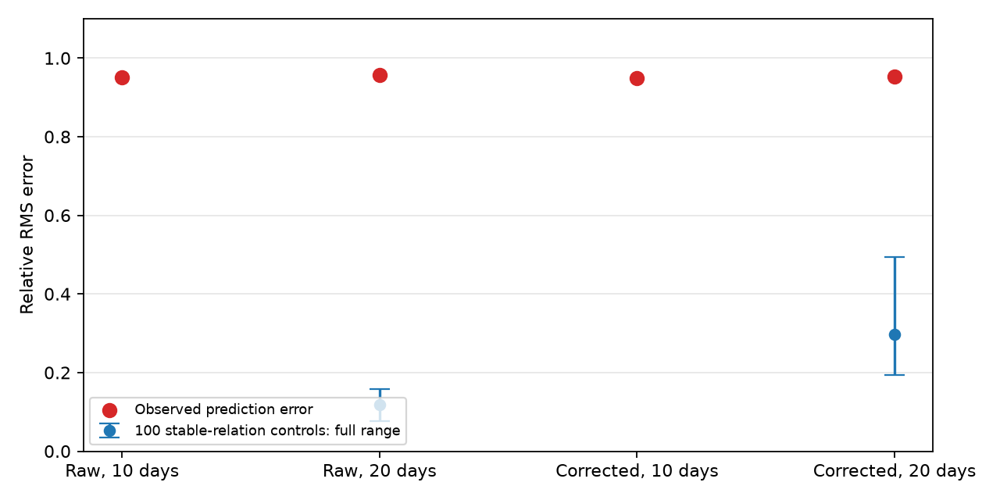
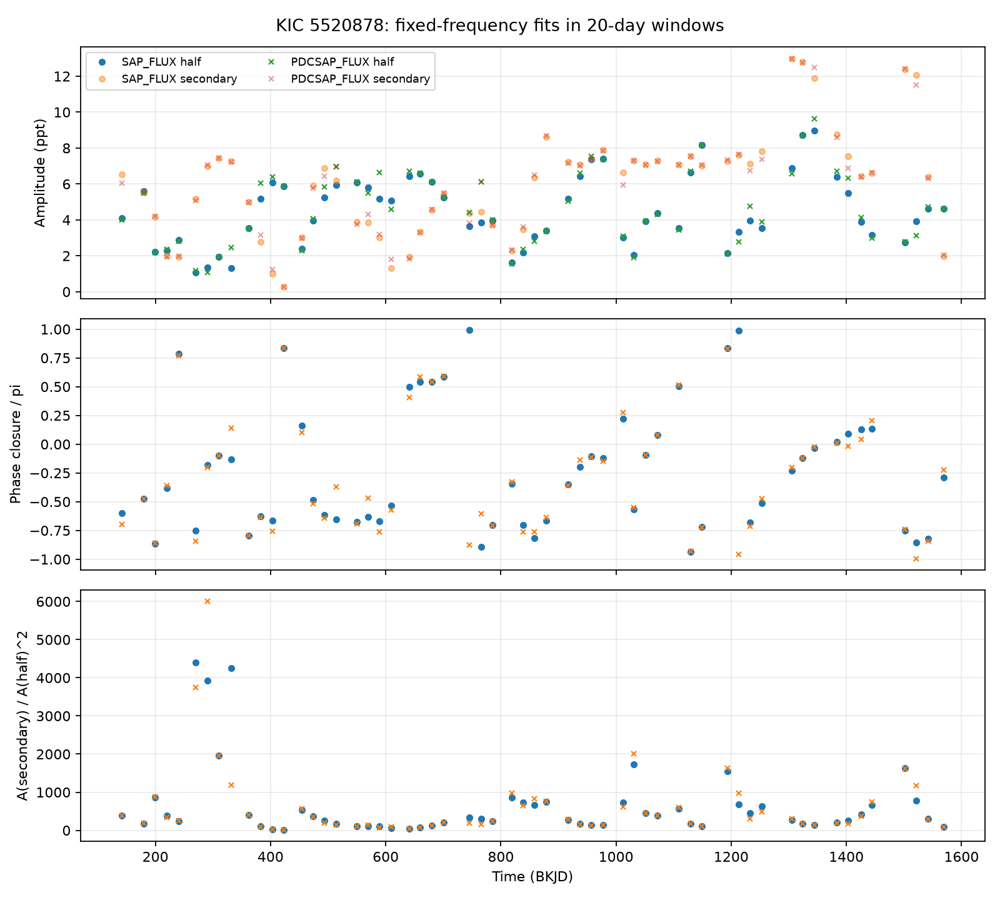

# A fixed harmonic relation does not predict the known secondary signal of KIC 5520878 in Kepler quarters 11 to 16

We tested a constant harmonic response for two known signals of the RR Lyrae star KIC 5520878. A relation fitted to Kepler quarters 2 to 10 gives a relative root mean square (RMS) error of 0.950 to 0.956 in quarters 11 to 16. Tests with a stable input relation give smaller errors. The result applies to local Fourier coefficients at fixed frequencies. It does not exclude a time-dependent or multi-mode stellar model. It is not a new signal or planet detection.



## Question and prior work

Can one constant complex response predict the signal near 5.87858 cycles per day from the signal at half that frequency? If a single visible sinusoidal mode produces a harmonic through a fixed quadratic response, its complex coefficients obey z_secondary = C z_half^2. C must be constant under this simple model. Both its magnitude and its phase have testable effects.

Moskalik et al. (2015, DOI 10.1093/mnras/stu2561) found these signals and their time variation in Kepler data through quarter 10. They discussed period doubling. Thus, time variation and the signals are prior results. Lindner et al. (2015, DOI 10.1103/PhysRevLett.114.054101) proposed strange nonchaotic dynamics for this star. Netzel et al. (2023, DOI 10.1093/mnras/stad2611) tested models in which the additional signal is a harmonic of a non-radial mode. These models can include more than the constant response that we test. Our added result is a reproducible test in later quarters, with two flux products, two window lengths, and sampling-matched controls. We do not test a Lyapunov exponent or a fractal spectrum.

Before target choice, we ran `sci search "astronomy" --in ./campaign` and a Kepler search. Full bundle verification was slow; we stopped those searches after about ten minutes. We also read public SCI metadata and text from the campaign ZIP files. The metadata scan found 149 astronomy-related records and no record with KIC 5520878. This is a limited prior-work screen, not proof that no earlier analysis exists. We did not read other workers' private workspaces.

## Data and method

We use all 17 long-cadence FITS files in the MAST public Kepler light-curve TAR for this target. FITS headers identify data release 25. The public S3 listing has no quarter 0 file. The first requested TAR name assumed that file existed and returned 404. The saved listing gives the correct name. No data were inferred from that failed request.

Shared data path: `datasets/kepler-kic5520878-q1-q17-dr25/lightcurves.tar`, or `/mnt/dell-data/shared_datasets/kepler-kic5520878-q1-q17-dr25/lightcurves.tar` on this machine. The dataset helper created this reusable dataset. Its source URL, transfer record, and TAR SHA-256 are in `files/download.json`. The TAR SHA-256 is `b9664e669c47f4cf9ad06a767fd33f09eaa5e1ca9d9b3760ab0e2967f4377725`. `files/inputs.json` records the resolved storage path, all used member hashes, and release headers. Raw data stay in the shared store.

We select finite times and flux with SAP_QUALITY equal to zero. We divide each flux product by its quarter median and subtract one. We use raw aperture flux (SAP_FLUX) and corrected flux (PDCSAP_FLUX) separately. We use equal weights. The two products use the same exposures and are not independent observations.

For each quarter and product, we fit the primary frequency within 3.715126 +/- 0.0002 cycles per day. The fit includes eight primary harmonics, a constant, and a linear trend. We then fit nonoverlapping 10-day and 20-day windows. Each accepted window has at least 35 samples per nominal day. This rule tests sample count; it does not require even coverage within the window. A short remainder at the end of a quarter is omitted.

Each window fit has a constant, a linear trend, eight primary harmonics, and sine and cosine terms at these frequencies: h = 5.87858/2, x = 5.87858, 1.5x, f_primary+x, abs(f_primary-x), f_primary+h, abs(f_primary-h), and 2f_primary-x. The clock is BKJD minus 1000 days. The coefficient convention is z = cosine coefficient minus i times sine coefficient. Frequencies above the nominal long-cadence Nyquist frequency are evaluated at the actual times. They are nuisance terms, not claimed detections. Amplitudes are observed flux amplitudes; we do not correct them for exposure integration.

We fit C by complex least squares in quarters 2 to 10: C = sum(conj(z_half^2) z_secondary) / sum(abs(z_half)^4). We use it without change in quarters 11 to 16. Quarters 1 and 17 are shown but excluded from this test because of short coverage. Relative RMS error is sqrt(sum(abs(z_secondary - C z_half^2)^2) / sum(abs(z_secondary)^2)). A zero prediction has error one. Each window has equal weight in this coefficient test. Quarter-wide residual spectra in two fixed bands are diagnostic only; their peak ratios are not detection probabilities.

For 20-day windows, we also make 100 control data sets. We retain the fitted half-frequency coefficient in each window. We replace the secondary coefficient by the early fitted C times its square. We add a randomly circular-shifted copy of the window's residual, project it through the same design matrix, fit C again in early quarters, and predict later quarters. Seed 5520878 fixes the shifts. This keeps the sampling and much of the residual time structure. It is a conditional recovery test, not a full model for instrument noise. It does not retain correlations between windows or test every possible systematic error. The 10-day fit is a sensitivity test; it has no control ensemble.

The target was selected from prior work. We selected the prediction test after inspecting initial amplitude and phase fits. All results are exploratory; we report no formal false-alarm probability.

## Results

| Flux | Window | Early windows | Later windows | Later prediction error | Control error range |
| --- | ---: | ---: | ---: | ---: | ---: |
| Raw | 10 days | 74 | 45 | 0.9505 | Not tested |
| Raw | 20 days | 35 | 21 | 0.9563 | 0.0772 to 0.1583 |
| Corrected | 10 days | 74 | 45 | 0.9496 | Not tested |
| Corrected | 20 days | 35 | 21 | 0.9520 | 0.1928 to 0.4945 |

The stable-relation control medians are 0.1181 for raw flux and 0.2965 for corrected flux. The method can recover a stable input relation more closely than the observed relation in this conditional test. This comparison gives no calibrated probability of model rejection.

Even a new best fit of C within the later data leaves relative errors of 0.905 to 0.915. A new value of one constant does not explain most of the coefficient variation. The early data also fit poorly, with errors of 0.933 to 0.955. Thus, the early relation was already inadequate. The later data confirm that its failure continues; this is not evidence for an abrupt change after quarter 10.



`files/windows.csv` gives every fitted window, including complex coefficients, sample counts, amplitudes, residual RMS, and phase closure arg(z_secondary/z_half^2). `files/prediction.json` gives the prediction and control tests. `files/summary.json` also gives the errors after separate early and later fits. `files/peaks.csv` gives the diagnostic frequency peaks.

## Physical meaning and limits

The results do not support a single constant quadratic transfer coefficient for these fixed-frequency projections. Phase changes, changes in the mode mixture, nearby frequencies, or a changing response can break this relation. A signal that moves within a fixed band can also change its fitted coefficient. The data do not choose between those explanations. In particular, the result does not exclude a non-radial mode whose observed harmonic has a more complex response. It does not establish strange nonchaotic motion, chaos, or a new period-doubling event.

Raw and corrected flux give similar prediction errors. This makes an error caused only by the correction step less likely. Separate quarters confirm repeat time variation with the same telescope. They do not supply an independent instrument check. We have no target-pixel localization, nearby-star control, short-cadence check, or independent telescope data in this study. Aperture changes, contamination, and primary-fit leakage remain possible contributions. Quarter normalization can change an amplitude transfer coefficient; it cannot alone account for an arbitrary phase closure. The residual controls are local and conditional. Long correlations and unresolved modes can make them too optimistic. The fixed frequencies and window lengths limit the tested scope.

## Reproduce and inspect

Use Python 3.12 with the package versions in `files/environment.json`. From this worktree, run:

```
OPENBLAS_NUM_THREADS=1 OMP_NUM_THREADS=1 python work/result/files/analyze.py
OPENBLAS_NUM_THREADS=1 python work/result/files/summarize.py
```

The thread settings reduce small-matrix overhead. They are not a campaign resource limit. On another machine, retrieve the source TAR from `files/download.json`, check its SHA-256, and set `RAW_DATA` to its path before the first command. Scripts write derived files next to themselves. Run a copy of the publication files to keep the signed original unchanged. The TAR listing in `files/s3_listing.xml` gives the retrieval inventory. No private key is included.

## Campaign record

Job: sci-1107-dell-astronomy-1db5fd4f2470. Topic: astronomy. Campaign: 11_07_2026. Machine: dell. Account: codex-andrii. Model: gpt-6.1-sol, high reasoning effort, in T3 Code through the Codex harness. One worker performed this analysis. No sub-agents were used. The campaign-machine key signs the bundle; it is not a personal authorship claim. Kepler/MAST provides the observations. This bundle contains derived evidence and code, not a new raw-data survey. The baseline license covers our contribution; source data keep their source terms.
