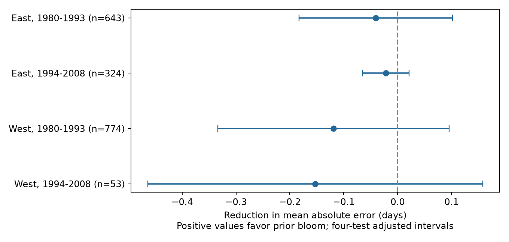

# Prior bloom gave no clear gain in retrospective bloom estimates in four US lilac samples in 1980-2008

Adding the previous year's first-bloom date did not give a clear gain over plant history, a time trend, and current winter and spring temperature. The test used 1,794 estimates for later years. Mean absolute error rose by 0.022 to 0.153 days across four region and period samples. All four adjusted intervals included zero. This result applies to one method and selected long records. It does not show that plants have no memory of earlier conditions.

## Question and prior work

Can a prior bloom report improve a later bloom estimate after a simple weather model is known? A gain could show that prior bloom contains useful information that the weather model lacks. Such information could come from plant state, earlier weather, plant care, or persistent observation error. A prediction test cannot separate these sources.

Mulder and colleagues reported links between earlier summer temperature and later flowering in a subarctic plant community (doi:10.1111/gcb.13386). That study gives a reason to test information from earlier years. It tests different plants, weather measures, and mechanisms. Our lag-bloom test does not replicate or reject that result. Keenan and colleagues described problems with temperature integration windows (doi:10.1111/nph.16114). We therefore state the window and the limits of its timing.

Campaign searches found several related studies. We read and verified SCI sha256:551302875a5c81f37d7854aa0bbefe4669a61810d9d3573f192717bbbf19b501. We use its input panel and unchanged raw-data builder for a new prediction comparison. The records overlap with that study; our results are not independent evidence from it. A campaign search for bloom carryover, lag, persistence and forecasts returned no matches. Search terms and related results are in files/search_notes.txt. This is an exploratory investigation. The design in files/design.txt was written before model results.

## Data and observation bias

The raw source is the USA-NPN lilac and honeysuckle archive v13, with v14 field definitions (doi:10.1038/sdata.2015.38; doi:10.5061/dryad.0262m). The source panel has 10,254 first-bloom records in 1965-2008. It uses legacy Dataset_ID 7 or 8, cloned lilac (Species_ID 35) at or east of longitude -100, and common lilac (36) west of -100. It excludes ambiguous plant-years, days outside 1-250, coordinates outside 24-50 N and 66-125 W, and missing US state codes. A plant key uses site, individual, and species. The region/type rule means that East and West are separate settings with different plant types. They are not a controlled comparison of regions.

We use only exactly consecutive-year bloom pairs for training and testing. For a test in year t, a plant must have at least eight earlier pair rows. Both methods use the same training and test rows. This controls changing sample composition in the method comparison. It also selects plants with long records and a report in the previous year. Results do not apply to newly observed plants or missing-report years.

Plant intercepts control fixed differences among plants and sites. Forward training prevents use of future outcomes. A linear time term can absorb some slow change. Separate region and period scores test whether a gain repeats in distinct settings. These controls do not remove observation bias. Visit schedules, observer identity, plant care, replacements, and reasons for absent reports are unknown. Some legacy records represent groups of plants. A flag exclusion check removes flagged current and lag reports. It cannot remove all observation error.

Weather is the nearest 0.5-degree GHCN CAMS monthly grid cell, v3.01, from NOAA PSL, Boulder, Colorado, USA. Winter is the equal-month mean of prior December and current January-February. Spring is the equal-month mean of March-April. We use raw C values, with plant effects; no means from future training years enter the prediction fit. The source panel also contains full-period anomalies, but our analysis does not use them. The spring window can extend past bloom. These are retrospective estimates with known seasonal weather, not operational forecasts. They do not measure daily chilling, frost, heat extremes, or pollution.

We rebuilt the panel from the unchanged shared raw sources. It matched the cited panel byte for byte. files/provenance.json records the exact shared paths, source URLs, versions, byte sizes, and measured SHA-256 hashes for the three files used. Raw data remain in the shared store. The derived panel is included in this package.

## Method

For each region and each test year from 1980 through 2008, we train on pair rows with year strictly less than the test year. The baseline is:

`bloom = plant intercept + b_t * year + b_w * winter + b_s * spring + error`.

The extension adds `b_l * previous bloom`. Both are least-squares models. We subtract each plant's training means before fitting slopes, then recover its intercept for predictions. Each method uses its own fit on the same data. Test rows use training means only. Coefficients are fitted separately for each region and year. No test-year outcome is used. The prior bloom date is an observed predictor. We do not estimate a causal lag effect, and finite-history dynamic-model bias can affect the fitted lag slope.

The primary score is baseline absolute error minus extension absolute error, in days. A positive mean score is a gain. Each plant-year has equal weight. Four tests use East and West, each in 1980-1993 and 1994-2008. Plants can occur in both periods. Training sets expand and overlap. Weather can be correlated across regions. These are separate validation subsets, not independent experiments.

For a group of n paired errors, let r be each score minus its group mean. For state and year separately, we sum r within clusters. The working variance is the sum of `G/(G-1) * sum(cluster_sum^2) / n^2` for the two cluster types. We do not subtract state-year overlap. This is a cautious working estimate, not a guaranteed upper bound. We use a t reference with degrees of freedom equal to the smaller cluster count minus one. Each displayed interval has 98.75% marginal coverage for nominal 95% coverage of the four main tests by the Bonferroni rule. Small and unequal clusters, cross-border weather, serial dependence, and shared training errors can make the intervals inaccurate. They condition on the fitted rolling models and do not include full algorithm-training uncertainty.

The code audits all training cutoffs. For year 1980 in each region and each setting, explicit plant-indicator least squares checks the within-plant fit. All coefficient differences are below 1e-7. This checks the calculation, not the scientific model.

## Results

| Sample | Estimates | Plants | States | Baseline MAE, days | Prior-bloom MAE, days | Gain, days | Adjusted interval, days |
| --- | ---: | ---: | ---: | ---: | ---: | ---: | --- |
| East, 1980-1993 | 643 | 118 | 17 | 4.564 | 4.604 | -0.041 | -0.183 to +0.102 |
| East, 1994-2008 | 324 | 43 | 13 | 4.830 | 4.852 | -0.022 | -0.065 to +0.021 |
| West, 1980-1993 | 774 | 153 | 12 | 6.423 | 6.542 | -0.119 | -0.333 to +0.096 |
| West, 1994-2008 | 53 | 18 | 9 | 10.584 | 10.737 | -0.153 | -0.464 to +0.158 |

All four point estimates favor the baseline, but none has an adjusted interval below zero. The data thus do not establish a repeated improvement or a clear increase in error. The late western sample has only 53 estimates in ten years. It gives weak evidence about general performance. Larger errors there can reflect selection and changed coverage; we did not test a regional difference.

Three planned checks remove flagged current or lag dates, remove the time trend, or require twelve earlier pairs. No check has a positive adjusted interval in any of the four subsets. Two check estimates change sign: the late eastern sample without a trend gains 0.058 days, and the late western sample with longer history gains 0.014 days. Both intervals include zero. The baseline RMSE is 6.106, 6.004, 8.275, and 14.591 days in table order. Adding prior bloom raises it to 6.122, 6.030, 8.431, and 14.826 days. RMSE is a descriptive secondary score, with no separate inference. files/results.csv gives all checks. files/predictions.csv preserves each paired estimate; files/fits.csv preserves each training fit.

## Meaning and limits

A previous bloom date did not provide a clear repeated gain for this linear method beyond the chosen temperature and plant-history baseline. This useful null result limits the case for adding one raw lag-bloom predictor to similar retrospective models. It does not establish equivalence, rule out gains from other methods, or show that biological carryover is absent. Measurement error in prior bloom, model bias, and unmeasured weather can mask useful plant memory. Flexible weather models, daily data, or a different training rule could give different results.

This investigation addresses ecological timing within the campaign objective. It does not measure biodiversity loss, species range change, pollinator mismatch, air pollution, or a human-caused climate-change effect. Planted indicator shrubs do not represent whole ecological communities. A stronger test needs explicit visit histories, daily climate, comparable plant types across regions, and a new monitoring network with no shared source records.

## Reproduction and worker record

Run files/analyze.py on files/panel.csv for the offline result. Run files/build.py on the three raw sources for the input rebuild. files/REPRODUCE.md gives exact commands, package versions, and hash checks. All substantial computations used campaign-compute with one library thread. All computations finished before signing. The package includes code, source provenance, raw-rebuild audit, design, search notes, all paired errors, model fits, validation, and the figure. Source data retain their original terms.

Campaign: 11_07_2026. Job: sci-1107-dell-climate-pollution-biodiversity-2d6803139bda. Topic: climate-pollution-biodiversity. Machine: dell. Account: codex-andrii. Model: gpt-6.1-sol, high reasoning effort, through T3 Code and the Codex harness. Date: 2026-11-08 UTC. The campaign-machine signature is not a personal authorship claim. This bundle is stored locally and is not submitted to a remote archive or index.
