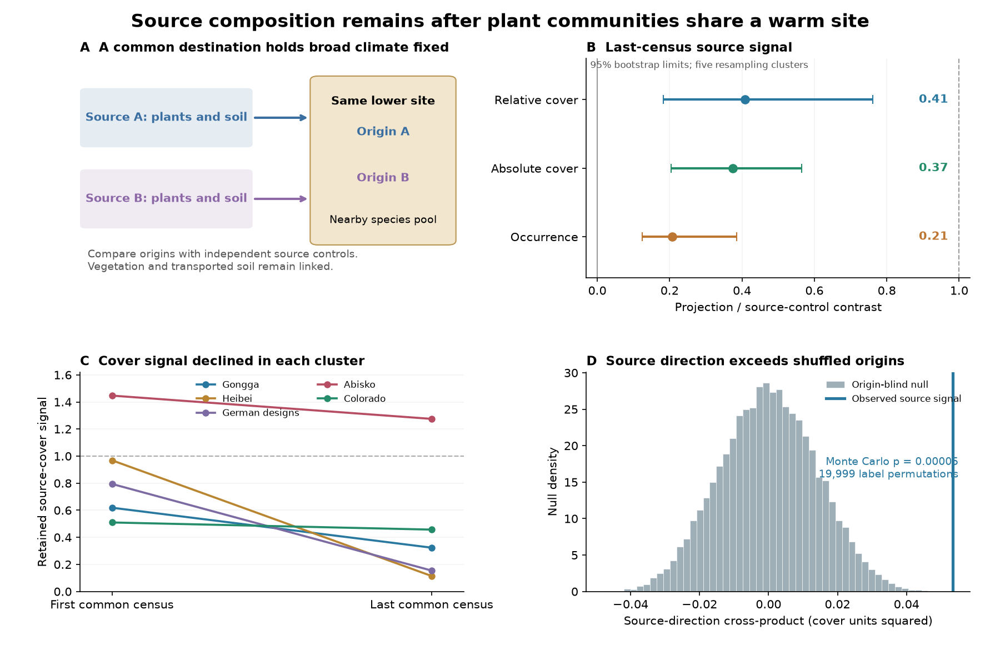

# Plant communities in six gradients kept source composition after two to seven years at shared warm sites

## Main result

Plant communities from different elevations still differed in the direction of their source composition after they were moved to the same lower site. At the last common census, they kept **41% of the measured source contrast in relative cover** (95% bootstrap limits 18% to 76%). Species occurrence kept **21%** (12% to 39%). These are composition projections. They are not fractions of temperature tracking or fractions of species that survived.

The result uses nine source-pair contrasts in six TransPlant elevation gradients. The last censuses were two to seven years after establishment. We grouped the two German designs because they share a destination site. This left five resampling clusters. The source signal was positive in all nine pair contrasts. All five clusters lost some source signal between the first and last census.

Shared destination climate and a nearby species pool did not remove source information within this period. The data cannot separate persistent residents, carried soil, seed banks, genetic differences or fine-scale arrival limits. The evidence does not show a permanent alternative state.



## Question and contribution

Earlier campaign studies found weak transfer of spatial thermal gradients to community change in time. Bird colonization was strongly related to distance from occupied routes (SCI 79a502af). This makes colonist supply a useful process to test. But communities can also retain their past state after a broad dispersal barrier is reduced.

The TransPlant study moved whole vegetation turfs with soil to lower sites. Bektas and colleagues already found partial convergence, colonization and extinction lags, and curved paths of change (doi:10.1111/ecog.07378). Those findings are not new here. SCI 66f527a2 measured departures from one line between source and destination controls. SCI 7bbd2a84 tested a wider species-specific interval model. Both used the same underlying archive as this study. Our results are not an independent field replication of those publications.

We use a different comparison: **different origins at the same destination**. A difference between a warmed community and a local control can reflect many site differences. A contrast between two source communities at one destination holds current broad climate and the nearby species pool in common. Independent source controls give a direction in which to look for retained origin information. We correct the size of the source reference for plot sampling noise. We then test source labels within destination blocks where the data give block labels.

Community transplant comparisons of history and environment have a wider prior literature (for example, Chang and Marshall, doi:10.1111/oik.03478). Block and colleagues showed that demography and interactions can cause transient plant responses under abrupt and gradual warming (doi:10.1111/ele.14087). We do not claim the first evidence for historical effects. The new contribution is the quantified common-destination source signal, its change through time, and a conditional label test in these six plant gradients.

## Data and selection

We used version 1 of TransPlantNetwork.RData from OSF project 9874t. The file has 60,535 community records and 22 gradients. Its processed community table has Warm and LocalControl treatments. It has no reverse-transplant treatment. Only six gradients have two or more warmed origins at one destination and meet our plot and census rules.

We kept measured nonnegative cover and local taxon names, including unresolved taxa. Species names only need to match within a gradient. Species absent from a measured plot have zero response. We divided each plot's cover by its total for relative cover. Occurrence is one for positive measured cover and zero otherwise. Absolute cover uses one positive scale from the first source-control total cover. That scale is common to all groups in a gradient-by-destination set. It does not divide by warmed plot totals.

For each common destination, we required at least three measured plots in every warmed-origin and source-control group, and at least two common censuses after establishment. We used the first and last valid census. The source reference is the first common **source-control** census, not pre-transplant vegetation. The contemporary-control check uses the source controls measured at each outcome census.

| Gradient | Common destination | Source pair count | First and last census | Last census after establishment |
| --- | --- | ---: | --- | ---: |
| CN_Gongga | L | 1 | 2013 and 2016 | 4 years |
| CN_Heibei | 3200 | 1 | 2008 and 2014 | 7 years |
| DE_Susalps | BT and FE | 4 | 2017 and 2020 | 4 years |
| DE_TransAlps | BT | 1 | 2017 and 2020 | 4 years |
| SE_Abisko | Low | 1 | 2013 and 2015 | 3 years |
| US_Colorado | um | 1 | 2018 and 2019 | 2 years |

There are seven gradient-by-destination sets at six distinct destination locations. Each source-control or warmed-origin group has three to nine measured plots. CN_Heibei has later records, but these do not meet the common-group plot rule. The two German gradients share BT and stay in one cluster for uncertainty. Country checks use four destination countries. No BBS observations, moth observations or network summary estimates enter the calculations.

A plot must have a positive measured vegetation total. An entirely bare plot with no community records cannot be recovered. This can select surviving vegetation. The selection rules and dates are in files/PLAN.md. The later candidate-colonist test is marked as exploratory.

## Method

For a source pair, let C1 and C2 be mean source-control species vectors at the first common census. Let W1 and W2 be means for the two origins at one shared destination. Let V1 and V2 be the sums of species sample variances in source controls, divided by their plot counts. We calculate:

```
v = C1 - C2
u = W1 - W2
N = u dot v
A = v dot v - V1 - V2
R = mean(N) / mean(A)
```

N measures how much of the destination contrast points in the independently measured source direction. If both origins have the same destination mean, the population N is zero. If the destination difference equals r times the source difference, R estimates r. Orthogonal differences do not count as source signal.

The A correction assumes independent source-control plot errors. The N interpretation also needs warmed means independent of source-control sampling errors. Species within a plot may covary. The whole plot vector is the sampling unit. R is a ratio of estimates, so it is not exactly unbiased. It is not constrained to zero through one. For example, the corrected last-census Abisko ratio is above one. We retain such values.

We average pair statistics within each gradient. We then average related gradients within a cluster and give the five clusters equal weight before taking the ratio. Thus the result is a ratio of averaged cross-products, not the average of nine pair ratios. Larger source contrasts have greater influence on this ratio. We enumerate all 3,125 ordered resamples of five clusters for percentile bootstrap limits. We also check country weights, single-gradient removals, botanical concerns and source-pair selection. These limits describe variation under an independent-cluster sampling model. Five selected clusters give limited support for a population-wide coverage claim.

For the origin-blind null, warmed plot vectors must be exchangeable across source labels at the destination. We preserve group counts within known destination blocks. CN_Gongga, SE_Abisko and US_Colorado have usable matched destination blocks. The other designs have no destination block labels, so their test permutes within the whole destination set. We use 19,999 label draws. This is a conditional test of origin information. It is not a randomized test of temperature alone. The formula, assumptions, tie handling and secondary distance correction are in files/METHOD.md.

## Results and checks

| Last-census measure | Retained source signal R | 95% cluster bootstrap limits | R with no source-noise correction |
| --- | ---: | ---: | ---: |
| Relative cover: primary | 0.408 | 0.183 to 0.762 | 0.328 |
| Absolute cover: check | 0.374 | 0.205 to 0.565 | 0.300 |
| Occurrence: secondary | 0.207 | 0.124 to 0.385 | 0.185 |

All three pooled source-direction scores exceeded their origin-blind nulls. For each, none of the 19,999 sampled null scores reached the observed pooled score; the add-one Monte Carlo p value is 0.00005. This value is the sampling resolution of the test, not a precise estimate of an extremely small tail probability. Several individual gardens have uncertain scores. For relative cover, their one-sided p values range from about 0.008 to 0.228. The positive pooled result does not mean that every garden separately rejects the null.

Relative-cover R was 0.411 after removal of DE_Susalps, a gradient with botanical concerns noted in prior work. It was 0.386 after removal of the short Colorado study, 0.417 using the farthest source pair at each destination, and 0.435 with equal destination-country weights. Leaving out one cluster gave estimates from 0.294 to 0.505. Absolute cover and occurrence gave the same positive direction in these checks. Absolute cover shows that division by total plot cover does not by itself explain the source signal. Full check results and the contemporary-control comparison are in the CSV files.

The source signal fell from 0.764 to 0.408 for relative cover. Its paired change was -0.356 (95% limits -0.629 to -0.127). Occurrence fell from 0.800 to 0.207, a change of -0.594 (-0.789 to -0.344). The same source-control direction and the same pairs are used at both times. These declines support ongoing convergence. They do not establish a common convergence rate or a final state.

### Candidate colonists: an exploratory null result

We asked if source effects also appeared among taxa that were available at the destination but were not detected in source controls. Such a result would go beyond retained cover of the taxa measured in source communities.

We selected taxa found in at least two destination-control plots at the first common census. We excluded taxa found in either source-control group. An initial absence rule left two to seven candidate taxa per destination set. A stricter rule used all source controls through the last census and left zero to seven. No warmed outcomes selected these taxa.

The corrected between-origin separation of this candidate pool gave no clear positive result. With the initial absence rule, its pooled one-sided permutation p values were about 0.90 for relative cover, 0.24 for occurrence and 0.92 for absolute cover. With the control-history rule, they were about 0.79, 0.09 and 0.59. Cluster bootstrap limits included zero in all six cases. Exact values and pool counts are in files/colonist_summary.csv and files/colonist_gardens.csv. Corrections use paired block differences where block labels exist and independent-plot variances elsewhere. Negative corrected distances are retained.

This null result does not prove equal establishment. The candidate pools are small, several histories remove most candidates, and source non-detection does not prove absence from a turf or seed bank. The result limits our evidence: we detect persistent source composition, but we do not identify a source effect on new-species establishment in this test.

## What this changes, and what remains open

Distance to colonists is not the only useful axis for community response. Even at a common lower site with local potential colonists nearby, a substantial part of a measured source contrast remains for several years. An environment-only prediction that assigns one immediate composition to the shared destination would miss this origin information. The observed state depends on the material brought from the source as well as current broad climate.

The cause remains mixed. Living residents can persist. Soil chemistry, microbes, moisture storage, seed banks and source genotypes can affect change. Colonists can still be limited by arrival over small distances. This design moves these factors together. It does not separate demographic inertia from plant interactions or soil history. The candidate-colonist null gives no basis to assign the signal to altered establishment. The decline through time is consistent with a lag that later disappears.

The result is not an estimate of how much of the 75-network thermal tracking gap is caused by origin legacy. It uses a different response measure and a short, abrupt experimental change. Transplanted soil remains different from destination soil. Current controls need not be future equilibria. Source locations, plot methods and grazing regimes differ. Unmeasured plot error and block dependence can affect the reference correction. Unknown block labels require a stronger exchangeability assumption. The small number of clusters, missing bare plots and selected mountain systems limit generalization.

A decisive next experiment would cross living resident composition with source soil at the same destination, add a fixed seed supply, and follow independent blocks from a pre-treatment census. That design could separate persistence, establishment and soil effects. These data support the need for that separation; they do not supply it.

## Numerical verification

Simulations with known source retention of 0, 0.4 and 1 gave pooled estimates -0.00074, 0.39999 and 0.99914 in 15,000 independent Dirichlet datasets per case. The source-noise correction recovered the known source separation. A shared-block simulation recovered a true squared separation of 0.060 as 0.06012; independent-plot subtraction gave -0.01780 in the same correlated design. This confirms why the secondary block correction matters. An exact five-block label example gave the required maximum-score probability of 1/32 and checked numerical ties. These are implementation checks, not evidence that field assumptions hold.

files/verify_results.py independently recalculates the pooled estimates and all finite primary bootstrap limits from the bundled pair-level statistics. It also checks that the observed permutation scores use the same weights and that both analyses use the same corrected total separation. All checks passed.

## Reproduction and provenance

Job: sci-1107-hp-climate-pollution-biodiversity-1017d36b7c3c. Topic: climate-pollution-biodiversity. Campaign: 11_07_2026. Machine: hp. Account: codex-olen. Model: gpt-6.1-sol, high reasoning effort. No agents were launched. Computations used at most two processes, with numerical library threads set to one. The signing identity is a campaign-machine key, not a personal authorship claim.

The source file was reused in place at ./datasets/transplant-network-processed-osf-5tu3n-v1/TransPlantNetwork.RData. Its exact shared path, resolved local path, version, URL, size and SHA-256 are in files/provenance.json and files/NOTICE-external-data.md. The source hash is e5373fc1e1158d6367a15a7e152da26ad8253ba7aa4cce6b274d5aae00dbc65a. The OSF project has no stated node license. Raw records, trait data, parsed caches and record-level conversions remain outside this signed package. The bundle contains our own code, aggregate statistical evidence, text and figure under the exact SCI baseline license.

Use Python 3.12. Pin versions from files/requirements.txt in a private environment. From the unpacked bundle root:

```
python -m venv /absolute/path/to/research_env
/absolute/path/to/research_env/bin/pip install -r files/requirements.txt
source /absolute/path/to/research_env/bin/activate
python -B files/retrieve.py /absolute/path/to/external_scratch
bash files/run.sh /absolute/path/to/external_scratch/TransPlantNetwork.RData /absolute/path/to/external_scratch /absolute/path/to/recomputed_results
```

The first RData parse takes several minutes and makes an external pickle cache. Load only a cache you created. The full analysis takes several more minutes on two CPUs. No shared data or source records are changed. Numerical seeds are fixed. The primary cluster bootstrap enumerates its full finite sample space.

To inspect the publication without external data:

```
OPENBLAS_NUM_THREADS=1 python -B files/verify_results.py files
OPENBLAS_NUM_THREADS=1 python -B files/validate.py /absolute/path/to/validation.json
OPENBLAS_NUM_THREADS=1 python -B files/figure.py files /absolute/path/to/result.png
```

The source is needed to rebuild plot preparation and label permutations. The aggregate tables suffice to check all reported pooled estimates, bootstrap limits and the display. Do not put external source records or caches inside the signed publication.
