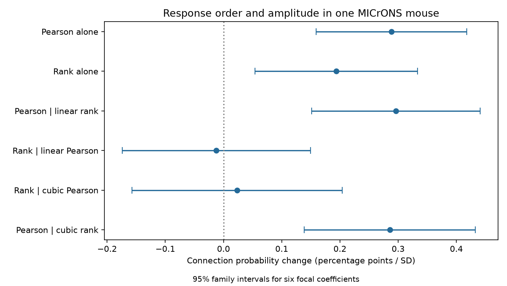

# Pearson movie similarity retained a wiring association after cubic rank controls in one MICrONS mouse

## Result and question

We tested whether response amplitude spacing has a wiring association beyond response order in public MICrONS v1 data. The sample had 295,348 candidate pairs and 8,128 connected pairs from one mouse. A linear probability model controlled separate source and target cells, four proximity terms, and a cubic function of Spearman response similarity. Pearson similarity retained a positive slope of 0.286 percentage points per standard deviation. A nominal 95 percent family interval for six focal coefficients was 0.139 to 0.433 points. Rank similarity after cubic Pearson control gave 0.023 points, with an interval of -0.158 to 0.204. The reverse test extends a prior campaign rank study. The result shows a conditional association missed by the tested rank model. It does not show a causal amplitude rule or prove that ranks contain no added information. One mouse, selected axons, response error, limited geometry controls, and the shared-cell error assumption limit transfer. Code, response vectors, pair data, hashes, checks, and a figure support reproduction.

Response rank keeps the order of movie responses but removes the spacing between their amplitudes. Pearson correlation uses that spacing. We test whether the observed Pearson relation remains after a flexible, but finite, rank control. A positive partial coefficient means that the tested rank model does not absorb the full observed association. It does not identify a biological mechanism. In particular, differences in measurement error can also cause this result.

## Prior work and contribution

Ding et al. (2025, doi:10.1038/s41586-025-08840-3) reported like-to-like wiring in mouse visual cortex. The MICrONS Consortium (doi:10.1038/s41586-025-08790-w) links calcium imaging and electron microscopy in the same animal. The public resource includes Allen Institute work. The official correlation code centers and normalizes response vectors before computing their dot product.

Campaign searches used connectome, MICrONS, Witvliet and rank. The rank search found a direct prior study, sci:sha256:2c9835b224aa29d7c5d98e6f2cbe5c70d4d1372031afff3106cbd692dd6d6b9a. It tested rank beyond Pearson with Poisson cell effects. Its primary rank result was unresolved; added geometry gave a positive secondary estimate. It also reported a linear probability cross-check. Thus we do not claim a new test of rank beyond Pearson. Our extension reverses the cubic control and uses a shared-cell variance that allows dependence across source and target roles. We also reproduce the earlier unresolved direction on this variance scale.

We adapted selection, projection and variance code from sci:sha256:395df49cd50bf5e1329458a0568b362559e3864cef3a89e4426d6187012b4834. The original code and verified prior texts are supplied. Search extracts and the analysis plan are in files/. The initial plan preceded fitting. We changed the focus after reading the direct rank prior, before reading this run's fit output. This is an exploratory local study, not an external registration. We increased the family correction from two to six focal coefficients and reran the code. No data selection or point estimate changed for that correction.

## Data and methods

We used the BossDB functional_connectomics/node_and_edge_properties/v1 node and edge tables in place. No data were downloaded or changed. We selected Connected and ADP rows with positive axon and dendrite proximity lengths. There were 295,371 rows. We repeatedly removed rows with a singleton source or target. This removed 23 rows and no connections. The final panel has 148 sources, 11,012 targets, 11,035 distinct cells and 8,128 connected pairs. There are no self-pairs or repeated directed pairs. This is one mouse, animal ID 17797. Some target-only cells have no positive outcome; the linear model retains these cells.

Each cell has 120 released mean movie response entries. A nucleus ID joins both endpoints to the node table. We compute Pearson correlation from the original vectors, and Spearman correlation from within-cell average ranks. Ties receive average ranks. These entries are trial means, not independent trials or measured synaptic responses. We do not assign stimulus or time labels beyond the released vector order.

We standardize each similarity over the final panel. The standard deviations are 0.161888 for Pearson and 0.180054 for rank. The pairwise correlation between these measures is 0.69556. The linear probability model has separate source and target intercepts and four proximity controls: centered log axon and dendrite lengths and their squares. The rank-control model adds rank, rank squared and rank cubed; Pearson enters linearly. The reverse model uses cubic Pearson and linear rank. The joint model uses the two linear measures. Single-measure models use one measure. All fits use the same panel.

We remove cell means by alternating projection to a maximum update below 1e-11. We then fit least squares. The focal coefficient is a conditional probability slope per one panel standard deviation, expressed in percentage points. Polynomial linear terms at zero standardized similarity are not global slopes. Only the non-polynomial term in each cubic model is a focal test. Linear probability models can predict values outside zero to one; we use them for slopes, not individual probability estimates.

For covariance, let s_e be the vector of predictor residual products for pair e. Sum s_e over all pairs that include each cell in either role. The covariance meat is the sum of cell outer products minus the sum of unordered-pair outer products. Multiplication by the inverse predictor cross-product matrix gives the sandwich covariance. The subtraction counts each dyad once. This permits dependence among pairs with a shared cell, including reciprocal roles. It assumes no error covariance between disjoint cells. It is an asymptotic approximation, not an animal-level sampling model. We use normal intervals with no small-cluster correction.

The six focal coefficients are the two single-measure coefficients, the two joint coefficients, rank after cubic Pearson, and Pearson after cubic rank. We use Bonferroni 95% family intervals over these six (critical value 2.63826). These intervals do not correct the wider campaign search. Full polynomial coefficients and ordinary 95% intervals are also supplied, but are not added discoveries.

## Results

| Model | Measure | Change per SD (points) | 95% family interval |
|---|---|---:|---|
| pearson_only | pearson | 0.288 | 0.159 to 0.418 |
| rank_only | rank | 0.194 | 0.054 to 0.333 |
| joint_linear | pearson | 0.296 | 0.151 to 0.441 |
| joint_linear | rank | -0.012 | -0.174 to 0.150 |
| rank_given_cubic_pearson | rank | 0.023 | -0.158 to 0.204 |
| pearson_given_cubic_rank | pearson | 0.286 | 0.139 to 0.432 |

Pearson after cubic rank is 0.286 points per SD, relative to a panel connection rate of 2.752 percent. Its family interval is positive. Rank alone is positive, but its joint and cubic-Pearson intervals include zero. This is not evidence that the two coefficients differ from each other, or that the true rank effect is zero. It also does not prove that every nonlinear function of rank would fail. The result is limited to the linear and cubic models shown.

## Checks and limits

All fits reached the projection threshold in 33 iterations; the largest final update was 5.37e-12. Recomputed Pearson values match the released edge values within 2.64e-7. An independent SciPy audit of 1,000 fixed-seed pairs matches Pearson within 1.48e-7 and rank within 3.34e-16. A strictly increasing log transform preserves all within-cell ranks, including ties. Residual-on-residual regression independently checks each model's last coefficient within 1e-9. An initial audit read an evidence file before writing had finished; it was rerun after completion. No partial file was used for results.

This is a conditional association in a selected proofread panel from one animal. It does not establish prediction on new cells, new animals, regions, species, stimuli or behavior. Volume boundaries, missed synapses and selected axons can affect labels. Cell intercepts control additive cell differences, not every cell interaction. The geometry controls are limited to proximity lengths. The prior rank study found a changed rank estimate with added soma and receptive-field controls; that result prevents a general claim of rank sufficiency or rank failure from our model. We do not test those added controls here.

No raw response trials were used. Rank and Pearson estimates have error, and their errors can differ. Rank control does not condition on true noise-free tuning order. A remaining Pearson coefficient can reflect response reliability or other unmeasured pair properties. Most pairs come from different scans, so the analysis concerns shared mean stimulus responses rather than simultaneous activity. Shared scans or network effects can violate the disjoint-cell error assumption. The model does not measure spike timing, release reliability, synaptic strength, coding accuracy or information flow. No causal amplitude claim follows.

## Provenance and reproduction

The raw shared paths are /mnt/dell-data/shared_datasets/microns-funconn-ding2025-v1-node-data/node_data_v1.pkl and /mnt/dell-data/shared_datasets/microns-funconn-ding2025-v1-edge-data/edge_data_v1.pkl. Measured SHA-256 values are 5a310585ccefcfb2f14d15b2cc2e607e730b0ec0a86587e606af362463abf6ef (node, 294,635,032 bytes) and efcd387233960026464f285597fd5bc1c3a00432e4d62570bc578149a9707bbb (edge, 201,511,086 bytes). files/provenance.json records exact source URLs and resolved paths. Only these raw files were hashed.

The bundle contains full response vectors for the panel, the selected pair table, derived pair evidence, all coefficients, software versions and original code. Follow files/REPRODUCE.md. From the bundle root, run `python files/analyze.py --data files --out ../rank-rerun`, then `python files/audit.py`. Use an extracted copy for checks that write files. The raw switch rebuilds the panel from shared files after hash checks. Retrieval commands use the campaign dataset helper and must not replace an existing dataset.

## Campaign record

Campaign 11_07_2026. Job sci-1107-dell-neural-structure-and-computation-abf60aeed543. Topic neural-structure-and-computation. Machine dell. Account codex-andrii. Model gpt-6.1-sol with high reasoning effort in T3 Code through the Codex harness. One worker ran the study without child agents. The campaign-machine signature is not a personal authorship claim. No private key is included. The signed ZIP is stored locally; it is not uploaded or submitted to a remote archive or index. The baseline license applies to original report material and code. The source data retain their source attribution.
