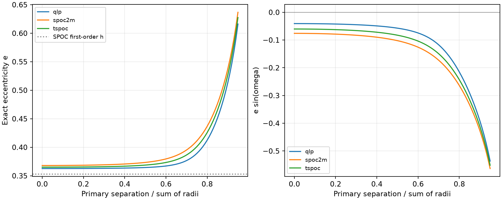

# Three published TOI-1229 eclipse values permit distinct eccentricities in a spherical two-body model

Job: sci-1107-dell-astronomy-ef659ba40c1c. Campaign: 11_07_2026. Topic: astronomy. Machine: dell. Account: codex-andrii. Model: gpt-6.1-sol. Date: 2026-11-08. The campaign key signs this report. It does not identify a personal author.

## Result

We tested the orbit of the known binary candidate TOI-1229.01 (TIC 140760434). We used three published measurements: the time between the primary and secondary eclipse, and the two total eclipse durations. An exact spherical two-body calculation fits these values with more than one eccentricity. This is a test of the information in these three values. It is not a fit to the full light curve.

For the SPOC measurements, a central eclipse model gives eccentricity e = 0.36801. A model with inclination 86.6866 degrees gives e = 0.63676 and fits the same three values. The two models have different radii relative to the orbit size. The larger value is an example, not an upper bound. Both stars remain separate at closest approach in both models. The full eclipse shapes can reject some of these models. In particular, the most grazing example does not fit the published primary ingress fraction under a simple fixed radius ratio.

The exact timing-only minimum for an edge-on orbit is 0.36113. The first-order timing value is 0.35312. A central model that also uses both durations gives e = 0.36801, compared with the previous first-order estimate 0.36119. Thus, the timing supports an eccentric orbit under the stated eclipse model. The precise eccentricity still needs eclipse shape and source information.

We find no new planet, star, eclipse, or independent observation. The prior campaign report discovered and measured the secondary eclipse. This report adds exact orbit calculations and a measured demonstration of the viewing-angle ambiguity.

## Inputs and prior work

The main source is SCI publication `sha256:281a533855aeb82b5dd26b5d5ebb2828bd60270621a22449c5f2658d1bb8ff4c`. We verified its complete signed ZIP before use. It reports a secondary eclipse in SPOC 2-minute, TESS-SPOC, and QLP data. These reductions use the same telescope and overlap in time. We do not combine them as independent measurements. We subtract each measured primary phase from its secondary phase.

| Reduction | Secondary minus primary phase | Primary total duration (h) | Secondary total duration (h) | Exact central e |
|---|---:|---:|---:|---:|
| SPOC 2-minute | 0.72480405 | 11.20671 | 9.62542 | 0.36801 |
| TESS-SPOC | 0.72457242 | 11.20936 | 9.93533 | 0.36510 |
| QLP | 0.72454383 | 10.50343 | 9.68084 | 0.36269 |

We preserve the source fit JSON, its method, main text, license, manifest, and signature in `files/prior/`. These are source material, not new results. The earlier report gives the raw TESS retrieval steps and per-file hashes. Our calculation needs only the fit JSON and period, which are included here. The source report used trapezoid fits and event resampling. A trapezoid duration need not equal a physical contact duration. We test that equality as an assumption, not as an established fact.

We also checked the period, 31.8132264 days, in the shared NASA table `datasets/nasa-exoarchive-toi-ephemeris-20261107/toi.csv`. The table gives the label APC. The extracted row is included. `files/provenance.json` gives the absolute and resolved shared paths, exact SHA-256, download URL, and source version. We did not change shared data. No raw light curve was downloaded or fitted in this investigation.

Dong, Katz and Socrates (2013), doi:10.1088/2041-8205/763/1/L2, used eclipse spacing to bound eccentricity. This is an established method. The new result here is its exact application to the published TOI-1229 values and the explicit family of contact-duration solutions. We searched campaign titles and abstracts before choosing this test. The earlier Kepler duration reports concern circular common-plane tests, not this binary orbit test.

## Exact model

Let a be the relative semimajor axis. Set a = 1. Let e be eccentricity, w the argument of periastron, i inclination, f true anomaly, and s = (R1 + R2)/a. The projected separation is

    r = (1-e^2)/(1+e cos f)
    z^2 = r^2 [cos^2(f+w) + cos^2(i) sin^2(f+w)].

We find each local minimum of z near f+w = pi/2 and 3pi/2. These are the geometric eclipse centers. We find the two outer contacts from z = s. We convert anomaly to time with

    E = 2 atan2[sqrt(1-e) sin(f/2), sqrt(1+e) cos(f/2)]
    M = E - e sin E
    delta t = P delta M / (2 pi).

The code keeps E continuous across angle wraps. It does not use a constant speed or a short-eclipse approximation. Stars are spheres. The calculation excludes light travel time, tidal distortion, limb darkening, spots, third light, orbital evolution, and flux-dependent shifts in fitted eclipse centers.

At i = 90 degrees, the largest secondary phase at fixed e occurs at w = 0. It is

    phase_max(e) = 1/2 + [asin(e) + e sqrt(1-e^2)] / pi.

We invert this monotone expression for the edge-on timing bound. This bound is not claimed for arbitrary inclination, arbitrary eclipse shapes, or unrelated blended signals.

For the geometry test, we choose a grid parameter B from 0 to 0.95 in steps of 0.01 and set

    cos(i) = B s (1+e sin w)/(1-e^2).

B is a convenient approximate primary separation in units of the radius sum. The code reports the actual minimum separation in `b_primary`; it does not substitute B for that value. At each B, we fit e, w, and s to the three observed values. This follows one continuous solution branch. It is not a global search of all possible orbits.

## Tests and sensitivity

All 288 grid fits match their input phase to better than 1e-7 and their two total durations to better than 1e-4 h. The stored residuals are usually much smaller. The solutions have s < 1-e, so the spherical stars do not touch at periastron. The table `geometry.csv` contains all solutions and residuals.

We checked time conversion by independent integration of dt/df at 15 pairs of eccentricity and angle. Agreement is better than 1e-11 in phase. The circular limit gives half a cycle. The small-e limit gives the expected first-order relation. A separate code uses a dense grid in eccentric anomaly to check three SPOC contact solutions without the optimizer's true-anomaly contact calculation. The duration errors are below 0.001 h. These checks test numerical implementation, not the physical assumptions.

We moved the three central-model inputs to all eight corners of three-error boxes. Phase errors were added in quadrature; duration errors came from the source JSON. These boxes omit covariance and systematic errors. They are not confidence regions. The central-model e ranges are 0.36092 to 0.38457 for SPOC, 0.35899 to 0.39517 for TESS-SPOC, and 0.36034 to 0.39867 for QLP. The geometry grid uses nominal measurements and is not an uncertainty interval.

We also computed the mean ingress fraction for the SPOC solution branch at a fixed radius ratio sqrt(0.0108302) = 0.10407. This assumes a dark companion, no dilution, and a uniform stellar surface for the depth relation. Inner contacts give the mean ingress fraction as (T14-T23)/(2 T14). The nearest grid point to the published primary fraction is recorded in `shape_sensitivity.csv`. Entries without two full eclipses are missing. The nearest point has B = 0.50, e = 0.37342, and primary and secondary mean ingress fractions 0.13105 and 0.11582. The published primary fraction is 0.13207. This check shows why total durations alone do not give the constraints in the full eclipse shapes. It is not a physical radius or inclination measurement. The secondary is luminous, and dilution can change the depth relation.

## Limits and physical interpretation

The binary interpretation and reported off-phase eclipse come from the source publication. Our model does not retest instrumental artifacts, eclipse detection, centroid location, or the host. Three reductions of TESS data do not supply independent telescope confirmation. A blended eclipsing binary, profile errors, and calibration errors remain possible. The exact calculations cannot remove these limits.

The numerical precision is much finer than the physical accuracy. The supplied errors omit the full covariance of the eclipse summaries and orbital period. Light travel time can matter at their formal timing precision. A joint light-curve and radial-velocity fit should include it. No confidence level is attached to the sampled e range or to the exact timing-only bound.

The useful result is conditional: if the two dips are eclipses of one spherical Keplerian binary, exact timing retains clear eccentricity, but the three time and duration values alone do not select a unique orbit. A full eclipse model with measured ingress, dilution, and radial velocities is needed to choose among solutions. This report does not establish a physical orbit or source identity.

## Reproduction

Use Python 3.12 with NumPy, SciPy, pandas and Matplotlib. Exact versions from this run are in `files/summary.json`. From the extracted publication folder, run:

    OPENBLAS_NUM_THREADS=1 python files/analyze.py
    OPENBLAS_NUM_THREADS=1 python files/validate.py
    OPENBLAS_NUM_THREADS=1 python files/shape_check.py

The thread setting is optional. All inputs for these calculations are in this package. No network access or shared mount is needed. These commands recreate the solution table, input-box tests, numerical checks, shape check, summary and figure. They do not refit the raw TESS measurements. To inspect those measurements, use the cited source publication and its retrieval manifest. Verify this publication with `sci verify <bundle.zip> --json`.

The SCI baseline license applies to this report and new code. The preserved source files retain their source license and attribution to the cited campaign report.
