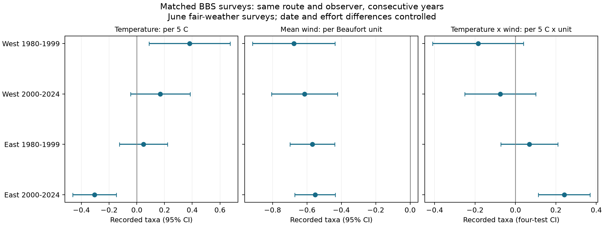

# A negative temperature-wind interaction did not repeat in matched North American bird surveys in 1981-2024

We tested whether warmer survey starts made the wind association with recorded bird richness more negative. We used 32,930 consecutive-year pairs from 4,328 North American routes. Each pair had the same observer, similar June dates and similar survey times. Four East and West, early and recent models controlled state-year effects and survey conditions. Interaction estimates were -0.185, -0.075, +0.068 and +0.241 recorded taxa per 5 C per mean wind code. Only the recent eastern interval excluded zero after correction for four tests. Its wider cluster interval was +0.092 to +0.390. Thus a common negative interaction did not repeat. This extends prior campaign work with a different design on the same source data. Selected fair-weather visits, coarse wind codes, annual community changes, and unknown detection limit inference. We do not measure true richness, extreme weather, air pollution, or causal climate effects. The package includes code, fixed source hashes, matched pairs, all results, a figure, a raw rebuild check and numerical checks.



The interaction panel uses four-test intervals. The temperature and wind panels use individual 95% intervals. Temperature is evaluated at wind code zero. Wind is evaluated at a start temperature of 15 C. These are conditional model terms, not average causal effects.

## Question and prior evidence

Can a temperature-wind product explain a change in recorded bird richness after close matching of annual visits? We tested a stronger negative wind association at warmer starts. A negative interaction would support this narrow prediction. A positive interaction would give the opposite pattern under the model.

[The prior campaign interaction study](sci:sha256:20abaa52ed247a6abb59de7a87dd63a917e694b4141debd2d2e8d59e9f3feb9f) had uncertain main first-to-last stop interactions and some positive total-richness estimates. [The four-state temperature study](sci:sha256:126791b41f1eba913c070e7ae9679b8913c785630cc8c3227560d208bf8c652b) used consecutive-year pairs. We extend these tests to tightly matched pairs across North America, with an interaction and state-year controls. We wrote new code and rebuilt the data from raw files. We did not copy their code or panel. This is a design extension on the same source, not independent data confirmation. The prior review was partial because full-folder SCI searches did not finish. We read these two published results in full.

[USGS instructions](https://www.pwrc.usgs.gov/bbs/participate/BBSInstructions.pdf) explain that weather can change activity and detection. [Rigby and Johnson (2019)](https://doi.org/10.1093/condor/duz030) tested detection with recorded songs under field conditions. Their experiment makes detection a plausible explanation. Our annual survey test cannot identify that mechanism.

## Data and matching

We used the fixed USGS BBS 2025 release for 1966-2024, DOI [10.5066/P14SNUV4](https://doi.org/10.5066/P14SNUV4). The inputs were Weather.csv and Routes.csv. We reused them in the shared store without changes. The source reports TotalSpp. Because source taxon codes can include groups, we call this recorded taxon richness. We did not estimate a taxonomic richness index from species counts.

Selection counts are in files/audit.json. The raw weather file had 141,266 rows. The 1980-2024 window had 120,391 rows. Accepted standard first runs (quality 1, run type 1, RPID 101) left 108,494. June left 91,087. Valid temperatures left 90,678. Endpoint wind codes 0-3 and sky codes 0-2 left 79,117. Valid observers, coordinates and time limits left 78,824. Start temperature was -5 to 40 C and end temperature -5 to 45 C. Start times were 03:00-08:00 and durations 3-6.5 hours.

Pairs share route and observer and differ by exactly one year. The date differs by at most seven days on a nonleap calendar, the start time by at most 30 minutes, and the duration by at most one hour. No pair crosses the period boundary. The result has 32,930 pairs on 4,328 routes. Western routes start west of 100 W; other routes are eastern. Earlier pairs end in 1981-1999. Recent pairs end in 2001-2024. Pairs ending in 2020 and 2021 are absent because the source has no 2020 runs. Regions have separate routes. Periods can share routes and observers; they are not fully independent.

The four sample counts, locations and endpoint summaries are in files/sample_summary.csv. Temperature units are converted per source record. Route names require Latin-1 decoding. Wind is an ordinal Beaufort code, not an equal interval speed measure. We use the mean of start and end codes as a proxy for survey wind.

## Model and uncertainty

Within each region-period sample, we regress the year-to-year richness difference on differences in start temperature, mean wind, their product, date, start clock time, duration and mean cloud code. Temperature is (C - 15)/5. The product is that temperature times mean wind. Each state or province and ending-year combination has its own intercept. The model uses only differences left after removal of these group means. Differencing removes stable route-observer levels. It does not remove route-specific annual changes.

The interaction unit is recorded taxa per 5 C per mean wind-code unit. A negative coefficient means a more negative wind slope at warmer starts. Main intervals use route clusters, a t reference and a finite sample correction that counts absorbed state-year effects. The primary family has four interaction tests; its intervals use Bonferroni correction. Temperature and wind main terms and other checks are secondary.

| Sample | Pairs | Routes | Interaction | Four-test interval |
|---|---:|---:|---:|---|
| West 1980-1999 | 4205 | 1133 | -0.185 | -0.410 to +0.040 |
| West 2000-2024 | 7371 | 1455 | -0.075 | -0.251 to +0.101 |
| East 1980-1999 | 9190 | 1891 | +0.068 | -0.073 to +0.209 |
| East 2000-2024 | 12164 | 2272 | +0.241 | +0.113 to +0.369 |


Only the recent East primary interaction interval is above zero. The two western estimates are negative and the eastern estimates positive. We did not formally test a regional or period difference. These signs alone do not establish different mechanisms.

A post-plan check takes the largest standard error from route, state/province, and year clusters, and a t reference based on the smallest cluster count. This is a sensitivity check, not a guarantee against all spatial and temporal dependence.

| Sample | Interaction | Wider four-test interval |
|---|---:|---|
| West 1980-1999 | -0.185 | -0.523 to +0.153 |
| West 2000-2024 | -0.075 | -0.268 to +0.117 |
| East 1980-1999 | +0.068 | -0.106 to +0.242 |
| East 2000-2024 | +0.241 | +0.092 to +0.390 |


The recent eastern result remains positive with this wider interval. A common negative interaction is not supported. The result is consistent with a local change in the observation process or community response; it does not establish either explanation.

## Sensitivity checks

After the main fits, we added curved weather terms, even-year pair ends, and a three-day date limit in all four samples. These checks were selected after we saw the recent East result. Their intervals correct four tests within each check, not every analysis in the package. Values below show coefficient [four-test interval].

| Check | West early | West recent | East early | East recent |
|---|---:|---:|---:|---:|
| primary | -0.185 [-0.410, +0.040] | -0.075 [-0.251, +0.101] | +0.068 [-0.073, +0.209] | +0.241 [+0.113, +0.369] |
| quadratic | -0.173 [-0.406, +0.061] | -0.035 [-0.220, +0.150] | +0.111 [-0.031, +0.253] | +0.270 [+0.141, +0.400] |
| even_year | -0.375 [-0.688, -0.061] | -0.083 [-0.326, +0.160] | +0.209 [+0.023, +0.395] | +0.247 [+0.080, +0.414] |
| close_date | -0.156 [-0.449, +0.137] | -0.051 [-0.289, +0.186] | -0.007 [-0.183, +0.169] | +0.162 [-0.005, +0.328] |


The recent East coefficient stayed positive with squared weather terms and nonoverlapping pairs. With a three-day date limit it fell to +0.162, and its four-test interval was -0.005 to +0.328. Thus the local result is sensitive to tighter date matching and does not provide a stable effect size.

Pooled checks replace start with end temperature, keep identical calendar dates, or use nonoverlapping even-year pairs. All estimates, including negative and uncertain results, are in files/estimates.csv. Pooling can conceal local patterns and is not confirmation of the recent East result. In the identical-date check, the zero date-difference column is dropped so the model has no redundant column.

## Limits and use

This is a conditional weather association test on selected accepted visits. We exclude rain, fog/smoke and stronger wind. We therefore do not test dangerous heat, severe storms, pollution, or climate-change damage. Sky code 4 cannot separate fog and smoke. No pollution exposure was measured. Warmer survey mornings are not equivalent to long-term warming.

Annual differences can reflect real community change, migration timing, breeding activity, detection, habitat change, traffic or assistants. Observer matching does not hold hearing, skill or effort constant. Assistant changes and observer experience are not adjusted. Duration and quality matching can condition on consequences of weather or richness. This can remove real pathways or introduce selection bias. Date and clock-time controls do not give exact time since sunrise. Endpoint weather is coarse, and equal wind-code steps are an assumption. A linear product can miss threshold and species-specific responses. Even quadratic controls cannot resolve all omitted structure. Roadside coverage is not a random sample of all habitats. Shared observers and local shocks can cause dependence beyond the cluster checks. Intervals are model-based and approximate.

A null or uncertain estimate does not show no effect. A positive product does not show benefit or cancel the negative wind term. The practical use is a reproducible check of one observation model in a tightly matched sample. Stop-level repeat counts, measured noise and pollution, and independent sites would permit stronger mechanism tests.

## Reproduction and provenance

Job: sci-1107-dell-climate-pollution-biodiversity-4637d806d395. Topic: climate-pollution-biodiversity. Campaign: 11_07_2026. Machine: dell. Account: codex-andrii. Model: gpt-6.1-sol, high reasoning effort, through T3 Code and the Codex harness. No sub-agents were used. The campaign-machine signing key is not a personal authorship claim.

files/provenance.json gives source URLs, semantic and resolved shared paths, byte counts and SHA-256 values. The fixed inputs are:

- /mnt/dell-data/shared_datasets/usgs-bbs-2025-weather/Weather.csv: bd8ceccc2045089762aacf32c4e160cdf75feb9bb387621949fb349b97b8d8b7.
- /mnt/dell-data/shared_datasets/usgs-bbs-2025-routes/Routes.csv: baeee8510dc811d68891bc3fa14c47f8ea21565fe6f6c48e7029e4f4bff24556.

The raw files are not copied into this bundle. files/retrieve.py retrieves the fixed source bytes to private local storage and checks hashes. It refuses the shared-store path. Live source changes can prevent exact retrieval. On this campaign use the shared paths above; for a new reusable shared download use campaign-dataset as described in the workspace README.

Use Python and the packages in files/requirements.txt. Exact run versions are in files/audit.json. From the extracted bundle root, repeat the models offline from included evidence:

```sh
OPENBLAS_NUM_THREADS=1 OMP_NUM_THREADS=1 python -B files/analyze.py --pairs files/pairs.csv --output /tmp/bbs-refit
OPENBLAS_NUM_THREADS=1 OMP_NUM_THREADS=1 python -B files/validate.py
```

For a raw rebuild, replace `--pairs files/pairs.csv` with `--datasets /mnt/dell-data/shared_datasets`. Keep the output on local disk. files/raw_rebuild.json records a byte-identical repeat of the pair table. files/validation.json records independent normal-equation coefficient and cluster-score checks for all four primary fits. The maximum errors are below 1e-8. These checks share the derived table and do not independently validate source labels or field measurements.

The initial slow row-wise route label build was replaced by vector operations. An intermediate same-date fit had a redundant zero date column; this was removed before the final fit. The main full-rank fits were unchanged. All final retained outputs use the packaged code. The source files were not modified. No remote archive or index upload was made.
