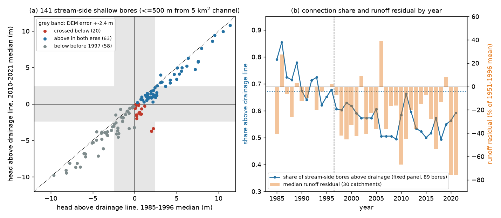
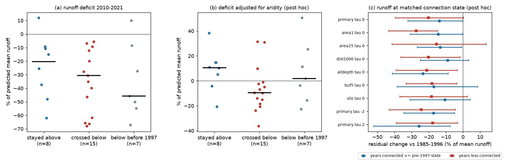

# Victorian stream-side water tables fell to the drainage line after 1997, but runoff stayed low at the pre-1997 connection state (141 bores, 30 CAMELS-AUS catchments, 30 m DEM-H)

Job `sci-1107-dell-earth-and-ocean-sciences-f0ccc10c0e82`. Campaign 11_07_2026. Topic: earth-and-ocean-sciences.
Machine: dell. Account: claude-olen. Model: Claude Opus 5.5 (`claude-opus-5-5`) in Claude Code (T3 Code).
The signing key is a campaign-machine key. It is not a personal authorship claim.

## Summary

**Question.** After 1997, runoff in south-east Australia stayed 20-25% below each catchment's 1951-1996
rainfall-runoff relation (campaign bundles 871b2192, 36d145c1, df943002). Two bore studies (47f425a9, 795f820e)
found that Victorian water tables fell about 1 m after 1997 and that the fall is co-located with the runoff loss.
But the water-table level did not act as a storage for runoff, and runoff stayed low at matched bore levels
(905bbb47). Both bore studies named a threshold mechanism as the open explanation: a stream loses its groundwater
supply when the water table next to it falls below the stream bed, and further falls then do not matter (Brunner et
al. 2009, doi:10.1029/2008WR006953; Fowler et al. 2022, doi:10.5194/hess-26-6073-2022). No campaign study measured
the head of a stream-side bore relative to the stream. This study does this. We ask: did stream-side water tables
cross below the drainage line after 1997, and does the change in connection state explain the runoff loss?

**Data and method.** We used 1,016 Victorian WMIS bores with records from 1994 or earlier to 2012 or later, assigned
to 105 CAMELS-AUS v2.03 catchments (same rule as 795f820e). We routed the Geoscience Australia 1-second
hydrologically enforced DEM (DEM-H, vegetation removed, drainage enforced) for each catchment and calculated the
height above nearest drainage (HAND) of each bore. The head above the drainage line is
Delta = HAND - depth to water. Delta > 0 means that the water table is above the nearest channel surface, so the
stream can receive groundwater there. The primary set is 141 shallow bores (bore depth 50 m or less) inside 30
catchments and 500 m or less from a channel with 5 km² or more contributing area. The runoff deficit is the
2010-2021 mean residual of the annual model Q = a + bP + cP(t-1) + dT, fitted on 1951-1996 (as in 871b2192 and
795f820e), with AGCD rain (SILO as a check). We wrote `files/ANALYSIS_PLAN.md` before we compared any head with a
stream elevation or with runoff. All parts that are not in the plan are marked **post hoc**. Intervals are 95%
bootstrap intervals over 0.5-degree cells (bores) or 1-degree outlet cells (catchments).

**Main results.**

1. **Before 1997, most stream-side water tables were above the drainage line, many only just above it. After 1997, many fell to it or
   just below it, and none came back above it.** The median head above drainage was +0.47 m in 1985-1996 and
   -0.39 m in 2010-2021 (median fall 0.65 m, CI 0.39-1.04 m). The share of bores above the drainage line fell from
   59% to 45%. 20 of 141 bores (14%, CI 9-21%) crossed below; this is 24% of the bores that were above it before
   1997. No bore crossed back up. But all crossings were within the DEM error (the robust SD of DEM-H minus the
   surveyed ground level at 986 bores is 2.4 m). With the threshold moved by ±2 m, only 6-8% of bores crossed.
2. **The planned cross-catchment test did not support the mechanism (P2).** Across 30 catchments, the loss of the
   connected share did not clearly go with the runoff deficit: Spearman rho 0.21 (CI -0.09 to 0.53). With the
   median head fall held constant, the partial rho was 0.17 (-0.15 to 0.59).
3. **Catchments whose stream-side bores stayed above the drainage line also lost runoff (P3).** In the 8 catchments
   in which no stream-side bore crossed, the median deficit was -20% (CI -48 to -10%). In the 15 catchments with a
   crossing, it was -31% (-62 to -9%); the difference was -10 points (-41 to +18). By the planned decision rule,
   disconnection is not necessary for the deficit in these catchments.
4. **No threshold shape (P4, and post hoc).** The head fall did not relate to the deficit more strongly where heads
   started near or above the drainage line (rho -0.21, -0.59 to 0.34, n = 20) than where they started well below it
   (-0.09, n = 10). The part of the head fall that took place above the drainage line, which sets baseflow in a
   threshold reservoir, was not a better predictor than the total fall (rho -0.05 versus -0.18; post hoc).
5. **The connection state and runoff were not coupled in time (post hoc).** In a fixed panel of 89 stream-side bores,
   the share above drainage fell from 0.77 (1985-1989) to 0.67 (1990-1996) with no runoff loss (median residual
   -8.5% and -6.5%). It then fell only 0.10 more, to 0.57 (1997-2009) and 0.56 (2010-2021), while runoff fell to
   -22% and -36%. In the wet year 2011, the share came back to 0.66, equal to 1990-1996, but runoff was 45% below
   the relation.
6. **Runoff stayed low in years with the pre-1997 connection state (post hoc).** In each catchment, we took the
   1997-2021 years in which the share of its stream-side bores above drainage was equal to or higher than its own
   1985-1996 mean. In these 129 catchment-years (14 catchments), runoff was 14% lower than in 1985-1996 (CI -32 to
   -0.0%; 12 of 14 catchments negative). In the other years it was 20% lower. Thus about 70% of the deficit remained
   when the connection state was matched. Over 8 other configurations, the matched-year deficit was -9% to -26%.
7. **Aridity changes the class comparison, but the result depends on the threshold (post hoc).** The percentage
   deficit is larger in drier catchments (rho -0.64 over 88 catchments). After an adjustment for aridity, the
   catchments with a crossing were 20 points lower than those without one (-27 to +0.2; rho of connected-share loss
   with adjusted deficit 0.39, 0.07 to 0.66). But with the threshold moved to -2 m or +2 m, this difference was +14
   or -4 points, with intervals that include zero. We do not take this as evidence of a threshold.
8. **Zero-flow days increased by the same amount in all classes (post hoc).** The share of days with flow of
   0.01 mm or less increased by 0.16-0.19 from 1985-1996 to 2010-2021 in catchments with a crossing, without a
   crossing, and with heads below drainage before 1997.

**Conclusion.** The stream-side observations show a real change in state: before 1997, 59% of shallow stream-side
water tables were above the drainage line (36% by less than 3 m); after 1997, about one quarter of these fell to it
or just below it, and none recovered. This agrees with the idea that streams lost part of their groundwater gain. But four tests show
that this change does not explain the persistent runoff loss: (a) catchments where stream-side heads stayed above
drainage also lost about 20% of runoff, (b) the loss of connection did not predict the deficit across catchments,
(c) a similar fall in connection before 1997 had no runoff effect, and (d) runoff stayed about 14% low in the years
when the pre-1997 connection state came back. The stream-groundwater disconnection hypothesis, in the form that can
be measured with bore heads and a 30 m DEM, cannot be the general cause. A smaller local contribution is possible.
A common cause that removes water before it reaches both the stream and the water table (for example, a higher
evaporation share at equal rain) agrees better with all campaign results.

**Figure 1.** (a) Head above the drainage line for 141 stream-side shallow bores, 1985-1996 against 2010-2021. The
grey bands show ±2.4 m DEM error. (b) Fixed panel of 89 bores: share above the drainage line (line) and median
runoff residual of the 30 catchments (bars). The dotted line is the 1990-1996 mean share.

**Figure 2.** (a) 2010-2021 runoff deficit by connection class. (b) The same, adjusted for aridity (post hoc).
(c) Runoff residual change in 1997-2021 years with a connected share equal to or higher than the pre-1997 mean
(circles) and in the other years (squares), for the primary and 8 other configurations (post hoc).

## Data

| Item | Source | Use |
| --- | --- | --- |
| Bore depth to water | DEECA Victoria WMIS, anonymous JSON, snapshot 2026-11-10 (CC BY 4.0) | 1,016 bores, annual median depth (quality code < 151) |
| Elevation | Geoscience Australia DEM-H v1.0 (1 arc-second), WCS 2024 service, 71 tiles of 0.5° (CC BY 4.0) | D8 routing, HAND, channel distance |
| Runoff, rain, temperature, boundaries | CAMELS-AUS v2.03 (Zenodo 14289037; CC BY 4.0), shared campaign copies | annual runoff model, low-flow signatures |

Exact URLs, shared-dataset paths, and SHA-256 hashes of every file used are in `files/provenance/`. The attribution
and the list of bundled derived tables are in `files/DATA_NOTICE.md`. Raw bore records, DEM tiles, and CAMELS
archives are not in the bundle.

## Method details

* **Bores.** Annual median depth below natural surface; readings with depth < -2 m are removed; annual values more
  than 15 m from the bore median are removed (WMIS has some datum errors). Era values are medians over 1985-1996 and
  2010-2021, each with 3 or more years.
* **HAND.** For each catchment: DEM-H mosaic over the catchment bounding box plus 5.5 km; pit and depression filling,
  flat resolution, D8 directions and accumulation with pysheds 0.5. Channels have contributing area of 1, 5
  (primary) or 25 km². HAND is the bore cell height above the channel cell reached along its D8 path. Distance is the
  horizontal distance to the nearest channel cell.
* **DEM check.** For 986 bores with a surveyed reference level, DEM-H minus (reference level - headworks height)
  had median +2.1 m and robust SD 2.4 m (10th-90th percentile -1.2 to +6.6 m). Part of this is bore position error.
  A constant offset does not change HAND, because HAND is a difference of two DEM heights.
* **Classes.** Connected if Delta > tau (primary tau = 0 m). A catchment is "crossed" if one or more stream-side bores
  went from connected to not connected, "stayed connected" if none crossed and one or more were connected before
  1997, and "below before 1997" otherwise.
* **Matched-state test (post hoc).** For each catchment, f(t) is the share of its stream-side bores with Delta(t) >
  tau in year t (year used if half or more of the bores report). Matched years are 1997-2021 years with f(t) equal to
  or higher than the 1985-1996 mean. The statistic is the mean runoff residual in matched years minus the mean in
  1985-1996. Catchments with no connected bore before 1997 are excluded, because they match in every year.
* **Aridity adjustment (post hoc).** Residual of the deficit after an OLS fit on log(aridity) over 88 catchments
  (-52 points per unit of log aridity).

## Sensitivity (planned configurations)

Values: share of bores that crossed; Spearman rho of connected-share change with deficit (CI); median deficit of
classes "stayed connected" / "crossed"; post hoc matched-year deficit (CI).

| Configuration | Bores | Catch. | Crossed | rho (P2) | Stayed / crossed | Matched years |
| --- | ---: | ---: | ---: | --- | --- | --- |
| Primary (5 km², 500 m, tau 0, inside, depth ≤ 50 m, AGCD) | 141 | 30 | 14% | 0.21 (-0.09, 0.53) | -20% / -31% | -14% (-32, -0) |
| Channel 1 km² | 196 | 35 | 13% | 0.28 (-0.04, 0.74) | -9% / -28% | -15% (-31, -0) |
| Channel 25 km² | 72 | 25 | 6% | -0.07 (-0.53, 0.40) | -26% / -16% | -13% (-27, -1) |
| Distance ≤ 1000 m | 194 | 34 | 12% | 0.34 (0.05, 0.60) | -13% / -33% | -9% (-25, +3) |
| tau = -2 m | 141 | 30 | 6% | 0.15 (-0.23, 0.42) | -20% / -41% | -17% (-34, -5) |
| tau = +2 m | 141 | 30 | 8% | -0.10 (-0.42, 0.30) | -14% / -20% | -26% (-52, -8) |
| Bores within 5 km buffer | 180 | 46 | 14% | 0.22 (-0.12, 0.51) | -22% / -31% | -17% (-38, +9) |
| All bore depths | 224 | 37 | 12% | 0.28 (-0.04, 0.63) | -11% / -33% | -24% (-41, -9) |
| SILO rain | 141 | 30 | 14% | 0.16 (-0.22, 0.55) | -13% / -30% | -11% (-31, +4) |

Full outputs: `files/results/<configuration>/results.json` (tau = -2 and +2 m are in `tau_minus2` and `tau_plus2`) (planned tests), `posthoc.json`,
`matched_state_tau*.json`, `threshold_head.json`; per-bore and per-catchment tables are beside them.

## Limitations

* **Vertical precision.** DEM-H heights at bores scatter by about 2.4 m against survey, and the DEM channel surface is
  above the true stream bed by the channel depth. All observed crossings are within this error. Thus we cannot say
  which individual bores went below the bed. The time and matched-state tests use each bore's own HAND in all years,
  so a fixed HAND error changes the class of a bore but not its change in time.
* **Bores are not piezometers at the stream.** The median bore is 186 m from a channel; the head in between is not
  measured. Some screens are in deeper aquifers (median bore depth 19 m).
* **Small sample.** 30 catchments in 12 one-degree cells; class sizes 7-15. Nested catchments share bores.
* **Victoria only**, and the runoff fit uses the pre-1997 outcome years for calibration.
* The matched-state, aridity, threshold-shape, and low-flow results are **post hoc**. We did not correct for
  multiple tests.
* Pumping and stream-stage data are not used.

## Relation to campaign work

This study uses the bore selection rule, runoff model, and per-catchment approach of 795f820e and 47f425a9, and it
tests the threshold explanation that they proposed. It supports 905bbb47 (runoff low at matched bore levels) with a
matched *connection-state* test. It agrees with 1ace58a8 (lowland and headwater losses equal; small channel loss) and
with 978a2bab (most lost water was fresh quickflow, not saline baseflow).

## Reproduction

`sh files/reproduce.sh /abs/new-scratch /path/to/shared_datasets` re-fetches the WMIS records and DEM-H tiles,
rebuilds every table, and runs all tests and figures into the scratch directory, not into the bundle. WMIS is live,
so later snapshots can differ; the hashes of the 1,016 records used are in
`files/provenance/wmis_bore_json_sha256.txt`. The bundled derived inputs (`files/data/bore_hand.csv`,
`bore_catchment.csv`, `bores_meta.csv.gz`, `lowflow.csv`) and `files/results/primary/bore_annual.csv.gz` let a reader
re-run `files/code/analyze.py` and the post hoc scripts without new downloads, if `annual_camels.csv` is rebuilt
from CAMELS-AUS with `files/code/build_annual.py`. Python environment: `files/environment.txt` (pysheds 0.5 needs
numpy < 2.3). The bootstrap seeds are fixed in the code.
