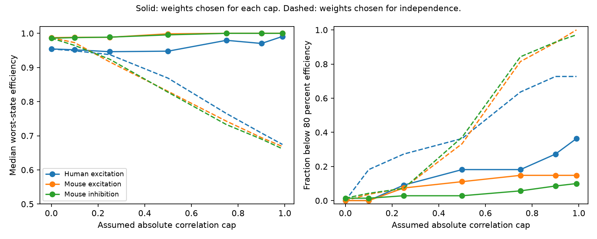

# A correlation cap of 0.5 left 101 of 108 selected Allen input models above 80 percent fixed-weight efficiency

One fixed positive readout retained at least 80 percent of the state-specific robust optimum in both response states in 101 of 108 selected cortical input models at an assumed absolute noise correlation cap of 0.5. Weights chosen under independence fell below this level in 39 models. Weights chosen for the cap fell below it in seven. Thus, the independence-based weights were sensitive to shared noise, but a fixed compromise still worked in most selected models. This is a conditional model result. It does not show that neurons learn these weights.

Figure 1. Each curve describes selected target-and-sign groups. Solid curves use a new fixed readout for each correlation cap. Dashed curves keep the fixed readout chosen at cap zero. Left: median of the smaller efficiency across first and late states. Right: fraction below 80 percent. The denominator is the state-specific robust optimum at the current cap. High relative efficiency at large caps need not mean high absolute signal-to-noise ratio. Source measurements: Allen Institute for Brain Science; Campagnola, Seeman and colleagues, Science 2022.

## Question and prior work

Does a fixed positive readout remain close to the best state-specific readout when inputs share unknown noise? Connectivity defines available inputs. Short-term plasticity changes their response scales. Noise covariance can then change the cost of keeping the readout fixed across states.

Campagnola, Seeman and colleagues linked connection calls and response dynamics in the same cell pairs (doi:10.1126/science.abj5861). Campaign publication SCI 5481b72a found that fixed weights retained 80 percent efficiency in 107 of 108 selected models under independent noise. SCI 7626d3a studied a correlation cap in one response state. SCI 1035506d studied a two-state best-single-input guarantee in all input pairs. We read these publications after searches for connectome, plasticity, convergence, noise covariance and fixed weights. The present study combines both states and all eligible inputs per target, normalizes against each state's full robust optimum, and tests transfer of the independence-based compromise. It does not repeat the best-single-input guarantee test. No prior code or record tables were reused.

Worst-case signal-to-noise optimization and cone methods are established. Kim, Magnani, Mutapcic, Boyd and Luo (2008), Robust Beamforming via Worst-Case SINR Maximization, give general background. We claim a sensitivity benchmark on linked cortical data, not a new general optimization theory. The cap grid and 80 percent rule are exploratory choices. They are not measured parameters or registered biological thresholds.

## Data and selection

We reused Allen Synaptic Physiology r2.1 small in place:

`/mnt/dell-data/shared_datasets/allen-synphys-r2.1-small-20230126/synphys_r2.1_small.sqlite`

Source: https://allen-synphys.s3-us-west-2.amazonaws.com/synphys_r2.1_small.sqlite . Object date: 2023-01-26. Size: 176771072 bytes. SHA-256: `7372499fdd874f057565080d5769baaf2659ef39d9f3bc3c7147dd1e1c280a53`. The code checks this hash before it opens SQLite read-only. The resolved shared object path is in files/provenance.json. No raw data download was needed.

The code joins pair, synapse, dynamics, experiment and slice through their IDs. Candidates are detected chemical connections in mouse VisP or human TCx. Human projects with culture in their names are excluded. Dynamics QC must pass. Both states require at least 20 observations, finite response medians with the expected sign, and positive finite standard deviations. Input groups share experiment, target cell and synapse sign and have at least two distinct sources. Inhibitory amplitudes are sign-reversed together. Cell classes are otherwise unrestricted.

Selection retains 304 of 1081 mouse excitatory candidates, 552 of 1690 mouse inhibitory candidates, 112 of 290 human excitatory candidates and 9 of 81 human inhibitory candidates. Group formation leaves 27 mouse excitatory groups with 60 inputs in 23 experiments; 70 mouse inhibitory groups with 153 inputs in 51 experiments; and 11 human excitatory groups with 26 inputs in nine experiments. There is no eligible human inhibitory group. Groups have two to five inputs. They can share cells and experiments.

Fields are pulse_amp_first_50hz and pulse_amp_stp_induction_50hz with their _std and _n fields. The pinned Allen implementation collects first response fitted amplitudes. For the late endpoint it first takes the median of stored pulses 6, 7 and 8 within each qualifying train. It then stores the median, population standard deviation and count across trains. The late state is a three-response statistic, not a single late pulse. Trial sets can differ between states. Neither first response nor late response is restricted here to a long preceding silence. We inspected the pinned source; its URL and hash are in files/definitions.json. It is a definition reference, not a verified database build revision. We did not audit raw pulses.

## Conditional model and exact reduction

Let a_ki be the absolute response median and s_ki its standard deviation for state k and input i. We assign the median as the mean response to one shared unit signal. This is an assumption. All inputs carry this same signal. Nonnegative weights w combine responses linearly. The same physical weights apply in both states, with sum(w)=1 to remove scale. Output gain may differ by state.

In each state, allowed covariance matrices have the released marginal variances and any positive semidefinite correlation matrix with each absolute off-diagonal correlation at most r. We use r in {0, 0.1, 0.25, 0.5, 0.75, 0.9, 0.99}. Covariance can differ between states.

For nonnegative weights, each covariance term has a nonnegative coefficient in the variance. Thus the largest variance is attained when every off-diagonal correlation equals +r. This matrix is feasible: it equals (1-r)I + r 11^T and is positive definite for these caps. The adverse covariance is exactly

`C_k(r) = (1-r) diag(s_k^2) + r s_k s_k^T`.

Define worst-case squared SNR and the state-specific robust optimum:

`J_k(w,r) = (a_k dot w)^2 / (w^T C_k(r) w)`;

`I_k(r) = max_{w >= 0} J_k(w,r)`.

The efficiency is `E_k(w,r)=J_k(w,r)/I_k(r)`. We choose

`e_star(r) = max_{w >= 0, sum(w)=1} min_k E_k(w,r)`.

Each state-specific optimum is found by enumerating all nonempty active supports. On each support the candidate is C_support inverse times a_support; candidates with negative components are rejected. Boundary optima occur on smaller supports, which are also checked. The smallest circuit has two inputs and the largest has five, so at most 31 supports are needed.

The fixed readout is found with SLSQP from three starts: each state optimum and equal weights. A separate second-order cone check uses bisection. At a trial e, each state constraint is

`sqrt(e I_k) norm(L_k w) <= a_k dot w`, where `L_k^T L_k = C_k`.

These are convex constraints for fixed e and positive signals. Their feasible sets shrink with e. Bisection therefore gives a global method in exact arithmetic. Numerical errors still apply. We compare the SLSQP objective with this method for every primary group at cap 0.5. The comparator called independent_fixed uses e_star(0) weights, then evaluates them against I_k(r), not I_k(0). The first_optimal comparator chooses only the first-state optimum at the current cap.

Efficiency measures relative loss due to a fixed readout, not absolute signal quality. Both its numerator and optimum denominator change with r. Hence e_star(r) need not decrease with r. At high r both states may prefer the same single input and reach relative efficiency one even as their absolute SNR falls.

## Results

| Scope | Groups | Median best fixed efficiency at r=0 | At r=0.5 | At r=0.9 | Below 80 percent at r=0.5: independence weights / cap-aware weights |
|---|---:|---:|---:|---:|---:|
| Mouse VisP excitation | 27 | 98.73% | 99.85% | 100.00% | 9 / 3 |
| Mouse VisP inhibition | 70 | 98.58% | 99.55% | 100.00% | 26 / 2 |
| Human TCx excitation | 11 | 95.42% | 94.77% | 97.03% | 4 / 2 |

At cap zero one of 108 fixed compromises falls below 80 percent. At caps 0.1, 0.25, 0.5, 0.75, 0.9 and 0.99 the counts are 1, 5, 7, 10, 13 and 15. For weights chosen under independence, the corresponding counts are 6, 10, 39, 88, 98 and 103. At cap 0.5 a fixed readout chosen for the cap restores the 80 percent rule in 32 models that fail with independence-based weights. At cap 0.9, 95 of 108 groups still meet the rule with cap-aware fixed weights; only ten meet it with independence-based weights.

The medians do not describe the full sample. At cap 0.5, 8 mouse excitatory, 15 mouse inhibitory and 6 human excitatory groups fall below 95 percent with the best fixed compromise. These are selected-model counts, not population prevalence estimates. We give no species contrast, confidence interval or p-value. Sampling and trial uncertainty were not estimated.

Sensitivity checks reselect inputs and rebuild groups. Requiring both response medians above 50 microvolts leaves 70 groups, six below 80 percent at cap 0.5. Requiring at least 50 observations in both states leaves 13 groups, two below 80 percent at that cap. Subtracting the squared baseline noise estimate from each marginal variance and requiring positive remaining variance leaves 25 groups, four below 80 percent. That subtraction assumes independent additive recording noise and can amplify errors. These reduced samples do not validate the primary moments. Full aggregates are in files/aggregate.csv and files/selection.csv.

## Checks and limits

At cap 0.5, cone bisection and multistart SLSQP agree within 2.10e-8 efficiency units for all 108 primary groups. Some cone solves warn of limited numerical accuracy. These are numerical checks, not formal error certificates. Dense 10001-point two-input searches at all seven caps do not exceed the chosen objective by more than 1e-7; the observed maximum positive excess is zero. There are 651 such searches and 108 cone comparisons. Fourteen synthetic identical-state and symmetric opposed-state examples agree with analytic solutions; the maximum analytic error is 5.56e-17. Seven hundred feasible random covariance examples obey the adverse variance bound. The optimized fixed objective also exceeds or equals the independence-weight objective within 1e-7 in every analyzed case. Code and scalar check results are included.

The shared noise cap is assumed, not inferred. Separately stimulated input trials do not supply joint covariance. Medians need not equal means. The late summary averages within a train differently from the first summary. Recording and fitting noise enter the standard deviations. Missing summaries and minimum counts select the sample. Choosing weights from estimated moments has no held-out test and can bias performance. Target groups are small incomplete slice circuits, not full intact connectomes. Timing, input tuning, dendrites, voltage nonlinearities, output spike noise and behavior are absent. Mouse and human data differ in region and tissue source. No generalization across animals or behavior is established.

The supported principle is conditional: shared noise can make weights chosen under independence poor, without requiring different weights in each response state. A direct biological test needs simultaneous trials, true mean estimates, measured covariance limits, a defined signal and evaluation in held-out animals and conditions.

## Reproduction, rights and provenance

See files/REPRODUCE.txt. All original code, aggregate model evidence, a static figure, exact input hashes and retrieval instructions are bundled. Allen source records, fitted summaries, record-level extracts, individual weights and external source code are excluded. Regeneration writes these materials to a separate external scratch path. Aggregate files describe our model optimization outcomes and do not reproduce a source database. The baseline license applies to our bundled code, narrative, figures and aggregate analysis results. External terms and attribution are identified separately in files/EXTERNAL_NOTICE.txt. No external source data are relicensed.

Job: sci-1107-dell-neural-structure-and-computation-79239647059a. Topic: neural-structure-and-computation. Campaign: 11_07_2026. Machine: dell. Account: codex-myxtap. Model: gpt-6.1-sol with high reasoning effort through Codex in T3 Code. No agents were launched. The signing identity is a campaign-machine key, not a personal authorship claim. Only a local signed bundle is requested; no upload or remote submission is part of this investigation.
