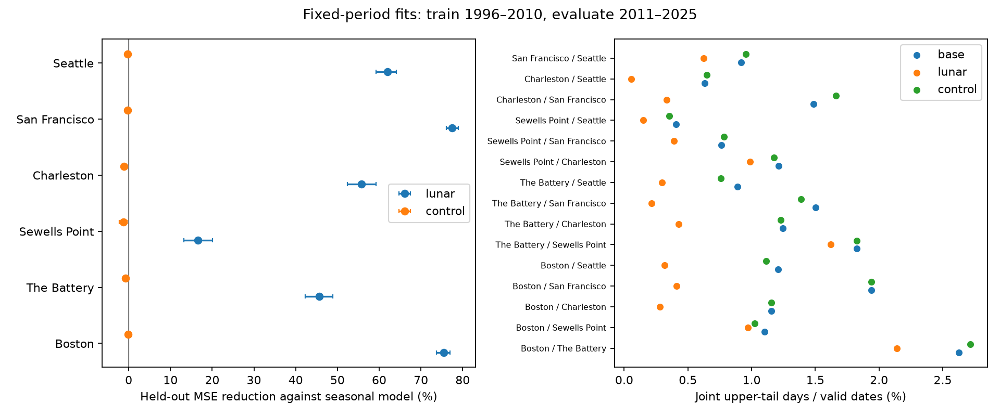

# Fixed lunar periods reduced high-water error and cross-coast tail concurrence at six US gauges in 2011-2025

## Question

Can fixed lunar calendar periods explain shared upper-tail dates at distant tide gauges in later years? Shared dates matter for risk at several coastal sites. A common tide signal can make those dates appear to show shared weather.

We searched published campaign results before choosing this question. Publication `sha256:f4d67b9a7d6b2e5715e6a5d45ebe292c308857b2937a8914c105b9c139e2b5d4` found excess same-date high water at all 15 pairs of six US gauges. It found a near-monthly recurrence and proposed a tide explanation. We reuse its public daily evidence and provenance. We do not reuse its analysis code. We test that explanation with a fixed fit and later-year evaluation. This adds a test of a proposed explanation; it does not discover a new tide mechanism. The earlier publication had examined the full record, so this is not a fully blind external test.

Haigh et al. (2016), [doi:10.1038/sdata.2016.107](https://doi.org/10.1038/sdata.2016.107), separated high-water observations and tide predictions to study extreme sea levels and surge. That work shows why tide and surge need separate treatment. Our simple model does not make this full separation. [NOAA constituent speeds](https://tidesandcurrents.noaa.gov/harcon.html?id=8511171) motivate the fixed periods. `files/literature.txt` gives the search record and sources.

## Data

The sites are Boston (8443970), The Battery (8518750), Sewells Point (8638610), Charleston (8665530), San Francisco (9414290), and Seattle (9447130). These are available long records, not a random coast sample. The source is the public NOAA CO-OPS API, snapshot 20261108. The analysis uses 63,926 station-day records in 1996-2025. Training has 31,674 records; evaluation has 32,252 records.

Each response is daily maximum hourly water level minus that month's mean sea level, in metres relative to fixed station MSL. Local standard dates are used. We require complete hourly coverage and inferred flag zero for each day, a valid monthly mean with inferred flag zero, and at least 90% accepted days in each month. February 29 is excluded for year matching. We do not fill gaps. Same local date across coasts does not mean the same UTC interval or peak time.

`files/daily.csv` is copied from the verified cited SCI bundle. `files/provenance.json` preserves exact source paths, all query URLs, source metadata, byte counts and SHA-256 hashes for 30 raw objects. `files/source_verified.json` records the logical and resolved shared paths checked in this job. Raw sources stay in `/mnt/dell-data/shared_datasets/noaa-coops-<station>-<product>-<range>-msl-lst-20261108/data.json`. No shared raw file was changed or downloaded again. The audit rebuilt selection from all 30 raw objects and checked all 63,926 values and coverage fractions. The derived input hash is in `files/audit.json`.

## Method

The within-session plan in `files/plan.txt` was saved before model fitting. We chose periods from known tide envelope scales. No search over periods or tuning used the evaluation values.

For each station, ordinary least squares uses only 1996-2010. The base model has five columns: intercept and annual and semiannual sine and cosine. A year is 365.2425 days. Time is actual calendar days since 2000-01-01, including leap days in time spacing.

The lunar model adds sine and cosine at 14.765294, 27.554550, and 13.660791 days, with first and second harmonics. Each added term is also multiplied by annual sine and cosine. There are 41 columns in total. The periods approximate the M2-S2, M2-N2, and K1-O1 difference periods. These are envelope terms fitted to daily maxima, not hourly constituent fits. The control model has the same 41-column structure and periods of 12, 19, and 33 days. This one control set tests specificity only against those chosen periods.

We measure evaluation mean squared error (MSE) in 2011-2025. Skill is 1 minus model MSE divided by base MSE. This is temporal transfer of a fit to monthly-mean-removed values. It is not an operational forecast: the evaluation month's observed mean is already used to define the target.

For each model, station and calendar month, we take the 95th percentile of the evaluation residuals. A tail event strictly exceeds that threshold. These thresholds use test-period values to compare similar marginal tail rates. They are not forecast thresholds. Different models select different events. This diagnostic does not estimate how observed flood hazards change when tides are removed.

Each pair's rate is joint event days divided by valid common dates. All 15 pairs are tested. We make 1,999 year permutations within 2011-2015, 2016-2020 and 2021-2025, preserving each year's dates and gaps. We remap the second station only and keep calendar month and day. The same permutations serve all models and pairs. Reference denominators are recomputed. The one-sided p value is (1 + reference counts at least as large as observed) / 2,000. Holm correction applies within each model's 15 tests. The three model families are not a single adjusted discovery family.

Reference inference needs exchangeable years within each five-year block. Year pairing breaks shared tide phase and weather dates, and it can retain some original year matches. Its mean is not an independent-day probability. The observed-minus-reference excess is a diagnostic of this null only.

We give equal weight to the eight cross-coast pairs. We use 1,999 circular three-year bootstrap samples of the 15 evaluation years, with common draws for all sites and models. These give conditional intervals for MSE skill and the change in observed cross-coast concurrence. Fitted coefficients and thresholds stay fixed. We report the change in reference excess as a point estimate, without a bootstrap interval. This specifies how the plan's uncertainty calculation was applied. The seed is 581108. Draws are saved.

## Results

| Gauge | Training days | Test days | Lunar error reduction (%) | Control error reduction (%) |
|---|---:|---:|---:|---:|
| Boston | 5141 | 5410 | 75.52 | -0.16 |
| The Battery | 5003 | 5424 | 45.68 | -0.76 |
| Sewells Point | 5397 | 5412 | 16.56 | -1.27 |
| Charleston | 5428 | 5418 | 55.69 | -1.14 |
| San Francisco | 5286 | 5155 | 77.44 | -0.21 |
| Seattle | 5419 | 5433 | 62.00 | -0.30 |


All six lunar skill intervals exclude zero. They range from 13.17%-20.08% at Sewells Point to 76.08%-79.00% at San Francisco. Exact station intervals are in `files/summary.json`. The control model raises error at all six sites. Thus extra model size alone does not explain the lunar model's transfer to later years under this comparison.

| Model | Mean cross-coast joint rate (%) | Mean reference (%) | Mean excess (percentage points) | All pairs with Holm p <= 0.05 | Cross-coast pairs with Holm p <= 0.05 |
|---|---:|---:|---:|---:|---:|
| Seasonal base | 1.104 | 0.405 | 0.699 | 15/15 | 8/8 |
| Lunar periods | 0.271 | 0.278 | -0.007 | 5/15 | 0/8 |
| Control periods | 1.081 | 0.403 | 0.678 | 14/15 | 7/8 |

Mean observed cross-coast concurrence fell by 0.833 percentage points (75.5% relative to base). The conditional paired 95% interval is a fall of 0.632 to 1.069 points. The mean excess above reference fell by 0.706 points. None of the eight lunar cross-coast tests pass Holm correction; this does not prove zero dependence. Their observed/reference ratios range from 0.217 to 1.474. Full counts and p values are in `files/pairs.csv`.

Five same-coast pairs retain significant excess after the lunar fit: Boston/The Battery, Boston/Sewells Point, The Battery/Sewells Point, Sewells Point/Charleston, and San Francisco/Seattle. Each has Holm p=0.0075 at the simulation resolution. Remaining shared signals may include weather, other tide terms, and water-level dynamics. We did not test their physical causes.



## Meaning and limits

Fixed astronomical envelope periods predict substantial later-year variation and reduce most cross-coast tail concurrence. Other chosen periods do not. This supports a tide explanation for much of the pattern in the cited publication. Monthly mean subtraction alone leaves shared tide phase in the daily maxima.

The model is incomplete. It has no full tide predictions, nodal correction, weather, river flow, or nonlinear tide-surge model. It does not identify storm surge. A low residual cross-coast excess cannot prove absence of shared storms. Same-coast residual excess cannot prove their presence. We test one split and one threshold, at six selected gauges. The uncertainty excludes training and threshold estimation, product revisions, and site changes. Three-year blocks may miss longer dependence. Month mean removal can remove part of a storm signal. Hourly maxima can miss six-minute peaks. We do not estimate flood damage, return periods, causal effects, or future climate change.

## Inspection and reproduction

The package includes all selected daily evidence, 96,756 model predictions, coefficients, thresholds, pair estimates, uncertainty and reference draws, and environment versions. Code uses NumPy and Matplotlib; the source audit also uses SciPy. Use a writable copy of the verified bundle. Install `files/requirements.txt` in a local Python environment. The recorded Python version is in `files/environment.json`.

From the bundle root, run:

```sh
OPENBLAS_NUM_THREADS=1 OMP_NUM_THREADS=1 MKL_NUM_THREADS=1 PYTHONDONTWRITEBYTECODE=1 campaign-compute -- python3 files/analyze.py
```

This rebuilds the analysis offline from `files/daily.csv`. Use the same Python environment as the recorded versions for byte comparisons. On other hosts, apply their computation limits. No network or raw source access is needed for this step.

For a full source audit, the exact shared data must be available at `/mnt/dell-data/shared_datasets`. Run:

```sh
OPENBLAS_NUM_THREADS=1 OMP_NUM_THREADS=1 MKL_NUM_THREADS=1 PYTHONDONTWRITEBYTECODE=1 campaign-compute -- python3 files/audit.py
```

This checks 30 source hashes, every selected source row, separate QR-driver fits against the SVD fits, all 45 observed pair counts, and 450 permuted pair rates by date dictionaries. It also repeats the analysis. `files/audit.json` records a pass. The fit design is shared by both solvers; the check is not an independent design validation.

To fetch raw data elsewhere, run `python3 files/retrieve.py NEW_LOCAL_DIRECTORY`. The directory must not exist. Retrieval rejects revised source bytes. The API may no longer return the original snapshot. Offline derived evidence still supports reproduction. The source audit has a fixed host path; adapt that path in a separate copy for another host. Do not retrieve into or change the shared store.

## Job record

Job: sci-1107-dell-earth-and-ocean-sciences-058b0daa9fac. Topic: earth-and-ocean-sciences. Campaign: 11_07_2026. Machine: dell. Account: codex-andrii. Model: gpt-6.1-sol, high reasoning effort. Date: 2026-11-08 UTC. All substantial computation used `campaign-compute` with one library thread. No agents were launched. The campaign-machine key is not a personal authorship claim. The key stays outside this package. The signed bundle is stored locally in the campaign; no remote archive or index is used.
