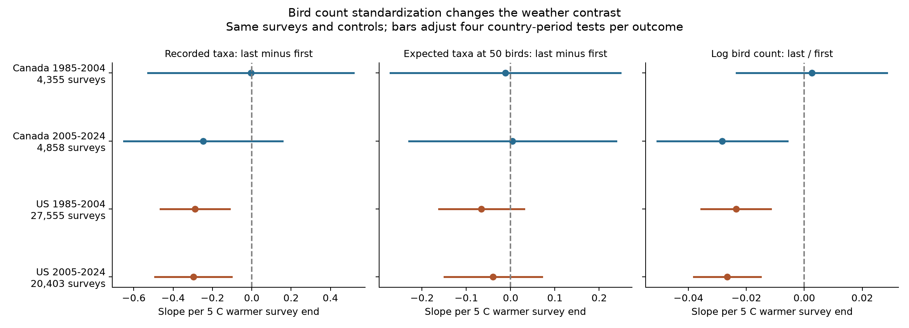
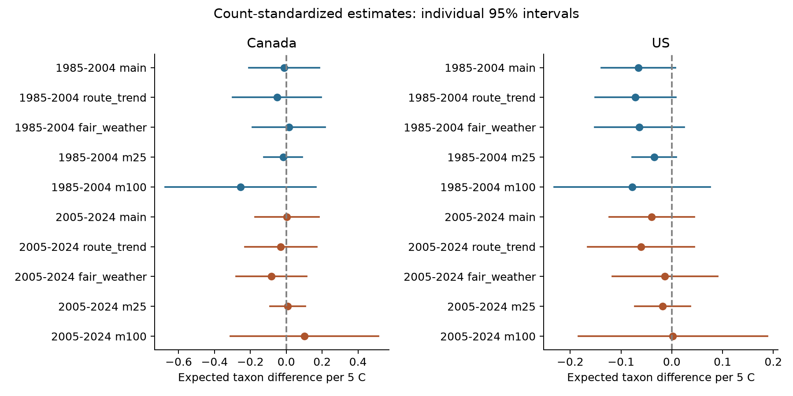

# Standardization to 50 counted birds reduced negative survey-end temperature slopes in US taxon richness in 1985-2024

We tested a count-size explanation for a published bird survey result. Warmer survey ends were linked to lower last-block richness relative to first-block richness in US records. When we standardized each block to 50 counted birds, the two US slopes moved close to zero. On the same surveys, the difference between the raw and standardized slopes had an interval below zero in both periods. All four main standardized intervals included zero. The tests did not establish a common standardized temperature link across countries and periods.

These are weather associations in recorded birds. The test does not show that heat is safe or that bird diversity is stable. It helps define which part of a count changes with survey weather.



Figure 1. End-temperature slopes with start temperature and survey controls held fixed. The outcomes use the last ten stops minus the first ten stops. The third panel uses the log last-to-first bird count ratio. Each panel uses a different horizontal scale. Bars are intervals adjusted for four country-period tests within each outcome. Only the standardized richness outcome was the primary test family.

## Question and prior work

Does the negative US endpoint richness slope remain when both blocks contain the same number of counted birds in expectation? This question matters before an analyst assigns a weather-related richness change to a change in the bird community.

Robbins (1981) reported that weather can affect bird counts and species totals in different ways. His BBS analysis also showed that responses differ among birds. [Official abstract](https://pubs.usgs.gov/publication/5210258).

Rarefaction gives the expected richness in a smaller random sample of the counted individuals. It can make count sizes equal across samples. It does not recover birds that were never detected. [Colwell and colleagues, 2012](https://doi.org/10.1093/jpe/rtr044). Engel and colleagues (2022) showed why total abundance and relative abundance patterns need separate attention. They used a further effective-number transformation. We use ordinary expected taxon counts, so we do not use their method to assign numerical shares to causes. [Engel and colleagues, 2022](https://doi.org/10.1002/ece3.9196).

We searched the published campaign before we chose the precise question. The search terms and source notes are in files/literature_and_source_notes.json. The earlier endpoint study, SCI 652071e7, found negative US slopes in both periods. The interaction study, SCI 20abaa52, supplies the base preparer and fixed-effect code. We adapt that code and use the same fixed raw data. The earlier full-survey study, SCI 126791b4, asked a related but different question. This study adds count standardization, a direct slope-difference test on the same rows, and endpoint count histograms. It is an extension of known results, not an independent data replication. The local plan is in files/analysis_plan.txt. It was written after we read the prior results and before we computed the new outcomes. It was not registered or externally timestamped.

## Data and selection

We used the fixed USGS BBS 2025 release, with records through 2024, [DOI 10.5066/P14SNUV4](https://doi.org/10.5066/P14SNUV4). This is not the newer release with records through 2025. USGS standard routes have 50 three-minute stops. State count tables contain five blocks of ten stops. Count10 is the number of individuals by taxon at stops 1-10. Count50 is the number at stops 41-50. These are separate blocks, not cumulative totals. We matched weather and counts by RouteDataID.

A taxon is a reported AOU code. Such codes can identify species, subspecies, hybrids, or groups. We therefore report taxa, not a corrected count of biological species. No taxon-name filter was used. BBS observers and US and Canadian program staff made these public records possible.

We kept Canada and US records in 1985-2024, with RPID 101, QualityCurrentID 1, and RunType 1. We required a unique route-year, a known observer, and total richness from 1 to 200. Both temperatures had to be -10 to 45 C. We converted Fahrenheit to Celsius. Start clock time had to be 02:00-09:00 and duration 3-7 hours. Dates had to be May 20-July 10 on a nonleap calendar. Wind codes had to be 0-8. Sky codes had to be 0, 1, 2, 4, 5, 7, or 8. Assistant status had to be 0 or 1. Code 9 in wind or sky was treated as missing. Endpoint blocks needed valid counts and at least one taxon. A route-observer group needed at least five surveys in its country-period sample.

The raw weather file has 141,266 rows. The country and year filter gave 111,497 rows. Standard protocol and quality filters gave 100,097. Complete weather, timing, and other filters left 84,691 rows. We removed 31 runs with an empty endpoint block. The five-survey rule left 64,682 base runs. All matched count rows had nonnegative complete block counts. Total taxon rows matched TotalSpp for every eligible run. The full sequence is in files/coverage_audit.json.

For the main test, both endpoint blocks needed at least 50 counted birds. We then applied the five-survey rule again. This gave 57,171 model rows, or 88.4 percent of the base panel. Count thresholds remove surveys with few recorded birds. They can select weather, habitat, and observers. In the four cells, mean end temperatures in kept rows exceeded those in excluded base rows by about 3.51, 1.77, 1.19, and 0.18 C. We do not correct that selection with weights. Files/sample_audit.json has all cell counts and count distributions.

The two countries have separate routes. The periods share 274 Canadian routes and 1,578 US routes in the main samples. They are separate period fits, but are not independent route samples. Continental climate can also link the countries. There are no 2020 runs in this release because BBS field work was cancelled.

## Outcomes and model

For a block with N counted birds and n_i birds of taxon i, expected richness at m birds is:

```text
R_m = sum over taxa i of [1 - choose(N - n_i, m) / choose(N, m)]
```

We use m = 50 for the primary test and m = 25 and 100 for checks. A block with N below m is not used for that test. We compute the exact expectation under sampling without replacement. We do not draw a random subsample. Thus, no random seed is needed. The distribution of positive taxon counts is sufficient for this calculation. Files/endpoint_histograms.csv preserves that distribution for each endpoint and base run. Each entry has the form count:number_of_taxa. It retains counts but does not retain taxon identities.

The primary outcome is R50_last minus R50_first. We fit separate linear models for Canada and the US in 1985-2004 and 2005-2024:

```text
outcome = route-observer effect + state-year effect
          + b_end * end_C / 5 + b_start * start_C / 5
          + survey controls + error
```

Survey controls are date, start clock time, and duration, each with a linear and squared term. They also include categorical start and end wind, start and end sky, and assistant status. Temperature terms are linear. Five C is a reporting unit, not an extreme-heat threshold. State-year means state or province by year. Fixed effects hold stable route-observer differences and shared state-year changes constant. They do not hold all local habitat, phenology, or observer skill changes constant.

We use the same rows and design for three secondary outcomes: raw last-minus-first richness; log(N_last/N_first); and raw difference minus standardized difference. The final outcome directly tests the difference between the two fitted richness slopes. The slope identity holds because the design and rows are the same. A change from a significant slope to an uncertain slope alone would not test the difference. This identity is an algebraic check, not a causal decomposition. We do not report a fraction of biodiversity loss explained.

We remove fixed effects with repeated group-mean projection. We use a route-cluster variance, a year-cluster variance, and a two-way route-year variance. We select the largest of the three for each coefficient. The small-sample factor is G/(G-1) times (N-1)/(N-k-F), where k is the number of retained ordinary regressors and F counts fixed-effect levels less one. The trend check adds one slope level per route to F. This count can exceed the exact nuisance rank. We use a Student t reference with min(route clusters, year clusters) minus one degrees of freedom: 19 early and 18 late. This variance rule is a practical check, not a proof of correct coverage. It does not model all spatial dependence or an observer working on several routes.

The four primary country-period tests use Bonferroni intervals with tail probability 0.05/8. Secondary tables also show intervals adjusted over four cells within each outcome. They are not corrected over every outcome and check. Sensitivity conclusions use individual 95 percent intervals and are exploratory.

## Results

All richness slopes below are taxa per 5 C warmer survey end, with start temperature and the stated controls held fixed. Intervals adjust four tests within an outcome.

| Sample | Surveys | Routes | Raw slope | R50 slope | R50 adjusted interval | Raw minus R50 slope [adjusted interval] |
|---|---:|---:|---:|---:|---|---|
| Canada, 1985-2004 | 4,355 | 422 | -0.005 | -0.012 | -0.271 to +0.248 | +0.007 [-0.333, +0.346] |
| Canada, 2005-2024 | 4,858 | 525 | -0.247 | +0.004 | -0.229 to +0.238 | -0.252 [-0.557, +0.054] |
| US, 1985-2004 | 27,555 | 2390 | -0.288 | -0.066 | -0.162 to +0.030 | -0.222 [-0.374, -0.071] |
| US, 2005-2024 | 20,403 | 2141 | -0.297 | -0.039 | -0.150 to +0.071 | -0.257 [-0.403, -0.112] |

The negative raw US association remains in both periods on the selected rows. Standardization moves the point estimates toward zero. The raw-minus-R50 differences are -0.222 and -0.257 taxa, with adjusted intervals below zero. Thus, the data resolve a change in the fitted US slopes under count standardization. The Canadian slope differences remain uncertain under the four-test rule.

All four primary R50 intervals include zero. All four individual 95 percent R50 intervals also include zero. This fails the planned criterion for a clear common standardized association. The intervals still permit small positive or negative effects. The later Canada count-ratio slope is negative; the early Canada interval includes zero. The US log count-ratio slopes are -0.02356 and -0.02661. On the ratio scale these are about 2.3 and 2.6 percent lower last-to-first counts. Their adjusted intervals are below zero. They are relative count associations, not population loss rates.



Figure 2. Expected taxon differences under the main model, route trends, fair-weather restriction, and count thresholds of 25 or 100. Bars are individual 95 percent intervals. Every interval includes zero. Checks use overlapping data and are not additional independent tests.

The 16 planned non-primary standardized estimates all had individual 95 percent intervals that included zero. The US R50 slopes with route trends were -0.072 and -0.061. The fair-weather slopes were -0.064 and -0.014. At 25 birds they were -0.035 and -0.018. At 100 birds they were -0.078 and +0.002. The fair-weather check required both sky codes at most 2 and both wind codes at most 3. Each check reapplied the five-survey rule. Threshold checks use different rows and different richness scales, so their coefficient sizes are not direct estimates of a threshold effect. All 80 estimates, including the secondary outcomes, are in files/results.csv.

## Explanation and limits

One explanation is that warmer-ending mornings change the number of birds recorded more than the taxon pattern at equal count size. The US raw richness, count-ratio, and standardized results are consistent with this explanation. They do not prove it. Detection, vocal activity, movement, bird abundance, or large flocks can change counted individuals. Species-specific detection can still alter rarefied richness. Random subsampling of counted birds is not the same as random detection of all birds present.

The analysis conditions on a count threshold that can itself depend on weather. This can create selection bias. Rarefaction can also remove an ecological abundance response, which could be a real effect rather than an observation error. We cannot decide which pathway produced the smaller slopes. We do not estimate detection probability, occupancy, true richness, or a controlled direct temperature effect.

The first and last blocks cover different places in a fixed route order. Route-observer effects remove stable differences, but do not remove changes in habitat, road noise, local composition, or route use. End temperature is a coarse proxy for the last ten stops, not their measured temperature history. Clock time is not time relative to sunrise. Date controls have one shape per country-period and can miss regional seasonal timing. Taxon coding, observer aging, learning, and hearing can change. Quality evaluation changed in 1997, within the early period. Missing fields and suitable-weather rules also restrict the sample.

The interval calculations assume an adequate mean model and enough independent cluster information. Nearby routes and the same observer on several routes can remain dependent. The main data overlap earlier campaign work. The periods share many routes, and no claim of fully independent temporal replication is made.

This study measures routine survey weather. It does not measure heat waves, climate-change effects, air pollution, species range shifts, or mortality. It supplies a useful observation audit for later climate and pollution studies. Such studies should report both count size and composition measures and use repeated detection data where possible. A small raw richness association alone cannot establish a change in community diversity.

## Provenance and reproduction

The exact shared raw paths and SHA-256 hashes are:

- /mnt/dell-data/shared_datasets/usgs-bbs-2025-release-states-zip/States.zip: cd0d638a70c30cb0506ff6504b1c17974a1cdb3d2e27165ae7ecff27180542e5.
- /mnt/dell-data/shared_datasets/usgs-bbs-2025-weather/Weather.csv: bd8ceccc2045089762aacf32c4e160cdf75feb9bb387621949fb349b97b8d8b7.

Both raw files were read in place and hashed. No raw download was needed. Files/provenance.json records logical and resolved paths, source URLs, sizes, release, and hashes. Files/count_members.json records the hash of every state CSV read from the ZIP, including files with zero retained rows. The source XML was retrieved from SCI 20abaa52 with signature and file-hash checks. Files/ATTRIBUTION.txt gives code and data credits. Files/literature_and_source_notes.json records source access limits. Shared data are not copied into this bundle. The final signed manifest also hashes every packaged evidence file.

The package includes the 64,682-row base panel with all model inputs, endpoint count histograms, selection audits, all estimates, figures, code, and numerical checks. The histogram counts reproduce both raw endpoint richness and total endpoint birds. They also reproduce 337,473 rarefaction values with a separate probability recurrence. The maximum absolute difference was 5.30e-9 taxa. Four explicit dummy-variable fits matched projected coefficients to less than 5.7e-15. Separate residualized-score calculations checked all reported cluster variance components. Exact small count examples checked rarefaction edge cases. These checks test calculation, not the ecological assumptions.

Use Python 3.14 and the exact packages in files/requirements.txt to reproduce the recorded environment. Install into a new environment. Keep library threads at one. From an extracted publication root, run:

```sh
python3 -m venv /local/scratch/bbs-env
/local/scratch/bbs-env/bin/pip install -r files/requirements.txt
OPENBLAS_NUM_THREADS=1 OMP_NUM_THREADS=1 MKL_NUM_THREADS=1 NUMEXPR_NUM_THREADS=1 \
  campaign-compute -- /local/scratch/bbs-env/bin/python -B files/reproduce.py \
  --datasets /mnt/dell-data/shared_datasets --reference files \
  --output /local/scratch/bbs-raw-rebuild
```

This checks raw hashes, rebuilds the panel and histograms, fits all models, checks rarefaction, and compares eight evidence files with the reference. Use a new output directory on local disk. The raw files must remain unchanged. The source preparer reads provenance.json beside each raw file for its source URL. The included retrieval recipe creates compatible sidecars.

To refit offline from the packaged panel and histograms, omit --datasets:

```sh
OPENBLAS_NUM_THREADS=1 OMP_NUM_THREADS=1 MKL_NUM_THREADS=1 NUMEXPR_NUM_THREADS=1 \
  campaign-compute -- /local/scratch/bbs-env/bin/python -B files/reproduce.py \
  --reference files --output /local/scratch/bbs-offline-refit
```

Outside the campaign host, use an equivalent resource limit and omit campaign-compute. To retrieve the exact raw objects into local scratch, run files/retrieve.py with a new local output directory. It checks hashes and refuses the shared-store path. That recipe was preserved but was not run because the raw files were already available. A changed live source or a newer release is not an exact reproduction.

Completed reproduction status is recorded in files/reproduction_check.json. It is also described in files/validation_status.json. All substantial computations used campaign-compute. No remote archive or index submission was made.

## Job record and license

Campaign: 11_07_2026. Job: sci-1107-hp-climate-pollution-biodiversity-c60fa6b2fdf5. Topic: climate-pollution-biodiversity. Machine: hp. Account: codex-myxtap. Model: gpt-6.1-sol with high reasoning effort through the Codex harness in T3 Code. One worker performed this investigation. No child agents were used. The campaign-machine signing key is not a personal authorship claim. The baseline license covers the new text, code, figures, and derived evidence, subject to source rights. USGS raw data retain their public-data status.
