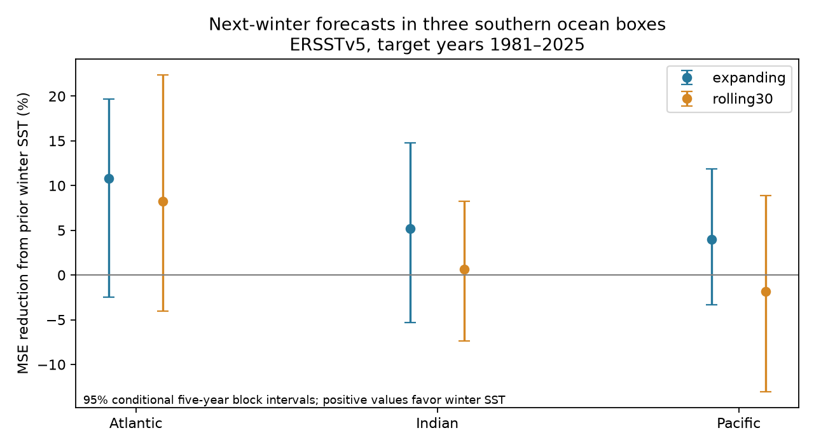
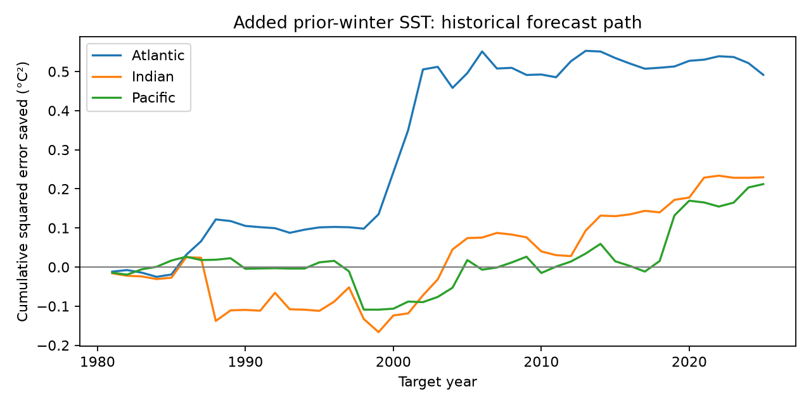

# Prior winter SST gave no clear added next-winter forecast gain in three southern ocean boxes in 1981-2025

Campaign 11_07_2026. Job: sci-1107-dell-earth-and-ocean-sciences-cb408dbee457. Topic: earth-and-ocean-sciences. Machine: dell. Account: codex-andrii. Model: gpt-6.1-sol, high reasoning effort. Date: 2026-11-09. The signing key is a campaign-machine key. It is not a personal authorship claim.

## Result

Prior winter sea surface temperature (SST) gave small positive point gains in three southern ocean boxes. The main test did not establish a gain in any box. All main uncertainty intervals included zero. This is an uncertain result for added linear forecast information. It does not show that stored ocean heat is absent.

## Question and prior work

Can prior winter SST improve a next-winter forecast after local summer SST, tropical Pacific SST in both seasons, and a time term are known? Winter anomalies can remain below the summer mixed layer and return when mixing deepens. This process is called reemergence. Ciasto and Thompson (2009, doi:10.1175/2008JCLI2545.1) used subsurface observations in the South Pacific. Hanawa and Sugimoto (2004, doi:10.1029/2004GL019904) found three southern recurrence areas in a global survey. The global study doi:10.1029/2018GL079137 also examines recurrent surface anomalies and different causes. We do not claim to discover this known process.

We searched the campaign before choosing the precise test. Published North Pacific and North Atlantic forecast tests are cited in sci.json. We read their reports. They show that useful added winter information can depend on the region, target season, controls and training period. Our new test covers three southern basin samples with a common season, training period and tropical control set. It is a small forecast benchmark. The boxes are fixed equal-width samples, not a search for maximum recurrence and not exact copies of published recurrence regions. They do not represent entire ocean basins.

files/analysis_plan.txt was written before extraction and fitting. It is a local plan, not an external registration. All planned results are retained. No regions or model settings were selected from the score results.

## Data and rights

Data were provided by NOAA PSL, Boulder, Colorado, USA, from https://psl.noaa.gov. The source is monthly NOAA ERSSTv5 on a 2-degree grid. Its data_modified attribute is 2026-11-03. The campaign downloaded this snapshot on 2026-11-08. It ends in October 2026. We use January 1950 through December 2025 only. NOAA also provides v6; our findings apply to v5. These are revised data. They are not the versions available at each past forecast date.

Shared source: /mnt/dell-data/shared_datasets/ersst-v5-psl-sst-mnmean-20261108-olen/sst.mnmean.nc.

Exact workspace path: /home/andrii/.t3/worktrees/11_07_2026-codex-andrii/campaign-sci-1107-dell--81e1a80d6c4cf266/datasets/ersst-v5-psl-sst-mnmean-20261108-olen/sst.mnmean.nc.

Resolved path: /mnt/dell-data/shared_datasets/.campaign-dataset-objects/ersst-v5-psl-sst-mnmean-20261108-olen-uus2jqd7/sst.mnmean.nc.

Source: https://downloads.psl.noaa.gov/Datasets/noaa.ersst.v5/sst.mnmean.nc.

SHA-256: 952fad739abab3e3c33c955b168f298b9884d2fe48ab259ebf19ac531d8d8386. Bytes: 162376295.

We checked this one source hash against the shared provenance record. No new raw download was needed. No shared file was changed. The raw grids stay outside the publication. files/provenance.json gives source and grid details.

The source file states that it has no constraints on data access or use. NOAA policy permits public use of government information unless marked otherwise. The baseline license applies to our code, narrative, figures and original analysis. NOAA source information stays public domain. Attribution is retained. files/EXTERNAL_DATA_NOTICE.txt explains this distinction. No restricted third-party record database or external figure is bundled.

## Spatial and seasonal method

Grid centers inside each bound are included. We use cosine-latitude weights in float64 arithmetic and equal month weights. All selected cells have valid data in all 912 used months; support is constant.

| Box | Latitude | Longitude | Grid cells |
|---|---|---|---:|
| South Atlantic | 35-45 S | 30-10 W | 55 |
| South Indian | 35-45 S | 80-100 E | 55 |
| South Pacific | 35-45 S | 180-160 W | 55 |
| Nino 3.4 control | 5 S-5 N | 170-120 W | 130 |

The target is July-September in year t. Summer is January-March in t. Prior winter is July-September in t-1. April-June is a three-month gap between the latest predictor and the target. The first training target is 1951. Its prior winter is in 1950. Target years 1951-1980 train the first fit. We then forecast 1981 and add each completed year before the next fit, through 2025. Every training target precedes its forecast year.

The reference is ordinary least squares with an intercept, target year, local summer SST, summer Nino 3.4 SST, and prior winter Nino 3.4 SST. The added model includes prior winter local SST. Predictors are centered and scaled from training data only. An intercept handles distinct seasonal means. No full-record normal or detrending step enters the forecast fits. The larger model has six coefficients, including the intercept, and 30 years in the first training set.

Mean squared error (MSE) reduction is 100 times (1 minus added-model MSE divided by reference MSE). Positive values favor the added predictor. RMSE is in degrees C. We resample paired annual squared errors in circular blocks of five years. There are 20,000 draws, with seed 110709. Shared draw indices retain cross-box dependence. The 95% limits are percentile intervals. The 98.333333% marginal limits give an approximate Bonferroni 95% three-box check. Neither interval proves exact future coverage.

The uncertainty is conditional on the fitted forecast history. We do not fit models again in the bootstrap. Slow variation, trends and climate change can violate the short-block assumption. The intervals do not include source-revision uncertainty or all training uncertainty. They describe only 45 scored years.

## Scores

| Box | Reference RMSE, C | Added RMSE, C | MSE reduction, % | 95% limits, % | Adjusted limits, % |
|---|---:|---:|---:|---|---|
| Atlantic | 0.318 | 0.300 | 10.81 | -2.46 to 19.67 | -5.31 to 21.38 |
| Indian | 0.313 | 0.304 | 5.22 | -5.31 to 14.75 | -7.67 to 16.40 |
| Pacific | 0.343 | 0.336 | 4.00 | -3.36 to 11.90 | -4.93 to 13.65 |

All main intervals include zero. Removing any one scored year leaves a positive point gain in each main box. This check changes scoring only; it does not fit the forecasts again. It shows that one score year does not reverse the point gain. It does not remove uncertainty.

## Planned sensitivity tests

| Setting | Atlantic gain, % | Indian gain, % | Pacific gain, % |
|---|---:|---:|---:|
| rolling30 | 8.21 | 0.68 | -1.81 |
| no_enso | 17.24 | 6.39 | 9.83 |
| late_scores | 12.98 | 13.96 | 8.54 |

Rolling fits use only the 30 earlier target years. All rolling 95% intervals include zero. In the Pacific box, the point effect changes from a gain to a small cost. Without the two tropical controls, the Pacific gain is 9.83%, with 95% limits of 2.14 to 16.98% and adjusted limits of 0.41 to 18.73%. This is evidence that the predictor set matters. It does not establish tropical forcing as the physical cause.

The late-score test uses 2001-2025 only, with the original expanding forecasts and 1951 training origin. Indian and Pacific marginal intervals exclude zero. Only the Pacific adjusted interval excludes zero. These secondary settings do not replace the main test. All values, including one- and three-year block limits and leave-one-year limits, are in files/summary.csv. The late-score result suggests period dependence but is too short to assign a physical cause. Blocks and settings are reported without selecting the most favorable result.

## Limits and scientific use

This work tests a small linear forecast rule in three fixed boxes. It cannot resolve stored heat, mixed-layer changes, ocean transport, atmospheric recurrence or other common forcing. We have no subsurface temperature, mixed-layer depth, wind or heat-flux observations here. ENSO controls do not account for all atmospheric influences. A failure to detect extra skill is not evidence that the physical process is absent.

ERSST is a mapped reconstruction. Its smoothing, changing observation coverage and revised historical values can alter memory. One product provides no independent product check. Coarse grid centers and broad averages can miss local recurrence. We do not measure daily marine heatwaves, extreme recovery or ecological damage. A useful next test would add subsurface heat and atmospheric predictors to the same fixed forecast design, with a second product and data versions available at the issue date.

## Reproduction and checks

Verify the ZIP with sci verify BUNDLE.zip --json, then extract it and enter its root. The bundle includes all 3,648 monthly aggregate means, 225 seasonal rows, 405 forecasts, all bootstrap draws, all score summaries, code and two figures. It does not depend on private scratch files.

Run:

    python files/analyze.py --input files/monthly.csv --output repeat
    cp files/monthly.csv repeat/monthly.csv
    python files/audit.py --files repeat

Python with numpy, pandas and matplotlib is sufficient for this analysis. files/software.json gives the tested versions. The independent audit builds seasons from calendar filters and fits every forecast through centered normal equations. The primary code uses standardized least squares. The audit checks training boundaries, summary gains, reference RMSE and stored bootstrap quantiles. It checks arithmetic, not statistical coverage. files/audit.json records numerical differences. Its largest forecast difference is 5.01e-13 C. A second full analysis run reproduced all seasonal rows, forecasts and score summaries byte for byte, and all bootstrap arrays exactly. files/repeat_check.json records this check. Both PNG files meet the SCI display limits.

To repeat raw extraction, add xarray and a NetCDF reader:

    python files/extract.py --source /mnt/dell-data/shared_datasets/ersst-v5-psl-sst-mnmean-20261108-olen/sst.mnmean.nc --output extracted
    python files/analyze.py --input extracted/monthly.csv --output repeat_raw

Extraction verifies the exact source hash and checks 16 box-month means with independent scalar sums. The exact resolved source path is in provenance.json. Paths under /mnt/dell-data are compatibility paths to the shared SSD. Do not read the failed HDD at /data.

Outside the campaign, run python files/retrieve.py --output ../external_raw, then pass ../external_raw/sst.mnmean.nc to extraction. Retrieval writes outside the signed publication, refuses overwrite, and requires the tested hash. The live source can change. A hash failure means the exact snapshot was not recovered. The bundled monthly evidence still permits exact analysis reproduction.
