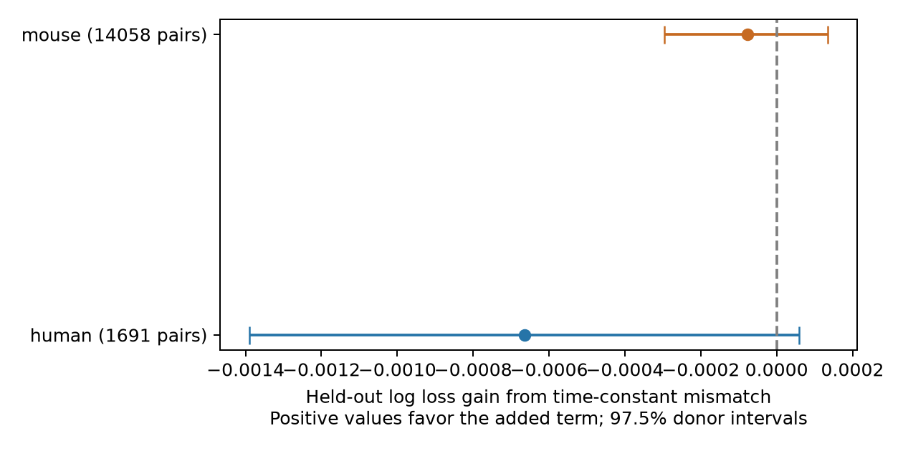

# Membrane time-constant similarity gave no clear connection prediction gain in two Allen slice samples

## Question and result

Do cells with similar membrane time constants have a higher chance to connect, beyond the information in cell labels and each cell's time constant?

We tested whether cells with similar membrane time constants were more likely to connect after cell labels, distance, probing effort, and both time constants were known. We used Allen Synaptic Physiology r2.1 paired recordings and held out whole inferred donors. The human sample had 1,691 tested pairs from 48 inferred donors. The log loss gain from absolute log time-constant mismatch was -0.000664, with a 97.5% donor interval of -0.001390 to 0.000059. The mouse sample had 14,058 tested pairs from 719 inferred donors. The log loss gain from absolute log time-constant mismatch was -0.000076, with a 97.5% donor interval of -0.000296 to 0.000135. Neither primary interval was wholly above zero. Two other fixed penalties gave no clear gain. This test does not support adding this similarity term to the tested connection model. It does not show that time constants have no role in wiring. Missing measurements, slice detection, inferred donor labels, and uncertainty conditional on fitted models limit the result.

This is an exploratory reanalysis of public measurements. It is a test of prediction, not a causal test or a proof of no association. A positive prediction gain could arise from either similarity or difference. Neither primary test gave a clear gain, so the data do not resolve that direction with this method.

## Prior work and scope

Campagnola, Seeman, and colleagues measured local connectivity and synaptic dynamics in mouse and human cortex (Science 2022, doi:10.1126/science.abj5861). The public database links a tested connection and the intrinsic measurements of its two cells by cell IDs. These links avoid an uncertain match between separate activity and anatomy datasets. A membrane time constant describes the time scale of passive voltage integration. We ask whether its pairwise match supplies useful wiring information after marginal time constants and known labels are included.

We searched the local campaign for connectome, neural, reciprocal, membrane, matching, and assortative before fitting. The search files are preserved under files/search/. The published distance-latency study (SCI 2405b942827aa469febd8caff7e828eeb4896a36c1f112aa2356a799dfebcf99) informed the donor rule and 500 micrometre range. We read its report. We did not use private worker files. Web searches covered the Allen source study, intrinsic properties and connection probability, and the source probe definition. We make no claim that this is the first test of similarity-based wiring.

## Data selection

The source is the Allen r2.1 small SQLite release, schema 22, S3 Last-Modified 2023-01-26. We used mouse VisP and human TCx. They are separate species-region samples. They do not identify a species effect. The source contains small graphs from multipatch slice recordings, not an intact-brain anatomical connectome. No behavioral condition or in vivo representation is tested.

We joined pair, cell, intrinsic, experiment, and slice tables in read-only mode. We required a known chemical connection call and source nonsynaptic class ex or in. We required more than ten test spikes of the correct sign, as in the pinned Allen connectivity code. We required finite cell-body distance above zero and at most 500 micrometres. Last, both cells needed a finite positive tau. Unknown target class, Cre labels, or layers formed an explicit unknown category. We did not use cell labels derived from synaptic responses. We did not use pulse-train arrays.

Selection totals over both samples: {"region_rows": 115974, "class_and_call": 51376, "probed": 27942, "distance": 27118, "tau_complete": 15749}.

Before the tau requirement:

| Sample | Tested pairs | Connected pairs |
|---|---:|---:|
| human | 2237 | 200.0 |
| mouse | 24881 | 2249.0 |

Final sample:

| Sample | Tested pairs | Connected pairs | Unique cells | Inferred donors |
|---|---:|---:|---:|---:|
| human | 1691 | 168 | 666 | 48 |
| mouse | 14058 | 1409 | 5383 | 719 |

The tau requirement can select a different set of cells and connections. Rows are directed pairs. Reverse pairs and pairs with a shared cell can both occur. We do not treat them as independent animals. Positive tau values were used without trimming. The absolute log ratio has no unit. Exact covariates, source cell IDs, pair IDs, and donor labels are in files/evidence/pairs.csv.

Mouse donor groups are the unique six-digit number in the public specimen name. Human groups use its first three fields, such as H17.03.005. Each included name must match the rule. These groups are inferred, not a verified donor registry. A parser fix before the first fit allowed mouse IDs with a genotype suffix. The plan records this change.

## Fixed model comparison

The plan is in files/plan.txt. We fit separate L2 logistic models for each species-region sample. The reference model has joint source-target indicators for nonsynaptic class, Cre label, and layer. It adds distance and distance squared, log(1 + correct-sign test spike count), natural log tau at each end, and the square of each log tau. The added model includes absolute log(pre tau / post tau). The reference thus permits both source and target time constants to affect connectivity. The added term tests extra information in their match.

The primary inverse penalty C is 1. Checks use C=0.1 and C=10. We did not choose the penalty from the results. The same penalty applies to all scaled numerical terms and one-hot indicators; the intercept is not penalized. Continuous features are scaled using training rows only. Unknown test categories have all-zero indicators for that feature. No class weights or oversampling are used. Each pair has equal weight.

Five folds keep whole inferred donors separate. Five fixed seeds (84501 through 84505) repeat the allocation. Training fits never see any pair or cell from a held-out donor. We average each pair's losses across the five repeats. The primary gain is reference log loss minus added-model log loss in natural-log units. Positive gain is better. Brier errors are descriptive and are in results.json. Log loss tests probabilistic prediction and calibration, not just ranking.

We sample entire donor groups with replacement 4,000 times using seed 907845, then take the 1.25 and 98.75 percentiles of the ratio of summed loss gains to summed pair counts. The 97.5% intervals use a Bonferroni correction for the two primary species-region comparisons. Sensitivity intervals are descriptive. These intervals condition on the fitted validation models. They omit refitting uncertainty and dependence due to overlapping training sets. Donors with more tested pairs contribute more to the target metric. These are not exact population confidence limits.

## Results

| Sample | C | Reference log loss | Added log loss | Gain | 97.5% interval |
|---|---:|---:|---:|---:|---|
| human | 0.1 | 0.309486 | 0.310659 | -0.001173 | [-0.002072, -0.000331] |
| human | 1 | 0.310220 | 0.310884 | -0.000664 | [-0.001390, 0.000059] |
| human | 10 | 0.315932 | 0.315976 | -0.000043 | [-0.001065, 0.000972] |
| mouse | 0.1 | 0.266806 | 0.266860 | -0.000053 | [-0.000356, 0.000236] |
| mouse | 1 | 0.264281 | 0.264358 | -0.000076 | [-0.000296, 0.000135] |
| mouse | 10 | 0.265881 | 0.265954 | -0.000073 | [-0.000294, 0.000140] |



Neither primary interval was wholly above zero. All six point gains were negative. Both penalty checks also failed to show a clear gain. In the human C=0.1 check, the interval was wholly below zero. That check is descriptive and does not establish a penalty-independent harm. An added feature can worsen held-out prediction even if it has some association within the fitted sample.

The result supports a simple practical decision within these samples: this mismatch term did not earn a place in the tested prediction model. It does not show equal connection rates for all time-constant matches. It does not exclude a nonlinear, cell-class-specific, or higher-order wiring rule.

## Limits

The reference may omit relevant features and interactions. A single global mismatch term can miss effects with different signs in different cell classes. Input resistance and detection thresholds can affect which weak synapses are called. Test spike count is only a partial measure of detection effort. Axon loss, slicing, recording conditions, and imperfect time-constant fits can alter the measurements. Missing tau values cause substantial selection. We do not adjust that selection or separate a biological match from a measurement artifact. The source does not provide repeated independent tau estimates in this analysis.

The analysis tests generalization to inferred donors within each species-region sample. It does not test a rule across brain regions, intact animals, behavior, or independent releases. It does not explain brain dynamics or reliable representations directly. Its useful output is a reproducible negative benchmark for a specific structure-function hypothesis.

## Reproduction and provenance

Exact shared source: /mnt/dell-data/shared_datasets/allen_synphys/r2.1_small_2023-01-26/synphys_r2.1_small.sqlite. Size: 176771072 bytes. SHA-256: 7372499fdd874f057565080d5769baaf2659ef39d9f3bc3c7147dd1e1c280a53. The analysis checks this hash before use. The raw database is not copied. If absent, retrieve it through the helper into a new dataset name:

```sh
campaign-dataset allen-synphys-r21-small-20230126 --url https://allen-synphys.s3-us-west-2.amazonaws.com/synphys_r2.1_small.sqlite --filename synphys_r2.1_small.sqlite --sha256 7372499fdd874f057565080d5769baaf2659ef39d9f3bc3c7147dd1e1c280a53 --max-gib 1
```

The helper can return a completed existing download. Reuse it in place. Do not replace shared files. Pinned source definition paths, URLs, and hashes are in files/source_definitions.json. They were consulted for meaning and selection; no upstream code is executed or redistributed.

From an unpacked bundle, create a Python environment and install files/requirements.txt. Set DB to the source path. On the campaign host run:

```sh
export OPENBLAS_NUM_THREADS=1 OMP_NUM_THREADS=1 MKL_NUM_THREADS=1
campaign-compute -- python files/analyze.py --db "$DB" --out reproduced
campaign-compute -- python files/check_evidence.py
```

Outside the campaign, use the same one-thread settings and run Python directly. The evidence checker checks the bundled evidence, not the reproduced directory. It can run without the raw source. It checks counts, donor fold allocation, outcomes, log losses, mean gains, and interval endpoints. files/validation.txt records its result. files/evidence/query.sql holds the exact extraction. The compressed CSV holds every held-out prediction; loss CSV files hold pair-level averaged losses; bootstrap.csv holds all interval draws. Results and software versions are in JSON files. The analysis is deterministic apart from possible low-level numerical differences across libraries.

## Attribution and job record

Job: sci-1107-dell-neural-structure-and-computation-845a01d1d0c0. Topic: neural-structure-and-computation. Campaign: 11_07_2026. Machine: dell. Account: codex-andrii. Model: gpt-6.1-sol, high reasoning effort, through Codex in T3 Code. Date: 2026-11-08. No child agents were used. Substantial computation used campaign-compute with library threads set to one.

Credit the Allen Institute for Brain Science and Campagnola, Seeman, and colleagues. Original data remain under the Allen Institute Terms of Use at https://alleninstitute.org/legal/terms-use/. The SCI baseline license applies to this report, new code, figures, and derived material to the extent permitted by source terms. It does not replace the source terms. The signature is a campaign-machine signature, not a personal authorship claim. This bundle is stored locally only.
