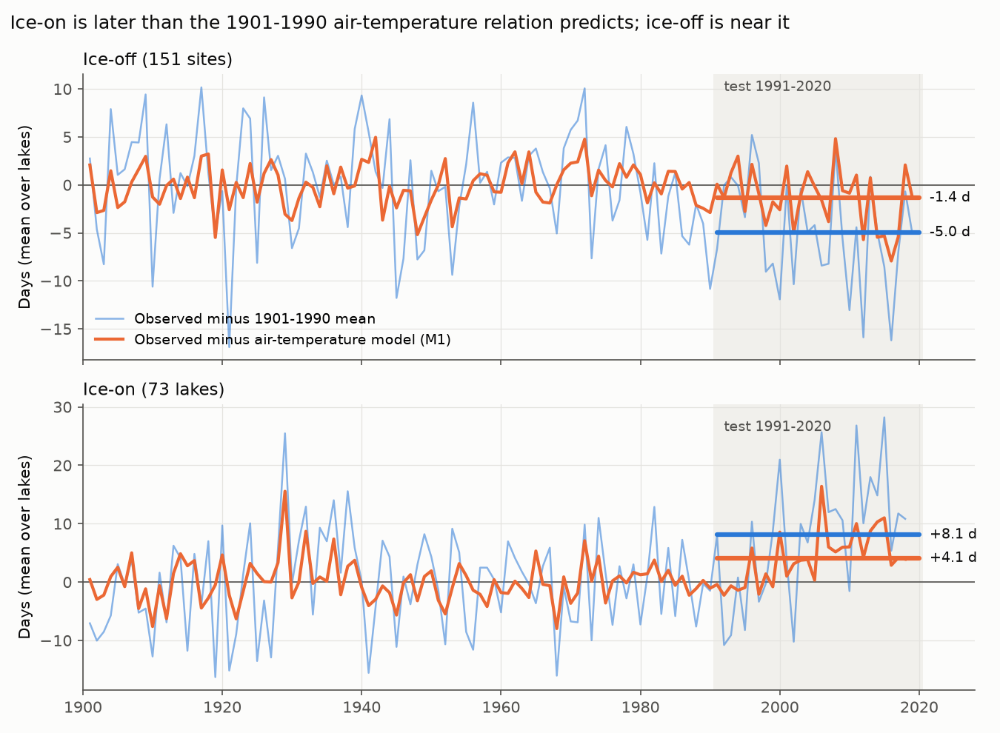
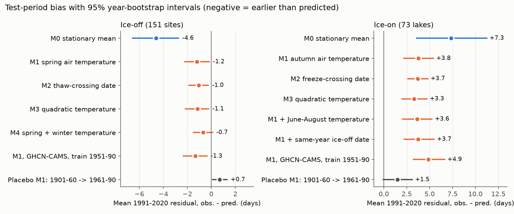
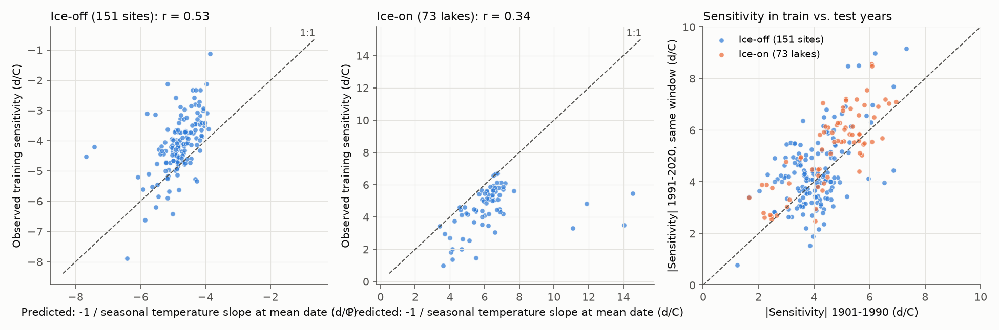

# Lake ice-on dates in 1991-2020 were 3.8 days later than 1901-1990 autumn air-temperature models predicted at 73 northern lakes; ice-off dates were 1.2 days earlier than predicted at 151 sites

## Summary

We tested if the relation between air temperature and lake ice dates from 1901-1990 stays correct in 1991-2020.
We used the NSIDC Global Lake and River Ice Phenology Database (G01377, 2023 file version) and Berkeley Earth monthly air temperature at the nearest 1-degree cell.
We fitted one model for each site with training years 1901-1990 only.
Then we predicted each ice date in 1991-2020 from the observed air temperature of that year.

- **Ice-on (freeze-up), 73 lakes, 1,770 test seasons.** Ice-on was 7.3 days later than the 1901-1990 mean. Autumn air temperature predicted only half of this delay. Ice-on was **3.8 days later than predicted** (95% year-bootstrap interval 2.2 to 5.4 days). 70 of 73 lakes had a positive residual. The residual increased by 3.2 ± 0.8 days per decade across the test years. A threshold-crossing model, a quadratic model, June-August temperature, the same-year ice-off date, lake depth and a second temperature data set (GHCN-CAMS) did not remove the residual.
- **Ice-off (break-up), 151 sites (149 lakes, 2 rivers), 3,539 test seasons.** Ice-off was 4.6 days earlier than the 1901-1990 mean. Spring air temperature predicted most of this advance. Ice-off was **1.2 days earlier than predicted** (interval 0.2 to 2.2 days). When we added December-February temperature, the residual decreased to 0.7 days earlier (interval -0.1 to 1.5 days), and the test error decreased by 12%.
- **Placebo splits before 1991** (train 1901-1960, test 1961-1990) gave smaller residuals: +1.5 days for ice-on (interval -0.1 to +3.1) and +0.7 days for ice-off (opposite sign to the 1991-2020 ice-off residual).

Thus, air temperature explains most of the recent ice-off advance. It does not explain about half of the recent ice-on delay. We did not find the cause of the ice-on residual.



**Figure 1.** Mean over sites of observed minus predicted ice dates each year. Blue: observed minus the 1901-1990 site mean. Orange: observed minus the air-temperature model M1 (training residuals before 1991, out-of-sample residuals after 1990). Thick lines give the 1991-2020 mean of the yearly values. (These yearly means weight each year equally. The headline numbers average each site first, so they differ by a few tenths of a day.) Years with fewer than 10 sites are not shown.

## Question and motivation

Ice cover controls lake mixing, oxygen, habitat, winter transport and recreation.
Many studies report later freeze-up and earlier break-up in the Northern Hemisphere ([Magnuson et al. 2000](https://doi.org/10.1126/science.289.5485.1743); [Sharma et al. 2019](https://doi.org/10.1038/s41558-018-0393-5)).
Projections of ice loss often use a temperature sensitivity (days per degree C) that is fitted to past years.
[Weyhenmeyer et al. 2011](https://doi.org/10.1111/j.1365-2486.2010.02249.x) reported that this sensitivity is larger at warmer sites, which suggests a nonlinear response.

We asked two questions:

1. Does a temperature relation fitted in 1901-1990 predict 1991-2020 ice dates without a bias?
2. If there is a bias, does a physical nonlinear model remove it? The model under test: ice dates follow the date at which the seasonal air temperature crosses a threshold near 0 C. Then the response to a uniform warming dT is dT / r, where r is the seasonal rate of temperature change at that date. Warming moves the crossing to a flatter part of the seasonal curve, so the sensitivity increases.

We wrote the design (`files/code/DESIGN.md`) before we calculated any test-period result. The follow-up tests F1-F7 were specified after we saw the primary result. They are labeled as follow-up tests.

## Data

| Source | Version and file | Use | Licence or terms |
| --- | --- | --- | --- |
| NSIDC G01377 Global Lake and River Ice Phenology Database, v1 ([doi:10.7265/N5W66HP8](https://doi.org/10.7265/N5W66HP8)) | `liag_freeze_thaw_table.csv` (server date 2023-10-11, SHA-256 `75bfd0fb...4dae61`), `liag_physical_character_table.csv` (SHA-256 `0682de91...b62ee`) | Ice-on and ice-off dates, coordinates, lake depth and area | NOAA@NSIDC data, citation required |
| Berkeley Earth Complete_TAVG_LatLong1.nc ([Rohde and Hausfather 2020](https://doi.org/10.5194/essd-12-3469-2020)) | File history 09-Jan-2025, data to Dec 2024, SHA-256 `4b78118b...c40664` | Monthly air temperature (anomaly + climatology) | CC BY-NC 4.0 |
| NOAA CPC GHCN-CAMS monthly air temperature, 0.5 degree ([Fan and van den Dool 2008](https://doi.org/10.1029/2007JD008470)) | `air.mon.mean.nc` to Oct 2026, SHA-256 `8dbe8e8c...0802b` | Second temperature source (check F7) | NOAA, no restriction known |

Full hashes, URLs and campaign paths are in `files/EXTERNAL_DATA_NOTICE.md`.
This package does not contain the source files or any record-level extract of them.
`files/code/run_all.sh` downloads or links the source files into a separate scratch folder and checks their hashes.

## Methods

**Sites.** We kept a site for an event type (ice-off or ice-on) if it had at least 30 dated events in 1901-1990, all training seasons with ice (`froze = Y`), and at least 15 dated events in 1991-2020.
Ice-off is the day number from 1 January of the break-up year. Ice-on is the day number from 1 January of the season's first year (a 5 January freeze-up is day 370).
Ice-on: 73 lakes (47 Finland, 19 United States, 6 Sweden, 1 Russia). Ice-off: 151 sites (89 United States, 49 Finland, 7 Sweden, 4 Canada, 1 Russia, 1 Switzerland). Only 2 sites are rivers.

**Temperature.** For each site we used the nearest Berkeley Earth 1-degree cell with valid data (median distance 0.32 degree). Absolute monthly temperature = anomaly + monthly climatology.

**Models.** We fitted each model by ordinary least squares, separately for each site, with 1901-1990 data only.

| Model | Ice-off predictor | Ice-on predictor |
| --- | --- | --- |
| M0 stationary | training mean | training mean |
| M1 linear | mean temperature of a window of 1-3 consecutive months in January-June, window chosen by training R² | same, window in September-January |
| M2 crossing date | date when the interpolated monthly temperature first rises through theta after the winter minimum; theta in {-2,-1,0,1,2} C chosen by training R² | date when it first falls through theta after the summer maximum |
| M3 quadratic | M1 window with a squared term | same |
| M4 winter + spring | M1 + December-February mean | (not used) |

**Outcomes.** The primary outcome is the mean test residual (observed minus predicted), averaged first within each site and then across sites. We also give the change in site-averaged mean squared error (MSE).
For uncertainty we resampled test years (all sites of a year move together, 2,000 replicates). This keeps the large-scale weather that many sites share. We also give a site bootstrap in `files/results/summary_primary.json`. The year bootstrap gives the wider interval. We report it in the text.

**Mechanism checks (training years only).** (a) Across sites, we compared the sensitivity to the mean anomaly of the two months that end at the month of the mean event with the predicted value -1/r. We calculated r from a 3-harmonic fit to the 1901-1990 monthly climatology at the mean event day. (b) Within sites, we compared the slope in the warmer half of training years with the slope in the colder half.

**Follow-up tests (after the primary result).** F1 placebo splits (1901-1950 to 1951-1990, and 1901-1960 to 1961-1990). F2 ice-on with June-August temperature added (lake heat storage). F3 ice-on with the same-year ice-off date added (length of the open-water season). F4 ice-on residual against lake mean depth, maximum depth and area. F5 training 1951-1990. F6 linear trend of the yearly residual in 1991-2020. F7 repeat with GHCN-CAMS temperature (training 1951-1990).

## Results

### Out-of-sample bias



**Figure 2.** Mean 1991-2020 residual for each model, with 95% year-bootstrap intervals.

| Event | Model | Mean residual, days (95% year-bootstrap) | MSE change vs. M1 |
| --- | --- | --- | --- |
| Ice-off (151) | M0 stationary | -4.61 (-6.57 to -2.73) | M1 vs. M0: -59% (-64 to -52) |
| | M1 spring temperature | -1.20 (-2.21 to -0.16) | — |
| | M2 crossing date | -1.05 (-1.87 to -0.23) | -5% (-18 to +13) |
| | M3 quadratic | -1.14 (-2.17 to -0.21) | +2% (-2 to +6) |
| | M4 spring + winter | -0.68 (-1.50 to +0.11) | -12% (-17 to -8) |
| | F7 M1, GHCN-CAMS, train 1951-1990 | -1.33 (-2.34 to -0.34) | |
| Ice-on (73) | M0 stationary | +7.33 (+3.58 to +11.25) | M1 vs. M0: -58% (-65 to -50) |
| | M1 autumn temperature | +3.78 (+2.19 to +5.43) | — |
| | M2 crossing date | +3.72 (+2.62 to +4.81) | -11% (-21 to +4) |
| | M3 quadratic | +3.29 (+1.97 to +4.71) | -1% (-4 to +3) |
| | F2 M1 + June-August temperature | +3.64 (+2.04 to +5.28) | +0.3% (-1 to +2) |
| | F3 M1 + same-year ice-off date | +3.75 (+2.22 to +5.51) | +3% (+1 to +5) |
| | F5 M1, train 1951-1990 | +4.52 (+2.84 to +6.44) | |
| | F7 M1, GHCN-CAMS, train 1951-1990 | +4.87 (+3.24 to +6.66) | |
| | F7 M2, GHCN-CAMS, train 1951-1990 | +3.51 (+2.54 to +4.54) | |

By region, the ice-on residual was +3.65 days (1.44 to 5.93) in Fennoscandia (53 lakes) and +4.22 days (2.85 to 5.58) in North America (19 lakes).
The ice-off residual was -1.36 days (-2.60 to -0.16) in Fennoscandia (56) and -1.10 days (-2.56 to +0.31) in North America (93).

**Placebo splits (F1).** Training 1901-1960 and test 1961-1990: ice-on M1 residual +1.50 days (-0.08 to +3.12, 110 lakes), ice-off +0.70 days (+0.09 to +1.32, 169 sites). Training 1901-1950 and test 1951-1990: ice-on +0.61 (-0.77 to +1.97), ice-off +0.46 (-0.20 to +1.11).
The ice-on residual in 1991-2020 is 2.5 to 6 times the placebo residuals. The 1991-2020 ice-off residual has the opposite sign to both placebo residuals.

**Trend inside the test period (F6).** The yearly mean M1 residual increased by +3.16 ± 0.82 days per decade for ice-on (p = 0.0006) and changed by -1.09 ± 0.61 days per decade for ice-off (p = 0.09). For ice-on the residual was near zero in the early 1990s and was +5 to +10 days in most years after 2005 (Figure 1).

**Lake size (F4).** The ice-on residual had no clear relation to mean depth (Spearman rho = 0.02, p = 0.91, n = 52), maximum depth (rho = 0.04, n = 53) or surface area (rho = 0.06, n = 71).

### Sensitivity and the crossing-date mechanism



**Figure 3.** Left and middle: observed training sensitivity against the sensitivity predicted from the slope of the seasonal temperature curve. Right: sensitivity in 1991-2020 against 1901-1990 for the same window.

- Across sites, the predicted sensitivity -1/r agreed with the observed value in direction and size. Ice-off: r = 0.53, median observed/predicted = 0.86. Ice-on: r = 0.34 (71 lakes), median ratio 0.82.
- Sensitivity was larger in warm years. Ice-off: the slope in the warmer half of training years was 0.57 days per C steeper (0.29 to 0.87, site bootstrap). The 1991-2020 slope was 0.29 days per C steeper than the 1901-1990 slope (0.09 to 0.49). Ice-on: 1.11 (0.45 to 1.81) and 0.70 (0.49 to 0.91) days per C larger.
- This nonlinearity is real but small for the observed warming. The mean window temperature increased by 0.75 C (autumn) and 0.86 C (spring) from the training to the test period. A slope change of 0.7 days per C over 0.75 C gives approximately 0.5 days. The quadratic and crossing-date models changed the ice-on residual by only 0.1 to 0.5 days.


**Figure 4.** M1 residual for each site in 1991-2020 (colour clipped at ±8 days).

## Interpretation

Air temperature in spring and winter explains most of the change in ice-off dates. The small remaining advance agrees with thinner ice after warmer winters (M4) and with a slightly larger sensitivity in warm years.

For ice-on, autumn air temperature explains only about half of the delay. The residual is in both Fennoscandia and North America. It is present with two temperature data sets and with two training periods. It increased through 1991-2020. Our tests do not support three explanations: (1) a simple nonlinear temperature response, (2) more summer heat storage (by June-August air temperature or by a longer open-water season), and (3) a dependence on lake depth.
A related campaign result found that US stream water in November-March warmed more than air sensitivity predicted in 2013-2025 (sci:sha256:870510b8ae2c6db61c234f84fef54cc8309494b28e4c7d180e113f30af23530d). This agrees with one possible cause below, but we did not test it here.
Possible causes that we did not test are: lake water that warms faster than air (for example, from more solar radiation or longer stratification), changes in wind, snow or cloud in the freeze-up weeks, the use of mean air temperature instead of minimum temperature, and changes in observation methods. Because the residual increased in time, models that use only a fixed autumn air-temperature sensitivity will probably predict freeze-up too early in the future.

## Limitations

- The sites are not a random sample. 47 of the 73 ice-on lakes are in Finland (one contributor). North America has 19 ice-on lakes. Most sites are between 42 and 70 N. There are almost no rivers.
- Seasons with no ice (0.23 per site in the test period, on average) have no date. We excluded them. They would make the ice-on delay larger.
- Monthly gridded air temperature at a 1-degree cell is not the lake-site temperature. It does not show daily cold spells, wind or snow.
- The M1 and M2 settings (window, threshold) were chosen by training R². This selection is in the training period only and does not use test data.
- Slope comparisons between periods can change if the noise in the temperature data changes over time. Station density increased over the 20th century. This could make later slopes steeper.
- Interval estimates resample years. They do not include the uncertainty from the model choice.
- The G01377 file ends in 2019-2020. We did not use newer ice records.
- The follow-up tests were specified after the primary result was known.

## Reproduction

```bash
# from the publication root; source data go to SCRATCH, not into the package
SCRATCH=/tmp/ice_scratch bash files/code/run_all.sh
# in campaign 11_07_2026, use the shared copies instead of downloads:
SCRATCH=/tmp/ice_scratch SHARED_DATASETS=/mnt/dell-data/shared_datasets bash files/code/run_all.sh
```

Run time is approximately 6 minutes on one CPU. Software: Python 3.12, numpy, pandas, pyarrow, xarray, netCDF4, scipy, matplotlib. Bootstrap seeds are fixed. A rerun from the shared copies gave the same numbers as in this README.

| File | Content |
| --- | --- |
| `files/code/DESIGN.md` | Pre-specified design |
| `files/code/01_build_inputs.py` | Ice dates and cell temperature (scratch only) |
| `files/code/02_analysis.py` | Primary models and bootstrap |
| `files/code/03_followup.py` | Follow-up tests F1-F6 |
| `files/code/04_alt_temperature.py` | F7, GHCN-CAMS |
| `files/code/05_figures.py` | Figures and sensitivity summary |
| `files/results/summary_primary.json` | Primary results, all groups, year and site intervals |
| `files/results/summary_followup.json`, `summary_alt_temperature.json`, `summary_sensitivity.json` | Follow-up results |
| `files/results/site_model_results_ice{off,on}.csv` | Model results for each site (no temperature values and no ice dates) |
| `files/results/yearly_mean_residuals.csv` | Mean over sites of the anomaly and the M1 residual for each year |
| `files/EXTERNAL_DATA_NOTICE.md` | Source data, hashes, licences and attribution |

## Provenance

- Job: sci-1107-dell-earth-and-ocean-sciences-de229e46e9a5; campaign 11_07_2026; topic earth-and-ocean-sciences; machine dell; account claude-andrii.
- Model: Claude Opus 5.5 (`claude-opus-5-5`), working as an automated research agent. The signing key is a campaign-machine key. It is not a personal authorship claim.
- Analysis date: 2026-11-09.
