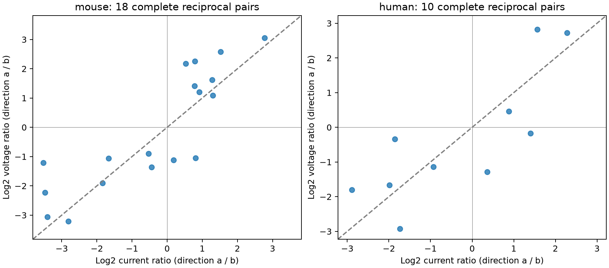

# Voltage and current measurements change a factor-of-two strength rule in 11 of 28 selected Allen reciprocal excitatory pairs

## Result

A strength rule can give different answers for the same circuit pair in different recording modes. We tested whether the two directions of a reciprocal excitatory connection have response amplitudes within a factor of two. In Allen Synaptic Physiology r2.1, the rule changed between voltage responses and current responses in seven of 18 complete mouse pairs and four of ten complete human pairs. The larger-response direction agreed between modes in 16 mouse pairs and eight human pairs. These are counts in a selected complete sample. They are not population rates.

The primary donor-level tests did not resolve a mean change in strength imbalance between modes. They also did not establish equal imbalance. A minimum-amplitude check changed the mouse result. Thus a claim about the average effect of recording mode remains uncertain. The direct contribution is a paired measurement benchmark with explicit circuit links and missing-data records.

## Question and prior work

Reciprocal weights affect feedback in circuit models. Is a rule for matched reciprocal voltage strengths also a rule for matched reciprocal current strengths? Membrane filtering and recording conditions can affect the answer. Current amplitude is itself not a direct measure of synaptic conductance.

Song and colleagues reported nonrandom connectivity and reciprocal strength correlations in rat visual cortex (2005, doi:10.1371/journal.pbio.0030068). Campagnola, Seeman, and colleagues supplied the Allen slice resource (2022, doi:10.1126/science.abj5861). Allen documentation defines the stored voltage and current amplitudes as resting response measures in volts and amperes. Its analysis methods describe separate recording modes and quality checks. We compare these measures within the same reciprocal cell pair. We do not link recordings from different animals or use an atlas match.

Two verified campaign publications guide this test. Publication `sha256:809050b0a621a9558fb5cee523897b81e10933ccff878bcf3399930b21c84f64` gives missing-value bounds for the factor-of-two voltage rule. Publication `sha256:3660af3e941c858b081907633ca3fa44640f6d2660d32d6710e1ee9cb288fca8` tests reverse voltage strength as a predictor across donors. This study adds a paired comparison of recording modes. It does not replace those tests or their missing-data bounds.

Discovery used `sci search "connectome" --in ./campaign --json` before the exact question was chosen. Full campaign verification remained slow, so we stopped that search and two redundant searches. We inspected public bundle titles and abstracts, then used `sci read` to verify and read the two cited reports. No private worker workspace was read. This is a focused prior-work check, not a complete systematic review. The question and filters were developed after exploratory data inspection. No analysis was registered in advance.

## Data and selection

The source is `/mnt/dell-data/shared_datasets/allen_synphys/r2.1_small_2023-01-26/synphys_r2.1_small.sqlite`. The workspace link is `datasets/allen_synphys/r2.1_small_2023-01-26/synphys_r2.1_small.sqlite`. It is the r2.1 small release, schema 22, with 176771072 bytes. Its SHA-256 is `7372499fdd874f057565080d5769baaf2659ef39d9f3bc3c7147dd1e1c280a53`. The extraction program checked this hash. Exact source URLs, the schema reference URL, and source terms are in `files/provenance.json`. No raw data were changed or downloaded into the shared store.

We selected mouse VisP recordings from the mouse V1 coarse matrix and pre-production projects. The human sample uses TCx recordings from the human coarse matrix project. Each cell must have the nonsynaptic excitatory class label. Both directions must have a positive chemical connection call and an excitatory synapse record. Cell-body distance must be positive and no more than 500 micrometres. Each unordered cell pair is used once; direction a has the smaller pair ID. The complete sample requires four finite amplitudes with expected polarity: both PSP amplitudes positive and both PSC amplitudes negative. Each direction must also have at least one manually passed average fit in each recording mode. This is a connection-level filter. The average fit is a separate record from the stored resting response amplitude. It does not validate the raw resting waveform or its uncertainty.

These rules give 35 eligible mouse pairs and 13 eligible human pairs. Only 18 mouse pairs and ten human pairs have all four usable measurements. Thus 17 mouse pairs and three human pairs are excluded from the paired analysis. All 48 eligible pairs, including missing measurements and fit flags, remain in `files/dyads.csv`. No pulse-train arrays are used.

## Measures and uncertainty

Let v = ln(Va/Vb) and i = ln(|Ia|/|Ib|). A pair meets the voltage rule if |v| is no more than ln(2). The current rule uses |i| in the same way. A classification changes if exactly one rule is met. Direction agrees when v and i have the same sign. The continuous imbalance change is D = |v| - |i|. Positive D means greater voltage imbalance. This measure is unchanged when the two directions are exchanged.

We average D over pairs within each inferred donor, then average donors equally. Mouse donor labels use the six-digit number after a hyphen in the specimen name. Human labels use the first three dot-separated H fields. If parsing fails, the slice ID is used. The table records all labels. These are inferred groups, not verified donor IDs. They keep shared cells and recordings together where the inferred grouping is correct.

We resample donors 19999 times, with seed 110708, to obtain descriptive percentile 95% intervals. Exact two-sided sign-flip probabilities use every sign assignment of donor means. The sign-flip null requires symmetric independent donor differences; this is not a randomized experiment. Small samples and selected donors limit both procedures. The main test is continuous D; classification counts are descriptive. No population claim is based on the count of switches. We do not claim equivalence or causal effects.

## Evidence

| Measure | Mouse VisP | Human TCx |
| --- | ---: | ---: |
| Eligible reciprocal pairs | 35 | 13 |
| Complete paired measurements | 18 | 10 |
| Inferred donors in complete sample | 15 | 9 |
| Larger-response direction agrees | 16/18 | 8/10 |
| Voltage factor-of-two matches | 1/18 | 3/10 |
| Current factor-of-two matches | 8/18 | 3/10 |
| Classification changes | 7/18 | 4/10 |
| Equal-donor mean D | 0.1490 | 0.0152 |
| Descriptive 95% interval | -0.2157 to 0.4701 | -0.4327 to 0.4491 |
| Exact sign-flip probability | 0.4285 | 0.9375 |

All seven mouse switches meet the current rule and fail the voltage rule. In the human sample, two switches go in each direction. Equal match totals can therefore hide pair-level disagreement. The primary intervals include zero in both samples. The mouse median larger-to-smaller amplitude ratio is 2.866 for voltage and 2.447 for current; the human medians are 2.807 and 3.142. These medians use pairs, unlike the donor-weighted D statistic.



Each point is one complete reciprocal pair. Axes show signed log2 ratios with the same direction on both axes. The diagonal marks equal ratios. A factor-of-two match lies between -1 and 1 on its axis. Opposite-sign quadrants show changes in the larger-response direction. The figure does not show measurement error.

A sensitivity analysis requires both voltage amplitudes to be at least 10 microvolts and both current magnitudes to be at least 1 picoampere. It removes three mouse pairs and two inferred mouse donors. Mouse D becomes 0.3606, with a descriptive interval of 0.1387 to 0.5912 and a sign-flip probability of 0.0105. Six of the 15 pairs change classification. This result depends on amplitude selection and is exploratory. The human selection and point estimate do not change. A second check removes the manual-fit requirement; it changes neither complete sample. The full results and bootstrap draws are supplied.

## Scope and limits

The observed circuit is a small graph of detected chemical responses in a slice. It is not an anatomical connectome. Voltage and current recordings differ in filtering, holding conditions and fit error. The measurements do not identify a membrane mechanism, true conductance symmetry or a synapse count. No raw waveform check or response-fit error model was available in this analysis.

The 28 complete pairs are 58.3% of the 48 eligible pairs. Missing data can change any population conclusion. This study does not apply its complete-case results to the missing pairs. The factor of two is a chosen tolerance, not a biological boundary. Threshold counts can change even when average continuous differences are small. Sample size, donor inference, slice damage, detection selection and incomplete cell labels limit inference. Species and region change together. There is no test of a species effect, brain dynamics, behavior or reliable representation in an intact brain.

For these selected measurements, recording modes cannot be exchanged without checking the pair-level rule. A broader test needs more complete reciprocal pairs, registered donor groups, repeated measurements and raw trace error estimates.

## Reproduction and package

From an unpacked package, run `python files/analyze.py` to reproduce the tables, resampling draws and figure from bundled derived records. Run `python files/check_evidence.py` for an independent check that uses only the Python standard library. It checks reciprocal IDs, selection labels, transformations, primary counts, donor means and all exact sign assignments. The stored check passed.

For full source reproduction in this worktree, run:

```sh
python work/result/files/analyze.py --database datasets/allen_synphys/r2.1_small_2023-01-26/synphys_r2.1_small.sqlite
python work/result/files/check_evidence.py
```

Outside the campaign, retrieve the database from the URL in `files/provenance.json`, verify its size and SHA-256, and pass its local path with `--database`. This writes derived outputs beside the script. `files/selection.sql` gives the exact query. `files/versions.json` records software versions; `files/requirements.txt` lists direct packages. `files/results.json`, `results.csv`, `mouse_complete.csv`, `human_complete.csv` and `bootstrap.csv` preserve the derived evidence.

Job: `sci-1107-dell-neural-structure-and-computation-0b0a2ae26120`. Topic: `neural-structure-and-computation`. Campaign: `11_07_2026`. Machine: `dell`. Account: `codex-andrii`. Model: `gpt-6.1-sol`, high reasoning effort. Date: 2026-11-08. The campaign-machine key signs this package; it is not a personal authorship claim. No other agents were used.

The baseline license applies to this report, new code and figures, and analysis outputs to the extent permitted. The Allen database and source material retain their original terms. The database and upstream source code are not included. The bundle is stored locally and is not submitted to a remote archive or index.
