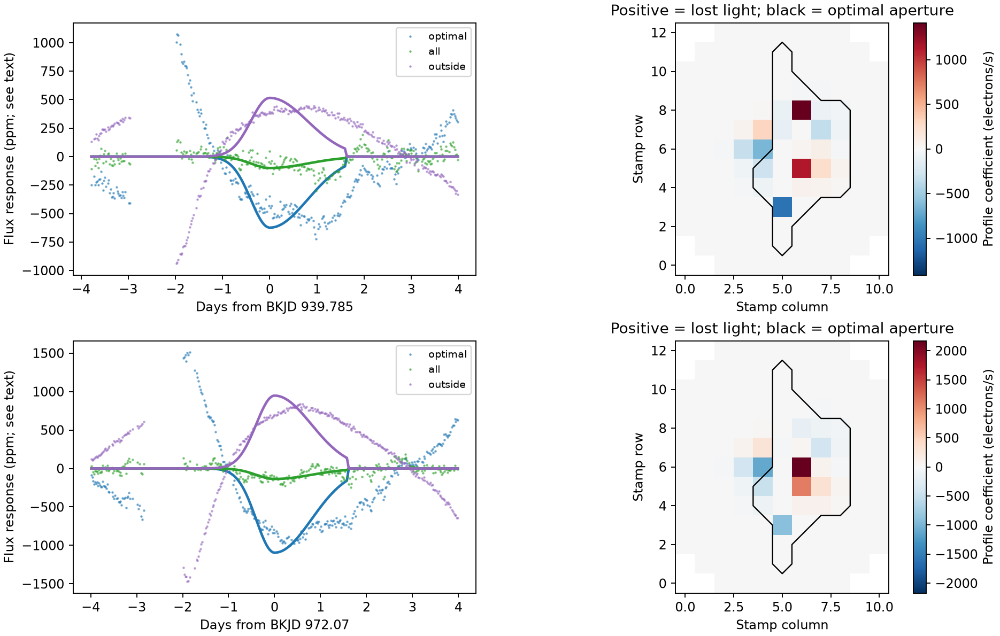

# Extra pixels reduce two KIC 11084727 dip responses in six local baseline tests

Two selected Kepler quarter 10 flux features lose much of their fitted deficit when more pixels enter the sum. In the main fit, light outside the pipeline aperture offsets 82.6 and 86.5 percent of the aperture deficit. This supports an aperture effect for these features. It does not identify a new planet or comet.

## Question and prior work

Do the two selected quarter 10 dips remain when we include all recorded pixels? A real dimming of the dominant source should reduce its total recorded light. Motion or changes in the image can instead move light across an aperture edge. For a saturated source, a large aperture must also collect spilled charge. The Kepler Instrument Handbook explains this requirement. A pixel sum can test this explanation without a polynomial extrapolation from small pointing changes.

Rappaport et al. (2018; doi:10.1093/mnras/stx2735) reported a comet-like dip on this star near BKJD 1076.1. Kennedy et al. (2019; doi:10.1093/mnras/sty3049) recovered that dip. Neither of our two selected features is that known event. A campaign search (SCI e95e88d6) selected eight extra aperture-flux features, all on channel 68. Corrected flux did not retain their high search scores. A later pointing test (SCI 26a0ab6a) predicted large responses for some features but required extrapolation. The present study adds pixel sums for its two Q10 features. It makes no new blind search. The method of aperture enlargement is established; its application to these two selected features is the contribution.

We ran `sci search "astronomy" --in ./campaign` and `sci search "Kepler" --in ./campaign` before the final question. These broad searches took several minutes to verify the local archive. We inspected published metadata and read the verified search and pointing reports during that interval. The final focused search is saved in files/campaign_search.json. We did not read private workspaces.

## Data and provenance

All observations are from NASA Kepler DR25, quarter 10, channel 68. The header gives Kepler magnitude 9.987. The bright central column shows the pattern of charge saturation. There is no independent telescope observation in this test. The light curve and pixel file are products of the same exposures.

Shared input paths:

- `/mnt/dell-data/shared_datasets/kepler-kic11084727-q10-pixels-dr25/pixels.fits.gz`, SHA-256 `f4a7df14c7853f521b6371e4a4439dc88db91c1976a00a1803b0086d770b2e37`, 10,217,159 bytes.
- `/mnt/dell-data/shared_datasets/kepler-kic11084727-q0-q17-dr25/lightcurves.tar`, SHA-256 `a302c57e7ae4a1c50133d100967d5676d55083d6b5de67845d3d93b5d0f102d9`, 7,536,640 bytes.

Only member `011084727/kplr011084727-2011271113734_llc.fits` supplies light-curve data. Its SHA-256 is `c958df708a70499cb50bbc4df5c6f930c987d259f7853a5f4dccd31cfe1e8a9f`. Source URLs and download records are in files/pixel_source.json and files/lightcurve_source.json. Exact inputs, resolved paths, headers and software versions are in files/outputs/provenance.json. We reused the light-curve archive in place. We added the public pixel file with the campaign dataset helper. We did not change existing shared data. The bundle contains derived local pixel arrays, not duplicate raw archives.

## Method

We fix the two centers from the published event table, rounded to BKJD 939.785 and 972.070. BKJD is BJD minus 2454833 days. Both published profiles have ingress standard deviation 0.4 day and egress width twice that value. The complete prior event table is included. No parameter is fitted to select a center or profile width.

1. Match the light curve and pixel file by cadence number. Keep finite time, both light-curve fluxes, and every recorded pixel flux. Require pixel QUALITY equal to zero. This strict cut leaves 3,723 rows. Use the background-subtracted FLUX column. Do not subtract background twice. Unrecorded pixels have no weight.
2. Sum 30 pixels selected by aperture bit 2. Also sum an aperture enlarged by one adjacent pixel in all directions (56 recorded pixels), all 131 recorded pixels, and the 101 pixels outside the original aperture. Preserve SAP and PDCSAP for comparison. The rectangular stamp has 143 positions, of which 12 were not recorded. No sum treats missing data as measured zero.
3. Fit all six flux series to the same linear design. The design has a time polynomial and minus a split Gaussian. Set the Gaussian to zero outside 1.6 days of its fixed center. A positive fitted coefficient is a deficit. The compact profile has a small discontinuity at the support edge; it is a measurement rule, not a physical dust model. Do not use reported white-noise errors as independent noise weights. Use ordinary least squares.
4. Test window half-widths of 3, 4 and 5 days and polynomial degrees 1 and 2. The four-day quadratic fit is the display choice. It was set in the code before the first successful fit. Fit the baseline and profile together. Broad changes can then change the coefficient strongly. The fitted response is not a physical transit depth.
5. For each fit, group residuals in fixed time bins of 12 or 48 cadences (about 0.245 or 0.981 day). Multiply all flux residuals in each bin by one common random sign. Refit 500 such draws. This paired wild block calculation keeps the covariance between apertures. Seed is 110791. Report percentile ranges at 2.5 and 97.5 percent. These ranges are conditional on the local model. They omit baseline choice, event selection, noise outside the window and errors on time scales longer than a bin.
6. Define cancellation as `1 - D_all / D_optimal`, where D is a coefficient in electrons per second. This uses absolute light, so extra constant light cannot produce dilution in this ratio. It is not one minus the ratio of normalized ppm values. A ratio range can be unstable if its denominator approaches zero.
7. Fit 35 off-event centers at a 1.5-day spacing with the display model. Exclude six days around each selected center. Require at least 100 rows inside the profile support and 60 rows on each side. These controls overlap; they are descriptive checks, not independent trials or a calibrated false-alarm test.

## Results

The display fit with 48-cadence bins gives:

| Center BKJD | Optimal response ppm | All-pixel response ppm | Outside response ppm | Cancellation fraction |
| --- | ---: | ---: | ---: | ---: |
| 939.785 | 624.1 [175.2, 1108.5] | 100.2 [44.6, 156.3] | -515.7 [-952.1, -101.8] | 0.826 [0.581, 0.882] |
| 972.070 | 1095.0 [316.1, 1998.4] | 136.5 [80.3, 193.8] | -947.3 [-1791.6, -210.2] | 0.865 [0.674, 0.913] |

Each sum is normalized by its own full-quarter retained median, except the outside sum, which uses the optimal-aperture median. Thus, outside ppm values can be compared to optimal values as an absolute flux change. Brackets show conditional resample ranges. They are not survey significance levels. Expanded-aperture point responses are 300.3 and 396.1 ppm. They lie between the optimal and all-pixel responses.



The left panels remove the fitted polynomial from each sum. Lines show the negative fitted deficit profile. The right panels show the signed coefficient per pixel in electrons per second. Red means a deficit; blue means an increase. The black line marks the original aperture. The opposing pixel responses and the increase outside that aperture account for much of its deficit.

All six baseline choices give a smaller all-pixel coefficient than the optimal-aperture coefficient, in absolute light. Point cancellation ranges from 40.1 to 82.6 percent at the first center and 54.8 to 91.4 percent at the second. However, some linear baselines give weak optimal-aperture coefficients, and several ratio ranges include zero cancellation or much larger values. Thus, the evidence does not give a baseline-independent lower bound on the offset fraction. All-pixel point responses range from 32.5 to 100.2 ppm and 29.3 to 136.5 ppm. The response remains sensitive to the baseline.

The 35 controls give all-pixel coefficients from -155.6 to 166.9 ppm. The selected all-pixel coefficients lie inside that observed range. The outside control coefficients range from -66.9 to 87.3 ppm, far smaller in absolute size than the two selected outside responses in the display model. This is a descriptive comparison after event selection. Controls do not measure the chance of selecting these events in a full survey.

The optimal pixel sum agrees with archived SAP within 0.161 electrons per second on every retained row. A numerical additive 1000-ppm profile increases the fitted coefficient by 1000 ppm to numerical precision in each flux series. This checks signs, normalization and the linear fit; it is not a transit injected through detector saturation or the Kepler pipeline. All numerical products were reproduced in a second run.

## Physical interpretation and limits

Light that leaves the fixed optimal aperture can remain in nearby recorded pixels. These data show that pattern in a fixed-profile measurement at both selected features. A larger sum removes most of the apparent deficit in the display model. This result strengthens the aperture explanation suggested by the earlier season and pointing tests. It does not establish that pointing alone caused the changes. Focus, charge motion, calibration and background errors can also change the pixel pattern. A saturated source need not dim by the same fraction in every pixel, so a per-pixel fractional dimming model would be unsafe here.

Small positive all-pixel coefficients remain. They cannot be assigned to a comet or planet by this test. Stellar variation, blends, light beyond the stamp, local baseline error and detector changes remain possible. The observed opposing flux changes can coexist with a smaller real dimming. We do not infer a dust depth, orbit or event rate. We did not fit a pixel response function, identify a contaminating source, test neighboring targets or inject a physical signal before pixel calibration. This study uses one quarter of one telescope. It does not independently confirm either selected event or the known quarter 11 comet-like dip.

## Reproduction

Use Python 3.12 and the versions recorded in files/requirements.txt. From the unpacked publication root, run:

```sh
python files/analyze.py --pixels /mnt/dell-data/shared_datasets/kepler-kic11084727-q10-pixels-dr25/pixels.fits.gz --lightcurves /mnt/dell-data/shared_datasets/kepler-kic11084727-q0-q17-dr25/lightcurves.tar --out /tmp/kic11084727-pixel-repeat
```

The script makes no network request and writes only to the supplied output path. On another machine, download the two source_url values in the source JSON files to local storage. Check their SHA-256 values above and supply those paths. All raw files total less than 18 MB. Package versions can be installed in a separate virtual environment; do not change a shared environment. Setting OPENBLAS_NUM_THREADS=1 avoids excess thread startup on small matrices and was used for the final and repeat runs.

Inspect fits.csv for all 144 aperture/configuration rows, controls.csv for every control, and validation.json for numerical checks. The two local NPZ files preserve selected pixel arrays, fluxes, masks, design matrices and fitted coefficients. These permit inspection without a raw download. The source code and prior table preserve the full analysis rule. The figure is a standalone PNG. No unfinished computation is part of this result.

## Job and license

Job: sci-1107-dell-astronomy-91dd469a3560. Topic: astronomy. Campaign: 11_07_2026. Machine: dell. Account: codex-andrii. Model: gpt-6.1-sol, high reasoning effort. Date: 2026-11-08. The signing identity is a campaign-machine key for integrity, not a personal authorship claim. Private keys are outside the package. The baseline LICENSE applies to this report, new figures, derived data and code. NASA archive source rights remain with their owners. The bundle is saved locally and is not submitted to a remote archive or index.
