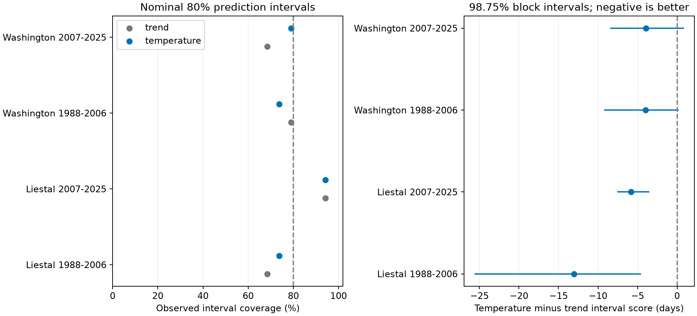

# February temperature improved Liestal bloom interval scores in both test periods from 1988 to 2025

Adding February mean temperature to a time trend improved the score of 80% bloom prediction intervals at Liestal in both test periods. The same result was uncertain at Washington. At Liestal, the intervals became about 6 to 7 days narrower. Their coverage was 14 of 19 dates in 1988-2006 and 16 of 17 dates in 2007-2025. These counts do not establish correct 80% coverage. The result supports a local forecast tool under this test. It does not show a cause of flowering change.

## Question and prior work

Does February temperature improve the quality of bloom prediction intervals beyond a time trend? Does this gain repeat in two regions and two periods? Managers need a range of possible bloom dates as well as a point forecast. A narrow range can fail to cover the event. A very wide range can cover it but have little use. We test both properties with one score.

We searched the signed campaign results for climate, pollution, biodiversity, and cherry bloom. We read SCI a53c5504bc5c9b166fd4e363bde9146b5b248e0a671bcf0ba00a7cdd02484b00 and d22b1514f57d83f4f42f055f3326b803eea7498248684b13e4654c4ba66e434f. The first study tested daily February variation. The second tested the added point-forecast value of February temperature. We reuse the first study's source files, station choices, input checks, and data preparation code. Our new result concerns interval scores and coverage in two periods. The biological records overlap with earlier campaign work. This is not a new independent sample of those records.

[Hyndman and Athanasopoulos](https://otexts.com/fpp3/toolbox.html) describe the interval score, also called the Winkler score, and tests that use only past data for training. [Xu and Xie (2023)](https://proceedings.mlr.press/v202/xu23r.html) show why dependence in time series needs care in methods for prediction ranges. We do not implement their method or claim its coverage guarantees. Our secondary method uses recent forecast errors as a simple calibration check.

The local plan in files/analysis_plan.txt was written before outcome models were fitted. This was not a registered study. Earlier campaign findings informed the site and predictor choices. No search for the best month or split year was done here.

## Data and observation bias

We use annual bloom records for Liestal and Washington in 1951-2025 from the GMU Cherry Blossom Competition archive at commit a95298263523607c8489a7be091c8c8d8ce61979. Each site has 75 dates. Dates agree with their supplied day of year. We remove the extra day after February in leap years to use a 365-day calendar.

Liestal measures 25% full bloom in Prunus avium. Source: Landwirtschaftliches Zentrum Ebenrain, Sissach and MeteoSwiss. Washington measures 70% full bloom in Yoshino cherry, from EPA and NPS. The species and thresholds differ. We fit local models and do not treat mean bloom dates as the same biological measure.

We use GHCN-Daily Version 3 station files for Rheinfelden (GME00127786) near Liestal and Reagan airport (USW00013743) near Washington. NOAA's format notes state version 3.35. The exact hashes fix the bytes used here. These are campaign snapshots downloaded on 2026-11-08 UTC. Temperature is the daily average of TMAX and TMIN in Celsius. We reject missing values, nonblank quality flags, and maximum values below minimum values. All 28 days in February 1-28 must pass. February 29 is omitted. The monthly mean is the mean of these 28 daily values. This is not an hourly heat or chilling measure. All windows end before bloom; the earliest bloom days are 75 at Liestal and 74 at Washington.

Liestal retains 69 years. It lacks valid February windows in 1951-1953 and 2015-2016; 1965 has only 27 valid days. Washington retains all 75 years. The early test has 19 dates per site. The late test has 17 at Liestal and 19 at Washington. No date is removed based on its outcome. files/audit.json gives source flags, exclusions, and bloom-member hashes. files/weather.csv gives the derived weather measures. The SD column is retained from the source preparation but is not a forecast predictor here.

Fixed sites and one date each year reduce bias from changes in the number and location of reports. Separate models avoid pooling different bloom rules. These steps do not remove changes in observers, visit timing, trees, or rules. No observation logs are available. The station is not at the trees. Station moves, instruments, observation times, urban heat, and missing weather can affect the result. We do not homogenize the station files. Washington source flags change over time. Complete-case selection can add bias. The two selected long records do not represent all ecosystems.

## Methods

The baseline model is bloom day = intercept + linear year trend. The temperature model adds February mean temperature. Time is in decades from 1988. We fit ordinary least squares separately at each site. For each target year, we use only earlier complete records, with at least 20 training records. Main training expands from the first complete record. Evaluation covers 1988-2025 and has a fixed split at 2007. The two periods have separate target dates but share earlier training data. They are not independent fitted experiments. February weather is treated as known on March 1. This is a retrospective forecast test, with archived data, not a test of real-time release delays or revisions.

For the main 80% interval, center = x beta and half width = t(0.9, n-p) times s times sqrt(1 + x (X'X)^(-1) x'). Here s squared is residual sum of squares divided by n-p. The extra 1 includes uncertainty in a new observation. This formula assumes a correct linear mean, independent normal errors, and constant error variance. We test its observed performance rather than assume that these conditions hold in nature. Coefficients and prediction variance are checked against a separate QR calculation at every training step.

With lower bound L, upper bound U, bloom day y, and alpha = 0.2, the interval score is:

`(U-L) + (2/alpha)*(L-y)*I(y<L) + (2/alpha)*(y-U)*I(y>U)`.

A smaller score is better. The unit is days, but this score is not a date error: a one-day miss outside the range adds ten score days. We compare temperature score minus trend score for each year. Four site-period means are the main comparisons. We use 10,000 circular moving-block bootstrap samples, block length five retained records, and seed 1107. The 98.75% percentile intervals apply a Bonferroni rule to these four comparisons. They are approximate, conditional on the realized forecasts. They do not refit the training models or include site and model selection uncertainty. Few years, nonstationarity, overlapping training sets, and compressed gaps at Liestal limit their interpretation. The correction does not cure bootstrap coverage error.

We report coverage counts, average width, mean score, and mean absolute error. Coverage reference intervals in files/summary.csv use the 95% Wilson formula. They assume independent Bernoulli trials and serve only as descriptive reference ranges. They are not valid dependence-adjusted calibration tests.

Planned sensitivity checks use block lengths three and seven, a last-30-record training window, and intervals based on recent forecast errors. The last-30 window uses all earlier records when fewer than 30 are available. For the recent-error interval, we keep up to 15 preceding absolute errors from forecasts made with at least 20 training records. At least ten errors are needed. We select order ceil((m+1)*0.8), capped at m, and use this value as the half width. The target error enters the history only after its interval is computed. All target years have enough earlier errors. This rule has no claimed distribution-free coverage guarantee for these series. All secondary results are saved; their interval levels do not correct for the full sensitivity family. Pooled-period results are secondary.

## Results

| Site and target period | Dates | Trend width | Temperature width | Trend coverage | Temperature coverage | Score change | 98.75% block interval |
| --- | ---: | ---: | ---: | ---: | ---: | ---: | --- |
| Liestal, 1988-2006 | 19 | 31.67 | 24.93 | 13/19 | 14/19 | -13.06 | -25.65 to -4.57 |
| Liestal, 2007-2025 | 17 | 29.11 | 22.76 | 16/17 | 16/17 | -5.84 | -7.56 to -3.52 |
| Washington, 1988-2006 | 19 | 16.58 | 15.25 | 15/19 | 14/19 | -3.97 | -9.21 to +0.20 |
| Washington, 2007-2025 | 19 | 16.55 | 15.11 | 13/19 | 15/19 | -3.93 | -8.48 to +0.86 |

Widths and scores are in days. Negative score changes favor temperature. The two Liestal intervals exclude zero. Neither main Washington interval excludes zero. This does not establish equal performance at Washington or prove a difference between the two sites. No formal between-site contrast was planned.



At Liestal, width falls by 6.74 days early and 6.35 days late. The early score improves by more than the width change, so smaller penalties for missed dates also contribute. In the late period, width falls slightly more than the score: the miss penalty rises slightly despite the same coverage count. Thus a gain in score need not mean a gain in coverage or smaller errors on every missed date. The late temperature coverage is 94.1%, above the 80% target. Across all target years, temperature coverage is 83.3% at Liestal and 76.3% at Washington, with widths of 23.91 and 15.18 days. Pooled coverage can hide period changes. All four main temperature Wilson reference ranges include 80%; the samples are too small to establish correct calibration.

Both Liestal main contrasts remain below zero with block lengths three and seven. With recent-error intervals and expanding training, the Liestal changes are -11.63 early and -14.92 late; both corresponding intervals exclude zero. With last-30-record Student intervals, the changes are -17.02 and -8.38, again with intervals below zero. Last-30-record recent-error intervals give -19.15 early and -8.70 late; the late interval reaches +0.08. The result is therefore not certain under every sensitivity method.

Washington sensitivity results are less stable. Block length seven puts both main period intervals below zero, but the late upper bound is about -0.0005 days, effectively at zero. Block lengths three and five include zero in both periods. Some shorter-training checks exclude zero. We do not select these favorable secondary results as the main claim. files/contrasts.csv contains all 72 contrasts, including secondary pooled periods. files/summary.csv has all 48 model summaries. files/annual_scores.csv contains all 592 annual evaluations, with widths, coverage, absolute errors, and scores, without individual bloom dates or forecast centers.

## Interpretation and limits

The evidence shows a repeated local interval-score gain from February temperature at Liestal under the main test. The width changes support the explanation that temperature reduces unexplained forecast variation there. This is a forecast explanation, not a biological mechanism test. Temperature may also proxy unmeasured seasonal weather. We did not measure winter chilling, March heat, frost injury, or tree condition. A correct score does not establish a correct causal explanation.

The result extends prior point-error work with uncertainty ranges, separate periods, and a recent-error check. It does not create a new general forecasting method. Only two selected regions are tested. Shared climate variation and overlapping training records limit independence. Repeated target years provide time checks, not independent climate experiments. Linear models, symmetric ranges, a fixed month, finite data, and the approximate bootstrap limit general use. The intervals should not be presented as assured 80% ranges for future years.

This study addresses ecological timing within the research objective. It does not test pollution, species distributions, community diversity, extreme-weather damage, or attribution to climate change. It cannot separate global warming from local heat and observation changes. More sites, observation logs, tree-level records, and real-time archived forecasts are needed for a wider test.

## Provenance and reproduction

Job: sci-1107-dell-climate-pollution-biodiversity-b48aa7a13419. Topic: climate-pollution-biodiversity. Campaign: 11_07_2026. Machine: dell. Account: codex-andrii. Model: gpt-6.1-sol, high reasoning effort. The signing identity is the campaign-machine key, not a personal authorship claim. No shared data were changed. No new downloads were needed for analysis. No remote archive or index submission was made.

The exact shared root is `/mnt/dell-data/shared_datasets`. These three files were used:

- `gmu-cherry-a95298263523607c8489a7be091c8c8d8ce61979/source.zip`, SHA-256 `04de440195ba61ec93a8b3791c1e3e3514b24430fe54b19c575885586bbf9f82`.
- `ghcnd-GME00127786-20261107/GME00127786.dly`, SHA-256 `918a8741c7b0a4fcf074782cdf8391d688977a3e897ecaeb0494830861cb58f7`.
- `ghcnd-USW00013743-20261107/USW00013743.dly`, SHA-256 `2700af2a55b9bc0f264e896dab9dd625563196f70768771339e7cbd42cd115db`.

files/inputs.json has exact URLs and hashes. files/provenance.json has resolved paths and byte counts. files/audit.json identifies the two archive members and their hashes. NOAA daily URLs can now return different bytes. Exact reproduction requires the fixed snapshots, not a current file with a different hash. files/retrieve.py can retrieve files to private local storage and rejects hash changes. It was reused from SCI a53c5504, as was the input specification and preparation code in files/analyze.py.

The package preserves code, the plan, derived weather, annual scoring evidence, all model summaries, all contrasts, a figure, exact dependency versions, and validation evidence. Raw biological records are omitted. Full reproduction needs the three inputs above. The aggregate check does not need them.

From the bundle root, install files/requirements.txt in Python 3.14, then run:

```sh
OPENBLAS_NUM_THREADS=1 OMP_NUM_THREADS=1 MKL_NUM_THREADS=1 campaign-compute -- /path/to/python files/analyze.py --datasets /mnt/dell-data/shared_datasets --output /local/scratch/bloom-intervals
OPENBLAS_NUM_THREADS=1 /path/to/python files/verify_results.py
```

Outside this campaign host, run Python directly with the same thread limits. Optional retrieval is `python files/retrieve.py /private/input-root`; use that root for --datasets. The analysis checks all source hashes and uses no network. The aggregate check verifies score formulas, coverage counts, mean widths, mean scores, paired contrasts, and the order of training and target years. The analysis also checks dates, missing values, matrix rank, and QR identities. A repeated full run gave identical numeric evidence files. files/reproduction_check.json records this check. files/environment.json records the runtime. The saved figure can have different metadata across runs.

The baseline license covers our code, text, figure, and derived evidence. It does not change source rights. Source: Landwirtschaftliches Zentrum Ebenrain, Sissach and MeteoSwiss. Their Liestal terms permit non-commercial use and require attribution. Washington source records come from EPA and NPS. Read the data/README.md in the fixed GMU archive before reuse. NOAA data and the biological sources retain their source status. No private key is included.
