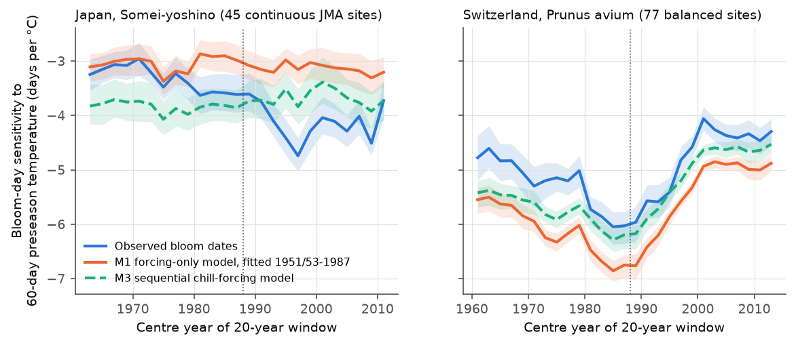
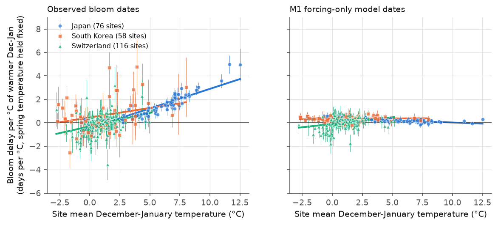
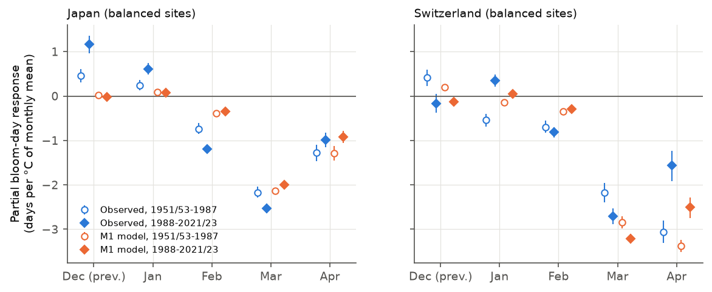

# Warm winters delay cherry bloom at warm sites in Japan and Korea; a fixed thermal-time model explains the Swiss drop in spring sensitivity but not the Japanese rise (1951-2023)

## Summary

Many studies report that spring phenology becomes less sensitive to temperature when the climate gets warmer.
Two explanations compete:

1. **Artifact of a non-linear response.** Development time is approximately inversely proportional to temperature.
   Thus, a linear slope in days per degree Celsius (d/°C) becomes smaller when the climate is warmer, with no change in the plant.
2. **Physiological change.** Warmer winters give less chilling. Then the plant needs more spring warmth and
   responds less to spring temperature.

We tested the two explanations with cherry bloom records from three independent national networks.
For each network we fitted a forcing-only thermal-time model (M1) on bloom years up to 1987 only.
M1 has constant physiology and no chilling. We simulated M1 bloom dates for all years with the observed temperatures.
Then we applied the same sensitivity regression to the observed dates and to the M1 dates.
If M1 shows the same change as the observations, the change needs no physiological explanation.
We also tested for a direct chilling signal: a bloom **delay** after a warm December-January when spring temperature is held constant.
A forcing-only model cannot make this delay.

Main results (95 % site-cluster bootstrap intervals, 2000 draws):

| Test | Japan (Somei-yoshino, JMA) | South Korea (KMA) | Switzerland (*Prunus avium*, MeteoSwiss) |
|---|---|---|---|
| Sites, years | 76 sites, 1953-2021 | 58 sites, 1980-2020 | 116 sites, 1951-2023 |
| Sensitivity to 60-day preseason temperature, 1951/53-1987 → 1988-2021/23 (balanced sites) | -3.33 → -4.28 d/°C (71 sites); **rise** of 0.96 [0.74, 1.17] d/°C | not tested (record too short before 1988) | -5.93 → -5.39 d/°C (77 sites); **drop** of 0.54 [0.26, 0.83] d/°C |
| Change that M1 (constant physiology) predicts | +0.07 [-0.03, 0.18] d/°C (no change) | - | 0.68 [0.49, 0.88] d/°C drop |
| Observed change minus M1 change | -1.03 [-1.22, -0.85] d/°C | - | -0.14 [-0.46, 0.18] d/°C (no excess) |
| Delay per °C of warmer Dec-Jan, at the warmest sites (10 % of sites with the warmest winters) | +2.21 [2.01, 2.37] d/°C (Dec-Jan mean 8.0 °C) | +1.07 [0.53, 1.61] d/°C (3.8 °C) | +0.21 [0.02, 0.39] d/°C (2.2 °C) |
| Same quantity from M1 dates | +0.10 | +0.36 | -0.23 (monthly) / +0.15 (daily) |
| Same delay at the 10 % coldest sites | -0.10 [-0.40, 0.11] | +0.17 [-0.38, 0.64] | -0.43 [-0.70, -0.18] |

Conclusions, with their scope:

* **Switzerland.** The apparent sensitivity dropped by about 9 % after 1988. M1 with constant physiology gives the same or a larger drop.
  Thus, in this network the drop needs no physiological change. In the log-duration form the sensitivity did not change (ratio 1.03 [0.97, 1.09]).
  This result agrees with the non-linear-response explanation.
* **Japan.** The apparent sensitivity did **not** drop. It increased by about 29 %. M1 predicts no change.
  The increase is also present in the 45 sites with continuous records to 2021 (excess -0.86 [-1.05, -0.67] d/°C).
  None of our models with chilling terms (M2, M2b, M3) reproduce the increase. We do not have an explanation for it.
* **Chilling signal.** A warm December-January delays bloom at sites with mild winters. The delay increases with site winter temperature in all three networks
  (gradient 0.33 [0.28, 0.39] d/°C per °C of site winter mean in Japan, 0.16 [0.02, 0.32] in Korea, 0.23 [0.10, 0.36] in Switzerland).
  M1 dates show no such gradient. In Japan, the delay at the warmest sites was larger after 1988 (+3.25 [2.96, 3.53] d/°C) than before (+1.60 [1.36, 1.84] d/°C).
  In Switzerland, where winters are cold, the effect is small.
* **Prediction out of sample.** Chilling terms fitted on the years up to 1987 decrease the error after 1988 only at the warmest third of the Japanese sites
  (RMSE change -0.41 [-0.72, -0.15] days for M2, -0.22 [-0.34, -0.11] days for M2b). They increase the error at cold sites and give no improvement in Switzerland or Korea.

Thus, the "declining sensitivity" pattern is not general. In the Swiss network a constant-physiology model explains it.
In the Japanese clone network it is absent, while a direct chilling-deficit delay is present at warm sites and increased after 1988.



**Figure 1.** Within-site sensitivity of bloom day to 60-day preseason temperature in moving 20-year windows. Shaded bands: 95 % site bootstrap intervals (500 draws).
Blue: observed. Orange: M1 forcing-only model, fitted on years up to 1987 and run with the observed temperatures. Green dashed: M3 sequential chill-forcing model.
Japan: 45 sites with records to 2021. Switzerland: 77 sites with at least 15 years in each period (E-OBS daily temperatures).



**Figure 2.** Per-site coefficient of December-January mean temperature in a regression of bloom day on December-January and spring (1 February to the day before mean bloom) temperature.
Vertical bars: ±1 standard error. Lines: pooled fixed-effects model in which the winter coefficient changes linearly with site winter mean. Left: observed dates. Right: M1 model dates.



**Figure 3.** Partial response of bloom day to each monthly mean temperature (within site and period). Open symbols: years up to 1987. Filled symbols: 1988 and later.
In Japan, the positive (delaying) December and January responses and the negative February response all increased after 1988. M1 does not show these changes.
In Switzerland, the main change is the smaller April response, because bloom moved earlier. M1 reproduces this change.

Figure 4 (`files/figures/fig4_holdout_rmse.png`) shows the out-of-sample RMSE changes of M2, M2b and M3 relative to M1 by site winter-warmth tercile.

## Question

Does the apparent drop in temperature sensitivity of cherry bloom under warming need a physiological explanation (chilling deficit),
or does a model with constant physiology explain it? Is there a direct chilling-deficit signal, and where?

## Data

All raw data are public. We did not redistribute raw bloom tables. `files/provenance/input_hashes.csv` gives the SHA-256 hash, size and source URL of each input file (349 files).

| Data | Source | Use |
|---|---|---|
| Cherry full-bloom (peak-bloom) dates, Japan (JMA, 1953-2021), Switzerland (MeteoSwiss, 1951-2023), first-flowering dates, South Korea (KMA, 1980-2020) | George Mason University peak-bloom-prediction repository, commit `a95298263523607c8489a7be091c8c8d8ce61979`, files `data/japan.csv`, `data/meteoswiss.csv`, `data/south_korea.csv`. Original sources: Japan Meteorological Agency, MeteoSwiss, Korea Meteorological Administration. | Response variable |
| Japan monthly mean temperature | JMA "past weather data" pages `monthly_s3.php?...&view=a1` (monthly mean of daily mean temperature, all years), one page for each observatory; downloaded 2026-11-07. Values flagged `]` (insufficient), `#` or `×` were removed. | Japanese temperatures |
| Switzerland daily mean temperature | E-OBS v31.0e, 0.1° ensemble mean `tg_ens_mean_0.1deg_reg_v31.0e.nc` (SHA-256 `f12b8b7a...04df6c6`), shared campaign dataset `/mnt/dell-data/shared_datasets/eobs_tg_ens_mean_0.1deg_reg_v31.0e` (added by this job with the campaign dataset helper), plus `elev_ens_0.1deg_reg_v31.0e.nc` | Nearest valid grid cell (median 3.6 km), shifted to site altitude with -6.5 K/km |
| South Korea daily mean temperature | ERA5 through the Open-Meteo archive API (`models=era5`, elevation downscaling to site altitude), 1979-09-01 to 2020-06-30; request URLs and response hashes in `files/provenance/era5_korea_fetch_log.tsv` | Korean temperatures |
| GHCN-Daily (NOAA), Japanese stations | `by_station/*.csv.gz`, downloaded 2026-11-07 | Quality check only (it has almost no Japanese data for 1990-2024) |

Site selection: Japanese stations from 30.5° N to 41.6° N (Honshu, Shikoku, Kyushu). This removes Hokkaido and the southern islands, where some stations observe other cherry species.
Japan and Switzerland need at least 20 bloom years at a site; South Korea needs at least 10.
The JMA bloom site and its temperature observatory are at the same place (median distance 0.1 km; maximum 6.1 km).

## Method

1. Daily temperature. To use one method in all regions, we rebuilt daily temperature from monthly means by linear interpolation between mid-month values.
   For Switzerland and Korea we also ran all analyses with the true daily series. Section "Checks" gives the differences.
2. Covariates. T_pre: mean of the 60 days that end on the day before the site's long-term mean bloom day. T_win: mean of December (previous year) and January.
   For the winter test (T4) we used raw monthly means (no interpolation): T_win = mean(Dec, Jan); T_spr = day-weighted mean of February-April over 1 February to the day before mean bloom.
3. Periods. P1: bloom years up to 1987. P2: 1988 and later. Balanced site set: at least 15 years in each period.
4. Models (all parameters fitted on P1 only; P2 is out of sample):
   * M1: forcing = sum of max(T - Tb, 0) from day t0. Bloom when forcing reaches F*_i (one value for each site). t0 and Tb are region-wide (grid search).
     Fitted values: Japan t0 = 1 March, Tb = 0 °C; Switzerland t0 = 1 March, Tb = 2 °C (monthly) or 15 February, 1 °C (daily); Korea t0 = 1 March, Tb = -3 °C.
   * M2: F*_iy = F*_i exp(-k (C_iy - mean C_i)), C = chill days (T ≤ Tc) from 1 November to 28 February.
   * M2b: F*_iy = F*_i exp(k (T_win,iy - mean T_win,i)).
   * M3: sequential model. Forcing starts when chill days (T ≤ Tc) since 1 November reach C* (latest start 31 March).
5. Tests (all CIs from a site-cluster bootstrap):
   * T1: within-site, within-period slope of bloom day on T_pre in P1 and P2 for observed and model dates. Excess = observed change minus model change.
   * T2: the same slope in moving 20-year windows.
   * T3: within-site regression on Dec, Jan, Feb, Mar, Apr monthly means, by period.
   * T4: within-site regression of bloom day on T_win and T_spr, with each slope allowed to change linearly with the site mean T_win.
   * T5: P2 RMSE of M2, M2b and M3 minus that of M1, by site winter-warmth tercile.

The plan before we saw results: data sources, T_pre, periods, M1, M2, T1, T2, T5.
We added T3, T4, M2b and M3 after the first T1 result for Japan. Thus, treat T3 and T4 as exploratory, but note that T4 replicates in three independent networks.

## Checks for observation and data bias

* **Network change in Japan.** JMA stopped bloom observations at about 30 stations from 2005 to 2012 (staffed observatories became automatic).
  The Japanese T1 result is the same on the 45 sites with continuous records (-3.24 → -4.14 d/°C; M1 -3.06 → -3.11).
* **Network growth in Switzerland.** The Swiss network grew from about 30 to 110 sites from 1951 to 1990. We used only balanced sites (at least 15 years in each period) for T1 and T2.
* **Duplicate records.** In the Japanese file, 466 site-years occur twice (932 rows), with the same date and two coordinate sets (station relocation). We kept one copy. No conflicting dates remained.
* **Temperature data.** Parsed JMA monthly values agree with GHCN-Daily (Tmax+Tmin)/2 at the same 97 stations for 1950-1989 (r = 0.999; anomaly r = 0.990; mean difference 0.14 °C).
* **Interpolation artifact.** With interpolated monthly data, January leaks into the early-February values. This gives a false positive winter coefficient of about +0.3 to +0.7 d/°C, which M1 dates also show.
  For this reason T4 uses raw monthly means. With raw monthly means, the Swiss results from monthly and daily data agree (warm-site winter coefficient +0.21 in both).
* **Regression dilution.** The within-site SD of T_pre is similar in both periods (Japan 0.88 and 0.85 °C), so a change in temperature variance does not explain the Japanese increase.
* **Temperature-window mismatch.** M1 uses the same temperatures and the same fixed windows as the observations. Thus, window effects are in both, and the observed-minus-model contrast removes them.

## Limitations

* The Japanese analysis uses monthly temperatures. M1 then cannot respond to day-to-day weather. The Swiss check shows that this changes sensitivities by about 1 d/°C in level, but not the sign of the period change.
* JMA temperature series are not homogenized for station relocations and urban warming. Urban warming changes mean levels more than year-to-year variation, but we did not test this.
* Swiss temperatures come from a gridded product at sites that are not at weather stations. Lapse-rate corrections reach several degrees at some sites.
* The Korean records are short (median 16 years) and the period before 1988 has only 8 years. We used Korea only for the spatial winter-delay test; its model comparison (T5) is weak.
* The Korean data are first-flowering dates; the Japanese and Swiss data are full-bloom dates. The species also differ (Somei-yoshino clone in Japan, *Prunus avium* in Switzerland, mostly *Prunus* × *yedoensis* in Korea).
* The chilling models are simple. Some fitted parameters are at the edge of the search grid (M2 and M3 Tc in Japan). Better chilling models (for example the Dynamic model with hourly data) could give different results.
* We have no explanation for the increase of spring sensitivity in Japan. Possible causes that we did not test: changes of sample trees, changes of observation practice, and earlier start of forcing after warm autumns.
* We used a split year of 1988 only. Figure 1 shows the time course without a split.

## Reproduce

Python 3.14 with the packages in `files/code/requirements.txt`. Set `OMP_NUM_THREADS=1`. Run from a work folder:

```
python -I code/fetch_jma_stations.py raw/jma/pref derived/jma_stations.csv
python -I code/fetch_jma_monthly.py raw/cherry/japan.csv derived/jma_stations.csv raw/jma/monthly derived/monthly_temp_japan.csv
python -I code/fetch_era5_korea.py raw/cherry/south_korea.csv raw/era5_korea        # about 1-2 h because of API limits
python -I code/build_eobs_daily.py <E-OBS tg file> raw/eobs/elev_ens_0.1deg_reg_v31.0e.nc raw/cherry derived/daily_temp_swiss.parquet
python -I code/assemble.py raw derived
python -I code/analysis.py derived results          # about 1 min
NBOOT=2000 python -I code/tests.py results/siteyear_table.csv.gz derived/monthly_temp.csv results   # some minutes
python -I code/figures.py results figures
# quality check only:
python -I code/match_ghcnd.py raw/cherry raw/ghcnd derived/site_station_match.csv
python -I code/build_ghcnd_daily.py derived/site_station_match.csv raw/ghcnd/by_station derived/daily_temp_japan.parquet
python -I code/qc_jma_vs_ghcnd.py derived/daily_temp_japan.parquet derived/monthly_temp_japan.csv
```

Put the three bloom CSV files from the GMU repository commit above in `raw/cherry/`. Get GHCN-Daily `ghcnd-stations.txt`, `ghcnd-inventory.txt` and the station files from NOAA.
The JMA web pages can change; compare your downloads with `files/provenance/input_hashes.csv`.

## Files

* `files/code/`: all scripts.
* `files/results/`: test tables T1-T5 (CSV), `tests.json`, `model_summary.json` (fitted model parameters and P2 errors), logs.
* `files/data/siteyear_table_japan_switzerland.csv.gz`: one row per site-year for Japan and Switzerland with bloom day, covariates and model dates. Korean rows are not included because the license of the compiled Korean file is not clear; the Korean per-site coefficients are in `T4_site_coefficients.csv`.
* `files/provenance/`: input hashes, station and grid-cell matches, ERA5 request log, E-OBS shared-dataset record, source README of the bloom data.

Data credits: Japan Meteorological Agency; MeteoSwiss ("Source: MeteoSwiss"); Korea Meteorological Administration; E-OBS (Copernicus Climate Change Service and the ECA&D data providers); ERA5 (Copernicus Climate Change Service) through Open-Meteo; NOAA NCEI GHCN-Daily; George Mason University Department of Statistics for the compiled bloom files.

## Provenance of this publication

* Job: sci-1107-dell-climate-pollution-biodiversity-9d49980aba21. Campaign 11_07_2026. Topic: climate-pollution-biodiversity. Machine: dell. Account: claude-andrii.
* Model: Claude Opus 5.5 (`claude-opus-5-5`), working as an automated research agent. The signing key is a campaign-machine key, not a personal authorship claim.
* Computation: all model fits and bootstraps ran through `campaign-compute` with one library thread.
* Air pollution was part of the campaign topic. This study does not use air-pollution data.
