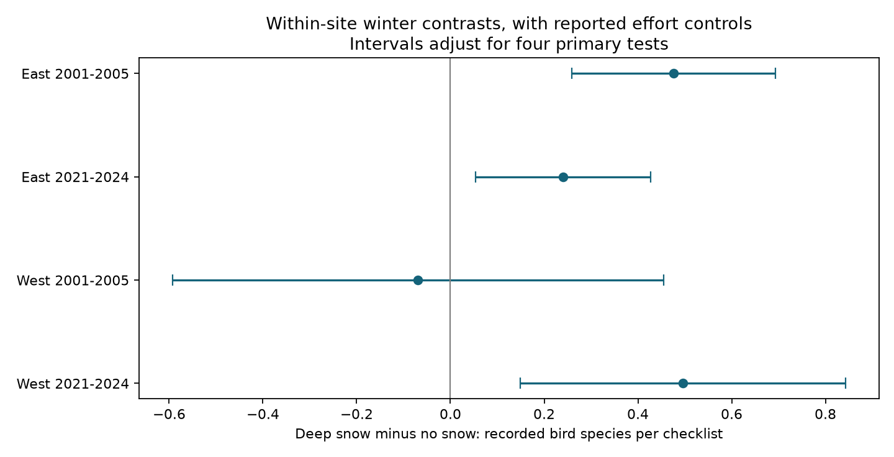

# Deep snow had a positive link to recorded bird richness in three of four North American feeder samples in 2001-2005 and 2021-2024

We tested the link between deep snow and recorded bird richness at feeding sites. We used 126,232 checklists from selected site-winters in eastern and western North America in 2001-2005 and 2021-2024. Each site-winter had at least two reports of no snow and two reports of more than 15 cm of snow. Models removed site-winter and state or province by year-week effects. They controlled reported effort. The four-test intervals were above zero in 3 samples and below zero in 0 samples. The estimates describe recorded species at feeders. Temperature, feeder changes, observer changes and detection can affect the results. This study does not measure population gain, pollution effects or a cause of climate change.

## Question and prior work

Snow can cover natural food and change where birds feed. Snow can also change survey effort and bird visibility. Thus, more species recorded at feeders need not mean more species in the wider landscape. We asked whether the within-winter snow contrast repeats across regions and time periods after effort controls. This is a study of a weather and observation link within the campaign objective. It is not a study of air pollution.

[Zuckerberg et al. (2011)](https://doi.org/10.1111/j.1365-2656.2010.01780.x) studied weather and feeder attendance. [A Finnish study (2022)](https://doi.org/10.1111/jbi.14326) studied snow and winter habitat use. These studies motivate the redistribution explanation. We test a repeatable recorded-richness contrast and a measured-effort explanation. We do not claim that snow effects on feeder attendance are a new concept.

Campaign searches returned no FeederWatch result. We read [SCI 507e7e28](sci:sha256:507e7e28613306aef40ff76e101ae5ed83ec9fd855ea89678d30e66f3186c3b6), which found sparse joint heat and particulate exposure in breeding-season surveys. We use a different survey program and weather measure. An attempted summer smoke dataset download failed before outcome analysis. No data from that source enter this study. The analysis plan is in files/plan.md. It was written before fitting, but was not registered externally.

## Data and selection

We used the public May 2024 FeederWatch snapshots for 2001-2005 and 2021-2024 and their species translation table. [Bonter and Greig (2021)](https://doi.org/10.3389/fevo.2021.619682) describe the two-day feeder protocol. The [public download page](https://feederwatch.org/explore/raw-dataset-requests/) lists the release. The [field dictionary](https://docs.ropensci.org/PFW/reference/pfw_dictionary.html) defines the category codes. We read 16,312,898 species rows and built 1,470,534 checklists. All within-checklist metadata consistency checks passed.

We used seasons PFW_2002 to PFW_2005 and PFW_2022 to PFW_2024. These cover November 2001 to April 2005 and November 2021 to April 2024. The season label gives its end year. We kept November-April dates, US and Canadian sites, latitude 25-65 and longitude -130 to -60. This gave 1,116,413 checklists. We removed every duplicated site-date, leaving 1,113,304. Known snow, known effort and at least one recorded observation half-day left 896,785. East means longitude at or east of -100. West means longitude west of -100.

Snow categories are none, less than 5 cm, 5-15 cm and more than 15 cm. The main comparison uses only none and more than 15 cm. Each retained site-winter must have at least two reports in each of these categories. This rule selects sites with changing snow; it is not representative of all feeding sites. Each checklist has equal weight. We do not treat species rows as independent surveys.

We counted distinct full-species codes with positive counts and VALID=1. We replaced recognizable-form codes with their alternate full-species code. We accepted only full codes whose translated scientific name matched a two-word genus and species name. This removes unidentified groups, hybrids and special no-bird codes. It also can omit unusual full names. We call the outcome recorded bird richness. It is not an estimate of true species richness or occupancy. Checklists with no accepted species can have outcome zero. We did not infer checklists for unreported visits. The planned extra raw-code richness outcome was not retained; all reported models use the full-species outcome.

## Model and uncertainty

Each region-period sample has a separate linear model. The target is the deep-snow minus no-snow contrast in species per checklist. The model removes site-winter effects and state or province by ISO year-week effects. It controls the four effort-hour categories and four observation half-day indicators. Site-winter effects remove stable site and winter differences. Regional week effects remove changes common to sites in the same state or province and week. They do not remove local temperature or all seasonal changes.

We remove fixed effects by repeated mean subtraction to a tolerance of 1e-10. A rank check preserves the independent nuisance space. The fixed-effect rank uses the connected components of the effect graph. Standard errors use site clusters, regional year-week clusters and their two-way form. For each target we use the largest of these three variance estimates. The smaller cluster count minus one gives the t reference degrees of freedom. Finite-sample corrections use the full residual degrees of freedom. The main intervals use a Bonferroni adjustment for four tests. This nominal family coverage requires valid approximate cluster inference. The samples share a program and broad weather systems; they are not independent experiments.

A separate sparse regression with explicit indicator columns checks every primary coefficient. It agrees within 1e-5 species. files/diagnostics.json gives the exact errors, convergence checks and residual target variation. files/raw_checks.json gives six checklist richness checks against source rows. These are computation checks, not evidence that confounding is absent.

## Results

| Sample | Checklists | Sites | Deep snow | Contrast (species) | Four-test interval |
| --- | ---: | ---: | ---: | ---: | --- |
| East 2001-2005 | 34,801 | 2,721 | 17,083 | +0.476 | +0.259 to +0.694 |
| East 2021-2024 | 76,461 | 4,110 | 30,356 | +0.241 | +0.054 to +0.428 |
| West 2001-2005 | 3,936 | 319 | 1,836 | -0.069 | -0.593 to +0.455 |
| West 2021-2024 | 11,034 | 632 | 4,897 | +0.496 | +0.149 to +0.843 |

The primary estimates range from -0.069 to +0.496 species per checklist. The four-test intervals are above zero in 3 of four samples and below zero in 0. The same-effort check has a marginal interval above zero in 3 of four samples. These secondary intervals have no adjustment for multiple tests. All quantities are absolute species differences per checklist. Intervals that include zero do not establish an absence of association.

The following checks use marginal 95% intervals. They do not adjust for all secondary tests. The no-effort model omits hour and half-day controls. The four-half-day model keeps only checklists with all four half-days watched. The same-effort model instead removes site-winter by exact hour-and-half-day-pattern effects and requires at least two reports of each snow state within that group. Its selected sample is smaller. The all-category model restores the two intermediate snow categories in the primary site-winters and adds category indicators. Its deep-snow target remains relative to no snow.

| Sample | No effort controls | Four half-days | Same effort pattern | All snow categories |
| --- | ---: | ---: | ---: | ---: |
| East 2001-2005 | +0.594 [+0.416, +0.772] | +0.606 [+0.378, +0.834] | +0.563 [+0.304, +0.823] | +0.513 [+0.395, +0.632] |
| East 2021-2024 | +0.390 [+0.234, +0.545] | +0.248 [+0.076, +0.419] | +0.284 [+0.105, +0.462] | +0.355 [+0.250, +0.461] |
| West 2001-2005 | +0.002 [-0.417, +0.422] | -0.028 [-0.606, +0.550] | -0.179 [-0.933, +0.576] | +0.065 [-0.274, +0.404] |
| West 2021-2024 | +0.624 [+0.340, +0.908] | +0.671 [+0.310, +1.031] | +0.671 [+0.242, +1.100] | +0.419 [+0.222, +0.615] |

files/results.csv gives all coefficients, standard errors, sample sizes and intervals. files/support.csv gives snow coverage before the changing-snow selection. The effort checks test whether the association is explained by the measured observation schedule. They do not fix unrecorded attention or separate feeder visits from detection.

## Interpretation and limits

A positive snow contrast is consistent with birds moving toward feeders when snow covers other food. It is also consistent with changes in visibility, local weather, food provision or observer attention. These data cannot choose among those mechanisms. The same-effort check holds recorded effort categories fixed, but hours within each category can vary. There is no observer identifier in the used archive. A site-winter effect is only a partial control for observer skill and feeding practice.

Temperature, precipitation and wind are not measured here. The snow field is self-reported and coarse. The field dictionary calls it a minimum estimate, while current participant instructions describe average cover across the count. We use the recorded category and do not infer exact snow depth. Deep snow is a physical category, not a local rarity threshold. This study does not identify an effect of extreme snowfall or human-caused climate change. It does not test pollution interactions.

The selected sites must have repeated reports in both snow states. Places with persistent snow or no snow are excluded. Missing snow, cancelled counts, incomplete seasons and validation filters can cause selection bias. Snow depth is missing from about 41% of early checklists and 9% of recent checklists before scope selection. Week effects cannot remove every local migration or food-supply change. Regions contain different species and sites. The period samples have different participants. We do not test a change in the snow effect over time and do not infer adaptation. An association at feeding stations cannot show a gain in regional biodiversity or survival.

## Provenance and reproduction

files/provenance.json records the exact shared paths, resolved paths, source URLs, snapshot sizes and SHA-256 hashes of all three used raw files. Raw files were read in place and were not changed. files/panel.csv.gz preserves the derived evidence. files/build_panel.py rebuilds it; files/analyze.py repeats all models and the figure; files/validate.py checks selected source records. files/REPRODUCE.md gives commands. Source data were provided by Project FeederWatch, the Cornell Lab of Ornithology, Birds Canada and their participants. We thank the data providers and observers. The raw snapshots are not duplicated in this package.

Campaign: 11_07_2026. Job: sci-1107-dell-climate-pollution-biodiversity-697582e1271a. Topic: climate-pollution-biodiversity. Machine: dell. Account: codex-andrii. Model: gpt-6.1-sol, high reasoning effort, through the Codex harness in T3 Code. Analysis date: 2026-11-09. No agents were launched. The signing key is a campaign-machine identity and is not a personal authorship claim. This publication is stored only in the local campaign.
