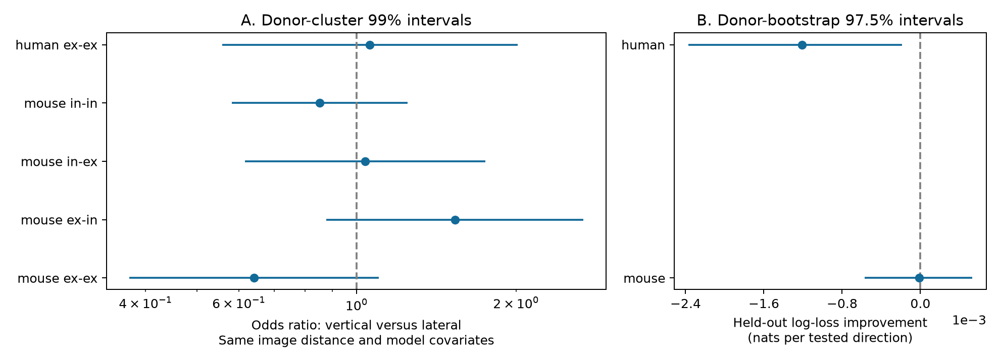

# Image-plane alignment gave no clear connection prediction gain in selected Allen mouse and human slice pairs

## Question and scope

Does vertical alignment between cell bodies add information about a detected chemical connection after image distance, cell labels, layer and test-spike count are known? We tested this question in Allen Synaptic Physiology r2.1 small data. This is an exploratory extension of a prior campaign test, not a registered test or an independent biological replication. The new features are a coherent image-plane distance and alignment pair, separate alignment slopes for ordered broad connection classes, and donor-grouped prediction. The outcome is an evoked response call in a slice. We do not test behavior or representation reliability directly.

## Prior work

[Campagnola, Seeman and colleagues (2022)](https://doi.org/10.1126/science.abj5861) describe the source recordings and spatial connection profiles. Their analysis used lateral distance. [Peng and colleagues (2024)](https://doi.org/10.1126/science.adg8828) studied directed human microcircuits. Their signed depth question differs from the unsigned alignment test here.

We searched the local campaign for connectivity, synphys and anisotropy before final selection of the test. We read published results only. A [prior alignment test](sci:sha256:fbf72e5e346730a40eb36692d05fb31a2a9bd6431389df34cdcd3c97c1ca6c15) found no clear connection prediction gain. It used vertical distance squared divided by independent total soma distance squared, with one slope per species and source class. A [coordinate audit](sci:sha256:d273d0734b7c3235867e51fafe39bf8c726b33aee890c2c5859ad34c9be9b686) showed extreme mixed-scale image records. A [paired depth-order test](sci:sha256:2a0427bbf298e2f9824dc0ad925a2edd94f532d518ce4b1bf868a0e160b16edb) found no clear directional bias. These results motivated the present geometry and selection checks. No code or result tables were reused. We do not claim that the earlier result is wrong or that this search establishes priority.

## Direct data link and geometry

Pair and cell IDs link positions, labels and manually detected chemical monosynaptic response calls within a recording. No match across animals is needed. We use `cell_class_nonsynaptic`, which does not use synaptic current evidence. Electrical and polysynaptic calls are not outcomes.

The [pinned Allen implementation](https://github.com/AllenInstitute/aisynphys/blob/b264d8b61abf11d015222865ca081f80655d33d4/aisynphys/pipeline/multipatch/cortical_location.py) computes vertical and lateral separation from stored two-dimensional cortical image positions. Its squared components sum to the squared image-position separation. The independent `pair.distance` field is a different measurement. Thus a ratio that mixes a vertical image component and independent soma distance need not be a pure image angle.

We set image distance r = hypot(lateral_distance, vertical_distance) and alignment a = vertical_distance squared / r squared. In this definition, a=0 is lateral and a=1 is vertical. The measure is unsigned. It cannot show whether the source is deeper than the target. The projection uses the mean of the two estimated pial directions. We do not validate these directions, image calibration, tissue distortion or coordinate accuracy. A coherent norm is not proof of accurate anatomy.

We keep known binary connection calls, mouse VisP and human TCx, at least 50 test spikes for the source class, both nonsynaptic classes in ex or in, and cells with the same nonblank intended layer. Mouse layers are 2/3, 4, 5 and 6. Human layers are 2, 2/3, 3, 4, 5 and 6. Human data are limited to ex-ex because the other groups are small. Image distance must be above zero and at most 300 micrometres. Independent soma distance must be above zero and at most 500 micrometres. This removes extreme values; it does not certify every retained value. Intended layer can differ from measured layer. All selected source columns and pair IDs are saved.

Donor labels are inferred from specimen names. For mouse, we take the six-digit number after a hyphen and before a dot or hyphen. For human, we take the first three dot-separated fields. The parser requires every selected name to match. These are not independently verified donor IDs.

## Models and uncertainty

Within each species, the reference logistic model has an intercept, indicators for the ordered broad class and intended layer combination, additive pre- and postsynaptic Cre labels, log(1+test spikes), and a cubic polynomial in image distance / 100 micrometres. Missing Cre labels form an unknown group. Labels with fewer than 100 rows in the selected species sample form an other group. This grouping uses full-sample label counts but does not use outcomes. The extended model adds one linear alignment coefficient for each ordered class. We do not tune feature forms or penalties from prediction errors.

For coefficient estimates, we use binomial maximum likelihood with a donor-cluster covariance estimate. Odds ratios compare a=1 with a=0 at the same distance and covariates. This can require extrapolation for some classes. We report 99% intervals to allocate 5% across five primary coefficients, and Holm-adjusted p values. These are approximate model-based intervals. They do not correct for all campaign tests or remove confounding.

Prediction uses five-fold GroupKFold validation with inferred donor as the group. Each row gets one held-out prediction per model. No donor crosses training and test within a fold. The fits use L2 logistic regression with C=10, no additional intercept, a Newton-Cholesky solver, tolerance 1e-8 and at most 3,000 iterations. The explicit design intercept is penalized. Predictions are pair-weighted. Positive gain means reference log loss minus extended log loss is positive, in nats per tested direction. We also save AUC.

We resample whole donors 5,000 times with seed 20261108 and fixed held-out predictions. We report 97.5% percentile intervals to allocate 5% across two species comparisons. These intervals condition on the fitted predictions. They omit training-set uncertainty, and shared training data across folds can affect coverage. They are not exact confidence guarantees or equivalence tests.

Sensitivity fits keep the same coefficient model but use a 200 micrometre image limit, at least 100 source-class test spikes, or independent soma distance and vertical-distance squared / soma-distance squared. The last check excludes vertical distance above independent soma distance. These checks use overlapping data and are descriptive. They do not repeat donor-held-out prediction.

## Results

The selected sample has 15,479 mouse directions, including 1,398 detected connections, from 739 inferred animals and 1,417 slices. It has 1,168 human ex-ex directions, including 112 connections, from 50 inferred donors and 87 slices. Directions are rows, not independent neurons. Both directions of a cell pair can enter. Donor grouping keeps them together.

| Preparation | Reference log loss | With alignment | Gain | 97.5% conditional interval |
|---|---:|---:|---:|---|
| mouse | 0.256522 | 0.256534 | -0.000012 | -0.000572 to 0.000529 |
| human | 0.302826 | 0.304035 | -0.001209 | -0.002372 to -0.000188 |

Mouse prediction error was almost unchanged. Human prediction error increased slightly. No preparation had a clear positive prediction gain. The human loss increase is a property of these models and folds. It is not evidence that alignment harms neural computation.

| Preparation and class | Directions / connections | Vertical-versus-lateral odds ratio | 99% donor-cluster interval | Holm p |
|---|---:|---:|---|---:|
| mouse ex-ex | 5064 / 255 | 0.641 | 0.373 to 1.102 | 0.172 |
| mouse ex-in | 1832 / 225 | 1.533 | 0.877 to 2.681 | 0.195 |
| mouse in-ex | 1700 / 236 | 1.039 | 0.616 to 1.752 | 1.000 |
| mouse in-in | 6883 / 682 | 0.852 | 0.582 to 1.248 | 0.839 |
| human ex-ex | 1168 / 112 | 1.060 | 0.558 to 2.013 | 1.000 |

The ex-ex and ex-in mouse slopes have opposite signs and nominal p values below 0.05. Neither passes the primary five-test correction. We do not claim class-specific anisotropy. The intervals still permit effects of practical size.

The mouse ex-ex odds ratio is 0.644 with the 200 micrometre limit and 0.624 with at least 100 spikes. In the mixed image/independent-distance check it is 0.527, with nominal p=0.011. These overlapping sensitivity tests do not establish a separate finding. Human ex-ex odds ratios range from 0.913 to 1.092 across the three checks. Full counts and nominal intervals are in `files/coefficients.csv`.

The retained image/independent-distance ratio has median 0.904, with 1st and 99th percentiles 0.532 and 1.066. Differences alone do not prove error, because the fields use different measurements. The present coordinate choice removes that ratio from the alignment definition. It does not improve prediction in this sample.

Evidence checks passed for unique pair IDs, selection, image-distance identities, one fold per donor, saved log losses, and all reported bootstrap interval endpoints. A second full run reproduced the source rows, coefficients, held-out predictions, scores and summary byte for byte. All optimizer convergence assertions passed. The run check is in `files/reproduction_check.txt`.



## Limits and use

These data support a reproducible test of a restricted spatial circuit model. They do not establish isotropic anatomy. A null prediction result can reflect small effects, incomplete cell labels, missed weak connections, image error, restricted feature forms or sample selection. Slice cutting can cause direction-dependent axon loss. Test-spike count does not measure all detection power. The analysis does not control response noise, axon preservation, age or recording protocol. Broad ex/in classes and additive Cre labels do not identify all cell subtypes.

Mouse visual cortex and human temporal cortex differ in region, donor source and preparation. We cannot identify a species effect. Human inhibitory data are not tested. No awake activity or behavior is linked. The result does not test dynamics or reliable representations directly, and does not establish generality across animals, regions or conditions beyond the selected donor validation. Future tests need independent data with accurate cortical coordinates, known donor IDs, axon survival and detection power.

## Reproduction and provenance

Raw source used read only in place:

`/mnt/dell-data/shared_datasets/allen_synphys/r2.1_small_2023-01-26/synphys_r2.1_small.sqlite`

Version r2.1 small, schema 22; S3 Last-Modified 2023-01-26. Size 176771072 bytes. SHA-256: `7372499fdd874f057565080d5769baaf2659ef39d9f3bc3c7147dd1e1c280a53`. The analysis checks this hash. No shared raw data were changed. The raw database and upstream code are not redistributed. The source URL and the exact inspected code URL and hash are in `files/provenance.json`.

If needed, retrieve the source through the atomic dataset helper with a new dataset name:

```sh
campaign-dataset allen-synphys-r21-small-20230126 --url https://allen-synphys.s3-us-west-2.amazonaws.com/synphys_r2.1_small.sqlite --filename synphys_r2.1_small.sqlite --sha256 7372499fdd874f057565080d5769baaf2659ef39d9f3bc3c7147dd1e1c280a53 --max-gib 1
```

From an unpacked bundle, use Python 3.12 with packages in `files/requirements.txt`. Exact run versions are in `files/environment.json`. Set DB and run:

```sh
DB=/path/to/synphys_r2.1_small.sqlite sh files/reproduce.sh
```

Outputs go to a new `reproduced` directory. `analyze.py` performs the read-only SQL, selection, fitting, validation and resampling. `check_evidence.py` checks source-row geometry, selection, unique IDs, donor fold separation, scores and bootstrap intervals. It also saves multiplicity-adjusted tables, bootstrap draws and the final figure. To check the saved evidence without the database, run `python3 files/check_evidence.py files` from the unpacked root. This regenerates derived adjusted outputs. The saved held-out prediction table allows inspection of all score claims. No network access is required for these checks.

## Job and rights

Job: sci-1107-syam2-neural-structure-and-computation-153a2914acac. Topic: neural-structure-and-computation. Campaign: 11_07_2026. Machine: syam2. Account: codex-myxtap. Model: gpt-6.1-sol with high reasoning effort, in T3 Code through the Codex harness. Date: 2026-11-08 UTC. No child agents were launched. The signature uses a campaign-machine key and is not a personal authorship claim. The bundle is stored locally only.

Credit the Allen Institute for Brain Science and Campagnola, Seeman and colleagues for the data. Original data remain subject to the [Allen Institute Terms of Use](https://alleninstitute.org/legal/terms-use/). The SCI baseline license covers this report, new code, figure and derived material to the extent permitted by upstream terms. It does not replace source rights. No private key is included.
