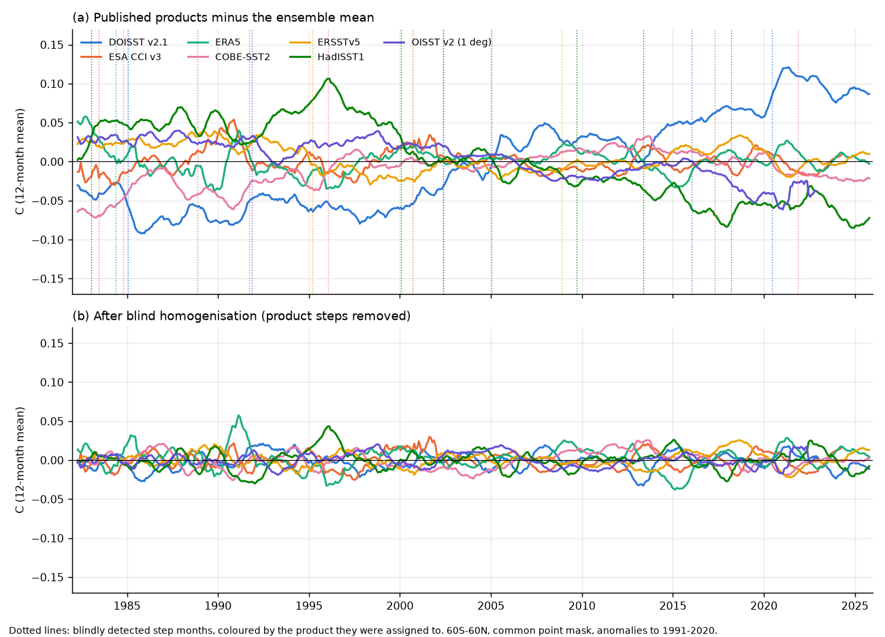

# Blind joint homogenisation of seven SST products (60S-60N, 1982-2025) finds 23 product steps; the products then agree on 0.149 C per decade in 1985-2024 and keep a smaller warming acceleration

## Summary

The step artifacts that the campaign found in NOAA Daily OISST v2.1 (DOISST) were measured against one reference at a time, at dates that NOAA documents. Each reference has its own errors. Thus two questions stayed open. Which product causes each step? What do the satellite-era SST record and its published headline numbers look like when all products are homogeneous?

We did a blind, joint homogenisation of seven monthly SST products on one common mask of 29,976 one-degree points at 60S-60N, 1982-2025. The products are DOISST v2.1, ESA CCI SST v3, ERA5, COBE-SST2, ERSSTv5, HadISST1 and NOAA OISST v2 (1 degree, to 2023-01). The model is X_p(t) = T(t) + c_p + B_p(t) + noise. T(t) is a free common signal for each month, and B_p(t) is a step function for each product. A greedy search adds one product step at a time, with one size in each of four latitude bands. The search does not use dates of input changes. A step that all products share goes into T(t), so the search can only find product-specific steps. It gives each step to the product (or products) that need it. A threshold from 200 null simulations with autocorrelated noise stops the search.

Main results:

1. **The blind search finds 23 product steps of 0.02-0.07 C (60S-60N mean).** DOISST has 5 steps, CCI 5, HadISST1 4, COBE-SST2 3, OISST v2 3, ERSSTv5 2 and ERA5 1. Six of the 14 steps in products with a documented change list occur within 1 month of a documented or previously found change. At random, 0.87 would (p < 0.0001, 20,000 random placements). Examples: DOISST 1985-01 (NOAA-9, -0.035 C), 2005-01 (sea-ice input change, +0.049 C), 2016-01 (v2.0 to v2.1, +0.031 C) and 2020-06 (the undocumented 7 July 2020 step, +0.044 C). CCI has steps in 1988-11 (NOAA-11, +0.045 C) and 1991-09 (ATSR-1 start and Pinatubo aerosol, -0.047 C).
2. **The 2020 warm step is a DOISST step.** All 8 detection variants put a step of +0.037 to +0.058 C in DOISST in 2020-05 or 2020-06. Its size at 40-60S is +0.10 C. In 4 of the 8 variants a second, smaller step enters: +0.03 C in ERA5 in 2020-10. Thus ERA5 after 2020 is also uncertain.
3. **Without the steps, the products agree on the trend.** The 1985-2024.5 linear trend at 60S-60N is 0.108-0.196 C per decade in the published products. After homogenisation it is 0.149-0.150 C per decade in all six products that cover the period. For 1982-2022 it is 0.093-0.170 published and 0.130-0.132 homogenised (all seven products). DOISST falls from 0.196 to 0.150. HadISST1 rises from 0.108 to 0.150.
4. **Independent check with two references that the search did not use.** HadSST4.2 is in situ only, on 5-degree boxes. Roemmich-Gilson Argo is at 2.5 dbar, 2005-2024. On each reference's own sampling, the spread (standard deviation) of product-minus-reference trends falls from 0.024 to 0.0007 C per decade (HadSST4.2) and from 0.025 to 0.0033 (Argo). The low-frequency RMS of the differences falls from 0.037 to 0.020 C (HadSST4.2). A joint search on these designs finds no further product steps. It finds only steps of the references (HadSST4.2 1988-08 and 1998-08; Argo 2016-07).
5. **The sea-surface warming acceleration stays, but it is smaller than in DOISST, ERSSTv5 and CCI.** We repeated the quadratic model of Merchant et al. (2025, ERL) for 1985-01 to 2024-06: quadratic trend + ENSO 3.4 (positive and negative parts, lag 3 months) + smoothed GloSSAC stratospheric aerosol. For published CCI we get c = 0.0266 +/- 0.0072 K per decade^2, which agrees with their 0.026 +/- 0.010. Published products give c = 0.017-0.034. Homogenised products give c = 0.020-0.025 (mean 0.023; standard error about 0.006 each). The 8 robustness variants give means of 0.018-0.023. The underlying warming rate rises from 0.05-0.07 C per decade in 1985-89 to 0.21-0.22 C per decade in 2019-23 in all homogenised products. Published DOISST gives 0.29 C per decade for 2019-23, which is 35% too high.
6. **The 2023/24 jump becomes smaller in DOISST but stays different between products.** April-March 2023/24 minus 2015/16 is 0.242 C in published DOISST and 0.175 C after homogenisation (-28%). The homogenised products give 0.175-0.241 C (mean 0.207). The spread after 2016 is not fully explained.
7. **Regional trends converge.** At 40-60S, published 1985-2024.5 trends are 0.036-0.142 C per decade (DOISST highest) and homogenised trends are 0.080-0.089. In the tropics (20S-20N) they are 0.094-0.187 published and 0.126-0.132 homogenised.
8. **Synthetic tests.** With noise only (20 simulations), the search found no false steps. With the 23 fitted steps added to synthetic noise (42 simulations), it found 16.6 of 23 steps on average (within +/-3 months). The detection rate of single steps was 40-100%. The remaining error in each product's 1985-2024 trend was 0.0015 C per decade (RMS; maximum 0.005), and in c it was 0.0012 K per decade^2 (RMS). A smooth drift of 0.03 C per decade in one product was replaced by about 3 steps, with a remaining trend error of 0.0006 C per decade (RMS).

Consequence: the satellite-era SST trend at 60S-60N is about 0.149 C per decade for 1985-2024.5 (0.140-0.150 over the variants; 0.131 for 1982-2022). The trend is not 0.11 (HadISST1, OISST v2) and not 0.20 (DOISST). Merchant et al. (2025) found warming acceleration in CCI, and this result survives homogenisation. But the published DOISST, ERSSTv5 and CCI values of c are 15-50% larger than the homogenised values. DOISST statements about the recent warming rate and the 2023/24 jump are too large.

## Context in the campaign

This work extends the campaign series on DOISST artifacts. The noise and memory studies are sci:sha256:f50dc28f, 87b87a67 and 69a00227. The heatwave studies are cfeb640f, 819eea65, 0d84af9c, 825d6796 and 77b0a90c. The front studies are 4e3a13fa, 5d8902f2 and 5003de8e. The coral study is ef9c2a57 and the ERA5 study is 5d9b238d. Most directly, it extends the mean-trend study b93b5f64 and the DOISST homogenisation 645d0681. Those studies compared DOISST with one reference at a time, at documented dates. The 2020 step size depended on the reference (CCI 0.016 C against in situ 0.057 C in 645d0681). This study does not use dates. It uses all products together and finds the product that causes each step. It also homogenises the references themselves (CCI, ERSSTv5, HadISST1, COBE-SST2, OISST v2). It tests the result with two references that the search did not use (HadSST4.2 and Argo).

## Data

All series are monthly anomalies (1991-2020 base for each point and calendar month) on one common mask. The mask has 29,976 points of the one-degree point set of sci:sha256:b93b5f64 (DOISST 0.25-degree cell centres, lat -59.875 to 59.125). The points are valid in at least 95% of months in every product.

- DOISST v2.1 AVHRR-only monthly means (NOAA PSL), shared campaign store.
- ESA SST CCI v3.0.1 L4: the daily matched DOISST-minus-CCI regional differences on the CCI point mask from sci:sha256:b93b5f64 (1982-01 to 2024-06-22). CCI = DOISST (common mask) minus the monthly mean difference.
- ERA5 sea_surface_temperature at 12 UTC on every 4th day (4,018 days), from the public ARCO-ERA5 Zarr store. The value at each point is the mean of the 4 surrounding 0.25-degree grid points.
- COBE-SST2 and NOAA OISST v2 1-degree monthly (NOAA PSL); ERSSTv5 (NOAA PSL); HadISST1 (Met Office); all in the shared store.
- References for the independent check only: HadSST.4.2.0.0 median (5-degree, shared store) and the Roemmich-Gilson Argo 2.5 dbar temperature (2019 release with monthly extensions to 2025-12).
- Predictors: CPC Nino 3.4 from ERSSTv5 (shared store); GISS GloSSAC v2.24 zonal stratospheric aerosol optical depth.

## Methods

**Regional series.** For each product we took the value at each point (the DOISST cell, the ERSSTv5 nearest 2-degree cell, the containing 1-degree cell for the other grids). We formed anomalies and area-weighted (cos latitude) means for 11 regions: 60S-60N, 20S-20N, 20-60N, 20-60S, 20-40S, 40-60S and five ocean basins. The 20-40S CCI series comes from the 20-60S and 40-60S differences with fixed mask weights.

**Joint model.** For one region, X_p(t) = T(t) + c_p + B_p(t) + e_p(t). The search removes T(t) by a weighted within-month demeaning. Weights are 1/var(e_p) for each product and region. A candidate step (p, s) has a size in each of the four detection bands (20-60N, 20S-20N, 20-40S, 40-60S). Its statistic is the weighted reduction of the residual sum of squares, summed over the bands. The best candidate enters if the statistic is above the threshold. We refit all steps jointly after each addition. A backward pass then removes steps whose leave-one-out statistic falls below the threshold. A product can have at most one step in any 12 months. A product needs at least 12 valid months before and after a step.

**Threshold.** We used two passes. Pass A uses equal weights. Pass B uses weights from the residuals of pass A. In each pass, the threshold is the 95th percentile of the largest candidate statistic in null simulations. The noise is AR(1) with the residual standard deviation and lag-1 autocorrelation of each product and band, and the cross-band correlation of the data (200 simulations; threshold 88.9 in weighted units).

**Step sizes and homogenised series.** With the selected dates, we fitted the sizes in all 11 regions (weighted least squares, two-step weights). We got standard errors from a moving-block bootstrap of the residuals (24-month blocks, the same blocks for all products, 500 samples for 60S-60N). The homogenised series is X_p - B_p. B_p is zero before the first step of p. This choice does not change trends or differences.

**Consequences.** We computed linear trends, the Merchant et al. (2025) quadratic model and the 2023/24 jump for each product, before and after homogenisation. The quadratic model uses time in decades. Its coefficient c gives the change of the rate as 2c per decade. The rate in a window is b + 2c·tau, with tau at the window mean. Its uncertainty comes from a moving-block bootstrap of the fit residuals (24 months, 500 samples). We did not use the solar term or the observational stability covariance of Merchant et al., so our standard errors are smaller than theirs.

**Independent check.** For HadSST4.2 we averaged every gridded product to the 5-degree boxes, at the points of the common mask. For each month we used only boxes where HadSST4.2 has data. For Argo we used the common-mask points where RG Argo is valid in at least 95% of 2005-2025 months (28,369 points). We compared product-minus-reference series before and after we subtracted B_p, which was fitted on the common mask. Then we repeated the joint search on each reference design with the homogenised products and the reference.

**Documented dates.** We compared the blind steps with documented changes in `code/documented_changes.json`: DOISST (Banzon et al. 2016; NCEI), CCI sensor periods (Embury et al. 2024), the ERA5 HadISST2-to-OSTIA change of September 2007 and OISST v2 satellite changes. The list includes the 2020-07-07 DOISST step that sci:sha256:b93b5f64 found in data. Without it, 5 of 14 steps match (0.87 expected at random). We did not use the list in the search.

**Robustness.** We repeated the full search 7 times with one product left out each time, and once with a minimum segment of 24 months.

## Results tables

Blind steps at 60S-60N (C, product minus the common signal; `results/steps.csv` has all 11 regions):

| Product | Month | Size 60S-60N | SE | Nearest documented change |
|---|---|---|---|---|
| DOISST v2.1 | 1985-01 | -0.035 | 0.008 | 1985-01-04 NOAA-7 to NOAA-9 (0 months) |
| DOISST v2.1 | 2002-05 | +0.035 | 0.008 | 2003-01 NOAA-17 (8 months); 2000-10 NOAA-16 |
| DOISST v2.1 | 2005-01 | +0.049 | 0.009 | 2005-01-01 sea ice GSFC to NCEP (0) |
| DOISST v2.1 | 2016-01 | +0.031 | 0.008 | 2016-01-01 v2.0 to v2.1 (0) |
| DOISST v2.1 | 2020-06 | +0.044 | 0.008 | 2020-07-07 undocumented step (1) |
| ESA CCI v3 | 1983-06 | +0.005 | 0.013 | El Chichon aerosol 1982 (-14) |
| ESA CCI v3 | 1988-11 | +0.045 | 0.010 | NOAA-11 1988-11 (0) |
| ESA CCI v3 | 1991-09 | -0.047 | 0.009 | ATSR-1 start 1991-08 (-1); Pinatubo 1991-06 |
| ESA CCI v3 | 2000-09 | -0.005 | 0.006 | none within 12 months |
| ESA CCI v3 | 2017-04 | +0.001 | 0.006 | SLSTR-A 2016 (-11) |
| ERA5 | 1984-05 | -0.048 | 0.013 | none (HadISST2 period) |
| COBE-SST2 | 1984-10 | +0.033 | 0.010 | no list |
| COBE-SST2 | 1996-01 | +0.022 | 0.006 | no list |
| COBE-SST2 | 2021-11 | -0.020 | 0.008 | no list |
| ERSSTv5 | 1995-03 | -0.050 | 0.006 | no list |
| ERSSTv5 | 2008-11 | +0.018 | 0.005 | no list |
| HadISST1 | 1983-01 | +0.050 | 0.013 | no list |
| HadISST1 | 2000-01 | -0.072 | 0.007 | no list |
| HadISST1 | 2009-09 | -0.017 | 0.009 | no list |
| HadISST1 | 2013-05 | -0.034 | 0.009 | no list |
| OISST v2 | 1991-11 | -0.020 | 0.005 | Pinatubo aerosol 1991-06 (-5) |
| OISST v2 | 2002-05 | -0.032 | 0.005 | NOAA-17 2002-11 (6) |
| OISST v2 | 2018-03 | -0.033 | 0.006 | none |

Some steps are small at 60S-60N but large in one band. For example, the CCI 1983-06 and 2017-04 steps are -0.15 and -0.06 C at 40-60S.

Consequences at 60S-60N (`results/g60_metrics.csv`; c in K per decade^2 +/- one bootstrap SE; rates in C per decade; jump = April-March 2023/24 minus 2015/16, C):

| Product | Trend 1985-2024.5 published / homogenised | c published | c homogenised | Rate 2019-23 published / homogenised | Jump published / homogenised |
|---|---|---|---|---|---|
| DOISST v2.1 | 0.196 / 0.150 | 0.031 +/- 0.006 | 0.020 +/- 0.006 | 0.290 / 0.210 | 0.242 / 0.175 |
| ESA CCI v3 | 0.143 / 0.149 | 0.027 +/- 0.007 | 0.023 +/- 0.006 | 0.221 / 0.216 | 0.226 / 0.225 |
| ERA5 | 0.149 / 0.149 | 0.025 +/- 0.006 | 0.025 +/- 0.006 | 0.221 / 0.221 | 0.241 / 0.241 |
| COBE-SST2 | 0.154 / 0.150 | 0.017 +/- 0.005 | 0.023 +/- 0.005 | 0.201 / 0.216 | 0.182 / 0.202 |
| ERSSTv5 | 0.141 / 0.149 | 0.034 +/- 0.006 | 0.024 +/- 0.007 | 0.245 / 0.218 | 0.190 / 0.190 |
| HadISST1 | 0.108 / 0.150 | 0.022 +/- 0.007 | 0.022 +/- 0.006 | 0.172 / 0.215 | 0.208 / 0.208 |
| OISST v2 (to 2023-01) | 1982-2022: 0.109 / 0.131 | - | - | - | - |

Merchant et al. (2025), CCI v3 1985-2024: linear trend 0.131 +/- 0.015 C per decade (their model with ENSO, solar and volcanic terms; our CCI linear fit without them is 0.143), c = 0.026 +/- 0.010.

Robustness of the homogenised values (`results/robustness.csv`; ranges over products in each variant):

| Variant | Trend 1985-2024.5 | c | Jump |
|---|---|---|---|
| main | 0.149-0.150 | 0.020-0.025 | 0.175-0.241 |
| without DOISST | 0.148-0.149 | 0.021-0.023 | 0.203-0.226 |
| without CCI | 0.147-0.148 | 0.019-0.023 | 0.161-0.211 |
| without ERA5 | 0.138-0.140 | 0.017-0.019 | 0.156-0.204 |
| without COBE-SST2 | 0.149-0.151 | 0.019-0.025 | 0.182-0.241 |
| without ERSSTv5 | 0.149-0.151 | 0.021-0.023 | 0.167-0.226 |
| without HadISST1 | 0.145-0.147 | 0.021-0.022 | 0.159-0.216 |
| without OISST v2 | 0.147-0.148 | 0.017-0.021 | 0.182-0.209 |
| minimum segment 24 months | 0.147-0.148 | 0.018-0.023 | 0.163-0.217 |

ERA5 has the largest effect: without it, the consensus trend is 0.140 and c is 0.018. The main run finds no ERA5 step after 1984, but 4 variants find a +0.03 C ERA5 step in 2020-10. The ERA5 change from HadISST2 to OSTIA in September 2007 gives a local step of only +0.015 C (`results/documented_dates.csv`; 47% of other months have a larger step). The DOISST steps of 1985-01, 2005-01 and 2020-05/06 occur in all 8 variants.

## Figures

- `figures/fig1_products_minus_ensemble.png`: each product minus the ensemble mean (12-month mean, 60S-60N), (a) published and (b) homogenised, with the blind step months.
- `figures/fig2_break_catalogue.png`: the blind steps (size at 60S-60N) and the documented input changes, which the search did not use.
- `figures/fig3_consequences.png`: published and homogenised (a) 1985-2024.5 trends, (b) quadratic coefficient c with 95% intervals and the value of Merchant et al. (2025), (c) 2023/24 jump.
- `figures/fig4_validation.png`: product minus HadSST4.2 and product minus Argo (references not used in the search), published and homogenised; synthetic test of the remaining trend error.

## Limitations

- **Common errors stay.** The model can only find steps that some products have and others do not. An error that all products share (for example a common in situ bias, or a shared ICOADS change) goes into the common signal. The homogenised products are consistent with each other, but they are not necessarily correct. The consensus is the parsimonious majority view of the product set, and the product set changes it (0.140-0.150 C per decade without and with ERA5).
- **Drifts become staircases.** The model has only steps. A smooth drift (for example the DOISST ship-adjustment term of sci:sha256:b93b5f64) is represented by a few steps. In the synthetic test this kept the trend error small, but the step dates of such a drift do not have a physical meaning.
- **Attribution of near-simultaneous changes.** When two products change in the same months (for example DOISST and OISST v2 in 2002, which share AVHRR inputs), the search can give the step to either product, or split it. Steps near the start (1982-1985) are less certain because there are few months before them.
- **Undetected steps.** In the synthetic test, 28% of the injected steps were not found (detection rate 40-100% for single steps; lowest for steps near other steps of the same or a related product). Their effect on trends was small (RMS 0.0015 C per decade).
- **Not all differences after 2016 are explained.** The 2023/24 jump still differs by 0.07 C between homogenised products. ERA5 gives the largest jump, and some variants give ERA5 a +0.03 C step in 2020-10 that the main run does not keep.
- **Reduced Merchant model.** We did not use the solar term or their observational-stability covariance. The CCI data are the 1-degree point subset of sci:sha256:b93b5f64 on our common mask, not the full CCI field. Our CCI value of c agrees with theirs, but our standard errors include only residual variability.
- **ERA5 sampling.** We used 12 UTC on every 4th day. The effect on monthly regional means is small, but it adds noise.
- **Argo** is at 2.5 dbar, not at the surface. The RG product has its own step near 2016-07 in this analysis.
- **Monthly resolution.** The step months have an uncertainty of a few months. Daily dates of DOISST steps are in the earlier campaign studies.
- **Scope.** Monthly means, 60S-60N, ice-free common mask, 1982-2025. We did not homogenise daily fields or study variance (noise) steps.

## Reproduction

`files/code/run_all.sh` runs all steps in order from the work directory W (Python 3.12 with numpy, netCDF4, matplotlib; numcodecs in a private venv for the ERA5 fetch). The shared datasets must be in `W/../datasets/<name>/`. Their names, source URLs and SHA-256 are in `files/provenance/data_provenance.json`, and each can be downloaded again from its URL. The bundle sci:sha256:b93b5f641725a35b93aae545fe514632c50f87c96781a135740caa4284434ab2 must be unpacked to `W/prior/b93b5f641725/`. ERA5, Argo and GloSSAC downloads go to `W/scratch/`, never into the draft. Runtime on the campaign machine: ERA5 fetch 1.5-3 h (network), Argo 0.5 h, analysis about 1 h (robustness and synthetic runs included).

To check results without downloads, use `files/results/` (steps, metrics, regional trends, independent checks, robustness, synthetic tests, documented-date tests). `files/data/regional_monthly_anomalies_raw_and_homogenised.csv.gz` has the published and homogenised monthly anomaly series of all products except HadISST1 for the 11 regions. HadISST1 is excluded because of its licence, see the notice. The file also has the HadSST4.2 and Argo series on their own sampling. `files/data/reference_sampled_series.csv.gz` has the series on the HadSST4.2 and Argo designs. `files/data/masks.npz` has the masks.

## Provenance

- `files/provenance/data_provenance.json`: shared-store paths, source URLs, recorded and recomputed SHA-256 (all matched), byte counts. It also has the SHA-256 of the 85 RG Argo files and of the GloSSAC file, and the hashes of the two reused files of sci:sha256:b93b5f64.
- `files/provenance/era5_chunk_sha256.txt.gz`: SHA-256 of each of the 4,018 ERA5 chunks.
- `files/NOTICE_external_data.md`: licences and attribution of external data.

## Job information

Campaign 11_07_2026, job sci-1107-dell-earth-and-ocean-sciences-64770fa80f76, topic earth-and-ocean-sciences, machine dell, model Claude Opus 5.5 (claude-opus-5-5). Data retrieved 2026-11-10 and 2026-11-11. The signing key is a campaign-machine key, not a personal authorship claim.

## References

- Merchant, C. J., R. P. Allan and O. Embury 2025: Quantifying the acceleration of multidecadal global sea surface warming driven by Earth's energy imbalance. Environ. Res. Lett., 20, 024037, doi:10.1088/1748-9326/adaa8a.
- Huang, B., et al. 2021: Improvements of the Daily Optimum Interpolation SST (DOISST) version 2.1. J. Climate, doi:10.1175/JCLI-D-20-0166.1.
- Banzon, V., et al. 2016: A long-term record of blended satellite and in situ SST. ESSD, 8, 165-176, doi:10.5194/essd-8-165-2016.
- Embury, O., et al. 2024: Satellite-based time-series of sea-surface temperature since 1980 for climate applications. Sci. Data, 11, 326, doi:10.1038/s41597-024-03147-w.
- Hersbach, H., et al. 2020: The ERA5 global reanalysis. QJRMS, 146, 1999-2049, doi:10.1002/qj.3803.
- Hirahara, S., M. Ishii and Y. Fukuda 2014: Centennial-scale sea surface temperature analysis and its uncertainty. J. Climate, 27, 57-75, doi:10.1175/JCLI-D-12-00837.1.
- Huang, B., et al. 2017: Extended Reconstructed SST version 5 (ERSSTv5). J. Climate, doi:10.1175/JCLI-D-16-0836.1.
- Rayner, N. A., et al. 2003: Global analyses of SST, sea ice and night marine air temperature since the late nineteenth century. JGR, 108, 4407, doi:10.1029/2002JD002670.
- Reynolds, R. W., et al. 2002: An improved in situ and satellite SST analysis for climate. J. Climate, 15, 1609-1625, doi:10.1175/1520-0442(2002)015<1609:AIISAS>2.0.CO;2.
- Kennedy, J. J., et al. 2019: An ensemble data set of sea surface temperature change from 1850. JGR Atmos., doi:10.1029/2018JD029867.
- Roemmich, D., and J. Gilson 2009: The 2004-2008 mean and annual cycle of temperature, salinity, and steric height in the global ocean from the Argo Program. Prog. Oceanogr., doi:10.1016/j.pocean.2009.03.004.
- Kovilakam, M., et al. 2020: The Global Space-based Stratospheric Aerosol Climatology (version 2.0): 1979-2018. ESSD, 12, 2607-2634, doi:10.5194/essd-12-2607-2020.
- Menne, M. J., and C. N. Williams 2009: Homogenization of temperature series via pairwise comparisons. J. Climate, 22, 1700-1717, doi:10.1175/2008JCLI2263.1.
- Chan, D., et al. 2026: Choosing the right sea surface temperature datasets. BAMS, doi:10.1175/BAMS-D-25-0210.1.
