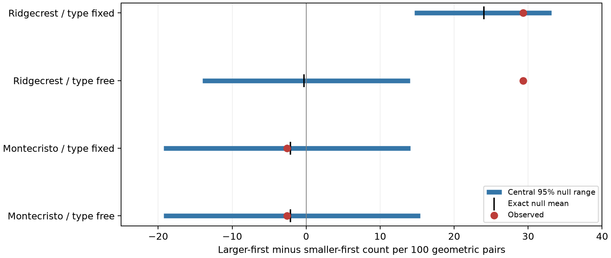
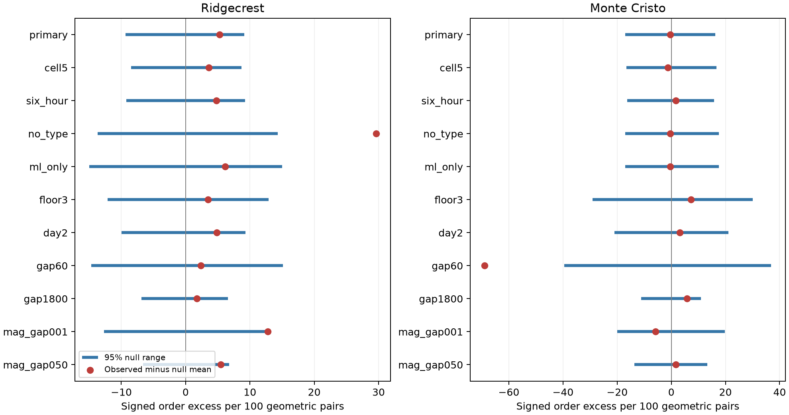
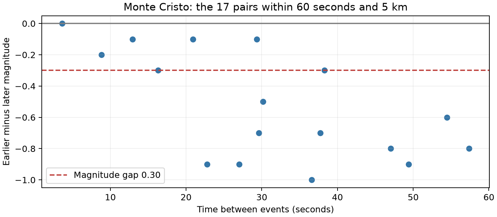

# Local shuffles gave no clear larger-first excess in 10-minute earthquake pairs at magnitude 2.5 or more on days 1 to 30

We tested whether the larger event came first more often than a local magnitude model expects. The two main tests gave no clear excess. Ridgecrest had a strong raw larger-first pattern. Most of that signed score was also expected when the magnitude type stayed fixed. Monte Cristo had a raw score near zero.

A planned one-minute check gave an unexpected smaller-first pattern at Monte Cristo. We report it as an exploratory result. It needs a test in other data and a test of catalog detection. It is not a forecast of a larger earthquake.



The blue bars show central 95% ranges under the label-shuffle model. The black marks show exact null means. The red points show observed scores. A range is conditional on the fixed times, locations, types, and magnitude sets. It is not a confidence interval for a physical effect. All four rows use the same horizontal scale. The gap threshold is 0.30 magnitude units.

## Question and prior work

Larger events can produce more later nearby events. This can cause a larger-first pattern even when the size of each later event is drawn without reference to its parent size. The [USGS aftershock model](https://earthquake.usgs.gov/data/oaf/background.php) includes size-dependent rates. [Helmstetter, Sornette, and Grasso](https://arxiv.org/abs/cond-mat/0205499v2) show how triggering cascades and event selection can produce foreshock and aftershock patterns. These results motivate a direction test. They do not give the answer for these pairs.

We searched the signed campaign before choosing this question. The search terms included `earthquake hydrology ocean`, `sea level`, `ENSO sea`, `aftershock spatial`, and `Ridgecrest magnitude order`. The compact search record is in files/campaign_search.json. It records the later searches, with initial sea-level results retained for context. Search does not prove novelty. No private worker files were read.

The [Ridgecrest size-and-time report](sci:sha256:ddec79efc92e46547677d5000479c5fbe5516c027e66a4f1225e7a935f67b1a9) already found that holding magnitude type fixed weakens a binary large-versus-small event test. We read it before this test. The [magnitude-similarity report](sci:sha256:04d0afc7a54bba616a924b30b7fc93062c9303246f15e7a138ac6767ae95ebff) tested absolute differences between consecutive events. The [Monte Cristo spatial report](sci:sha256:f1c231c8ac4d278093652a38d1b2f0a1c4c3a197037bc6f0981cc9d13f30d41c) tested location shuffles at the same ten-minute and 5 km limits. The [global magnitude-order report](sci:sha256:ce1b9b5357b3f981475c73d4d2c5c64a9b3b952c33e6133d7165869877047bc5) found larger-first order for much larger earthquakes at day-to-month lags.

Our added test uses all nearby pairs, a fixed pairwise magnitude-gap rule, a fixed denominator, and full magnitude-label shuffles. It repeats that rule in two sequences. It tests the type constraint from the start. Its new evidence includes the short-gap Monte Cristo result. It does not claim the first discovery of earthquake clustering or magnitude dependence. Known results from the same snapshots informed the design, so the two samples are not new independent data for all related claims.

[Corrado, Herrmann, and Marzocchi (2025)](https://doi.org/10.1785/0220240277) report that missed events can produce magnitude correlations. We read their [author-repository abstract](https://www.iris.unina.it/handle/11588/993798), not the restricted full paper. This gives a catalog-based explanation to consider. Our time-order statistic is different from their correlation statistic.

## Data and scope

We read two existing public USGS ComCat snapshots in place. No new raw data were downloaded. No shared dataset was changed. Source versions are the exact response bytes retrieved on 2026-11-08 UTC. These are retrospective preferred-event catalogs, with later revisions. They do not record what was known at the time of each event.

| Snapshot | Raw rows | Bytes | SHA-256 |
| --- | ---: | ---: | --- |
| Ridgecrest | 4,964 | 952,174 | `e51b17123cf76ec3a1cb45a4d9a4562d64c6105922c57aea94a8d15a5bfdc5f4` |
| Monte Cristo | 1,968 | 349,862 | `92fb53e4096880015acbdb181a5871af2c0ac75def69dea808bbcdd6d2b008f5` |

The logical shared paths are:

```text
/mnt/dell-data/shared_datasets/usgs-ridgecrest-m2-100km-30d-20261107/catalog.csv
/mnt/dell-data/shared_datasets/usgs-montecristo-m2-100km-30d-20261108/catalog.csv
```

[Provenance](files/provenance.json) gives exact query URLs, logical and resolved paths, helper-record hashes, retrieval times, and hashes of the signed extracts. Queries request earthquakes of magnitude at least 2 within 100 km and 30 days of each mainshock. Both responses are below the 20,000-row limit. IDs are unique. Extracts retain all raw rows with the fields needed for the analysis, including rows below the analysis floor. The [USGS CSV guide](https://earthquake.usgs.gov/earthquakes/feed/v1.0/csv.php) defines the source fields.

The time origins are 2019-07-06 03:19:53.040 UTC and 2020-05-15 11:03:27.176 UTC. We retain preferred magnitude at least 2.5 in elapsed days [1,30). The first 24 hours and the day-30 endpoint are excluded. There is no depth cut. We do not assign each event to a fault or a triggering parent. We use the source query region. A constant magnitude floor does not establish complete detection.

Distances are epicentral great-circle distances on a sphere of radius 6371.0088 km. Depth is not part of this distance. Magnitude types remain as reported; they are not converted to a common scale. The source magnitudes have no more than two decimal places. We use integer hundredths to avoid a floating-point ambiguity at the 0.30 threshold.

## Fixed method

The [plan](files/plan.md) was saved before the new event selections and scores. It is a local plan, not an external registration. [Post hoc notes](files/posthoc_note.md) record each added check and display.

Form every pair with a positive time gap no greater than 600 seconds and an epicentral distance no greater than 5 km. Count each pair once. The earlier event defines its time order. Let L be the number with earlier-minus-later magnitude at least 0.30. Let S be the number with that difference at most -0.30. Let N be the number of all geometric pairs, including smaller magnitude gaps. The statistic is:

`T = (L - S) / N`.

The denominator N stays fixed in every magnitude shuffle. This avoids a changing selected-pair denominator. We also show L/(L+S) as a raw descriptive fraction. It is a different statistic. We do not apply an independent-pair binomial test to it. Pairs can share events and bursts.

Each primary shuffle group has the same elapsed day, 10 km epicentral grid cell, and preferred magnitude type. The local grid uses x = R cos(center latitude) times the longitude offset in radians, and y = R times the latitude offset in radians. Cell indices are floor(x/10) and floor(y/10). Grid centers are the original query centers in provenance.json.

Independently and uniformly permute magnitudes within each group. Hold all times, locations, types, pair edges, and group membership fixed. Score each full assignment once. This retains shared pair endpoints in the null distribution. The model assumes that magnitude labels can be exchanged within each group. It permits arbitrary observed time bursts and local magnitude sets. Rapid changes within a group, detection, source choice, and real event interactions can each break this assumption.

For an edge in one group, the exact expected signed contribution is zero. Each ordered assignment of two distinct labels has a reverse with the opposite sign. For an edge between groups, take the mean signed contribution over the Cartesian product of their magnitude lists. Add edge means and divide by N to obtain the exact null mean. It need not be zero: group and type patterns can be linked to time order.

Each primary test uses 19,999 shuffles. The upper-tail p value is (1 + number of shuffled scores at least observed)/(1 + number of shuffles). It tests the planned larger-first alternative. We apply Holm correction to the two primary p values. Central null ranges use the 2.5th and 97.5th percentiles. They describe the given catalog model. They do not include source error, uncertainty across sequences, or uncertainty in a physical parameter.

## Primary results

| Sequence | Events | Geometric pairs | Observed T | Exact null mean | Central 95% null range | Upper-tail p | Holm p |
| --- | ---: | ---: | ---: | ---: | --- | ---: | ---: |
| ridgecrest | 931 | 157 | 0.293 | 0.240 | 0.146 to 0.331 | 0.14475 | 0.28950 |
| montecristo | 636 | 78 | -0.026 | -0.021 | -0.192 to 0.141 | 0.54295 | 0.54295 |


Ridgecrest has 73 larger-first and 27 smaller-first pairs with magnitude gaps of at least 0.30. Its raw larger-first fraction is 73%. Monte Cristo has 24 and 26, or 48%. The remaining 57 and 28 geometric pairs have smaller gaps and contribute zero. The conditional test gives no clear larger-first excess in either sample. This is not evidence that the physical effect is zero or that earthquakes are independent.

There are 337 primary shuffle groups at Ridgecrest and 167 at Monte Cristo. Of 931 and 636 events, 757 and 562 belong to groups with more than one magnitude value. Of 157 and 78 edges, 154 and 77 have at least one such endpoint. These counts are upper bounds on edge mobility, not effective independent sample sizes.

## What the type constraint changes

In Ridgecrest, removing the type constraint leaves the observed score at 0.293 but changes the exact null mean from 0.240 to -0.003. The upper-tail p value changes from 0.14475 to 0.0002. This is the minimum at 4,999 draws for that check, not a precise estimate of a smaller tail. The result agrees with the earlier campaign warning for a different binary statistic. We do not interpret a change in null mean as a fraction of physical triggering that type explains.

The type-pair table makes the change visible. The 42 edges from an `mw` event to a later `ml` event all have a positive contribution. Their exact expected sum is 41.15 under type-preserving shuffles. The 90 `ml`-to-`ml` edges have an observed signed sum of 5 and an expected sum of -0.51. The `ml`-only test gives upper-tail p=0.2368. Source type is linked to event size and may retain real size information as well as measurement structure. Conditioning on it narrows the test; it does not identify a causal artifact.

All 78 primary Monte Cristo edges connect `ml` events. Removing the type constraint does not change its exact mean. Different seeds give slightly different Monte Carlo p values for that equivalent score model.

## All planned checks



Values are observed and shuffled scores after subtraction of each exact null mean. The two panels use different horizontal limits. Read the tick labels before comparing the panels. Blue ranges are null reference ranges, not physical-effect intervals. `mag_gap001` uses a gap of 0.01; `mag_gap050` uses 0.50. Other names follow the plan.

| Sequence | Setting | Events | Pairs | Observed T | Exact null mean | Upper-tail p |
| --- | --- | ---: | ---: | ---: | ---: | ---: |
| ridgecrest | primary | 931 | 157 | 0.293 | 0.240 | 0.14475 |
| ridgecrest | cell5 | 931 | 157 | 0.293 | 0.257 | 0.23660 |
| ridgecrest | six_hour | 931 | 157 | 0.293 | 0.245 | 0.16600 |
| ridgecrest | no_type | 931 | 157 | 0.293 | -0.003 | 0.00020 |
| ridgecrest | ml_only | 833 | 90 | 0.056 | -0.006 | 0.23680 |
| ridgecrest | floor3 | 300 | 32 | 0.312 | 0.277 | 0.39080 |
| ridgecrest | day2 | 760 | 135 | 0.296 | 0.248 | 0.18380 |
| ridgecrest | gap60 | 931 | 47 | 0.234 | 0.211 | 0.43980 |
| ridgecrest | gap1800 | 931 | 312 | 0.119 | 0.101 | 0.32060 |
| ridgecrest | mag_gap001 | 931 | 157 | 0.376 | 0.248 | 0.03040 |
| ridgecrest | mag_gap050 | 931 | 157 | 0.287 | 0.232 | 0.08180 |
| montecristo | primary | 636 | 78 | -0.026 | -0.021 | 0.54295 |
| montecristo | cell5 | 636 | 78 | -0.026 | -0.013 | 0.58320 |
| montecristo | six_hour | 636 | 78 | -0.026 | -0.042 | 0.44600 |
| montecristo | no_type | 636 | 78 | -0.026 | -0.021 | 0.54840 |
| montecristo | ml_only | 629 | 78 | -0.026 | -0.021 | 0.55580 |
| montecristo | floor3 | 223 | 22 | 0.091 | 0.018 | 0.37760 |
| montecristo | day2 | 534 | 50 | 0.020 | -0.011 | 0.42600 |
| montecristo | gap60 | 636 | 17 | -0.706 | -0.016 | 1.00000 |
| montecristo | gap1800 | 636 | 195 | 0.056 | -0.002 | 0.16740 |
| montecristo | mag_gap001 | 636 | 78 | -0.090 | -0.031 | 0.73860 |
| montecristo | mag_gap050 | 636 | 78 | 0.000 | -0.017 | 0.42040 |


These checks share data. They are not independent replications. The Ridgecrest 0.01-gap upper tail is 0.0304 before any correction. It does not give a new primary claim. All rows, both tails, exact means, and draw arrays are preserved. The omit-day diagnostic keeps each edge's original null expectation; it does not refit groups after deletion. Its primary excess remains positive for Ridgecrest and changes sign across deletions for Monte Cristo.

## Exploratory one-minute result



The planned Monte Cristo 60-second check has 17 geometric pairs and 34 distinct endpoint IDs. The earlier magnitude is no greater than the later magnitude in every pair. Twelve gaps are at least 0.30; all twelve have the smaller event first. The five other pairs contribute zero under the planned gap rule. The 12 large-gap pairs occur on eight distinct elapsed days. No pair in this set shares an endpoint with another pair. This does not prove that the pairs are independent physical events.

The score is -12/17 = -0.706, against an exact null mean of -0.016. The planned 4,999 draws gave lower-tail p=0.0006. This direction was not the primary alternative. We then ran 199,999 new shuffles of the identical setting to reduce Monte Carlo error. There were 22 shuffled scores at most as low as observed. The refined lower-tail p value is 23/200,000 = 0.000115. The 95% binomial interval for the simulated tail probability is 0.000069 to 0.000167. This interval measures simulation error only.

We count both tails of all 25 tested sequence-settings for an exploratory Bonferroni bound. The resulting bound for the refined result is 50 times 0.000115 = 0.00575. This correction covers the listed choices, not choices outside the package. It does not convert a post hoc interpretation into independent confirmation. Repeating a shuffle with more draws also does not add new earthquakes.

Three checks were fixed after this result and before their scores:

| Post hoc check | Events | Pairs | Smaller-first / larger-first gaps | Exact null mean | Lower-tail p | 50-tail bound |
| --- | ---: | ---: | --- | ---: | ---: | ---: |
| posthoc_gap60_cell2 | 636 | 17 | 12 / 0 | -0.200 | 0.00240 | 0.12000 |
| posthoc_gap60_sixhour | 636 | 17 | 12 / 0 | -0.039 | 0.00015 | 0.00750 |
| posthoc_gap60_reviewed_nn | 563 | 14 | 10 / 0 | -0.024 | 0.00060 | 0.03000 |


The finer 2 km grouping gives weaker evidence after the same 50-tail correction. This limits the result. Finer groups also leave fewer label exchanges. Different p values do not measure a physical length scale. The reviewed Nevada-network restriction removes automatic records and the one cross-network edge. The remaining 14 pairs still include ten smaller-first gaps of at least 0.30 and no larger-first gaps of that size. Thus, those particular record flags do not fully account for the raw ordering. They do not rule out other catalog effects.

One possible explanation is selective loss of smaller events after a larger event. Such loss can remove larger-first observed pairs and retain smaller-first pairs. Other possible explanations include source association errors, local rate changes, magnitude error, and real rapid event interaction. We did not model detection, inspect waveforms, or identify unique physical ruptures from separate catalog IDs. The tests narrow some simple local and record-status explanations; they do not choose a mechanism. A useful next test would use an independent waveform-based catalog and simulate its detection process before testing this fixed 60-second rule.

## Limits

Two selected sequences do not represent all earthquakes. The same revised catalogs supplied several prior campaign tests. The primary pair rule and its 0.30 gap are fixed choices, not universal scales. Magnitude types, stations, detection, and revisions can vary with time and size. The finite 100 km query and magnitude floor omit events. Reported errors are not propagated. Epicentral distance is not fault distance. The null depends on local exchangeability, and there can be important changes inside its groups.

The primary tests have limited evidence for small excesses. Failure to reject is not an equivalence test. The short-gap pattern has only 17 pairs, was interpreted after a sensitivity result, and is weaker under one finer spatial model. Neither result estimates a triggering exponent, event-parent relation, causal magnitude memory, or a safe hazard threshold. No prospective forecast was tested.

## Audit and reproduction

The independent scalar audit passed all 25 settings. It rebuilt event selection and geometric edges, enumerated exact group expectations, checked every saved p value and null range, and checked source extracts against the two raw files. Its largest distance difference was 5.29e-12 km. The largest simulation-mean error was 2.30 Monte Carlo standard errors or less. A 12-assignment synthetic graph checked shared-endpoint and without-replacement arithmetic. These are implementation checks, not validation of exchangeability or catalog completeness.

A second full calculation matched every numerical table and all 26 saved null arrays, including the refinement and three follow-up arrays. [REPRODUCE.md](files/REPRODUCE.md) defines the data flow, fields, optional raw retrieval, and comparison rules. The package contains 399,974 shuffle scores. Source hashes and the signed extracts permit an offline repeat without duplicating raw catalogs.

From the extracted bundle root, use the recorded Python environment and run:

```sh
PYTHON=/path/to/python sh files/reproduce.sh /absolute/fresh/output
```

The script writes only to the fresh output directory. No shared-store access or network is needed after dependencies are installed. Verify the publication ZIP with `sci verify BUNDLE.zip --json` before extraction. Keep the signed source package unchanged.

## Campaign record and license

Campaign: 11_07_2026. Job: sci-1107-hp-earth-and-ocean-sciences-42d812be3130. Topic: earth-and-ocean-sciences. Machine: hp. Account: codex-andrii. Model: gpt-6.1-sol, high reasoning effort, through T3 Code and the Codex harness.

No agents were launched. Computations ran directly in this isolated worktree with the host Python 3.12 environment. No shared base package was changed. Raw sources were read in place. Downloads were not needed. The signed ZIP is stored only in the shared local campaign. No remote archive or index received it. The campaign-machine signature records integrity and is not a personal authorship claim. The private key is outside this package.

The SCI baseline license applies to original text, figures, derived tables, and code as stated in LICENSE. USGS sources retain their source status and attribution.
