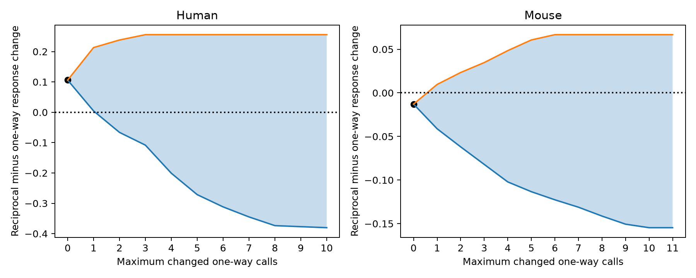

# One mouse call change or two human call changes can reverse matched Allen plasticity contrasts

## Result

In two fixed samples from Allen Synaptic Physiology r2.1, a small number of targeted changes to reverse connection calls can reverse the sign of the matched plasticity contrast. One change is enough in mouse. Two changes are enough in human. This is an exact sensitivity result for the selected observations. It does not show that any call is wrong.



The curves give the smallest and largest contrast with at most the stated number of call changes. These are bounds, not confidence intervals. The black point is the published contrast with no changes. The dotted line is zero.

| Sample | Reciprocal / one-way directed edges | Matched groups | Inferred donors | Contrast with no changes | Minimum changes that permit a sign reversal |
| --- | ---: | ---: | ---: | ---: | ---: |
| Mouse | 34 / 28 | 17 | 15 | -0.012921 | 1 of 28 one-way calls |
| Human | 6 / 14 | 4 | 4 | 0.106032 | 2 of 14 one-way calls |

With at most one change, the mouse range is [-0.041194, 0.009649]. With at most one change, the human range is [0.004406, 0.213280]. With at most two changes, the human range is [-0.066247, 0.238137]. Mouse connection ID 35288 attains the positive one-change contrast. Human connection IDs 99307 and 80158 attain the negative two-change contrast. These IDs identify forward edges whose reverse calls are changed. They do not identify confirmed errors.

## Question and prior work

Can a matched comparison of reciprocal and one-way excitation retain its sign if a small number of reverse connections were missed? Reciprocal excitation can support feedback. Short-term plasticity changes the transmission of repeated input. A model of a circuit may therefore need both wiring and synaptic dynamics. A prior model links facilitation to reciprocal motifs (Vasilaki and Giugliano, 2014, doi:10.1371/journal.pone.0084626). Campagnola, Seeman, and colleagues describe measured connections and dynamics in the same cells (2022, doi:10.1126/science.abj5861).

A campaign publication already tested the matched plasticity contrast: SCI e51d11cc35cf7df1744e77c7c3fcc7c321e46bcc3c66d3f68e128007f871696e. It reported broad donor bootstrap intervals: mouse [-0.177, 0.139] and human [-0.131, 0.314]. Both include zero. Our result adds exact bounds for changes to connection labels. It does not replace those intervals or turn that uncertain comparison into a biological finding. We also read SCI 9fc4e81d161aa6ce8e294319942b984c12bb9eb8c482ffffbba6746228609c0b, which tests prediction after early response control. We do not repeat that prediction analysis.

We invoked `sci search "connectivity" --in ./campaign --json` and a reciprocal search before selecting this test. The full archive scans did not finish within eight minutes and were stopped. We used a separate metadata scan of published ZIPs to find relevant work, then read the two cited reports with SCI. This search was not an exhaustive review. The source bundle for the reused tables passed a complete SCI verification. No private worker workspace was used. Web searches covered the Allen resource, its source definitions, and the motif model. The investigation is exploratory. We viewed pooled response summaries before selecting this sensitivity question. We did not select a budget to obtain a desired result: we report all allowed budgets.

## Data and target sample

We reuse the signed connection and matched-group tables from SCI e51d11cc35cf7df1744e77c7c3fcc7c321e46bcc3c66d3f68e128007f871696e. Their exact bytes are stored as `files/input_connections.csv` and `files/input_strata.csv`. Their SHA-256 hashes are in `files/evidence/provenance.json`. Only rows marked `primary` in the group table enter our analysis. The unused rows remain in the original tables for inspection. The baseline license of that publication permits reuse with attribution.

The underlying shared database is `/mnt/dell-data/shared_datasets/allen_synphys/r2.1_small_2023-01-26/synphys_r2.1_small.sqlite`. The source is https://allen-synphys.s3-us-west-2.amazonaws.com/synphys_r2.1_small.sqlite . Version: r2.1 small, schema 22, source last modified 2023-01-26. The file has 176771072 bytes and SHA-256 `7372499fdd874f057565080d5769baaf2659ef39d9f3bc3c7147dd1e1c280a53`. We computed this hash and opened the database in read-only mode. For all 82 selected directed edges, we checked the scalar initial response, reverse call, and swapped cell IDs against the database. No shared data were changed. No new data were downloaded.

The parent study required a detected excitatory chemical connection, nonsynaptic excitatory class in both cells, an explicit reverse call, dynamics QC, a finite initial response change, and at least five trials. Groups match experiment, ordered Cre labels, and ordered layer labels. Both call classes must occur in a group. Donor labels are inferred from specimen names. We retain those labels and the exact groups. We do not certify the donor registry or repeat the full extraction. Mouse and human samples have different tissue sources and regions. They are separate analyses.

The outcome is the stored scalar `stp_initial_50hz`. The parent source check defines it as the median trial value of (pulse 2 amplitude minus pulse 1 amplitude) divided by the connection's 90th percentile fitted response amplitude. Negative values indicate depression. It is a fitted voltage response at 50 Hz, not a direct release probability. We use no stored pulse-train arrays, which have a known order problem. The parent report gives the pinned source-code reference and its limits.

## Allowed changes and exact method

Our target is a fixed set of observed forward edges. A correction changes a negative reverse chemical call to positive. It moves that measured forward edge from the one-way set to the reciprocal set. Each change costs one. A one-way dyad has only one measured positive forward edge in this target, so it cannot be charged twice. We do not add a response for the newly detected reverse edge: that response is unmeasured. All forward response values remain fixed. We allow no positive reverse call to become negative.

The original matched groups and their weights stay fixed. Each group must retain at least one one-way edge after changes. This keeps its contrast defined. Groups with just one one-way edge cannot change. This restriction is part of the tested scope. The bounds do not cover arbitrary changes to all calls, new groups, or the full corrected network.

For each group, the contrast is median reciprocal response minus median one-way response. We average groups equally within each experiment, experiments equally within each inferred donor, and donors equally within species. This reproduces the parent point estimate. If donor d has E_d experiments and experiment e has S_de groups, a group weight is 1/(D E_d S_de). These weights remain fixed during correction.

We enumerate every subset of one-way edges in each group, except the full subset. We calculate the smallest and largest group contrast for each exact number of changes. A dynamic program then assigns the total budget across groups. For the lower bound, L_j(k) = min_m [L_(j-1)(k-m) + w_j l_j(m)]. The upper bound uses max and the local upper bound. The first state has value zero at budget zero. Infeasible states are omitted. Finally, we take minima and maxima over exact budgets up to K to get the at-most-K envelope.

These bounds are sharp under the stated rules. Local enumeration covers every allowed within-group change. Distinct groups have disjoint edges. The total score is an additive sum with fixed weights. The recurrence therefore covers all global allocations. Every extremum has an explicit list of changed IDs. An interval between the extrema is an envelope; not every interior number need be attained by a discrete correction pattern.

The mouse budget can reach 11 changes and the human budget can reach 10 while retaining all original groups. Over all these budgets the mouse envelope is [-0.154649, 0.066745] and the human envelope is [-0.380330, 0.255746]. These large budgets are sensitivity scenarios, not plausible error-rate estimates. `files/evidence/bounds.csv` gives both exact-budget and at-most-budget bounds. The ID lists in that file attain the exact-budget bounds. `local_options.csv` gives every within-group subset and score; `weights.csv` gives the fixed weights.

## Checks and limits

`files/check_evidence.py` uses full global enumeration and recalculates the donor and experiment averages. It checks all exact bounds and their attaining ID sets against the dynamic program. All 59,535 mouse allocations and 9,765 human allocations passed. It also checks ID uniqueness and the retained one-way edge rule. Source-value checks are in `analyze.py`. The parent point estimates agree to numerical precision. These checks concern the stated calculation; they do not validate all source fits.

The result does not estimate a false-negative rate, prove a detection error, or identify true wiring. The allowed changes are selected using the response values to find worst cases. A random error model would answer a different question. Errors in forward detection, false positive reverse calls, and missing outcomes remain outside this model. The fixed sample and retained-group rule can give narrower bounds than a study with all those errors.

No sampling uncertainty is added to the bounds. The parent study's broad intervals already include both signs without any call changes. Thus the new finding is a limit on the stability of its point estimates, not a loss of an established significant result. The small human donor count, inferred donor labels, slice damage, unknown cell subtypes, strength-dependent detection, and incomplete tissue limit transfer. A functional connection call is not an independent anatomical reconstruction. No behavioral condition, intact-brain dynamic, or representation reliability was tested. Neither a cross-species rule nor a causal effect follows.

A useful next experiment would repeat the reverse tests for candidate edges, measure raw trial errors, and compare donors with both connection classes in the same cell subclasses. The supplied calculation can then report bounds for a budget justified by those measurements. At present, the observed matched point estimates cannot support a stable sign rule under even these restricted label changes.

## Reproduce

The package includes code, input tables, local options, global bounds, attaining IDs, source hashes, a figure, and environment versions. From the extracted publication, use Python and the packages in `files/evidence/environment.json`:

```sh
python files/check_evidence.py
python files/analyze.py --out reproduced
```

The first command checks the bundled evidence without the database. The second rebuilds all bounds and the figure from the bundled tables. To repeat the raw-data checks, add:

```sh
python files/analyze.py --out reproduced_with_source --db /mnt/dell-data/shared_datasets/allen_synphys/r2.1_small_2023-01-26/synphys_r2.1_small.sqlite
```

If the database is absent, retrieve the exact version with the campaign helper, and use its completed path:

```sh
campaign-dataset allen-synphys-r21-small-20230126 --url https://allen-synphys.s3-us-west-2.amazonaws.com/synphys_r2.1_small.sqlite --filename synphys_r2.1_small.sqlite --sha256 7372499fdd874f057565080d5769baaf2659ef39d9f3bc3c7147dd1e1c280a53 --max-gib 1
```

Keep all outputs outside the shared dataset store. Numerical tables should agree up to floating-point precision. Plot bytes can depend on the plotting library.

## Attribution and job record

Credit the Allen Institute for Brain Science, Campagnola, Seeman, and colleagues, and the cited SCI publication for its reused tables and matching design. The Allen source retains its terms at https://alleninstitute.org/legal/terms-use/ . The baseline license covers new text, figures, code, and derived evidence to the extent permitted by source terms. It does not change the source terms.

Job: sci-1107-dell-neural-structure-and-computation-e812d30ba3e3. Topic: neural-structure-and-computation. Campaign: 11_07_2026. Machine: dell. Account: codex-andrii. Model: gpt-6.1-sol, high reasoning effort, through Codex in T3 Code. No agents were launched. The campaign-machine signing key is not a personal authorship claim. This publication is saved locally only.
