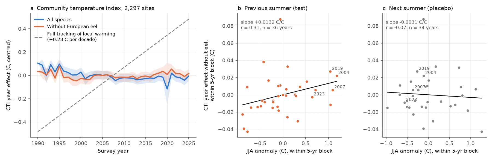
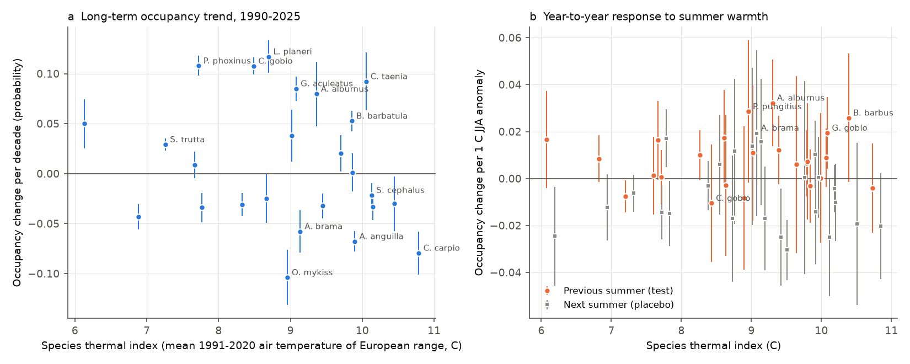
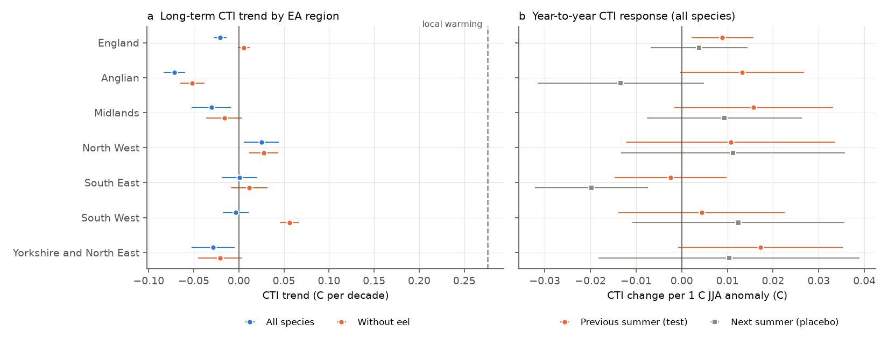

# English river fish communities did not move toward warm-water species as local air temperature increased, 1990-2025; warm summers gave only a small next-year increase

## Summary

We used 24,945 electric-fishing surveys at 2,297 Environment Agency (EA) river sites in
six regions of England, 1990-2025. For each survey, we calculated a community temperature
index (CTI). The CTI is the mean species thermal index (STI) of the species that the
survey caught. The STI of a species is the mean 1991-2020 air temperature (E-OBS) of the
European grid cells where GBIF shows the species.

Main results:

1. Local air temperature at the survey cells increased by 0.276 C per decade
   (SE 0.004). In the same period, the CTI decreased by 0.021 C per decade
   (95% CI -0.028 to -0.013). With abundance weights, the decrease was 0.060 C per decade.
2. The decrease came mostly from one species. European eel occupancy decreased by
   0.068 per decade. When we removed eel, the CTI trend was +0.005 C per decade
   (95% CI -0.001 to +0.012). This is 2% of the local warming rate (95% CI -0.4% to 4.3%).
3. The long-term trend was not the same in the six regions. Without eel, the trend
   was from -0.052 (Anglian) to +0.056 (South West) C per decade. No region came near
   the warming rate. The trend also changed with survey season and period (Table 1).
4. A warm summer gave a small CTI increase in the next survey year: +0.009 C per 1 C
   of June-August anomaly (95% CI 0.002 to 0.016; standard errors clustered by year,
   34 years). The next-summer placebo was +0.004 (95% CI -0.007 to 0.014). Without eel, the
   previous-summer slope was +0.012 (0.004 to 0.019) and the placebo was +0.000
   (-0.007 to 0.008).
5. Warm-water cyprinids carried this short-term response. After a summer that was 1 C
   warmer, bleak, barbel, gudgeon and common bream were found at 2-3 percentage points
   more surveys of their sites. But across all 25 species, the response did not clearly
   increase with STI (slope 0.003 per C of STI, p = 0.20).
6. The short-term slope multiplied by the summer warming rate predicts a CTI trend of
   only +0.002 to +0.003 C per decade. Thus even a real temperature effect of this size
   cannot make a large long-term CTI change. Other causes changed the CTI more than
   warming did: the eel collapse, the salmon decrease and large increases of small
   benthic species (minnow, bullhead, brook lamprey, stone loach).

The abundance-weighted CTI did not pass the placebo test (the next-summer slope was the
same size as or larger than the previous-summer slope). Thus we do not use it for the
short-term claim.



## Question and prior work

Many studies use the CTI to measure community response to warming ("thermophilization").
Comte et al. (2021, PNAS, doi:10.1073/pnas.2011639118) reported that river fish
communities around the world moved toward warm-water species. Nunn et al. (2025, Water
Research, doi:10.1016/j.watres.2025.123163) reported that English fish richness increased
as water quality improved. Earlier campaign publications found that trawl fish CTI
followed sea temperature in Atlantic surveys but not in Pacific surveys
(sci:sha256:edec25d0...), and that winter bird CTI increased without a link to winter
temperature (sci:sha256:c94acf78...).

We asked two questions for English rivers:

- Did the CTI follow local warming from 1990 to 2025?
- Does a warm summer change the CTI in the next year, and does a next-summer placebo
  show no change?

We also asked which species and which observation effects control the answers.

## Data

- **Fish:** EA National Fish Populations Database, file `FW_Fish_Counts.csv`
  (export 2026-10-08; Open Government Licence v3). We kept surveys in England with
  electric fishing (PDC, DC, AC or not specified), strategy "catch depletion" or
  "single catch", not species-selective, 1990-2025. We kept sites with 6 or more survey
  years and a span of 10 or more years. Result: 24,945 surveys, 2,297 sites
  (Anglian 481, Midlands 290, North West 395, South East 317, South West 498, Yorkshire
  and North East 316). We used 34 freshwater species. We did not use hybrids, genus-level
  or family-level records, or marine and estuarine species.
- **Temperature:** E-OBS v31.0e daily mean temperature, 0.25 deg ensemble mean
  (1950-2024). Each site uses the nearest land cell. Anomalies are relative to 1991-2020
  for each cell.
- **Species thermal index:** GBIF occurrence-density maps (years 1970-2025), presence in
  ~0.18 deg squares, joined to 0.25 deg E-OBS cells in Europe (12 W-40 E, 35-71.5 N).
  STI = mean 1991-2020 annual air temperature of the occupied cells
  (`files/results/species_thermal_index.csv`). The order is as expected: grayling 6.1 C,
  Atlantic salmon 6.9 C, brown trout 7.3 C ... barbel 10.4 C, common carp 10.8 C.
  We used the GBIF map service because the GBIF occurrence search service refused
  our requests (HTTP 429).

The exact files, hashes and terms are in `files/EXTERNAL_DATA_NOTICE.md`.

## Methods

**CTI.** Presence CTI (main) = mean STI of the species that the survey caught (any run).
Abundance CTI = mean STI weighted by log(1 + run-1 fish per 100 m2). We also calculated
variants: without small benthic species ("large"), without stocked and diadromous
species ("resident"), without both ("core"), without eel, with a summer STI, and with a
median STI.

**Long-term trend.** Linear model of CTI on year (per decade), with fixed effects for
site, survey month, method and strategy, and log fished area. Standard errors are
clustered by site. We fitted the same model for local temperature anomalies at the
same surveys.

**Short-term test.** CTI on the June-August (JJA) anomaly of the previous summer (test)
and of the next summer (placebo). The next summer occurs after the survey, so it cannot
change the catch. If its slope is not zero, the model has residual confounding. The
models have the same fixed effects and remove slow change with region x 5-year blocks
(main), region linear trends, or region quadratic trends. Standard errors are clustered
by year, because one summer anomaly affects all of England.

**Species.** For each species with 200 or more presences, we fitted a linear
probability model of presence at sites where it occurred at least once. We also
calculated the CTI trend with each species removed.

**Observation-bias checks.** Survey month, method and strategy fixed effects; only PDC
electric fishing; only July-October surveys; only sites with one method and strategy;
control for number of species; summer and median STI; separate periods and regions.

## Results

Table 1. CTI trends (C per decade, presence CTI unless stated). Warming at the same
surveys: annual +0.276 (0.004), JJA +0.274 (0.005).

| Sample | All species | SE | Without eel | SE |
| --- | --- | --- | --- | --- |
| England 1990-2025 | -0.021 | 0.004 | +0.005 | 0.003 |
| England, abundance CTI | -0.060 | 0.007 | | |
| England, July-October surveys only | -0.005 | 0.005 | +0.022 | 0.004 |
| 1990-2007 | -0.068 | 0.008 | -0.030 | 0.008 |
| 2008-2025 | +0.007 | 0.006 | +0.014 | 0.006 |
| PDC electric fishing only | -0.027 | 0.005 | | |
| Sites with one method and strategy (172) | -0.044 | 0.012 | | |
| Anglian | -0.072 | 0.006 | -0.052 | 0.007 |
| Midlands | -0.031 | 0.011 | -0.016 | 0.010 |
| North West | +0.025 | 0.010 | +0.028 | 0.008 |
| South East | +0.001 | 0.010 | +0.011 | 0.010 |
| South West | -0.004 | 0.007 | +0.056 | 0.005 |
| Yorkshire and North East | -0.029 | 0.012 | -0.021 | 0.012 |

Table 2. Short-term test, presence CTI, England (C per 1 C JJA anomaly; SE clustered by
year).

| Variant | Detrending | Previous summer | SE | Next summer (placebo) | SE |
| --- | --- | --- | --- | --- | --- |
| All species | region x 5-year | +0.0089 | 0.0035 | +0.0038 | 0.0054 |
| All species | region linear | +0.0105 | 0.0034 | +0.0055 | 0.0037 |
| All species | region quadratic | +0.0081 | 0.0032 | +0.0042 | 0.0037 |
| Without eel | region x 5-year | +0.0116 | 0.0037 | +0.0003 | 0.0039 |
| Resident species | region x 5-year | +0.0131 | 0.0042 | -0.0012 | 0.0041 |
| Core species | region x 5-year | +0.0139 | 0.0036 | +0.0003 | 0.0044 |
| Abundance CTI | region x 5-year | +0.0103 | 0.0070 | +0.0138 | 0.0072 |

The same-summer anomaly (for all survey months) had a slope of +0.010 (0.004). A summer
two years before the survey had no clear slope (-0.002, SE 0.006). In the six regions,
the previous-summer slope was positive in five, but each 95% interval included zero
(Figure 3b). The South East had a negative placebo slope (-0.020, SE 0.006). Thus the
short-term result is a national result with weak regional replication.



Species (Figure 2, `files/results/species_models.csv`). Occupancy increased most for
small benthic species with low or middle STI: minnow +0.108, bullhead +0.108, brook
lamprey +0.117 and three-spined stickleback +0.085 per decade. It decreased for European
eel (-0.068), Atlantic salmon (-0.043), rainbow trout (-0.104) and common carp (-0.079).
Coarse fish with high STI (roach, dace, chub, gudgeon, barbel, bream) decreased by 0.02-0.06
per decade at their sites. Removal of eel changed the England trend by +0.026 C per
decade; removal of any other species changed it by less than 0.013 (Figure 4).



## Interpretation

The CTI of English river fish did not follow local warming in 1990-2025. Warm summers
had a real but small short-term effect, mainly through warm-water cyprinids. This agrees
with the known link between summer temperature and cyprinid year-class strength. But the
size of this effect predicts only about 1% of full tracking. Other drivers controlled the
long-term CTI: the European eel recruitment collapse, which is not a local temperature
effect, the salmon decrease, and the increase of small cold-to-middle STI species. Better
water quality and better recording of small species can explain the last change. Our
data cannot separate these two causes.

Thus a positive or negative CTI trend in these rivers is not a reliable sign of a
climate response. An analysis must show which species cause the trend before it uses the
CTI as evidence of thermophilization.

## Limitations

- STI uses air temperature over the GBIF range. GBIF records are dense in north-west
  Europe. This can make some STI values too cold (for example perch). Water temperature
  was not available for each site. The summer STI and the median STI gave the same
  long-term conclusion (no tracking). With the median STI, the previous-summer slope was
  smaller (+0.005, SE 0.002) (`trend_models.csv`, `interannual_models.csv`).
- Air temperature at 0.25 deg is a coarse proxy for river temperature.
- Short-term inference has about 34 independent years. The test is national. Regional
  results are not precise.
- The CTI trend depends on survey season, period and region (Table 1). We report these
  results; we do not select one.
- 2020 had few surveys (COVID-19 restrictions). Its year effect is imprecise.
- The EA database is a living export. A new download can differ a little. GBIF maps also
  change; `species_thermal_index.csv` holds the exact values that we used.
- Water-quality data were not joined. We cannot test whether water-quality recovery
  caused the increase of small species.
- We did not test other countries. "Independent regions" here means six EA regions.

## Files

- `files/code/` - all analysis code (`run_all.sh` runs every step; scratch output goes
  outside the publication). `environment_versions.txt` lists package versions.
- `files/results/` - aggregate results: `trend_models.csv`, `interannual_models.csv`,
  `followup_models.csv`, `species_models.csv`, `species_sti_regressions.csv`,
  `leave_one_species_out.csv`, `year_effects.csv` (by region), `year_effects_national.csv`,
  `species_thermal_index.csv`, `panel_summary.csv`.
- `files/figures/` - Figures 1-4 (PNG).
- `files/EXTERNAL_DATA_NOTICE.md` - sources, hashes, licences and attribution.


## Reproduce

```
bash files/code/run_all.sh /path/to/scratch /path/to/output
```

The script downloads the EA export and E-OBS v31.0e, checks their SHA-256 hashes, gets
GBIF density tiles, and runs steps 02-08. To use the exact published STI values, copy
`files/results/species_thermal_index.csv` to `<scratch>/sti_gbif.csv` before step 05
(see the comment in the script). Run time is about 30 minutes on one machine.

## Provenance

- Campaign 11_07_2026; job sci-1107-dell-climate-pollution-biodiversity-c99dfbc330ef;
  topic climate-pollution-biodiversity; machine dell; model Claude Opus 5.5
  (claude-opus-5-5). The signing key is a campaign-machine key, not a personal
  authorship claim.
- Data retrieved 2026-11-09. Contains Environment Agency information (c) Environment
  Agency and/or database right. We acknowledge the E-OBS dataset from the Copernicus
  Climate Change Service, and the data providers in the ECA&D project
  (https://www.ecad.eu). GBIF.org occurrence density maps, accessed 2026-11-09.
