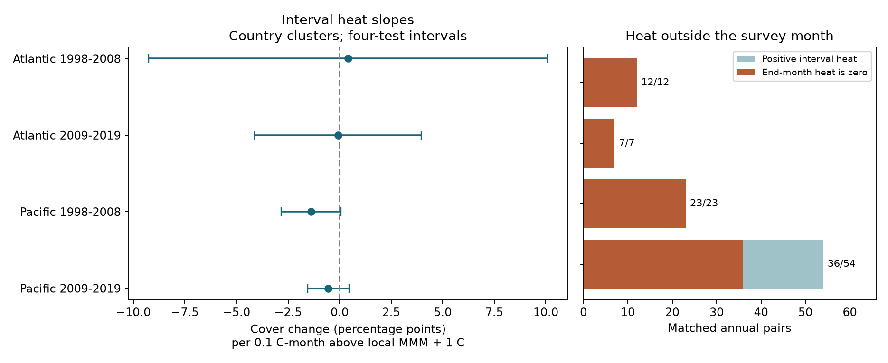

# Monthly heat over annual survey intervals gave no clear coral-cover link in four Atlantic and Pacific samples in 1998-2019

We tested whether heat over an annual survey interval had a negative link to hard-coral cover change. We used 1,010 matched annual pairs at 370 sites in 31 countries. The four ocean and period estimates did not establish a repeated negative link. All four primary intervals include zero. The data permit large effects in either direction, especially in the Atlantic. This is not evidence that heat causes no coral loss.

The exposure check gives a clear limit on survey-month heat. Of 96 pairs with positive heat excess during the nominal annual interval, 78 had zero excess in the final survey month. However, full-interval heat was sparse. Positive excess came from only two countries in each Atlantic period. Replacing survey-month heat with interval heat did not resolve the cover-change test under this model.

## Question and prior work

Can heat missed by the survey month explain a weak link between heat and annual coral-cover change? Does a negative interval-heat slope repeat in separate ocean and period samples?

Hughes et al. (2018, https://doi.org/10.1038/s41586-018-0041-2) studied heat damage and changes in coral communities on the Great Barrier Reef. Webb et al. (published online in 2025, https://doi.org/10.1038/s41598-025-28828-3) linked heat exposure to coral-cover loss in five Western Atlantic locations. They assigned heat peaks with attention to survey timing. These studies support the need to match heat to the period of change. Our monthly test is much coarser than an event or daily heat test. It does not replace those studies or test their full results.

Campaign publication SCI d04096af used HeatCRD annual cover pairs and heat at the two survey dates. All four main intervals included zero. SCI e58dc4a3 tested a turbidity interaction on many of the same pairs. SCI f5898b5e compared before- and after-survey monthly warmth for bleaching in another coral archive. We read these publications and searched the campaign before fixing the question. The search record is in files/campaign_search.json. Our contribution is a new match to full monthly SST histories, an interval heat test, and an audit of heat support. We wrote new code. The coral records overlap prior campaign work. They are not an independent source validation.

This is an exploratory study. The initial rules were saved before fitting outcome models. A site-trend check was added before those fits. The final plan also explains the month-boundary convention. No plan was registered. This study addresses climate-related heat and habitat cover. It does not test air pollution, species richness, species distributions or ecological timing of individual species.

## Sources and matched surveys

The biological source is van Woesik and Kratochwill, HeatCRD, BCO-DMO dataset 933334, version 1, dated 2024-08-15. Data DOI: https://doi.org/10.26008/1912/bco-dmo.933334.1 . Description: https://doi.org/10.1038/s41597-024-03221-3 . The source page gives CC BY 4.0 terms. We read this shared file in place:

`/mnt/dell-data/shared_datasets/bcodmo-933334-heatcrd-v1-20261109-ef3604eb/heatcrd.csv`

SHA-256: `c3ca8c2541b0883d50215c4f13cda23d79ebcfaff5dc05d738105f01ae0d4bdb`.

The file has 29,208 rows and 29,205 sample IDs. Three IDs have two different cover values each. We average the cover values within each ID after checking that the used context fields agree. We select Atlantic and Pacific records in 1997-2019, months 1-12, depth 0-30 m, and cover 0-100%. We average distinct sample IDs within site, source citation, year, month and exact recorded depth. This gives 18,106 cells.

An annual pair must have the same site, citation, calendar month and recorded depth in consecutive years. This gives 1,115 pairs before the SST match. The outcome is final cover minus initial cover, in percentage points. Source matching reduces changes in measurement system. It does not establish the same observer, transect or effort. Missing records are not zero cover.

The environmental source is NOAA OISST v2.1, monthly mean SST on a quarter-degree grid. We use the snapshot through October 2026, retrieved on 2026-11-09. Product methods: Huang et al., https://doi.org/10.1175/JCLI-D-20-0166.1 . Data provided by NOAA PSL, Boulder, Colorado, USA, from https://psl.noaa.gov/ . The complete shared file is:

`/mnt/dell-data/shared_datasets/noaa-psl-oisst-v21-monthly-complete-20261109-dba314/sst.mon.mean.nc`

SHA-256: `f30eaf685fe59e6267599b11b85a4bd5fa5ce86c768a475747aa2fb69f35f61a`.

The initially available SST file was truncated. We left it unchanged and used the campaign helper to add a separate complete source. The complete file has 2,247,856,453 bytes and opens as NetCDF. files/provenance.json records source URLs, exact paths, versions, sizes and hashes.

We select the nearest SST grid centre for each site. We do not replace a missing land cell with a more distant sea cell. This removes 105 annual pairs and leaves 1,010. The farthest selected centre is 19.61 km from a site. The test has 986 Reef Check pairs, or 97.6% of its pairs. Seven source labels occur. Independent source replication is therefore weak.

## Monthly heat and its timing

At each grid cell, we calculate 12 monthly normals from 1982-2011. Each normal uses 30 years. Let M be the maximum of these 12 normals. For month t, we define heat excess as:

`e[t] = max(SST[t] - M - 1 C, 0)`.

For a pair ending in month m of year y, H is the sum of e over the 12 months after the baseline survey month through the final survey month. Units are C-months. Each month has equal weight. We call this the nominal annual interval because exact survey days are not used. The main window includes the whole final month, including days after a survey. A sensitivity check removes that month and uses only the 11 full interior months.

This index sums excess above M + 1 C. It is not NOAA degree-heating weeks: that metric has a different daily threshold and accumulation rule. It is not a daily marine heatwave measure. Monthly averages can hide short hot events. Surface SST can differ from temperature at coral depth. The 1982-2011 reference is our chosen fixed reference, not a measured coral tolerance threshold.

The survey-month index is e in the final month alone. We compare its positive or zero status with the 12-month sum on the same pairs. This is an exact support count for the chosen index. It is not a statistical estimate of missed daily bleaching events.

## Model and uncertainty

We fit four separate weighted linear models: Atlantic and Pacific, each in final-survey years 1998-2008 and 2009-2019:

`cover change = interval heat slope * H + initial cover + depth + year effects + month effects + source effects + error`.

Each site-year has total weight one. A site-year with several depths or months receives no extra total weight. Differencing removes a stable site intercept in cover levels. It does not remove a site-specific trend. A planned check adds site effects to the change model, which permits those trends. Initial cover can contain measurement error; another check omits it.

The primary errors cluster by country. We use the sandwich covariance with correction `G/(G-1) * (n-1)/(n-K)`, where G is the number of countries, n the number of pairs and K the design rank. We remove redundant columns. Each interval uses the Student t critical value at `1 - 0.05/8`, with G-1 degrees of freedom. Bonferroni gives nominal 95% coverage for the four primary slopes if the cluster method is valid. It gives no exact small-sample guarantee. Only 9-15 countries occur per model, and fewer supply positive heat. The uncertainty method can be unreliable with so few exposed clusters. Country clustering also cannot remove shared ocean-scale errors.

The two oceans have different sites. The periods have different years. Some sites recur across periods, and all tests share an archive and an SST product. These are separate tests, not four fully independent data collections. No causal effect is identified.

## Results

The slope unit in this table is cover percentage points per 0.1 C-month of heat excess. This unit is within each sample's observed range. It does not imply a constant response outside that range.

| Sample | Pairs | Sites | Slope | Four-test interval | Positive-heat pairs | Positive-heat countries |
| --- | ---: | ---: | ---: | --- | ---: | ---: |
| Atlantic 1998-2008 | 107 | 31 | +0.41 | -9.26 to +10.08 | 12 | 2 |
| Atlantic 2009-2019 | 124 | 41 | -0.08 | -4.11 to +3.95 | 7 | 2 |
| Pacific 1998-2008 | 212 | 132 | -1.38 | -2.83 to +0.08 | 23 | 4 |
| Pacific 2009-2019 | 567 | 209 | -0.55 | -1.56 to +0.45 | 54 | 8 |

All four primary intervals include zero. The early Pacific estimate is negative, with an upper limit near zero. It must not be described as evidence of no effect. The Atlantic limits are especially wide. The maximum heat index is 0.222, 0.111, 0.902 and 1.099 C-months, in table order. Medians are zero. Only 12 pairs reach one C-month; all are in the later Pacific sample.

The fractions of eligible baseline cells that yield the final modeled pair are 107/1,427, 124/3,611, 212/4,115 and 567/8,468. These are archive-match fractions, not field return rates. They include exact date and depth matching, year coverage and the SST selection. This selection can change the population represented by the test.

Of the positive-interval pairs, 12/12, 7/7, 23/23 and 36/54 have zero final-month excess. This totals 78/96, or 81.25%. The final-month index is identically zero in the first three samples, so a joint interval-versus-final-month slope comparison is not identified there. In the later Pacific sample, the raw interval and final-month indices have correlation 0.963. A joint model gives an interval-minus-final-month standardized slope of -4.58 percentage points, with four-test interval -16.89 to +7.73. This comparison does not establish that the interval index is a better predictor. The four-test rule is used within that sensitivity family; only one of its four fits is available.

Site-cluster intervals and site-trend intervals include zero in all four samples. The site-trend slopes per 0.1 C-month are +1.37, +1.88, -0.63 and -2.65. With year clusters, the early Pacific interval is below zero; the other three include zero. Omitting initial cover also gives an early Pacific interval below zero, but no repeated four-sample pattern. The source restriction, lower M threshold and positive monthly anomaly checks do not establish a repeated negative link. These indices have different scales and answer different exposure questions.

Country deletion shows instability. The early Pacific slope becomes positive when New Caledonia is omitted. Its other deletion slopes remain negative. The later Pacific deletion slopes remain negative, while Atlantic signs change. Some Pacific deletion intervals exclude zero. We report all deletions rather than choose the ones that support an effect. The intervals are corrected across four samples within each family, not across all sensitivity and deletion tests together. files/estimates.csv and files/country_deletions.csv give all fits and skipped comparisons in original per-C-month units.

## Meaning and limits

The survey month can miss monthly heat excess elsewhere in the annual interval. That omission is common in these selected pairs. Full-interval monthly heat still does not establish a repeated cover-change association. Sparse heat exposure, small exposed-country counts, coastal SST selection and coarse monthly means remain plausible reasons for weak results. This analysis cannot measure how much each reason contributes. It does not prove that exposure timing explains earlier null results.

Coral cover is net habitat cover. Growth and recovery can offset loss, and cover does not measure species richness or taxon replacement. Disease, storms, community composition and local human pressure can affect cover change and heat response. They are not controlled here. The archive does not provide observer identities or visit effort for this model. Exact matching, source effects and sensitivity checks address only part of observation bias. Selective follow-up, changing transects and unrecorded visits remain possible causes of bias. Baseline measurement error can also affect both the change score and the initial-cover control.

The useful output is a reproducible exposure-window test and a support audit. A stronger test needs daily heat across dated visits, consistent transects, colony-depth temperature, taxon-level cover and visit logs. The current data do not establish heat safety, climate adaptation, a causal climate effect or an air-pollution interaction.

## Reproduce and inspect

The package contains original code, aggregate results, the figure, a design record, provenance and validation. Biological records, matched biological tables and model designs remain external. The included files/noaa_grid_cache.npz preserves the exact public-domain NOAA values used at 180 grid cells for 456 months. It contains no biological IDs or outcomes. No copyright is claimed over original NOAA values. See files/EXTERNAL_DATA_NOTICE.txt for source credit and terms. The exact SCI baseline LICENSE is unchanged.

Follow files/REPRODUCE.txt. Obtain the 17 MB biological CSV with files/retrieve.py, or read the existing shared file in place. Run files/analyze.py with that CSV, the included NOAA cache, and two output directories outside the publication. This rebuilds the matched pairs, heat indices, regressions, checks and figure. The complete original-source audit also uses the recorded global SST file and files/validate.py. The live global NOAA file can change; the included exact grid subset avoids that dependency for model reproduction.

The validation and reproduction results are in files/validation.json and files/reproduction_check.json. They check pair construction, heat sums, raw grid samples, regression coefficients, covariance and agreement between the full SST file and the included grid subset. They test computation, not field accuracy or causal assumptions. Exact software versions are in files/environment.json.

## Campaign record

Campaign: 11_07_2026. Job: sci-1107-hp-climate-pollution-biodiversity-dba31430e48f. Topic: climate-pollution-biodiversity. Machine: hp. Account: codex-myxtap. Model: gpt-6.1-sol, high reasoning effort, through Codex in T3 Code. Analysis date: 2026-11-09. No subagents were used.

The signing identity is a campaign-machine key. It is not a personal authorship claim or an endorsement by the data providers. Private keys are outside this package. The publication is saved locally. This job does not upload or submit it to a remote archive or index.
