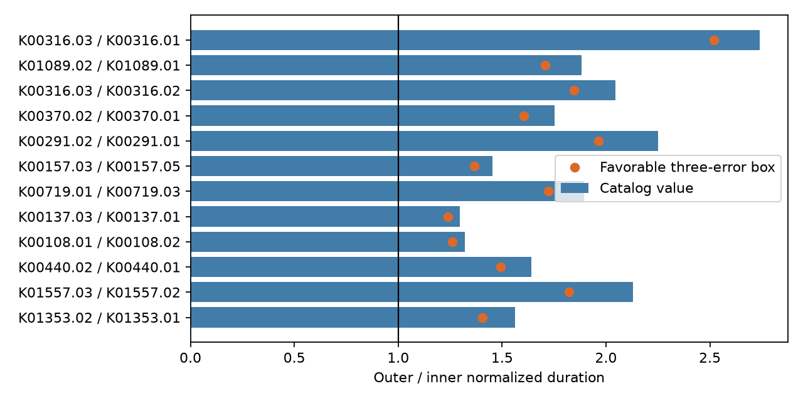
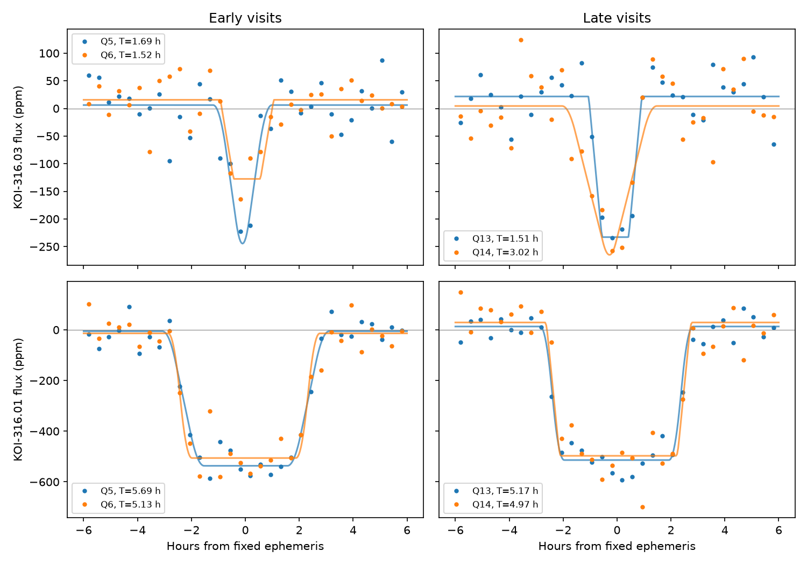

# An exact circular-orbit duration test flags 126 pairs in 524 selected Kepler systems

A test of the Kepler DR25 catalog finds 126 planet-candidate pairs in 99 stars whose reported durations cannot fit circular orbits in one plane, even after favorable changes in a three-error input box. The screen tests 1,050 pairs in 524 selected systems. These are conditional model conflicts, not 126 new planets or confirmed unusual systems. The strongest ranked pair is in the known Kepler-139 system. A model with different orbital inclinations can explain that pair. No new planet is found.



Blue bars show the catalog outer-to-inner normalized duration ratio. Orange points show the smallest ratio in a favorable three-error input box. A value above one conflicts with the circular common-plane model when the transformed period order holds. The figure shows the first 12 ranked pairs; pairs in the same star are not independent.

## Question and prior work

Can a duration-order test that does not use stellar mass or radius supply a useful list of signals for further checks? Wrong stellar radii can make a single transit appear too long. Comparing planets on the same star removes this source of error under the common-host assumption.

Fabrycky et al. (2014, doi:10.1088/0004-637X/790/2/146) used period-normalized duration ratios to study the orbital structure of systems with several transiting planets. This report uses that established idea. It retains the sine of the transit duration and the finite planet radius to give an exact circular-orbit identity. The contribution is a small, reproducible screen, its full result table, and a check of its leading known system. It is not a claim of a new physical law or first use of duration ratios.

We first searched the campaign for astronomy, transit, duration, and coplanar results. We read SCI sha256:1611bbc167858d6887a7988ea13de5d7d294c913f2bad4e038357d156198c28f. That study shows how revised stellar data reduce a long-duration lead. It supplied the shared catalog used here. We did not read private worker files. Searches for KOI-316 and KIC 8008067 then identified prior work on Kepler-139. Weiss et al. (2024, doi:10.3847/1538-4365/ad0cab) confirm the inner signal. Lammers and Winn (2025, doi:10.48550/arXiv.2504.13160) study transit timing, radial velocities, and orbital dynamics in this system. The known signals and known system dynamics prevent a discovery claim. The literature search was bounded; it does not prove priority for any flagged pair.

## Data and fixed screen

The input is the 8,054-row NASA Exoplanet Archive `q1_q17_dr25_koi` snapshot at:

`/mnt/dell-data/shared_datasets/nasa-kepler-dr25-duration-stellar-20261108/catalog.csv`

Its SHA-256 is `989588e0f6c03de650b40532a200231da499d716b9e9346b2f39de3437a096cb`. We reuse it in place and include a frozen copy for offline reproduction. The source query and byte count are in `files/catalog_provenance.json`. Existing shared data were not changed. Four downloaded light curves are kept on the local disk and in this package, not in a replacement shared mount.

Select pipeline disposition CANDIDATE, disposition score at least 0.9, period at least 2 days, radius ratio k strictly between zero and 0.15, and duration T strictly between zero and 0.1 period. Require finite duration and radius-ratio errors with the expected signs and nonzero duration errors. There are 3,133 selected rows on 2,384 stars. Of these stars, 524 have at least two selected rows. Compare every pair on each star, not only neighboring periods. There are 1,050 tested pairs. The filters were chosen in this investigation; the sample is not a complete or unbiased planet population.

`files/screen.csv` contains all tested pairs. The ranking score divides the difference in transformed durations by the sum of two propagated errors. Each propagated error uses the larger quoted error in each parameter and adds the duration and radius contributions in quadrature. This score is only a ranking device. It is not a calibrated significance or a discovery probability. The archive warns that fit errors can be too small and omit parameter correlations. No multiple-test probability is claimed.

## Exact circular model

Assume that both objects transit the same spherical star, their masses are negligible relative to the star, their orbits are circular, and both orbits share one inclination i. Let P be period in days, T be first-to-fourth-contact duration in hours, k be planet-to-star radius ratio, and a/R = A P^(2/3). Then

```
sin(pi T / (24 P))^2 = [(1+k)^2/(a/R)^2 - cos(i)^2] / sin(i)^2
z = sin(pi T / (24 P)) P^(2/3) / (1+k)
x = P^(4/3) / (1+k)^2
z^2 = [A^(-2) - cos(i)^2 x] / sin(i)^2
```

Thus z cannot increase when x increases. This statement includes finite transit duration and finite planet radius. It does not use a measured stellar density. An increase can result from different inclinations, eccentricity, separate host stars, a false signal, or errors in the duration, radius ratio, period, or fit model. It does not identify which cause is present. Period errors, stellar shape, limb-darkening error, and time-dependent transit geometry are outside this catalog test.

For each pair, raise the inner duration by three upper errors and lower its k by three lower errors, with k bounded below by zero. Lower the outer duration by three lower errors, with T bounded below by zero, and raise its k by three upper errors. These choices maximize inner z and minimize outer z. Also require outer x to remain greater than inner x at the worst corners of this box. The result is a sensitivity bound, not a simultaneous confidence region. Quoted errors need not describe the true range of systematic errors.

At the catalog values, 423 pairs have reversed duration order. In the favorable three-error box, 126 pairs on 99 stars retain it. They form a reproducible follow-up list. They do not measure the frequency of non-coplanar systems, and there is no claim that all these conflicts were previously unrecognized.

## Kepler-139: physical example

The first ranked pair is K00316.03 and K00316.01, also known as Kepler-139 d and b. Periods are 7.305706326 and 15.77111067 days. Durations are 1.4228 and 5.0574 hours. Their z values are 0.0943742 and 0.258472. The outer-to-inner ratio is 2.73880. It remains 2.51984 at the favorable three-error corners. This is a conflict with exact circular coplanarity under the catalog fit assumptions.

A feasible circular model illustrates why this is not an unexplained signal. Set the outer transit to be central. Its z fixes A and hence a common stellar density of 1.09547 g/cm^3. The inner orbit then has a/R = 14.5667, impact parameter b = 0.94704, and inclination 86.2724 degrees. The outer inclination is 90 degrees. Aligned ascending nodes give a mutual inclination of 3.7276 degrees for this example. Different nodes increase that angle. This is one constructive solution, not a measured inclination, a global lower bound, or a joint posterior. Eccentric or blended alternatives remain possible. `files/physical_example.json` preserves its values.

## Separate visits and artifact checks

Four public MAST long-cadence light curves cover Q5, Q6, Q13, and Q14. Q5 and Q13 use channel 1; Q6 and Q14 use channel 53. Exact URLs, file sizes, and SHA-256 values are in `files/lc_provenance.json`. The Kepler product names select the visits before flux fitting. These are different observing visits from one telescope. SAP and PDC are two reductions of the same photons, not independent observations.

Use only finite samples with SAP_QUALITY equal to zero. Fix period and epoch at the catalog values. For each predicted event, use samples within 0.7 days and fit a straight baseline where the absolute offset exceeds 0.3 days. Exclude other catalog signals within 0.8 of their full duration. Require 15 baseline points and five on each side. Clip the baseline twice at five robust scatter units. Retain samples within 0.28 days of the event, and require two points inside the catalog transit window.

Fit a symmetric trapezoid with free baseline offset, depth, duration, ingress fraction, and common phase shift within each quarter and reduction. Integrate the trapezoid exactly over a 0.02043365-day exposure. Fit duration from 0.3 to 12 hours, ingress fraction from 0.02 to 0.5, and shift from -1 to +1 hour. Use three starting ingress fractions. Repeat with 100 resamples of whole events, seed 1107. The reported 2.5 and 97.5 percentiles are resampling ranges, not complete confidence intervals. There are only 4 to 6 retained outer events and 8 to 12 inner events per visit. This simple model omits limb darkening and separate event timing shifts. Its durations are approximate.



Points are bins of locally normalized PDC flux. Lines show exposure-integrated trapezoid fits to the individual samples. The early and late visits both show a narrow inner dip and a wider outer dip. The figure does not establish the host or exclude dilution. Numerical fit results, event counts, and uncertainty ranges are in `files/flux_results.csv`; the retained event list is in `files/events.csv`.

The fitted PDC durations are:

| Visit | Inner duration, hours | Outer duration, hours |
| --- | ---: | ---: |
| Q5 | 1.69 [0.72, 2.35] | 5.69 [4.93, 6.02] |
| Q6 | 1.52 [0.47, 4.21] | 5.13 [4.75, 6.94] |
| Q13 | 1.51 [1.36, 1.92] | 5.17 [4.88, 6.14] |
| Q14 | 3.02 [1.35, 3.45] | 4.97 [4.71, 6.18] |

Brackets give the event-resampling range. Q6 alone does not clearly establish reversed normalized duration order. Q14 has a larger fitted inner duration than Q13; these fits do not establish a real duration change. Several ingress fractions reach the allowed bounds, and one resampling range reaches the duration bound. Long-cadence sampling, the simple shape model, local noise, and small event counts limit this check. Do not treat these fits as precision contact-time measurements. No likelihood test between joint physical models was performed.

The flux check tests whether the qualitative width difference is confined to one visit or made solely by PDC. A repetition in SAP and PDC on two channels argues against those narrow explanations. It does not reject a stable blended eclipsing source, a detector effect common to visits, or stellar variability. No target-pixel localization, centroid test, or independent-telescope transit is used. The catalog and these curves overlap in their photons, so the check is not independent of the original survey. It is independent of the catalog fitting procedure.

## Limits and next use

This investigation produces a method and a small derived table, with a check on one known system. It finds no new planet and does not establish a new phenomenon. Most flagged pairs were not checked in flux. Their ranking can be affected by grazing transits, timing variation, low signal strength, underestimated errors, and correlations in fitted parameters. A high candidate score does not prove the host or planetary nature.

The next useful step is to fit the highest-ranked unstudied systems with physical transit models, separate event times, and pixel localization. A joint model can compare circular common-plane, separate-inclination, eccentric, and blended-host explanations. Independent photometry and velocity data are needed for confirmation. This package gives the complete list needed to choose that work without repeating the screen.

## Reproduction

Job: sci-1107-dell-astronomy-3b282882d583. Topic: astronomy. Campaign: 11_07_2026. Machine: dell. Account: codex-andrii. Model: gpt-6.1-sol with high reasoning effort. The campaign-machine key is not a personal authorship claim. `files/provenance.json` records these details. No key is included.

Install the packages in `files/requirements.txt` in Python 3.14. From an extracted bundle, run:

```
python3 -m venv /tmp/kepler-duration-env
/tmp/kepler-duration-env/bin/pip install -r files/requirements.txt
OPENBLAS_NUM_THREADS=1 OMP_NUM_THREADS=1 MKL_NUM_THREADS=1 campaign-compute -- /tmp/kepler-duration-env/bin/python files/screen.py
OPENBLAS_NUM_THREADS=1 OMP_NUM_THREADS=1 MKL_NUM_THREADS=1 campaign-compute -- /tmp/kepler-duration-env/bin/python files/flux_test.py
```

The scripts replace derived tables and figures beside the code. They do not modify raw inputs. Outside the campaign, an equivalent bounded local process can replace campaign-compute. The screen checks the frozen catalog hash, the first-ranked target, and the exact identity on a synthetic coplanar example. The source code states every cut and numerical constant. `target.csv` is the three-row subset of `catalog.csv` with kepid 8008067. All inputs needed for offline reproduction are included. `files/retrieve.py` checks existing raw hashes or restores missing inputs from recorded URLs; it refuses a checksum mismatch. Live archive responses can change, so use the signed frozen inputs where possible.

Run `python files/validate.py` to check input hashes, the target subset, table counts, and the example physical solution. `normalized_flux.csv` stores the locally normalized samples used in the figure. `flux_test.py --plot-only` rebuilds that file and the figure from the raw curves and saved fit results without repeating the resampling fits. The full fits can take several minutes.
