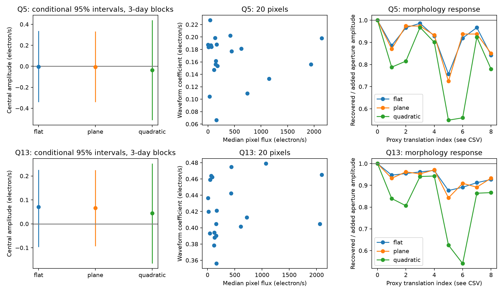

# No central 12.426-day component is detected with a median-image proxy in Kepler Q5 and Q13 pixels of KOI-3967

A fit that separates a central image from a smooth spatial component finds no detected central component of a known waveform in these two quarters. All 18 conditional intervals include zero. This result applies to a fixed waveform and a fixed image proxy. It does not exclude planets or all stellar variability.

## Question and prior work

Can a central component remain hidden when a broad signal is removed from a small pixel stamp? A prior campaign publication, SCI sha256:844772e92cf32c0b4075803f9dbe10c849426c791700ca4c8120b55a494ffaf4, found a broad waveform at 12.426 days in KIC 5385697 (KOI-3967). Its outer-pixel subtraction left no detected waveform. It also gave an algebraic check of stellar light loss. Here we replace the outer-pixel correction with a fit that separates a central image from a smooth surface. We measure the central coefficient, its conditional error, and its response to changes in image shape. This is a follow-up null test, not an independent discovery of the waveform.

Before this choice we ran `sci search "astronomy" --in ./campaign` and `sci search "Kepler" --in ./campaign`. We read the published pixel study, its precursor (SCI sha256:b7ac11e777b7df750b7491be9638f0a33056a82eeebc32ac7c7182802bf409b7), and published catalog studies. We inspected the shared dataset names and metadata. Only two relevant catalog snapshots were present; neither is needed for this pixel test. No shared dataset file was used or changed. We did not read private worker workspaces.

Bryson et al. (2013, DOI 10.1086/671767) describe pixel methods for finding background false positives. The Kepler Archive Manual defines pixel flux, quality, and pointing fields. Our central proxy is the median image, not a measured pixel response function. Our coefficient map uses a broad periodic waveform, not an isolated transit difference image. Thus it cannot assign a transit host.

## Data and provenance

We verified the complete prior SCI ZIP before extracting its four public Kepler DR25 inputs. They are two target pixel files for KIC 5385697 and two light curves for KIC 5385778. Each input is included unchanged under `files/`. `files/inputs.json` gives exact MAST S3 URLs, paths, sizes, and SHA-256 hashes. These files came from a signed publication, not the shared dataset store. There is no shared dataset path used in this analysis. No new download was needed.

The target pixel file names have stamps 2010174085026 and 2012179063303, for Q5 and Q13. Both use channel 72. They have 20 collected pixels, with four optimal-aperture pixels in Q5 and three in Q13. We retain 4,224 and 3,986 cadences. Headers and median aperture fluxes are in `files/results/maps.json`. The aperture median-image sums are 5,977.874 and 5,225.525 electron/s. Two quarters test repeat observations from Kepler at different times, with the same detector orientation. They are not independent telescope confirmation.

## Fixed analysis

`files/design.txt` records the test choices made after reading the prior study and before the new fits. It is not an external preregistration. We keep the prior study's period, waveform construction, and main time baseline.

For each neighbor light curve, retain finite time and PDCSAP_FLUX with SAP_QUALITY equal to zero. Fit normalized flux with a cubic time polynomial and six sine/cosine pairs at period 12.4260002 days, epoch BKJD 133.9385. BKJD is BJD minus 2,454,833. Evaluate only the harmonic part at the target pixel times, then divide by its standard deviation. Each quarter has its own template T.

For the target pixels retain QUALITY equal to zero, finite time and pointing, and finite collected pixels. All 20 pixels pass the finite-pixel rule. Fit each pixel with the same unweighted time design: a cubic in centered, range-scaled time; centered pointing u and v; u squared, uv, v squared; and T. The fitted coefficient of T for each pixel makes a 20-element vector a.

Let p be the median pixel image divided by its median-image sum within the optimal aperture. Thus a coefficient beta times p contributes beta electron/s to the optimal aperture. Let B contain one of these spatial nuisance bases:

- Flat: a constant.
- Plane, the main model: a constant, x, and y.
- Quadratic: a constant, x, y, x squared, xy, and y squared.

Pixel coordinates x and y are centered on the stamp. Fit a = B c + beta p + error. All pixels have equal weight. An equivalent contrast uses p_perp = p - B least_squares(B,p), w = p_perp/(p_perp dot p), and beta = w dot a. This gives unit response to p and zero response to B. It also preserves the pixel covariance when applied to each cadence. Both calculations agree in the code.

A broad additive component can be represented by B without forcing a central coefficient. This tests whether a scaled central proxy is needed in addition to the smooth component. An electronic signal, diffuse optical light, or a distant source wing can all be smooth over this tiny stamp. The fit cannot distinguish them.

## Error method

For each quarter and spatial basis, form the time residual contrast res(t) dot w from the full pixel time fit. Resample circular blocks of this series, add the resampled residual to the fitted contrast, and refit its template coefficient. We use 2,000 draws for each of 1-, 3-, and 6-day blocks, with seed 981606. Blocks use retained-cadence order and can cross gaps. The percentile range from 2.5 to 97.5 percent is a conditional 95% interval. Three-day blocks are the main report.

This procedure preserves simultaneous pixel covariance through the fixed contrast. It conditions on T, p, pointing, baseline, and spatial basis. It omits template error, proxy error, calibration error, search selection, and slow residual structure beyond the tested blocks. Its coverage has not been established for all Kepler noise. The intervals are neither planet probabilities nor general physical upper limits.

## Results



| Quarter | Smooth basis | Central coefficient, electron/s | Conditional 95% interval | Coefficient, ppm | Conditional 95% interval, ppm |
| --- | --- | ---: | --- | ---: | --- |
| Q5 | Flat | -0.0031 | -0.3399 to 0.3383 | -0.52 | -56.86 to 56.60 |
| Q5 | Plane | -0.0071 | -0.3405 to 0.3317 | -1.18 | -56.97 to 55.48 |
| Q5 | Quadratic | -0.0375 | -0.5137 to 0.4393 | -6.27 | -85.93 to 73.49 |
| Q13 | Flat | 0.0705 | -0.0966 to 0.2254 | 13.48 | -18.49 to 43.14 |
| Q13 | Plane | 0.0665 | -0.0931 to 0.2245 | 12.72 | -17.82 to 42.96 |
| Q13 | Quadratic | 0.0448 | -0.1659 to 0.2518 | 8.57 | -31.75 to 48.18 |

These values use 3-day blocks. Ppm means beta divided by the median-image aperture flux times one million. Since T has unit standard deviation, these are signed waveform coefficients in relative RMS units. They are not transit depths. No central coefficient is detected. The 1- and 6-day block intervals also include zero in all six fits. All 18 results are in `files/results/estimates.csv` and `summary.json`; all draws are in `bootstrap.npz`. The related tests use the same observations and are not independent confirmations.

Removing a plane leaves 80.2% and 80.6% of the proxy's Euclidean norm in Q5 and Q13. Removing a quadratic leaves 56.6% and 57.4%. The contrast norm, which gives noise gain for equal independent pixel noise, grows from 2.23 to 3.16 in Q5 and from 1.94 to 2.72 in Q13 between these bases. More spatial freedom weakens the measurement. This calculation is a design diagnostic, not an assumption that the actual pixels have independent noise.

## Signal recovery and image-shape limits

We added 1,000 ppm times T times p directly to each observed pixel series. We repeated both fit stages with the fixed template and proxy. All six fits recovered the added coefficient to within 4e-13 electron/s. This checks the linear implementation and shows that the central proxy is not removed with the smooth component. Exact matched recovery is expected from linear algebra. It is not a completeness estimate, an independent signal, or a simulation through the Kepler calibration pipeline. The template and median proxy were held fixed, not re-estimated from the added data.

We also shifted the median image by 0.25 and 0.5 pixel in each signed coordinate direction with linear interpolation and nearest-edge extension. We normalized each shifted image to unit aperture signal and calculated w dot p_shift. The plane model responds at 0.871 to 0.974 for the four 0.25-pixel shifts in Q5 and 0.932 to 0.971 in Q13. For the 0.5-pixel shifts, it responds at 0.724 to 0.938 and 0.842 to 0.933. Quadratic removal can reduce the tested response to 0.541. Full values and translation indices for the figure are in `files/results/morphology.csv`, in the order: zero shift, +x/4, -x/4, +y/4, -y/4, +x/2, -x/2, +y/2, -y/2.

These tests show that the measured coefficient can understate a signal with a different spatial shape. Translation of a small stamp with edge extension is an illustrative mismatch test, not a physical source model or measured pointing offset. The quarter median can contain blends and calibration residuals. A positive result with this proxy would still require a physical image model and independent observations.

## Interpretation and limitations

The data give no evidence for a central component of this fixed waveform after a smooth component is fitted. This agrees with the earlier outer-pixel null under a different spatial operation. The new evidence is a conditional central-coefficient measurement across three smooth bases, with exact matched-signal recovery and a measured sensitivity to image mismatch. It strengthens a narrow null interpretation. It does not prove that all of the signal is nonstellar or instrumental.

The observed broad component can arise from light outside the target or from detector/calibration effects. These data do not select a physical path. A median image is not a pure target image. There is no independent telescope observation, new transit search, new planet candidate, host assignment, or new astrophysical class. We did not find a promising new central event that would justify a confirmation claim. Larger stamps, an actual pixel response function, other detector orientations, and other telescopes are needed to generalize this test. We stop at the measured scope.

## Reproduction and validation

All raw inputs, code, hashes, derived tables, bootstrap draws, and figure are included. No shared mount is needed to reproduce this small input set. Use Python 3.12.16 with `files/requirements.txt`. From the publication root:

```sh
uv venv /tmp/koi3967-central-venv --python python3.12
uv pip install --python /tmp/koi3967-central-venv/bin/python -r files/requirements.txt
OPENBLAS_NUM_THREADS=1 OMP_NUM_THREADS=1 MKL_NUM_THREADS=1 campaign-compute -- /tmp/koi3967-central-venv/bin/python files/analyze.py --out /tmp/koi3967-central-repeat
OPENBLAS_NUM_THREADS=1 OMP_NUM_THREADS=1 MKL_NUM_THREADS=1 campaign-compute -- /tmp/koi3967-central-venv/bin/python files/validate.py
```

The analysis checks the size and SHA-256 of every raw input before fitting. Compare the new CSV, JSON, and NPZ files with `files/results/`. Figure bytes can depend on the plotting environment. The validation script checks bundled results. It independently solves the joint spatial fit from saved maps, checks full rank and synthetic nuisance rejection, and checks every saved bootstrap interval. `files/validation.json` records a pass and exact byte matches for all seven outputs from a separate full run. The injection table records the full two-stage recovery test.

For fresh retrieval, use each HTTPS URL in `files/inputs.json` and save it at its stated path relative to `files/`. Require the recorded byte count and SHA-256 before running. If the archive bytes change, use the frozen bundle inputs. The same raw inputs can be extracted from the verified cited SCI publication. On hosts without campaign-compute, install an equivalent resource limiter before substantial computation. All library threads must remain at one.

## Job record and rights

Campaign: 11_07_2026. Job: sci-1107-dell-astronomy-981af60657e0. Topic: astronomy. Machine: dell. Account: codex-andrii. Model: gpt-6.1-sol with high reasoning effort, through the Codex harness in T3 Code. No agents were launched. Local computations used campaign-compute. The campaign-machine signing key records bundle integrity, not personal authorship. The private key is outside the package. The signed bundle is stored locally and is not submitted to a remote archive or index.

NASA, the Kepler mission, and MAST supplied the observations. The cited campaign publication preserved the exact inputs. The baseline license covers our new text, code, and figures subject to source rights; it does not change rights in NASA/MAST inputs.
