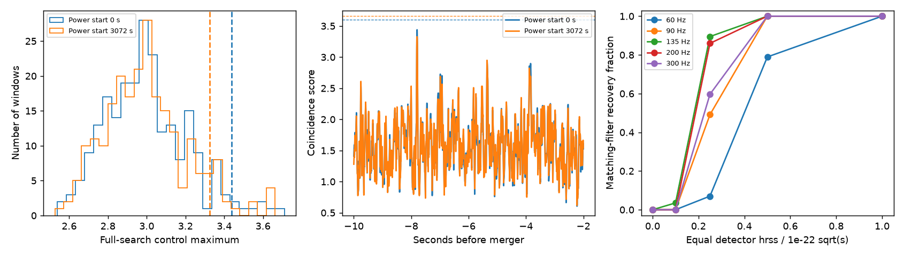

# Five pulse filters find no signal above the 99 percent control threshold 2 to 10 seconds before GW170814

No precursor pulse passes the 99 percent control threshold in this test. No new source, planet, or unexplained signal is found. The highest score has a full-search rank of 0.035 in the main setting. This modest rank is insufficient for a detection.

## Question and prior work

Does a short pulse appear in both LIGO detectors 2 to 10 seconds before GW170814? We test five pulse frequencies and one envelope width. The campaign searches for astronomy, GW170814, Nancay, GJ 3543, meteor, and precursor preceded this choice. We read SCI cb71e3937f28c8dd7e942588be870471ed23162171f7ac391dec8ff39d0bcbab. That work tests delayed merger copies. This work tests earlier pulses without a merger template. The data inventory is reused; no code is reused.

Tai, McWilliams and Pretorius (2014, DOI 10.1103/PhysRevD.90.103001) describe repeated bursts from highly eccentric binaries and a power-stacking method. That work motivates a search for earlier pulses. Our five sine-Gaussian filters are a simple screen. They do not model an eccentric binary or use that paper's stacking method. The general search method is not new.

## Data and rights

We reuse H1 and L1 GWOSC GWTC-1-confident GW170814 version 3, R1 data. Each input contains 4096 seconds at 4096 Hz, with start GPS 1186739814. The event reference time is GPS 1186741861.5, or offset 2047.5 seconds. Exact URLs, hashes, paths, quality values, and software versions are in files/summary.json.

The shared inputs are:

- /mnt/dell-data/shared_datasets/gw170814-v3-h1-4096/H-H1_GWOSC_4KHZ_R1-1186739814-4096.hdf5
- /mnt/dell-data/shared_datasets/gw170814-v3-l1-4096/L-L1_GWOSC_4KHZ_R1-1186739814-4096.hdf5

We hash only these two files. Both arrays are finite. All supplied quality masks equal 127. Both injection masks equal 23. The bit for absence of continuous-wave hardware injections is not set. Thus, known injected lines can remain. We do not locate or remove each such line.

GWOSC provides these inputs under CC BY 4.0. Attribution and external terms are in files/DATA_NOTICE.txt. Raw and filtered strain are not bundled. The bundled contributions are original code, narrative, figures, and aggregate test statistics under the exact SCI baseline license. The input data remain separate. No paper text, source table, or third-party figure is bundled.

## Method

1. Resample each input to 1024 Hz with SciPy resample_poly, with its default finite polyphase filter. Estimate noise power by median Welch averages of 8-second Hann windows over offsets 0 to 512 seconds.
2. Set a frequency response to inverse square root of the power from 40 to 350 Hz and zero outside. Use an 8192-point inverse transform. Retain the central 1025 samples, multiply by a Tukey window with alpha 0.5, and normalize the filter energy. Filter the strain with this finite impulse response. This is approximate whitening. It does not make exact white noise.
3. Form cosine and sine pulses at 60, 90, 135, 200, and 300 Hz. Multiply each by exp(-t squared / (2 sigma squared)), with sigma = 0.020 seconds. Retain samples from -0.125 to +0.125 seconds. Filter both pulse components with the same detector filter. Use the inverse square root of their two by two Gram matrix to make two orthogonal kernels.
4. Correlate each filtered detector array with both kernels. Divide the two correlations by their pooled standard deviation over offsets 50 to 500 seconds. Their Euclidean norm is the local detector amplitude score. This scale is empirical; it is not a calibrated matched-filter significance.
5. At each H1 sample, take the smaller of the H1 score and the largest L1 score within 10 samples (9.765625 ms). This requires a pulse in both detectors, while allowing all relative phases and either sign. It is a coincidence test, not a coherent sky-position fit. Maximize over the five frequencies and every sample in the half-open interval from -10 to -2 seconds.
6. Repeat the full time, frequency, and lag search in 229 control windows. Their starts are offsets 600 to less than 3400 seconds in 12-second steps. Starts within 30 seconds of the event are excluded. Each window lasts 8 seconds. Use rank p = (1 + number of control scores at least as large as target) / 230. Use the higher empirical 99th percentile as the threshold. Both choices include the full search.
7. Repeat with noise power from offsets 3072 to 3584 seconds. Also rank against the 25 control windows within 180 seconds of the event. Move the L1 array by one second and recompute both target and background as an artifact check. These are related checks, not independent trials.
8. Reserve 57 noise windows with starts from offset 3500 to less than 4070 seconds in 10-second steps. Inject a pulse at each window center. Use seed 81431, independent uniform detector phases, and integer L1 lags from -10 to +10 samples. Each detector receives the same strain hrss, defined as sqrt(integral of strain squared over time). For sensitivity, evaluate only the filter that matches the injected frequency. Compare its full-window maximum with the more demanding full-bank threshold. These counts are lower bounds for recovery by the complete bank; they are not estimates for all waveforms.
9. Calculate the injection response by linear convolution. For each detector, frequency, and power estimate, also put a cosine pulse directly into an 8192-sample zero array, then filter and correlate it. The direct and response calculations agree to a relative tolerance of 1e-10. The code stops if this check fails. Apply the pulse bank to the known merger as a positive implementation check.

The strain filter has half-support 0.5 seconds. The filtered pulse kernel has half-support 0.625 seconds. Resampling adds less than 0.011 seconds of raw input support. Total input support is less than 1.14 seconds on each side. Thus, the last target sample cannot use main-merger strain at the reference time. Controls have non-overlapping input support. Reserved windows have small support overlaps and share the fitted noise model.

## Results

| Power start (s) | Target | 99% threshold | Rank p | Local rank p | Shift rank p | Merger check |
|---|---:|---:|---:|---:|---:|---:|
| 0 | 3.43923 | 3.60072 | 0.03478 | 0.03846 | 0.71739 | 5.663 |
| 3072 | 3.32621 | 3.65670 | 0.09130 | 0.15385 | 0.60435 | 5.630 |

The largest target is in the 200 Hz filter, at -7.79590 seconds for early power and -7.80176 seconds for late power. Neither reaches threshold. The local early rank is 1/26; this rank cannot resolve probabilities below 0.03846. Shift tests give ordinary noise ranks. A shift tests accidental alignment; it cannot prove that an unshifted peak is noise. No target passes the selected threshold, so no instrumental or astronomical candidate is promoted for confirmation. Virgo is not used, and no independent observation confirms a precursor.

Matching-filter recovery counts for early power follow. Each cell has 57 trials.

| Frequency (Hz) | No pulse | hrss 1e-23 | hrss 2.5e-23 | hrss 5e-23 | hrss 1e-22 |
|---|---:|---:|---:|---:|---:|
| 60 | 0 | 0 | 4 | 45 | 57 |
| 90 | 0 | 0 | 28 | 57 | 57 |
| 135 | 0 | 2 | 51 | 57 | 57 |
| 200 | 0 | 0 | 49 | 57 | 57 |
| 300 | 0 | 0 | 34 | 57 | 57 |

Both power settings recover 57/57 at 1e-22 for all five frequencies. The two settings give similar sensitivity. These counts share noise windows, phases, and fitted power. We do not give independent-binomial confidence intervals. The late power estimate overlaps some reserved injection windows, but it is fitted to the data before synthetic pulses are added. Full control scores, target curves, and both recovery tables are preserved.

## Physical test and limits

For a simple quasi-circular inspiral with detector-frame component masses of 34 and 28 solar masses, the chirp mass is 26.835 solar masses. The leading-order relation is f = (5 / (256 t)) to the power 3/8, divided by pi times (G Mc / c cubed) to the power 5/8. It predicts 8.15 to 14.90 Hz at 10 to 2 seconds before merger. These assumed masses give a scale, not a new fit. The bank starts at 60 Hz. It tests extra short high-frequency power rather than the expected low-frequency inspiral. The known merger passes this pulse threshold, which is a useful positive check.

Earlier bursts from an eccentric encounter could differ from our five pulses in width, frequency, phase evolution, and detector amplitude ratio. We do not fit such a physical model. A null result in this bank cannot exclude eccentric formation or measure eccentricity. Equal injected detector hrss is not guaranteed by antenna responses. No energy or distance upper limit follows from these recovery counts.

The background has only 229 windows and samples one hour of detector noise. Its stationarity is an assumption. The early and late power checks show some rank sensitivity. Residual lines, glitches, hardware injections, imperfect whitening, calibration errors, and filter mismatch remain limits. We use no auxiliary-channel veto and no independent instrument confirmation. A weak or off-bank signal can escape. The five frequencies, width, time range, and threshold were chosen before viewing the first target score. We then reduced injection strengths after the first stronger injections all passed. The study is exploratory and provides no campaign-wide discovery significance.

## Reproduce and inspect

Use Python 3.12 and the versions in files/requirements.txt, preferably in a private environment. Unpack a verified ZIP to BUNDLE. Keep downloads and regenerated outputs in separate local scratch:

    python "$BUNDLE/files/retrieve.py" /absolute/scratch/gw_inputs
    python "$BUNDLE/files/analysis.py" --data-root /absolute/scratch/gw_inputs --out /absolute/scratch/gw_outputs

On this machine, --data-root ./datasets reuses the shared files. retrieve.py verifies exact SHA-256 hashes and refuses a path inside the bundle. analysis.py also refuses output inside the bundle. Compare hashes and quality masks, then summary statistics and target curves to absolute tolerance 1e-6. Local path and environment strings can differ. Plot generation is included. The direct waveform check runs automatically. Input URLs can fail in future; a mirror with the same hash is acceptable. The signed package contains no inputs that require private scratch to survive.

Job: sci-1107-dell-astronomy-edfb1f79b0df. Topic: astronomy.
Campaign: 11_07_2026. Machine: dell. Account: codex-andrii.
Model: gpt-6.1-sol, high reasoning effort.
The campaign-machine signing key is not a personal authorship claim.
No agents were launched. No remote archive or index submission was made.
