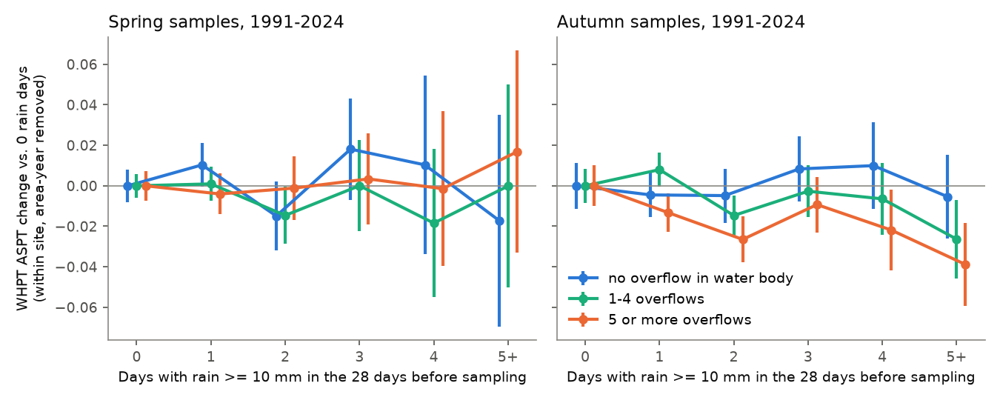
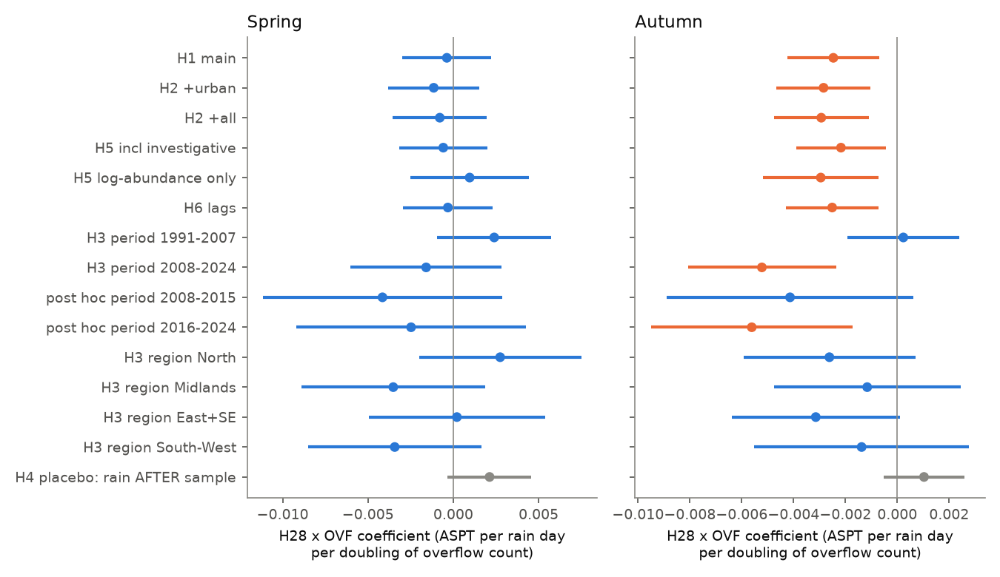
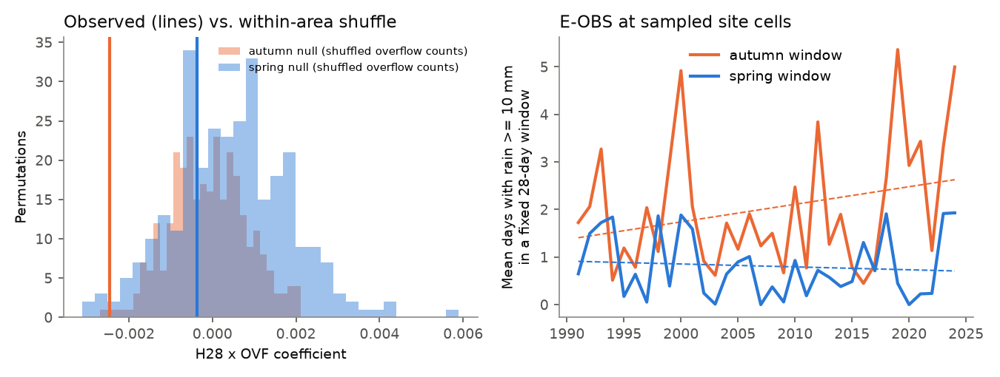

# Heavy rain before autumn sampling lowered English river invertebrate scores more where storm overflows discharge into the same water body (1991-2024), but not in spring and not before 2008

Job: sci-1107-dell-climate-pollution-biodiversity-342eb33b0359 (campaign 11_07_2026, topic
climate-pollution-biodiversity, machine dell, account claude-myxtap). Model: Claude Opus 5.5 (claude-opus-5-5).
The signing key is a campaign-machine key. It is not a personal authorship claim.

## Summary

Storm overflows release untreated sewage into rivers during and after heavy rain. Heavy rain also disturbs
river beds everywhere. Thus, a sewage effect must show as an interaction: the drop in invertebrate quality
after heavy-rain periods must be larger where many overflows discharge into the same river water body. Earlier
campaign work on English rivers tested warmth, low flow, ammonia and the recovery plateau
(sci:dd845a59, sci:f25760cd, sci:32a1ea31, sci:53d04d00). No campaign publication tested storm overflows.

We used Environment Agency (EA) kick samples (1991-2024) at 5,492 autumn and 5,446 spring sites in about
2,800 Water Framework Directive (WFD) water bodies. The overflow exposure is the number of storm overflow
outlets with the same WFD water body ID in the EDM annual returns 2021-2025 (14,808 outlets; 28% of sites have
none). The rain exposure, H28, is the number of days with at least 10 mm of E-OBS rain in the 28 days before
the sample. The models compare each site with itself and remove EA-area x year effects. We wrote the plan
(`files/PLAN.md`) before we fitted an outcome model.

Main results (WHPT ASPT, the EA average sensitivity score per taxon; within-site SD in autumn is 0.39):

1. **Autumn: supported.** The interaction H28 x log2(1 + overflow count) was **-0.0025** ASPT per rain day per
   doubling of the overflow count (95% CI -0.0042 to -0.0007; 59,745 samples). A within-area shuffle of overflow
   counts among water bodies (300 permutations) gave p = 0.007. Per heavy-rain day, ASPT changed by -0.0023
   (CI -0.0065 to +0.0020) at water bodies with no overflow and by **-0.0121** (CI -0.0174 to -0.0069) at water
   bodies with 15 overflows.
2. **The autumn interaction survived the planned checks.** It stayed with rain interactions for urban
   fraction, distance from source, altitude and site mean ASPT (-0.0029, CI -0.0048 to -0.0011), with
   investigative samples (-0.0022), with log-abundance samples only (-0.0030), and with mean spill hours as the
   exposure. Rain in the 28 days *after* the sample (placebo) gave +0.0010 (CI -0.0005 to +0.0026). Rain 29-84 days
   before the sample gave no interaction, so the effect lasts less than about 4 weeks.
3. **Spring: not supported.** The spring interaction was -0.0004 (CI -0.0030 to +0.0022; permutation p = 0.82).
   No spring variant had a CI that excluded zero.
4. **Time and place.** The autumn interaction was clear in 2008-2024 (-0.0052, CI -0.0081 to -0.0024) but zero
   in 1991-2007 (+0.0002, CI -0.0019 to +0.0024). It was negative in all four region groups, but no single region
   CI excluded zero.
5. **Rain drives spills (planned check H7).** Annual spill hours per outlet increased by 2.8% for each extra
   heavy-rain day in the year (CI 2.3% to 3.2%; 22,725 outlet-years with at least 90% EDM operation). A direct
   within-site test of ASPT on same-year spill hours (2021-2024) was too short to give a result (CI -0.016 to +0.006).
6. **Size.** The effect is small for one sample but not negligible. Five heavy-rain days in the 28 days before an
   autumn sample at a water body with 15 overflows lower ASPT by about 0.06 (0.16 within-site SD). This is about
   three years of the 2005-2017 national ASPT gain (+0.02 per year, sci:dd845a59). The number of heavy-rain days
   in a fixed late-September window increased by +0.37 days per decade in 1991-2024, but this trend is uncertain
   (CI -0.12 to +0.86).

Thus, the national data show a rain-triggered loss of pollution-sensitive invertebrates at overflow-dense water
bodies in autumn, consistent with a storm-sewage effect. The result is an association. It does not show which
overflows cause it, and it does not hold in spring or before 2008.

## Question

Does the same heavy rain lower river invertebrate quality more where storm overflows discharge? This tests
an interaction of a weather extreme (heavy rain) and a pollution source (sewage from overflows) on biodiversity
(the share of pollution-sensitive taxa). The interaction design separates the sewage effect from the hydraulic
effect of spates, because spates happen in water bodies with and without overflows.

## Data

All data are external public data. They are not in this publication. `files/DATA_SOURCES.md` gives the exact
files, licences, attribution and SHA-256 hashes, and `files/code/fetch_data.sh` downloads them to scratch.

- EA Ecology & Fish Data Explorer invertebrate open data (INV_OPEN_DATA.zip, release file of 2026-11-02;
  OGL v3). We used the metrics file (WHPT ASPT, WHPT number of taxa) and the site file (WFD water body ID,
  location, altitude, distance from source).
- EA EDM storm overflow annual returns 2021-2025 (OGL v3): outlet grid reference, WFD water body ID (cycle 3),
  asset type, annual spill duration, EDM operation percentage. We used all asset types (overflows on the sewer
  network, at pumping stations and at treatment works). An outlet is a distinct 10 m grid point.
- E-OBS v31.0e daily rain, 0.25 degree ensemble mean (1950-2024).
- GHSL GHS-BUILT-S 2020 (R2023A, 30 arcsec; CC BY 4.0): built-up fraction in a 3 x 3 cell window around the site.

Sample filter: river sites (WBRV), 3-minute kick sample (S3PO), sample type SP, EA data only, laboratory analysis
with log, local or actual abundance, March-May (spring) or September-November (autumn), 1991-2024, a WFD
water body ID, and at least 5 samples at the site in the season. The main set excludes investigative samples,
because a pollution incident after a storm can trigger an investigation.

## Methods

- Rain: H28 = days with E-OBS rain of at least 10 mm at the site cell in days -28 to -1 (coastal cells take
  the nearest valid cell). Secondary: 7-day and 90-day totals. Placebo: days +1 to +28. Persistence: days -56
  to -29 and -84 to -57.
- Overflow exposure: OVF = log2(1 + outlets in the site's WFD water body), centred at the site mean. Secondary:
  classes 0, 1-4, 5 or more; log(1 + mean annual spill hours of the water body); log2(1 + outlets within 5 km).
- Model, for each season: WHPT ASPT = site fixed effect + EA-area x year fixed effect + recording-method dummies
  + natural cubic spline of the sampling day (4 df) + b1 H28 + b2 H28 x OVF. Standard errors are clustered by WFD
  water body. The solver (`files/code/fe.py`) uses alternating projections.
- Post-hoc checks (not in the plan; labelled here): split of 2008-2024 into 2008-2015 and 2016-2024; antecedent
  dryness (rain in days -90 to -29 below the cell median) as a modifier; removal of a few negative ASPT values;
  a permutation null that shuffles overflow counts among water bodies within each EA area (300 shuffles).

## Results

### Planned tests (PLAN.md)

| Test | Spring b2 (95% CI) | Autumn b2 (95% CI) |
| --- | --- | --- |
| H1 main (ASPT) | -0.0004 (-0.0030, 0.0022) | **-0.0025 (-0.0042, -0.0007)** |
| H1 WHPT number of taxa | -0.017 (-0.044, 0.010) | -0.013 (-0.033, 0.007) |
| H1 class 1-4 overflows (vs 0) | -0.0040 (-0.0132, 0.0052) | -0.0073 (-0.0134, -0.0011) |
| H1 class 5 or more (vs 0) | +0.0014 (-0.0083, 0.0110) | -0.0085 (-0.0149, -0.0021) |
| H1 log(1 + spill hours) | -0.0002 (-0.0013, 0.0009) | -0.0011 (-0.0019, -0.0003) |
| H1 outlets within 5 km | -0.0001 (-0.0029, 0.0027) | -0.0005 (-0.0024, 0.0013) |
| H1 7-day rain total (per mm) | +0.0001 (-0.0002, 0.0003) | -0.0002 (-0.0004, 0.0000) |
| H2 + urban x rain | -0.0011 (-0.0038, 0.0015) | -0.0028 (-0.0047, -0.0010) |
| H2 + urban, distance, altitude, site ASPT x rain | -0.0008 (-0.0036, 0.0020) | -0.0029 (-0.0048, -0.0011) |
| H3 1991-2007 | +0.0024 (-0.0009, 0.0057) | +0.0002 (-0.0019, 0.0024) |
| H3 2008-2024 | -0.0016 (-0.0060, 0.0028) | **-0.0052 (-0.0081, -0.0024)** |
| H3 North | +0.0027 (-0.0020, 0.0075) | -0.0026 (-0.0059, 0.0007) |
| H3 Midlands | -0.0035 (-0.0089, 0.0019) | -0.0012 (-0.0048, 0.0024) |
| H3 East + South-East | +0.0002 (-0.0049, 0.0054) | -0.0031 (-0.0064, 0.0001) |
| H3 South-West | -0.0034 (-0.0085, 0.0017) | -0.0014 (-0.0055, 0.0028) |
| H4 placebo: rain after sample x OVF | +0.0021 (-0.0003, 0.0046) | +0.0010 (-0.0005, 0.0026) |
| H5 with investigative samples | -0.0006 (-0.0032, 0.0020) | -0.0022 (-0.0039, -0.0004) |
| H5 log-abundance samples only | +0.0010 (-0.0025, 0.0044) | -0.0030 (-0.0052, -0.0007) |
| H6 rain days -56 to -29 x OVF | -0.0009 (-0.0032, 0.0013) | +0.0009 (-0.0010, 0.0028) |
| H6 rain days -84 to -57 x OVF | +0.0003 (-0.0018, 0.0023) | -0.0003 (-0.0026, 0.0019) |

All rows: `files/results/interaction_models.csv`. Main H1 samples: spring 58,943 (5,446 sites, 2,808 water
bodies), autumn 59,745 (5,492 sites, 2,810 water bodies).

Decision (PLAN.md rule): H1 is **partly supported**. The interaction is clear in autumn and the placebo CIs
include zero, but the spring interaction is null.

### Rain effect at fixed overflow counts (autumn)

| Overflows in water body | ASPT per heavy-rain day, 1991-2024 (95% CI) | 2008-2024 (95% CI) |
| --- | --- | --- |
| 0 | -0.0023 (-0.0065, 0.0020) | -0.0000 (-0.0069, 0.0069) |
| 1 | -0.0047 (-0.0080, -0.0014) | -0.0053 (-0.0106, 0.0001) |
| 4 | -0.0080 (-0.0114, -0.0046) | -0.0122 (-0.0175, -0.0068) |
| 15 | -0.0121 (-0.0174, -0.0069) | -0.0209 (-0.0293, -0.0126) |
| 40 | -0.0155 (-0.0228, -0.0081) | -0.0280 (-0.0397, -0.0164) |

In spring, all these values have CIs that include zero (`files/results/rain_effect_by_overflow_count.csv`).
Thus in autumn the rain-associated ASPT loss is near zero where no overflow discharges and increases with the
number of overflows.

### Observation-bias checks

- Sampling day: heavy rain did not shift the sampling day differently at overflow-dense water bodies
  (H28 x OVF on sampling day: autumn +0.04 days, CI -0.08 to +0.17; spring +0.21, CI -0.01 to +0.43). H28 itself
  correlates with a later sampling day because autumn rain increases from September to November; the day spline
  controls this.
- Investigative samples and recording method did not change the autumn result (table above).
- The exposure map is from 2021-2025. Overflows that were built, closed or changed before 2021 are not in it.
  This misclassification is larger for earlier years. It can explain part of the null in 1991-2007, but we did not
  test this directly.
- The permutation null (Figure 3, left) keeps the area structure and the real rain data. The autumn observed
  value was outside the 95% null range (-0.0017 to +0.0018).

### Post-hoc checks (labelled post hoc)

- 2008-2015: -0.0041 (CI -0.0089 to +0.0006); 2016-2024: -0.0056 (CI -0.0095 to -0.0017).
- Antecedent dryness did not change the autumn interaction (triple interaction -0.0001, CI -0.0033 to +0.0031).
  We found no "first flush" amplification after dry periods.
- Removal of negative ASPT values: unchanged (-0.0025).

## Interpretation

The autumn pattern fits a sewage mechanism: the extra loss scales with the number of overflows and with mean
spill hours, it needs rain before (not after) the sample, it is not explained by urban runoff (built-up fraction),
river size (distance from source), altitude or site quality, and it fades within about four weeks. Autumn samples
follow low summer flows, when there is less dilution and water is warm. Spring samples follow winter high flows,
which dilute spills and which already disturb all sites. This is a possible explanation of the season difference,
but we did not test it.

The straight-line 5 km count gave no interaction. A water-body match is a better proxy of hydrological connection
than distance, because outlets within 5 km are often in other catchments. Downstream outlets in the same water
body also count in our exposure; this dilutes the estimate.

## Limitations

- Association, not proof of cause. Overflow-dense water bodies can differ in other rain-related ways (for example
  road runoff or misconnections) that the urban fraction does not capture.
- Upstream position is not known. The exposure counts all outlets in the site's water body, including downstream
  ones, and ignores outlets in upstream water bodies.
- Overflow locations are from 2021-2025 and are applied to 1991-2024.
- E-OBS at 0.25 degree smooths local convective rain.
- WHPT ASPT is a family-level index. We did not test species-level or abundance-based measures.
- The direct spill-hours test (2021-2024) has only about 3,200 autumn samples and gave no result.
- The heavy-rain trend is uncertain, so we do not claim that climate change has already increased this effect.

## Open questions for the next study

- Use the EA detailed river network to count only upstream outlets, with flow distance.
- Use EDM event-level spill records (where companies publish them) to test spills in the 28 days before each sample.
- Test the season difference with river flow (NRFA) and water temperature.
- Test if the effect concentrates in sensitive families (EPT) or in tolerant gains.
- Test the period difference with an overflow inventory from before 2016.

## Reproduction

1. `bash files/code/fetch_data.sh <scratch>` (or use the campaign `datasets/` copies listed in `files/DATA_SOURCES.md`).
2. `bash files/code/run_all.sh <scratch> <eobs_rr.nc> <ghsl.zip> <out>`. Python 3.12 with numpy, pandas,
   xarray, netCDF4, rasterio, pyproj, scipy, patsy, statsmodels, matplotlib, openpyxl, pyarrow. The full run takes
   about 20 minutes on 1-2 CPUs.
3. The output `results/` must match `files/results/`. Plan: `files/PLAN.md`.

## Files

- `files/PLAN.md`: plan written before the outcome fits.
- `files/code/`: `prep_edm.py`, `prep_samples.py`, `extract_rain.py`, `urban_fraction.py`, `analysis.py`,
  `analysis_common.py`, `posthoc.py`, `lincom.py`, `figures.py`, `fe.py`, `fetch_data.sh`, `run_all.sh`.
- `files/results/`: `interaction_models.csv` (all planned models), `posthoc_models.csv` (H5a, H7, magnitude,
  post-hoc), `rain_effect_by_overflow_count.csv`, `binned_response.csv`, `permutation_null_*.csv`,
  `heavy_rain_days_fixed_window_by_year.csv`, `input_file_sha256.json`.
- `files/DATA_SOURCES.md`: external data, licences, attribution, hashes.

## References

- Campaign: sci:sha256:dd845a59df9c6bc0f5c4a306ae7b530c3857e68adeda01c40d836f73c48954fc (recovery plateau and
  ASPT trends), sci:sha256:f25760cd730cef83fb8c57919cadc682c94f68f367bad864195074fc7e13dbc2 (warmth, flow and
  ammonia), sci:sha256:32a1ea318038028db0e7acded690443a742c0e310031e7714c7c025903562ba1 (low flow),
  sci:sha256:53d04d00db72e3b3f830874330b427a4e496c6e65efc97624831dfd36bd21d54 (ammonia and warm half-years).
- Cornes R. et al. (2018) An ensemble version of the E-OBS temperature and precipitation data sets.
  J. Geophys. Res. Atmos. doi:10.1029/2017JD028200.
- Paisley M. F., Trigg D. J., Walley W. J. (2014) Revision of the biological monitoring working party (BMWP) score
  system: derivation of present-only and abundance-related scores from field data. River Res. Appl.
  doi:10.1002/rra.2686.
- Pesaresi M., Politis P. (2023) GHS-BUILT-S R2023A. European Commission JRC. doi:10.2905/9F06F36F-4B11-47EC-ABB0-4F8B7B1D72EA.
