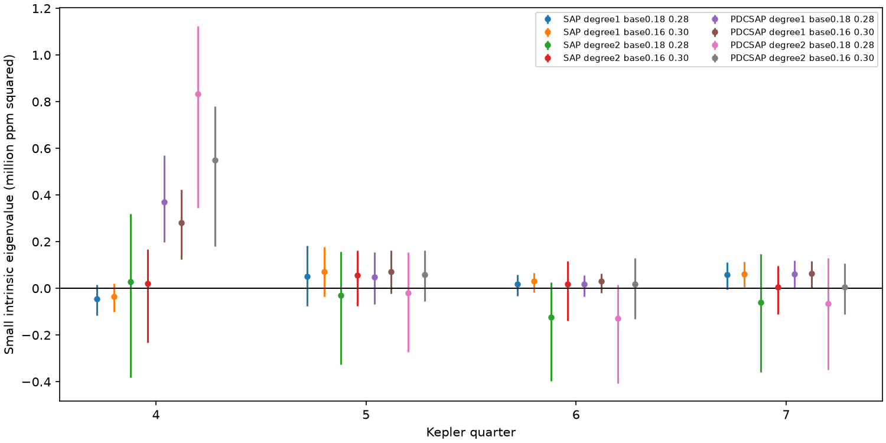
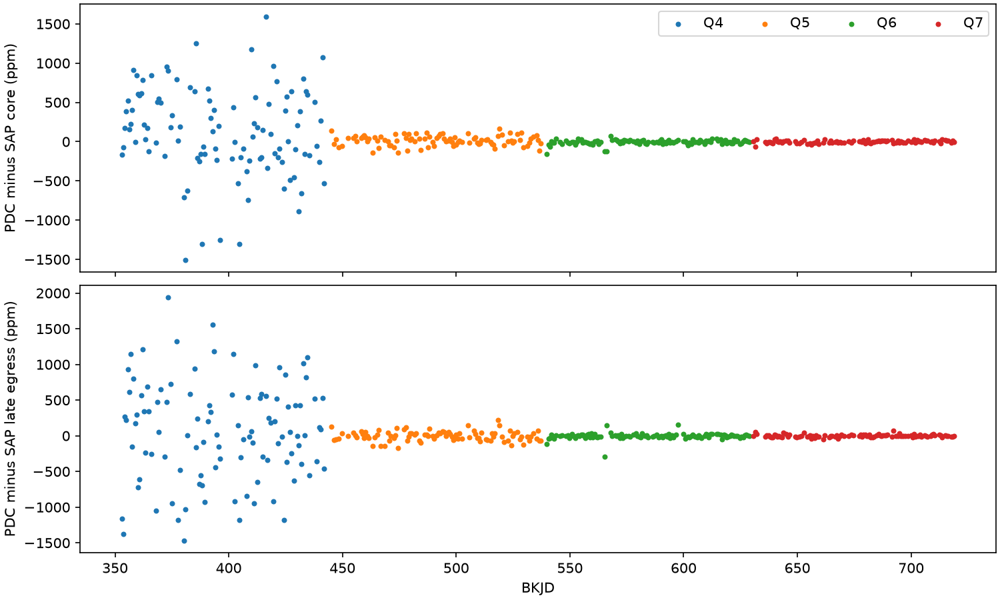
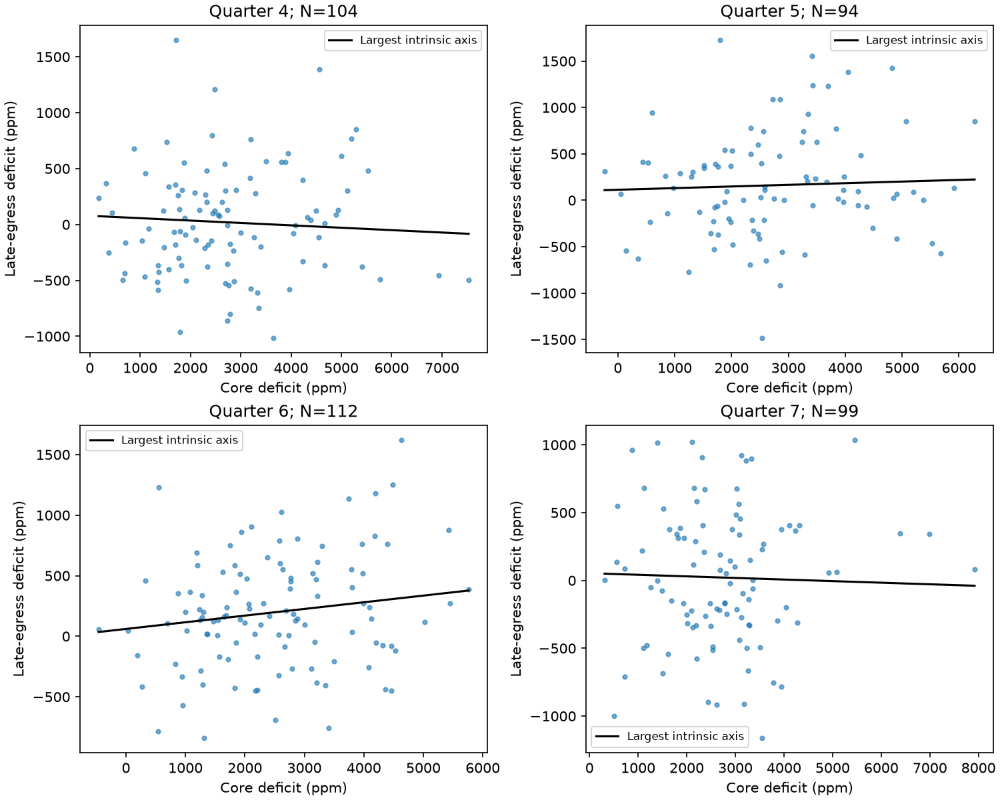

# Kepler quarter 4 corrected flux gives a core and egress variance excess that raw flux does not confirm

## Result

We tested a fixed transit shape with variable amplitude for KIC 12557548. This is a known system with dusty transits. We used public Kepler release 25 long-cadence data from quarters 4 to 7. The primary selection gives 409 events. A core and late-egress covariance test gives an excess in corrected quarter 4 flux. Raw aperture flux does not confirm that excess. Thus, these data do not give a result that is stable under the choice of flux product.

The table gives the small eigenvalue of the measured covariance after subtraction of the estimated error covariance. Units are square parts per million (ppm). A negative estimate can occur after error subtraction. It is not a negative physical variance. Intervals are conditional 95 percent block intervals. They do not include all instrument or baseline uncertainty.

| Quarter | Events | Raw flux estimate | Raw flux interval | Corrected flux estimate | Corrected flux interval |
| --- | ---: | ---: | --- | ---: | --- |
| 4 | 104 | -44,271 | -116,565 to 16,660 | 370,784 | 198,009 to 569,741 |
| 5 | 94 | 51,632 | -76,243 to 183,042 | 49,758 | -68,181 to 155,205 |
| 6 | 112 | 18,721 | -33,010 to 58,077 | 17,400 | -34,485 to 56,472 |
| 7 | 99 | 58,310 | -4,431 to 111,632 | 60,370 | -2,227 to 119,489 |



All four quarter 4 raw-flux intervals include zero. All four corrected-flux intervals have positive lower limits. Corrected-flux estimates range from 282,018 to 833,045 square ppm. This difference remains with both linear and quadratic local baselines. Quarter 7 has a positive lower limit with one linear baseline window, but the quadratic tests do not retain it. We did not correct these exploratory tests for multiple comparisons.

For identical accepted events, the root mean square of the corrected-minus-raw core deficit is 574 ppm in quarter 4. The late-egress value is 694 ppm. The corresponding values in quarters 5, 6, and 7 are 65/68, 31/41, and 16/19 ppm. These are differences between locally reduced products, not absolute pipeline correction amplitudes. They do not identify which product is more accurate.



## Question and prior work

Can one fixed transit profile with variable amplitude explain the joint variation of the core and late egress under a simple measurement model?

This question can separate variation in total dust absorption from variation in transit shape. A fixed optically thin cloud shape whose column density changes would give one amplitude direction. A change in the relative amount or location of dust can add a second direction. A time shift, an error in the baseline, or an instrument effect can also add a second direction.

Van Werkhoven et al. (2014) already found that a simple one-dimensional exponential tail does not explain the full short-cadence data. They fitted a two-component model. Van Lieshout et al. (2016) studied physical dust-tail models. We do not claim the first evidence for a complex or variable transit shape. This study adds a small, reproducible diagnostic of the dependence on the flux product. It does not refit a physical grain model or overturn those results.

Before selection, we searched the campaign for astronomy, KIC 11084727, and KIC 12557548. Published work on KIC 11084727 already covered several artifact and repeat tests. Campaign publication `sha256:500bd31905c1520c2526dc0a6dc8f005e99d01386659c3bd62848d3585b3f74c` supplies the four raw files and a catalog record used here. Its question was adjacent-depth correlation. We also found later campaign tests of depth correlation, time direction, and quiet-event clustering. Our question uses two parts of each transit instead of neighboring transit depths. We read published results only.

## Data and provenance

The period is 0.65355361 days and the epoch is BKJD 132.058957, from the NASA Exoplanet Archive `q1_q17_dr25_koi` table. BKJD is BJD minus 2454833. The selected row is in `files/catalog_row.json`. We directly checked the period and epoch in the shared catalog at:

`/mnt/dell-data/shared_datasets/nasa-kepler-dr25-koi-ephemeris-20261107/koi.csv`

The SHA-256 of that file is `b5303a99894149d2cc61cf02052a7e440fbbc6a45d43aff9af5e2c052fc40588`. We did not change the shared data. `files/source_provenance.json` records the resolved shared path, original catalog query, exact raw-file URLs, sizes, and hashes. The raw files were copied from the verified public campaign bundle, then checked against those hashes. No new download was needed. All four FITS files are in `files/raw/`. Their headers identify release 25. The retrieval script can restore missing files from the public STScI AWS mirror and verify the hashes.

The two flux products use the same photons. Separate quarters use the same telescope. Neither is independent telescope confirmation. Prior independent observations support the known dust interpretation in general; no independent telescope observation in this package confirms the quarter 4 excess. We acknowledge NASA, the Kepler team, STScI, MAST, and the NASA Exoplanet Archive.

## Method

We accept finite flux, positive finite flux errors, and quality values 0 or 2048. We retain 2048 because transit-like events can receive this flag. We normalize each flux product by its quarter median. Each orbit uses a local polynomial baseline. The primary baseline uses samples at distances 0.18 to 0.28 days from the predicted center. We require at least four samples on each side. We also test distances 0.16 to 0.30 days. We test polynomial orders one and two.

The core window is -0.04 to +0.04 days. The late-egress window is +0.06 to +0.14 days. Each must have at least three samples. These are means over fixed windows, not a fitted maximum depth or a tail-length measurement. Long exposures and missing samples affect them. The estimator is additive: fitted baseline minus mean normalized flux, in ppm. A fractional deficit relative to each local baseline would differ slightly as stellar brightness changes.

Let y be the normalized local samples and A be the two extraction rows. The measured deficits are A y. A includes the contribution from the fitted baseline and the negative core or egress mean. We propagate archive errors through the full operator. In matrix form the covariance is A diag(error squared) A-transpose. Thus, the shared baseline covariance is included. Each event covariance is multiplied by the larger of one and the baseline reduced chi-square. This allows some excess local noise. It assumes independent sample errors after this scale adjustment. It does not model correlated instrument noise.

Within each quarter, we calculate the sample covariance of core and egress deficits and subtract the mean event error covariance. A variable-amplitude fixed profile has rank one under this model, apart from cadence sampling. We report the small eigenvalue without forcing it to be positive. A positive value can indicate shape variation or a failure of the measurement model. A value consistent with zero does not prove a constant shape.

For each reduction and quarter, we draw 1000 circular block samples of 10 accepted event records. Each record contains both deficits and its covariance. Missing orbits are not filled. A block has 10 accepted records, so its elapsed time can vary across gaps. We recalculate the covariance and eigenvalues in each sample. The quoted limits are percentile intervals. They condition on the extraction, noise model, and selected time range. They do not provide simultaneous coverage for all reductions. Baseline scale estimates are not independently refitted within these draws.

## Cadence and noise tests

Fixed-shape simulations use a separate empirical profile for each quarter and reduction. We bin all local baseline-subtracted deficits on a 0.01-day grid from -0.155 to +0.155 days. We smooth the binned profile with a Gaussian of one-bin width. This is an exposure-averaged empirical shape; we do not interpret it as an instantaneous optical depth. Linear interpolation evaluates it at each event's actual sample times. It is zero outside the profile grid. Each event's measured pair sets its amplitude by projection on its sampled template response. Amplitudes are not constrained positive. Independent Gaussian noise uses the event covariance. We then repeat the same covariance test for 1000 draws.

These simulations account for the observed cadence sampling. They condition on a template and amplitudes estimated from these data. They do not include uncertainty in the template, baseline scale, colored noise, or dust physics. They are diagnostics, not general discovery probabilities. The noise-free sampling contribution is only 377 to 4394 square ppm in the primary raw reductions. Quarter 4 corrected flux exceeds all 1000 simulated values. Its finite-simulation upper-tail estimate with a plus-one correction is 0.001. Raw quarter 4 gives 0.848. Raw quarter 7 gives a nominal 0.029, but that result is not stable across baseline orders and has no multiple-test correction.

`files/injections.py` adds independent Gaussian late-egress variation of 0, 300, 600, or 1000 ppm root mean square to the sampled fixed-shape model. These are covariance-level injections using the exact sampling operators. They do not rerun the Kepler pipeline or add signals to pixels. At 600 ppm, detection fractions against each quarter's conditional 97.5 percentile null threshold are 0.998, 1.000, 1.000, and 1.000. At 300 ppm they are 0.568, 0.442, 0.790, and 0.730. Zero added variation gives fractions from 0.019 to 0.045 in a second simulation set. Thus, this test can miss smaller shape variation. These results are not an upper bound on a physical dust parameter.

The diagnostics check that the extraction operators cancel constant, linear, and, where fitted, quadratic baselines to less than 8e-15. A 200000-draw Gaussian check reproduces a propagated covariance to a maximum relative discrepancy of 0.0027. The code also records eigenvalues after multiplying error standard deviations by two and three. These stress tests show the dependence on the noise scale; they do not measure its true value.



## Physical meaning and limits

The quarter 4 excess depends on the flux product. A pipeline correction can change the shape statistics, but raw flux can also contain errors that hide real variation. The comparison alone does not establish an instrument cause. Quarters 5 to 7 do not reproduce the large product difference. A common noise process, stellar curvature, aperture contamination, or imperfect local baselines remain possible. We used no pixel localization or comparison-star analysis.

The rank-one model is an intentionally narrow physical approximation. Changes in dust production, grain loss, projected geometry, optical depth, or event timing can break it. The observables cannot select among those causes. The data selection is short compared with prior 15-quarter studies. The long-cadence exposures limit time resolution. Conditional errors and sample selection prevent a broad claim about constant dust shape. We establish no new object or planet candidate. The useful result is a documented product-dependent diagnostic that a physical fit should check.

## Reproduce

Use an extracted working copy so that execution does not change signed files. All numerical inputs are included. The shared catalog and network are not required after extraction. Python 3.12.16 was used; package versions are in `files/requirements.txt`.

```sh
uv venv .venv --python 3.12
uv pip install --python .venv/bin/python -r files/requirements.txt
OPENBLAS_NUM_THREADS=1 OMP_NUM_THREADS=1 campaign-compute -- .venv/bin/python files/analyze.py
OPENBLAS_NUM_THREADS=1 OMP_NUM_THREADS=1 campaign-compute -- .venv/bin/python files/diagnostics.py
OPENBLAS_NUM_THREADS=1 OMP_NUM_THREADS=1 campaign-compute -- .venv/bin/python files/injections.py
```

All substantial calculations ran under the host campaign-compute limiter with one library thread. On another host, use equivalent resource limits. `analyze.py` makes `results.json`, `events.csv`, and two figures. `diagnostics.py` makes paired-product records, checks, and the product-difference figure. `injections.py` makes the sensitivity table. Each program starts with the same fixed random seed. Code, extraction windows, and all simulation counts are included. Floating-point and plotting changes can change final file bytes. `retrieve.py` verifies existing raw files and restores missing files from recorded public URLs. The source retrieval code comes from the cited public bundle; the analysis code is new.

## References

- Van Werkhoven et al. (2014), [Analysis and interpretation of 15 quarters of Kepler data of the disintegrating planet KIC 12557548 b](https://doi.org/10.1051/0004-6361/201322398).
- Van Lieshout et al. (2016), [Dusty tails of evaporating exoplanets II](https://doi.org/10.1051/0004-6361/201629250).
- [NASA Exoplanet Archive](https://doi.org/10.26133/NEA4), source of the catalog period and epoch.
- [Kepler public data on AWS](https://registry.opendata.aws/mast-kepler/), source of the raw long-cadence files.
- SCI publication `sha256:500bd31905c1520c2526dc0a6dc8f005e99d01386659c3bd62848d3585b3f74c`, source of the reused public files and retrieval code.

## Campaign record

Campaign 11_07_2026. Job sci-1107-syam2-astronomy-c73c794fb478. Topic astronomy. Machine syam2. Account codex-myxtap. Model gpt-6.1-sol, high reasoning effort, through T3 Code and the Codex harness. One finite worker performed this investigation. `files/campaign_record.json` gives the UTC date. The campaign-machine signature records bundle integrity. It is not a personal authorship claim. No signing private key is included. This bundle is saved locally only.
