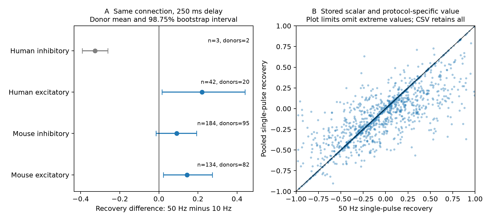

# First-response changes at 250 ms were higher after 50 Hz than 10 Hz trains in selected Allen excitatory connections

## Question and scope

Does the same cortical connection retain a detectable effect of induction frequency on its response after a 250 ms pause? We compare eight-pulse 10 Hz and 50 Hz trains within detected connections. Holding the source and target cells fixed controls their circuit identity and geometry. This is a narrow test of history dependence in functional circuit weights. It does not test full connectome dynamics.

We compared response change after a 250 ms pause following 10 Hz and 50 Hz trains in the same detected Allen cortical connections. Protocol-specific summaries avoid the stored recovery scalar, which pools induction frequencies. We required at least five trials at each frequency and used equal weights for inferred donors. The sample had 363 connections in four species and synapse-type groups. In 134 mouse excitatory connections from 82 inferred mice, the mean difference was 0.14476, with a 98.75% interval of 0.02230 to 0.27401. In 42 human excitatory connections from 20 inferred donors, it was 0.22070, with interval 0.01639 to 0.44063. Four-pulse recovery intervals included zero. The pooled single-pulse recovery scalar differed from the 50 Hz summary in 891 of 1347 audited connections; 198 had opposite signs. The package provides a protocol-specific extraction tool and derived evidence. Small selected slice samples, summary-level errors, unmodeled protocol order, and inferred donor labels limit inference. The test does not identify a recovery time constant or a mechanism.

## Prior work and contribution

Campagnola, Seeman, and colleagues measured local cortical connectivity and synaptic dynamics (Science 2022, doi:10.1126/science.abj5861). Their study established extensive cell-type dependence. We do not claim that short-term plasticity or frequency dependence is new. Our contribution is a reproducible within-connection comparison at a fixed pause, with donor-level uncertainty, and an audit that separates frequency-specific summaries from pooled recovery fields. This is a secondary analysis of existing experiments.

Campaign searches used connectome, synphys, short-term, recovery, 250ms, and frequency recovery. The published distance-plasticity benchmark (SCI c33af30c) informed use of the scalar definitions, the known pulse-array issue, and inferred donor rules. Its endpoint was 50 Hz induction, not protocol-specific recovery. No code or derived table from that work was reused. Searches are not proof that this exact comparison is new. Initial planning considered prediction of recovery from induction. Source inspection showed frequency pooling in the recovery scalar, so we changed to the paired protocol comparison before effect estimates. The saved design records this change.

## Data and measure

We use the Allen Synaptic Physiology r2.1 small SQLite database, schema 22, S3 last modified 2023-01-26. Detected monosynaptic connections (`pair.has_synapse=1`) must have dynamics QC. Mouse data use VisP; human data use TCx. We retain excitatory and inhibitory synapse types separately. `ex` and `in` in the tables denote these two types.

The primary response is `stp_recovery_single` in `stp_all_stimuli`, for current clamp, 250 ms recovery, and induction frequency exactly 10 or 50 Hz. Each protocol must have at least five eligible trial summaries. The response is the median across trials of `(A9-A1)/Q`, where A1 and A9 are fitted first and ninth pulse amplitudes. Q is the signed 90th percentile for excitatory responses or signed 10th percentile for inhibitory responses, computed across eligible amplitudes for that connection. Zero indicates that the response returned to the first-pulse amplitude. Negative values indicate a smaller response magnitude. This is not a fraction of depletion recovered, a conductance, or a recovery time constant. The two frequencies share a denominator, but the first-pulse estimate can differ across protocols.

The source code computes scalar recovery at 250 ms without a frequency filter. This is consistent with the schema description of `stp_recovery_single_250ms` and `stp_recovery_250ms`. These fields must not be treated as 50 Hz outcomes. The source code directly computes the protocol-specific change metrics from pulse-number keys. We use those metrics and never use `pulse_amplitudes`, whose list aliasing is flagged in shared metadata.

Delay normalization can yield duplicate frequency/delay keys. Entries with neither finite single nor finite multi recovery are ignored. If a frequency still has two finite entries, we exclude that connection instead of averaging medians. Flow counts: {"ambiguous_protocol_excluded": 28, "qc_confirmed": 2112, "region_eligible": 2037}. Single-trial protocol entries have missing summaries in the source and cannot be reconstructed from this small database. Their trials can still contribute to pooled scalars.

## Estimation and uncertainty

The primary difference is the 50 Hz response minus the 10 Hz response within an edge. We average differences within each inferred donor, then give donors equal weight. This prevents recordings with many measured edges from dominating. In mice, the unique six-digit identifier in the specimen name defines the inferred donor. In humans, the first three dot-separated fields define the inferred donor. These are parsing rules, not verified donor identities. Exact specimen names and IDs are saved.

We resample donors with replacement 10,000 times using seed 110730838. The 98.75% percentile intervals give an approximate four-group comparison rule. They describe uncertainty across the sampled donor clusters. They do not include fit error, uncertainty in donor identity, protocol selection, or all sources of slice sampling bias. A group with fewer than ten donors is descriptive only. We do not use its interval for a population conclusion. No regression model, hyperparameter tuning, or prediction split is used.

## Results

| Group | Connections | Inferred donors | Mean 50 Hz minus 10 Hz | 98.75% interval |
|---|---:|---:|---:|---:|
| mouse ex | 134 | 82 | 0.14476 | [0.02230, 0.27401] |
| mouse in | 184 | 95 | 0.09114 | [-0.01421, 0.19291] |
| human ex | 42 | 20 | 0.22070 | [0.01639, 0.44063] |
| human in | 3 | 2 | -0.32630 | [-0.39195, -0.26064] |




The mouse and human excitatory intervals exclude zero for the first-response measure. Mouse inhibitory data do not give a clear difference. This result applies to changes relative to the protocol first pulse, not absolute response amplitude or a general recovery mechanism. All four-pulse sensitivity intervals include zero. The ten-trial filter retains only one donor in each mouse group and no human group, so it cannot assess robustness across donors.

The human inhibitory sample is too small for a population result. Species and cortical region differ together; these groups do not isolate species effects. Figure A shows equal-donor means. Figure B compares all finite 50 Hz single-pulse summaries with their pooled scalar in the audited sample, without a five-trial threshold. The scatter display is limited to [-1,1] on each axis; all values remain in audit.csv.

## Sensitivity and scalar audit

| Group | At least 10 trials: mean [interval], donors | Four-pulse recovery: mean [interval], donors |
|---|---|---|
| mouse ex | too few donors for an interval | 0.02442 [-0.04085, 0.09516], 81 |
| mouse in | too few donors for an interval | 0.03565 [-0.01710, 0.08620], 94 |
| human ex | absent | -0.02966 [-0.10298, 0.04578], 20 |
| human in | absent | too few donors for an interval |


The ten-trial check tests a stricter precision filter. The four-pulse check uses the median trial change from pulses 1-4 to pulses 9-12, divided by Q; each protocol again needs five trials. These are secondary descriptive checks. They change the selected sample or the response definition and are not independent replications. Pair-weighted means and donor means are both in results.json.

For single-pulse recovery, the pooled scalar differed by more than 1e-12 from the 50 Hz summary in 891/1347 audited connections. The median absolute difference was 0.06737, and the 90th percentile was 0.43955. Signs differed in 198 connections. This is an exact database audit, not a hypothesis test. No uncertainty interval is needed for these fixed-release counts. The count of finite protocol summaries can understate contributing frequencies because one-trial summaries are missing. We do not reconstruct a pooled median from protocol medians. Pooled and protocol-specific estimates answer different questions; a difference is not itself a software error.

## Meaning and limits

A circuit model can preserve a structural edge while its response changes with stimulation history. This report tests whether one such history contrast remains after a fixed pause. It supplies a frequency-specific extraction method to prevent mixing protocols when assigning temporal response parameters to circuit edges.

Only detected connections with enough trials at both frequencies enter the paired test. Recording quality, detection, slice damage, and the decision to collect a protocol can select this sample. This is not an anatomical synapse-count dataset. The experiment controls cell identity within an edge but does not randomize history in this analysis. Frequency also changes the duration of the eight-pulse train. Trial order, drift, and different first-pulse estimates can affect differences. Summary metrics lack trial-level covariance and cannot give a measurement-error correction. A common amplitude normalization can induce dependencies. We do not infer vesicle depletion, receptor dynamics, or a unique recovery model.

The source study already addressed cell-type differences; we do not retest all subclasses here. Sparse human inhibitory data and region/species confounding limit transfer. The results do not establish a rule across brain regions, behavior, intact brains, or animals outside the sampled slices. Null intervals can reflect low precision. A nonzero paired mean would not imply a universal effect in individual synapses.

## Reproduction and provenance

Exact shared raw file: `/mnt/dell-data/shared_datasets/allen_synphys/r2.1_small_2023-01-26/synphys_r2.1_small.sqlite`.
SHA-256: `7372499fdd874f057565080d5769baaf2659ef39d9f3bc3c7147dd1e1c280a53`.
Source: https://allen-synphys.s3-us-west-2.amazonaws.com/synphys_r2.1_small.sqlite . The analysis verifies the hash before reading. The raw database is not redistributed.

Definition files used for interpretation are `dynamics.py` and `schema_dynamics.py` in `/mnt/dell-data/shared_datasets/allen_synphys_source/b264d8b61abf11d015222865ca081f80655d33d4/`. Exact paths and hashes are in files/source_hashes.json. That file and files/retrieve.sh preserve the pinned upstream retrieval recipe. These definition files are not imported or redistributed.

In an unpacked bundle, install files/requirements.txt in a local Python environment. Set DB to the raw file. On this campaign host, use:

```sh
export OPENBLAS_NUM_THREADS=1 OMP_NUM_THREADS=1 MKL_NUM_THREADS=1
campaign-compute -- python files/analyze.py --db "$DB" --out reproduced
python files/check_evidence.py
```

Outside the campaign, the same analysis can run directly with one library thread. The second command uses the bundled evidence without the raw database. It independently checks protocol links, connection uniqueness, paired differences, sample counts, equal-donor means, pair means, and scalar discrepancies. The recorded validation output is in files/validation.txt. The computation used the host campaign-compute limiter. Software versions are recorded in files/requirements.txt and files/evidence/provenance.json.

The package retains cohort.csv, protocols.csv, audit.csv, all bootstrap draws, SQL, results, the figure, and analysis code. `protocols.csv` contains finite summaries from eligible source rows before duplicate-key exclusions; cohort.csv is the definitive paired sample. The strict duplicate rule can omit usable single-pulse data if multi-pulse keys are ambiguous. Use results.json for exact values rather than rounded table entries.

## Attribution and job record

Job: sci-1107-syam2-neural-structure-and-computation-30838e2cbf6c. Topic: neural-structure-and-computation. Campaign: 11_07_2026. Machine: syam2. Account: codex-myxtap. Model: gpt-6.1-sol, high reasoning effort, through the Codex harness in T3 Code. Date: 2026-11-08. No additional agents were used.

Credit: Allen Institute for Brain Science and Campagnola, Seeman, and colleagues. The original data remain subject to https://alleninstitute.org/legal/terms-use/ . The baseline license covers this new report, code, figures, and derived material to the extent permitted by source terms. It does not replace source terms. The campaign-machine signing key is not a personal authorship claim. This publication is stored locally only.
