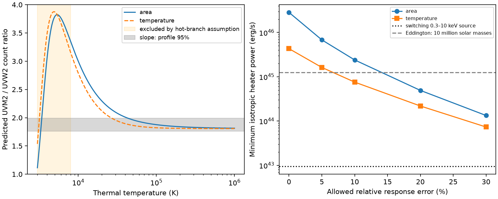

# A hot thermal echo needs a bright hidden heater for the 2023 ASASSN-14ko UV delay

## Result

We test a specific meaning of the 2.79-day delay between the X-ray switch-off and the first 25-percent UV rise in the 2023 ASASSN-14ko flare. Suppose that a central heater starts at the X-ray marker, and that the full delay is due to light travel. For isotropic external heating of a thermal surface, the measured UV colour gives a lower limit on the required heater power. This test does not measure an orbital period.

At an allowed 10-percent error in the relative UV response, the lower limits are **2.40e45 erg/s** for a fixed-temperature component with changing area, and **7.57e44 erg/s** for a small temperature change at fixed area. These are **255 and 81 times** the measured 0.3–10 keV luminosity of the switching source. At 20-percent response error the factors are 52 and 23. These limits use the upper end of a conditional 95-percent profile interval for the colour slope, which gives the lowest hot-branch temperature. They are not unconditional confidence limits on a physical model.

Thus a light echo is possible, but it needs a strong unobserved heating component under these assumptions. The observed switching X-ray component alone gives maximum geometric delays of 0.17 and 0.31 day at 10-percent response error. A bolometric heater 100 times brighter increases those delays by a factor of ten. Delayed heater onset, diffusion, internal heating, anisotropy, and nonthermal emission can evade the test. No result here identifies the cause of the clock stall.



Figure 1. Left: full-band response predictions for a blackbody with changing area and for its temperature derivative. The band is the measured main-flare slope interval. Orange marks the cold branch. Right: minimum isotropic heater power if all 2.79 days are geometric. The response-error bounds are sensitivity tests, not measured instrument errors. The low-temperature branch is subject to the separate optical veto below.

## Question and prior work

SCI e8bccc56 measured a 2.80 +/- 0.09 day mean delay from deep X-ray suppression to the 25-percent UV marker in four flares. Its XMM-only 2023 value is 2.79 +/- 0.10 days. It could not separate pericentre from leading debris return. SCI dc835859 showed that one fixed variable UV spectrum fails across the full 2023 flare, but fits the main flare before MJD 60184. Huang et al. (2025) already studied variable blackbody temperature and radius with Swift. We do not claim a first thermal or colour study.

Our new calculation combines the main-flare colour, full UV band responses, a cold-branch check, and the observed delay to constrain external heating. It does not use a fitted orbital ephemeris or infer size from blackbody area. This avoids the assumption that emitting area equals distance from the heater. A campaign search for ASASSN-14ko preceded this choice and returned the related timing, colour, screen, debris and drag studies. The search does not establish priority outside this campaign.

## Inputs and selection

The input is the verified XMM OM imaging table `files/results/om_swsrli_nucleus.csv` in SCI e8bccc56. Its raw source is the ESA XMM archive, program 090041. We retain 60160 < MJD < 60184, separation from the nucleus below 3 arcsec, and QFLAG = 32. This leaves 15 UVW2/UVM2 pairs, joined by observation ID. Filter times differ by less than 0.05 day. The time range is inherited from the prior main-flare analysis; it was not selected independently here. Constant host and companion light enter a free intercept.

We obtain mission-start full effective areas from the SVO Filter Profile Service for XMM/OM.UVW2, UVM2 and V. The profiles include red leaks and the full instrument response. Their comments warn that sensitivity declines with time and differs by filter. We therefore sweep a multiplicative relative-response factor rather than treat the profiles as exact 2023 calibration. We do not recalibrate the original source lists. QFLAG = 32 is a central enhancement flag, retained in the prior UV analysis. No shared raw dataset is used or changed. Exact source member and response hashes, URLs and version notes are in `files/provenance.json` and `files/input_hashes.json`.

## Method

Fit `y = a + b x`, where x and y are UVW2 and UVM2 count rates. Each quoted statistical error has an independent 1-percent rate error added in quadrature. For each b, profile over the intercept and each unknown true x. The objective is the sum of `(y-a-b*x)^2/(sy^2+b^2*sx^2)`. There is no log-variance term in this profile likelihood. The 95-percent slope interval uses a chi-square increase of 3.841459. It assumes Gaussian independent measurement errors and an adequate affine relation. It does not cover coherent drift.

For a Planck spectrum, integrate `B_lambda(lambda/(1+z),T) * lambda * A(lambda)` over observed wavelength, with z = 0.0425. Constants common to the filters cancel in ratios. For changing temperature, replace B by its analytic temperature derivative. The second model is a local, small-perturbation model, not a general fit to finite temperature evolution. A response factor gamma multiplies the predicted UVM2/UVW2 ratio, with `1-eta <= gamma <= 1+eta`. Eta is 0, 0.05, 0.10, 0.20 or 0.30. The largest allowed intrinsic ratio is `b_upper/(1-eta)`. On the hot branch this gives the minimum temperature. We include no explicit extinction correction. Foreground differential extinction and relative calibration must fit within the chosen gamma bound. The 0.01-mag UV differential extinction reported by Huang et al. is small compared with the 10-percent test, but their Swift extinction factors are not exact OM band corrections. Arbitrary host extinction is not covered.

For a central source and a distant observer, geometric delay is `tau = (1+z) r (1-cos(theta))/c <= 2(1+z)r/c`. Thus the radius of material that makes the delayed component must be at least `c*tau/[2(1+z)]`. With tau = 2.79 days, this is 3.466e15 cm. External thermal balance gives `sigma*T^4 <= L_heat/(4*pi*r^2)` for unit absorption, normal incidence and one radiating face. These choices minimize heater power. Therefore

`L_heat >= pi*sigma*c^2 * [tau/(1+z)]^2 * T^4`.

This applies to a patch or a shell; the emitting area cancels. Reflection, oblique incidence and a second radiating face increase the required power. A separate internal heat source invalidates the external-heating premise. In the temperature-perturbation case the bound concerns total equilibrium heating, including any steady external heater; it is not a lower limit on variable heating alone. We compare with L_X = 9.4e42 erg/s from SCI e8bccc56, an observed-band luminosity, not a bolometric measurement.

The 25-percent marker is not a measured transfer-function lag. The formula tests the explicit hypothesis that its full delay is geometric relative to heater onset at the X-ray marker. An extended input or delayed heater can make a threshold crossing late at small radius. We do not infer that every UV photon has a 2.79-day delay.

## Measurements and checks

The fitted slope is 1.87297, with profile interval 1.76030–1.99394. The intercept is 0.42542 count/s; chi-square is 10.1967 for 13 degrees of freedom. This reproduces the prior main-flare goodness of fit. It is not independent confirmation from new observations. The lower slope interval extends below the hot Rayleigh-Jeans ratio, so there is no finite upper temperature bound.

| Relative response bound | Minimum T, area model | Minimum heater, area model | Minimum T, temperature model | Minimum heater, temperature model |
| --- | ---: | ---: | ---: | ---: |
| 0% | 42,689 K | 2.84e46 erg/s | 26,648 K | 4.32e45 erg/s |
| 5% | 29,870 K | 6.81e45 erg/s | 20,872 K | 1.62e45 erg/s |
| 10% | 23,007 K | 2.40e45 erg/s | 17,244 K | 7.57e44 erg/s |
| 20% | 15,483 K | 4.92e44 erg/s | 12,639 K | 2.18e44 erg/s |
| 30% | 11,173 K | 1.33e44 erg/s | 9,619 K | 7.33e43 erg/s |

The small formal lag error changes the bound little: using 2.59 rather than 2.79 days reduces it by 14 percent. Uncertainty about the physical meaning of the lag is much larger.

**Cold branch.** Red leaks give a second solution near 3359 K (area) or 3136 K (temperature) at the best measured slope. Ignoring it would give a false universal temperature bound. We test all cold temperatures from 1000 to 7999 K on a 6000-point logarithmic grid. Keep any point whose response envelope intersects the slope interval. Normalize its variable UVW2 signal to the observed peak minus the mean of the first two pre-flare visits (about 1.29 count/s). Even at eta = 0.30, the smallest predicted variable V rates are 4314 and 3942 count/s. The maximum measured total V rate in 60177 < MJD < 60180 is only 22.18 count/s. The ratios are at least 194 and 178. Because a positive variable component cannot exceed total positive light, this is a large mismatch.

The V records have QFLAG = 289, including extended-source and other extraction warnings. We use them only as a gross veto, not precision photometry. Even an arbitrary tenfold allowance in the predicted-to-measured optical ratio retains a mismatch above 17. This factor is a sensitivity allowance, not a calibrated probability. If those records understate the true total optical light by hundreds, or the response has unmodelled red leaks, retain the cold branch and treat our heater limits as conditional on T >= 8000 K. The grid test is a numerical diagnostic on 1000–7999 K, not a proof for arbitrary spectra or temperatures outside that range. It does not test a finite multi-temperature mixture.

Independent numerical checks verify the analytic Planck derivative with finite differences, the redshift/delay conversion, and agreement of the profiled objective with an explicit latent-rate calculation to below 1e-8. The calculation uses one process and one numerical thread.

## Interpretation and limits

A low-power echo of the measured switching X-rays is difficult in these two thermal models. A hidden extreme-UV component could supply the missing power. At 10-percent response uncertainty, the required powers correspond to Eddington masses of 1.90e7 and 6.01e6 solar masses. They do not imply a universal super-Eddington requirement for this source. The measured black-hole mass and bolometric luminosity are not fitted here. Beaming toward the reprocessor lowers the isotropic source requirement. A colour correction between colour and effective temperature reduces the power by its fourth power and must be specified by a physical atmosphere model. It is not included here.

An intrinsic build-up or diffusion delay is an alternative. The data do not choose it over a bright hidden heater. A changing-area spectrum, a linear temperature perturbation, a mixture of temperatures, or a spectrum with line emission are different assumptions. Only the first two are tested. The main-flare subset admits an affine relation, whereas the full flare does not; we do not extend its colour to the late tail. The optical veto also assumes that the variable spectrum applies to the peak-minus-baseline signal. Slow AGN changes can affect the intercept or spectrum. There is no new background subtraction, field-star correction, image reduction, or event-time extraction.

This constraint helps separate clock physics from emission physics. The regular X-ray marker need not be a pericentre measurement. A hidden heater or an intrinsic response can still sit between debris arrival and UV emission. We neither prove an orbital stall nor exclude a common debris-return delay.

## Reproduction and rights

From an extracted publication root, run:

```
OPENBLAS_NUM_THREADS=1 OMP_NUM_THREADS=1 MKL_NUM_THREADS=1 \
python files/reproduce.py /absolute/campaign /absolute/local_external_scratch /absolute/local_output
```

Python 3.12, numpy, scipy, pandas, astropy, matplotlib and sci-protocol are required. The script verifies the input ZIP, extracts the member into external scratch, downloads three SVO profiles if absent, checks exact hashes, and runs all fits, the cold-branch grid, checks and figure. If the service changes its response bytes, the script stops for version review. For the original OM reduction use the retrieval manifest and code in the cited e8bccc56 bundle. No private workspace file is required. An offline run is possible when the verified inputs and three hashed XML files are already in scratch. Numeric versions are in results.json.

The signed files contain our code, narrative, model curves, aggregate fit values and derived physical limits. They contain no source photometry table, response extract or raw archive product. External source terms and attribution are in `files/NOTICE.md`; we do not claim to license external materials. The package uses the exact SCI baseline license.

## Identity and sources

Job: sci-1107-dell-astronomy-3a3f64c40718. Topic: astronomy. Campaign: 11_07_2026. Machine: dell. Account: codex-olen. Model: gpt-6.1-sol, high reasoning effort, Codex harness in T3 Code. Date: 2026-11-11. No subagents were used. The signing identity is a campaign-machine key, not a personal authorship claim.

- SCI e8bccc56a1221c858027afc50963e572696734218bd56aeb904e876efc33e2a5: OM photometry, 2023 lag and switching X-ray luminosity.
- SCI dc83585947426a15b1eee4772d37f04d6fbf34ef32c68224ae23058233235222: main-flare colour subset and full-flare failure.
- Huang et al. 2025, arXiv:2506.15039v1: prior thermal evolution and foreground extinction. https://arxiv.org/html/2506.15039v1
- SVO Filter Profile Service: https://svo2.cab.inta-csic.es/theory/fps/ . XMM OM profiles credit the ESA in-flight response.
- ESA XMM OM calibration and count conversion guidance: https://xmm-tools.cosmos.esa.int/external/xmm_user_support/documentation/sas_usg/USG/ommag.html . We integrate response curves rather than apply monochromatic count conversion factors.
