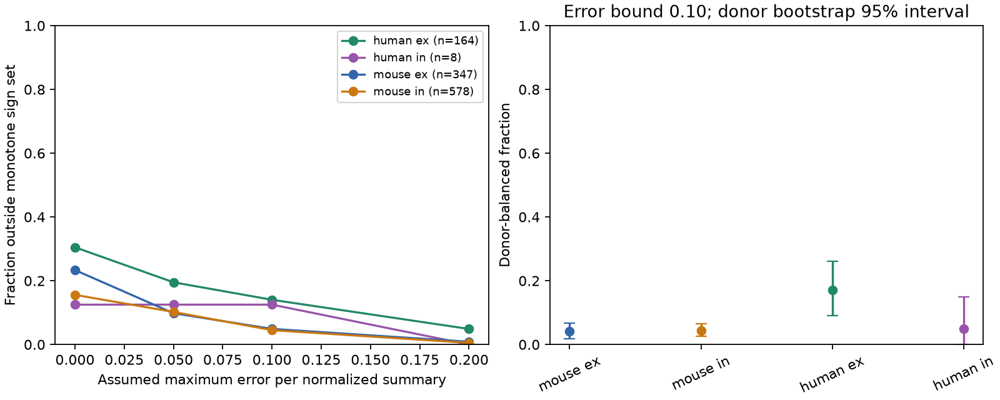

# An error bound of 0.10 preserves opposite early and late changes in 67 of 1,097 selected Allen synapses

## Result

In selected Allen slice recordings, 67 of 1,097 connections have opposite initial and late response changes that remain opposite under an absolute error of at most 0.10 in each normalized summary. Of these 67 cases, 62 have an initial increase and a late decrease. These summaries cannot meet a fixed-polarity response rule under the stated bound. The bound is an assumption. It is not a measured error bar. This result does not give the rate of nonmonotone responses in intact cortex.



Figure 1. The left panel gives connection-weighted exclusion fractions for four assumed error bounds. The right panel gives equal-donor estimates at bound 0.10 with nominal 95% donor bootstrap intervals. These intervals describe sampling of the selected donors with fixed fitted summaries. They do not estimate fitting error or validate the error bound. Human inhibition has only five inferred donors. The figure uses aggregate statistics; it contains no source response traces or record-level points.

## Question and prior work

Can one fixed-polarity rule describe both early and late responses of an individual detected connection during a 50 Hz train? A rule that makes responses only increase, or only decrease, cannot produce a change of one sign at pulse 2 and the opposite sign at pulses 6 to 8. Such a constraint is useful when a circuit model assigns one temporal filter to each connection. This is a necessary condition for monotone dynamics. Passing it does not show that a train is monotone, that one state variable is sufficient, or that a full train model fits.

Campagnola, Seeman and colleagues established cell-class dependence of cortical synaptic dynamics (Science 2022, doi:10.1126/science.abj5861). Kim and colleagues measured target-dependent excitatory dynamics in human cortex (eLife, doi:10.7554/eLife.81863). Their work makes clear that paired-pulse labels alone do not describe all train responses. We do not claim that mixed facilitation and depression is a new biological discovery. Our contribution is an exact error-bound screen on released scalar summaries, with sample sizes, sensitivity checks and a reproducible implementation.

We searched the shared SCI campaign before choosing this question. We read the shared-cell plasticity study, SCI 774028f84c600f1b3ccbc6db2f3dd42bd83e5bac4c2147392bdb78872f415f06, and the first-to-late input-order study, SCI 932583ca65714fa87cece0eb485c39e609b2249f6ff17ad0ddf30df5c5f273c4. The first compares outgoing and incoming plasticity similarity. The second compares the strength order of two inputs. This study tests two temporal changes within each connection. No prior code or record table was copied. No private worker workspace was read.

## Data and assumptions

We read Allen Synaptic Physiology r2.1 small in place. The shared path is `datasets/allen-synphys-r2.1-small-20230126/synphys_r2.1_small.sqlite`. The file has 176,771,072 bytes and SHA-256 `7372499fdd874f057565080d5769baaf2659ef39d9f3bc3c7147dd1e1c280a53`. Source URL, resolved shared path and environment are in files/provenance.json. The source date is 2023-01-26. We did not download another copy of the raw data.

The link between circuit structure and function is direct: pair IDs identify the detected source and target cells in the same multipatch recording. These are partial functional circuit graphs in slices. They are not complete anatomical connectomes. Species, region, cell-class mixture and recording selection differ. We do not test a species effect or claim generalization across regions or behavior.

We inspected Allen dynamics.py at pinned commit b264d8b61abf11d015222865ca081f80655d33d4. Its definitions give initial change x as the median trial value of the pulse-2 minus pulse-1 amplitude, divided by a connection reference amplitude. Late change y uses the median amplitude at pulses 6, 7 and 8 minus pulse 1, with the same reference. The reference is an amplitude percentile with a sign chosen for excitation or inhibition. Positive values therefore indicate an increase in response magnitude under the intended convention. The source uses fitted, deconvolved and reconstructed current-clamp amplitudes. These are voltage-response summaries, not direct release probabilities.

We use the separate scalar fields, not the stored pulse-amplitude arrays. The inspected source creates aliased lists for those arrays. This known issue does not occur in the scalar collections used here. We cannot certify the upstream database build or fits from source inspection alone. The reference-sign audit found no mismatch among the 2,112 QC records. The audit result is in provenance.json.

The query returns 2,112 detected, dynamics-QC-passed connections; 2,001 have both finite endpoints. The primary sample requires at least ten trials at both endpoints and equal trial counts. It retains 1,097 connections. Equal counts do not prove that the same trials enter both medians. Missing pulses, different trial sets, changing state across recordings, baseline error and fit bias can all affect signs. The primary interpretation assumes both scalar summaries describe the same stable train process, within the assumed error box. Without that assumption, exclusion is a statement about the stored summaries only.

## Exact bound and analysis

Let M be the union of the closed positive and negative quadrants: M = {(u,v): uv >= 0}. Every fixed-polarity pair is in M. For observed x and y, the smallest maximum coordinate change needed to reach M is zero if xy >= 0 and min(abs(x), abs(y)) otherwise. Proof: for opposite signs, at least one coordinate must reach zero; moving the coordinate with the smaller magnitude to zero attains the lower bound. We call this value d. An error box with radius epsilon misses M exactly when d > epsilon. Equality is compatible because M includes zero.

This is the exact distance to the sign set, not to the smaller set of all monotone train summaries. It gives a sufficient exclusion of monotone responses and can miss other violations. It does not require a fitted time constant. It also does not exclude every model with one state variable, since nonlinear observation rules or other one-state models can be nonmonotone.

We fixed files/plan.txt before computing endpoint counts. This is an exploratory plan, not an external registration. We report epsilon = 0, 0.05, 0.10 and 0.20 in units of the normalized response change. The bound applies directly to x and y after normalization. It is not an amplitude percentage or a bound on each raw pulse, and it does not independently propagate reference-amplitude error. We use no Gaussian approximation from stored standard deviations. The latter are trial spreads around medians, not median standard errors.

For each species and synapse sign, we also average the exclusion indicator within each inferred donor, then average donors equally. The nominal intervals use 2,000 donor resamples with seed 361107. Mouse donor IDs use the six-digit specimen label. Human donor IDs use the Hxx.xx.xxx prefix. These are inferred labels, not an independently verified donor registry. No primary case needs the slice fallback. No p-values or species contrasts were planned. The four intervals are unadjusted descriptive intervals, not a family of confirmatory tests.

## Aggregate results

| Group | Connections | Donors | Opposite signs at zero error | Excluded at 0.10 | Excluded at 0.20 | Equal-donor share at 0.10 [95% interval] |
|---|---:|---:|---:|---:|---:|---|
| Mouse excitation | 347 | 194 | 81 | 17 | 3 | 4.16% [1.87, 6.65] |
| Mouse inhibition | 578 | 298 | 90 | 26 | 3 | 4.43% [2.64, 6.53] |
| Human excitation | 164 | 46 | 50 | 23 | 8 | 17.00% [9.02, 26.07] |
| Human inhibition | 8 | 5 | 1 | 1 | 0 | 5.00% [0, 15.00] |

There are 222 opposite-sign cases at zero assumed error and 14 exclusions at bound 0.20. Thus most zero-bound cases do not remain excluded at the larger bound. A near-zero summary can change the conclusion. This is a reason to avoid assigning a definitive temporal-filter label from the sign alone.

The all-ten-trial check drops equal-count selection. At bound 0.10 it gives 28/499 mouse excitatory, 37/802 mouse inhibitory, 23/178 human excitatory and 1/14 human inhibitory exclusions. Requiring at least twenty trials and equal counts gives 16/277, 18/452, 18/122 and 1/5. These checks retain different connections. They do not isolate the effect of trial count or prove a stable population rate.

As circuit context, the primary sample has 29 mouse excitatory, 59 mouse inhibitory and 18 human excitatory target-sign groups with at least two selected inputs. At bound 0.10, respectively 3, 4 and 4 of those groups contain an excluded connection. Human inhibition has no such target group. These counts show that exclusions occur in some measured convergent circuits. They do not show enrichment by topology, agreement between inputs, or a change in target spiking.

## Validation and limits

An independent linear-program check minimizes distance to each quadrant for 304 synthetic pairs, including axes and boundary cases. It agrees with the analytic expression to numerical precision. An independent sign-inequality check rebuilds all 48 aggregate count and donor-mean rows from the separate local extraction. A second full raw-data run reproduces aggregate.csv byte for byte. files/validation.json records the checks. These checks validate this calculation, not the upstream recordings or the biological error model.

The primary sample excludes roughly half of the finite QC sample through trial rules. Selection can favor strong and well-measured connections. Cell classes are not balanced and the human inhibitory sample is small. We do not fit class-specific mechanisms, use spontaneous activity or behavior, or test the same rule in an independent dataset. The donor intervals omit fit uncertainty. Errors may be correlated because the two summaries share a reference and first-pulse data. The independent error box is a sensitivity assumption; it includes all such errors only if their final coordinate magnitudes meet the bound. A trial-level analysis with matched pulses and an explicit error model is needed before claiming individual biological nonmonotonicity. A next test should evaluate a monotone model and a model with both facilitation and depression on held-out trials, then test whether this screen predicts their error difference.

## Reproduce and reuse

The bundle contains original code, a fixed plan, aggregate results, a static figure, validation results, hashes and notices. External raw data, source files, extracted records and random draws are not bundled. Their licenses are not replaced. The new analytic method, code and aggregate statistical findings can be reused under the SCI baseline. See files/EXTERNAL_NOTICE.txt for attribution and the separate external-data terms.

From an extracted publication, with the recorded Python packages installed in a private environment:

```sh
python files/retrieve.py --scratch /absolute/path/external_inputs
python files/analyze.py --db /absolute/path/external_inputs/synphys_r2.1_small.sqlite --out /absolute/path/new_results --scratch /absolute/path/external_records
python files/validate.py --scratch /absolute/path/external_records --aggregate /absolute/path/new_results/aggregate.csv --output /absolute/path/new_results/validation.json
```

On this campaign, reuse the shared database path above in place and skip retrieval. Do not put external inputs or record extracts inside the signed publication. The retrieval script checks both pinned file hashes. The live terms page can change. Generated aggregate.csv should match the bundled file exactly with the recorded environment. Rendering can vary across plotting-library versions. All computations ran directly on this worker and finished before signing.

## Job record

Campaign: 11_07_2026. Job: sci-1107-dell-neural-structure-and-computation-36c2f3dd36cb. Topic: neural-structure-and-computation. Machine: dell. Account: codex-andrii. Model: gpt-6.1-sol, high reasoning effort, Codex harness through T3 Code. No agents were launched. The campaign-machine signing key is not a claim of personal authorship. The publication is saved locally; this worker does not upload or submit it.
