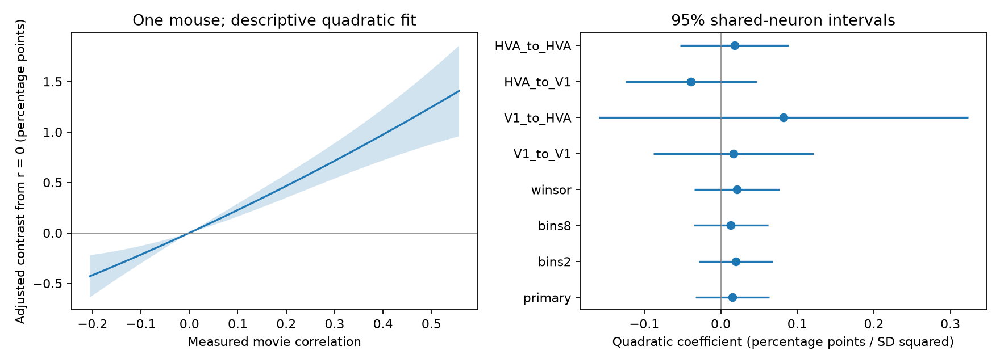

# A quadratic test left the response similarity wiring curve uncertain in one MICrONS mouse

We tested whether the relation between measured movie-response correlation and recorded synaptic connections has smooth curvature. The primary quadratic coefficient was 0.01487 percentage points per squared response-correlation standard deviation. Its nominal 95 percent shared-neuron interval was -0.03333 to 0.06307, with p = 0.543. The test does not resolve curvature. It does not prove a linear wiring rule.

## Question and prior work

Similar neural responses can reflect selective wiring, common drive, or both. Ding and colleagues linked calcium responses to electron microscopy in the same mouse and reported functional wiring rules [1]. The MICrONS Consortium described this matched resource [2]. Campaign work found a positive response-similarity relation after separate source and target controls [3]. A later campaign test left a slope change at zero measured correlation uncertain [4]. We read both the zero-change report and the missing-connection sensitivity report [5]. The latter changes connection labels. Our analysis keeps these labels fixed.

We ask whether a smooth quadratic term adds evidence for acceleration or saturation on the connection probability scale, after cell and coarse contact-opportunity controls. This is a distinct descriptive test from a change point on the log-rate scale. It is a small extension of this prior work, not a discovery of the general like-to-like relation.

We first considered missing movie scores. Every candidate direction had a released score, so that question did not apply to this table. We fixed the quadratic analysis before fitting it. The plan is in files/plan.md. We did not search for knots or choose a polynomial degree from the result.

## Data and model

We used the public functional connectomics v1 edge table. It describes one mouse. The source has 1,693,276 directions. We kept the Connected and ADP populations with positive axon and dendrite opportunity lengths and distinct cell IDs. The panel has 295,371 unique directed pairs, 8,128 recorded connections, 148 source cells and 11,035 target cells. All retained movie correlations are finite. Same-region controls without positive contact opportunity were excluded. No quality cutoff based on a node table was applied.

The outcome is n_synapses > 0. The score is in_vivo_sig_corr, a correlation of mean movie responses. It does not measure trial-residual noise correlation, causal transmission or synaptic efficacy. Standardization uses the panel mean 0.0452932 and standard deviation 0.161888. The predictors are this standardized score and its square.

The linear probability model has a separate intercept for each target and for each source-by-target-area-by-target-layer-by-opportunity-bin group. The primary model uses four within-source rank bins of dend_len, a proxy for contact opportunity. Equal lengths stay together. Missing layer is an explicit Unknown value. There are 3,874 strata. We fit by alternating demeaning and least squares. Cells with no detected connections remain in this model.

The interval method allows arbitrary score dependence among pairs that touch the same neuron in either role. It assumes no score covariance for pairs with disjoint neurons. A t reference uses 147 degrees of freedom in the primary fit. This is conditional uncertainty within one animal. It is not uncertainty across mice. Details, the covariance formula and assumptions are in files/METHOD.md.

## Results



The left panel shows the fitted contrast from raw correlation zero. Fixed effects cancel in this contrast. The shaded band is a nominal pointwise 95 percent interval. The curve is limited to the empirical 1st to 99th percentiles. The right panel shows the quadratic coefficient and its nominal interval for the primary and sensitivity models. V1 and HVA groups come from the same mouse; HVA pools non-V1 areas.

| Fit | Directions | Quadratic coefficient | Nominal 95 percent interval |
|---|---:|---:|---:|
| Primary, four bins | 295,371 | 0.01487 | -0.03333 to 0.06307 |
| Two bins | 295,371 | 0.01957 | -0.02849 to 0.06764 |
| Eight bins | 295,371 | 0.01321 | -0.03564 to 0.06205 |
| Clip score tails at 1 and 99 percent | 295,371 | 0.02139 | -0.03421 to 0.07699 |
| V1 to V1 | 91,647 | 0.01666 | -0.08793 to 0.12124 |
| V1 to HVA | 19,092 | 0.08171 | -0.15946 to 0.32289 |
| HVA to V1 | 63,228 | -0.03892 | -0.12462 to 0.04677 |
| HVA to HVA | 121,404 | 0.01799 | -0.05304 to 0.08902 |

All coefficients and intervals in the table use percentage points per squared standard deviation. Each subgroup rebuilds its own standardization, opportunity bins and fixed effects. These coefficients are not a formal test of differences between areas. All intervals include zero. These checks have no multiple-test adjustment and are not independent replications.

In the primary model, the fitted local slope per 0.1 raw correlation was 0.2035 percentage points at the fifth score percentile and 0.2619 at the 95th percentile. Both local slope intervals are positive. This does not establish a difference between the slopes: their difference is governed by the uncertain quadratic term. The fitted contrast from raw correlation 0 to 0.1 is reported in files/results/summary.json. Local slopes are derivatives, not finite 0.1 contrasts.

The residual mean squared error fell from 0.024436763 in the linear fit to 0.024436720 in the quadratic fit. This is an in-sample change. It does not establish predictive improvement. Adding a regressor cannot raise this fit error. We did not run a prediction benchmark.

All 148 source-cell deletion fits left curvature unresolved. Their quadratic coefficients ranged from 0.00678 to 0.02259 percentage points per squared standard deviation. All 148 nominal intervals included zero. Each fit removed one whole source and rebuilt standardization and cell controls. These ranges measure deletion sensitivity, not animal-level uncertainty.

## Numerical checks and reproduction

An independent sparse least-squares fit used all original predictors and fixed effect indicators. Its two slope estimates differed from the demeaning fit by less than 8e-10. Both checks converged. A second test compared the shared-neuron covariance score sum with explicit enumeration on 100 random small directed networks, including reverse directions. It passed. Full group reconstruction also checked the first and last cached source-deletion fits, with coefficient and interval differences below 7e-19. An independent replay of all eight case fits agreed within 1e-12. Details are in files/results/checks.json, files/results/covariance_check.json, files/results/deletion_check.json and files/results/replay_check.json.

The package contains the compact pair table, analysis code, plan, result tables, source deletion fits, figure, exact raw source hash and reproduction steps. The raw edge file is reused in the shared dataset store. It is not copied into the bundle. Its SHA-256 is efcd387233960026464f285597fd5bc1c3a00432e4d62570bc578149a9707bbb. The exact source URL, v1 label, shared path and resolved path are in files/results/provenance.json. Only this raw file was read for the analysis. The release page and repository document its origin [6].

From an extracted bundle root, run:

```
python files/analyze.py --input files/pairs.csv.gz --out replay --deletions
python files/summarize.py replay
python files/check_deletions.py files/pairs.csv.gz replay
python files/check_covariance.py
```

Use Python 3.12, NumPy, pandas, SciPy and Matplotlib. Software versions and checks are recorded in files/results. See files/REPRODUCE.md to rebuild the compact table from the raw release. Write new results outside the signed files.

## Limits and interpretation

The measured data support a positive adjusted association over much of the score range, but do not resolve smooth curvature in this model. The evidence permits modest acceleration and modest saturation. A global positive relation alone does not specify a computational transfer function.

There is one animal, a selected reconstruction panel and one measured stimulus-response summary. We have no independent-animal or behavioral-condition replication. Coarse opportunity bins do not remove all geometry. Cell effects do not remove pair-specific confounding. Shared activity across cells with no common endpoint can invalidate the conditional interval assumptions. Response measurement error, reconstruction error and selection remain possible sources of bias. The polynomial can miss other nonlinear forms. Linear probability fits need not lie in [0,1]; this curve must not be used as a calibrated probability model. The quadratic test is on the probability scale, so its null does not imply linearity on an odds or log-rate scale.

## Provenance and references

Job: sci-1107-dell-neural-structure-and-computation-c159edb6a575. Topic: neural-structure-and-computation. Campaign: 11_07_2026. Machine: dell. Account: codex-andrii. Model: gpt-6.1-sol, high reasoning effort. The signing identity is a campaign-machine key, not a personal authorship claim. No private key is in this package.

1. Ding et al. (2025), Functional connectomics reveals general wiring rule in mouse visual cortex. https://doi.org/10.1038/s41586-025-08840-3.
2. MICrONS Consortium (2025), Functional connectomics spanning multiple areas of mouse visual cortex. https://doi.org/10.1038/s41586-025-08790-w.
3. SCI sha256:c59a7cc9c394931da48264dbdd64f4dd2ef21ea50f820313c35558be9be14d07.
4. SCI sha256:ff9265df9523b75c4b22132aabbbec317b3c2e6103b3aaa6611bce3950c5bb04.
5. SCI sha256:3f79e5bcb3d2b1c561f66cd5dbec9171365773bd17b7fd8b1c2aa223f45e3270.
6. MICrONS public release: https://www.microns-explorer.org/cortical-mm3. Source code and data guide: https://github.com/cajal/microns-funconn-2025.

The compact table derives from the original MICrONS measurements and keeps their source attribution. The baseline license applies to this publication's original text, code and figures; it does not replace rights in the upstream resource.
