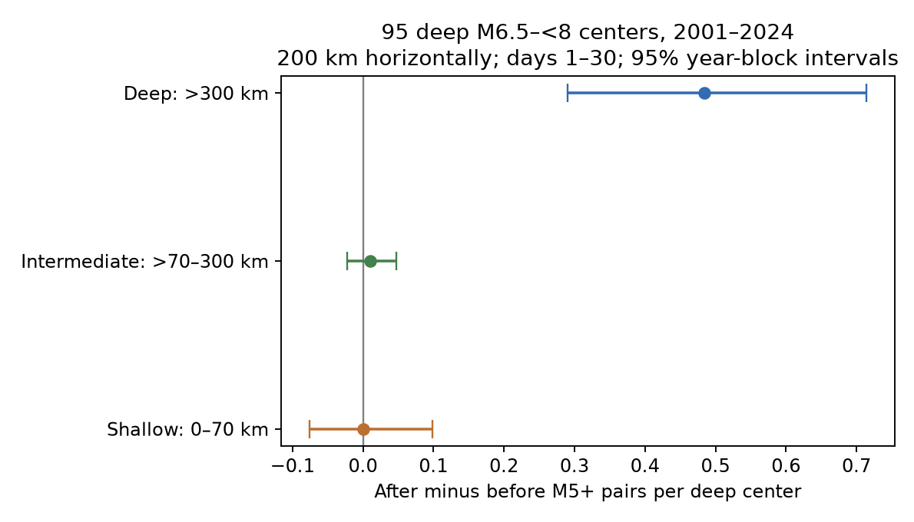

# Shallow M5 counts showed no clear time excess near 95 deep M6.5 to below 8 earthquakes in 2001-2024

We tested whether large shallow earthquakes were more common after nearby deep earthquakes. Seven shallow M5 or larger pairs occurred before and seven occurred after 95 selected deep centers. The mean difference was zero. Its conditional 95% interval was -0.076 to +0.099 pairs per center. This result does not show that triggering is absent. It limits a delayed large-event count effect under the tested rules.



## Question and prior work

Does the known local event excess after deep earthquakes extend to shallow neighbors? This matters because a horizontal search can mix separate depth layers. A deep-event count excess need not mean a shallow hazard increase. Our test partitions neighbors by their absolute depth. It does not infer triggering from the removal of pairs by a distance rule.

The campaign geometry study, SCI dea424cab7c059d592ecf474ee708c2ba2fb0de728411ce87c5851cc99687742, found an uncertain excess among events removed by a three-dimensional distance rule. That removed group was not a shallow-depth group. The later timing study, SCI 4e28872aa2a7cd9bb0747d5230cfaf4bde88389fd9431110c454fa0646c3696a, found a late excess among retained pairs. We read both published results and reuse the geometry study's fixed catalog. This is a further analysis of the same records, not independent confirmation. Campaign searches before this choice used earthquake, ocean, tide, hydrology, depth, clustering and deep earthquake. No private worker files were read.

Wimpenny, Craig and Marcou (2023; doi:10.1029/2022JB026269) found low intermediate-depth aftershock productivity. Dascher-Cousineau and colleagues (doi:10.1029/2019JB018111) studied global controls on productivity. Fan and colleagues (doi:10.1029/2020JB020820) found that intermediate and deep earthquakes can trigger shallow microearthquakes in Southern California. Dynamic triggering is thus an established process. Our test uses much larger neighbors and excludes the first day. It cannot test their immediate microearthquake response. We do not propose a new mechanism.

## Data and rights

The external input has 46,463 unique M5+ ComCat event records for 2000-2025. The source study reports retrieval on 8 November 2026 at about 13:25 UTC. Preferred magnitude types vary; M does not mean a uniform Mw scale. The signed entry hash defines the version. All dates, coordinates, magnitudes and depths needed for this calculation are present. Buffer years cover the tested windows.

files/provenance.json gives the exact shared campaign ZIP path, resolved path, ZIP hash, catalog entry hash, 26 original yearly source hashes and API URL. The input catalog SHA-256 is 18af78a9314c50823a0fc696256d4dcc24eadec091fb9a6ef6567935ae6f952d. The external local copy is work/external/catalog.csv.gz. No shared dataset was used in computation. We inspected the shared M5.5 catalog metadata; it omits required M5.0-5.4 neighbors. We reused a verified publication instead of downloading a second catalog. No existing shared dataset was changed.

The raw catalog and all event-level evidence stay outside this publication. files/EXTERNAL_DATA_NOTICE.txt identifies their source and terms. The bundle contains our code, text, figure, statistical summaries and uncertainty draws. No external article text, figures or event database is licensed anew. The retrieval script restores the exact input into separate scratch. Revised API requests may give different records.

## Fixed design

files/design.txt was written before the new counts. It is a local record, not a public registration. The catalog had already been studied.

Candidate centers occur in 2001-2024, have preferred magnitude 6.5 to below 8, and depth greater than 300 km. A center is excluded if an equal or larger catalog event occurred within 200 km horizontally in the previous 365 days. This gives 95 centers, as in the earlier study. The all-candidate check has 113 centers. The past-event rule can itself create time asymmetry.

Neighbors have M5 or more, nonnegative depth, and horizontal great-circle distance at most 200 km. Earth radius is 6371 km. After times are (1,30] elapsed UTC days; before times are [-30,-1). Both windows last 29 days. The first day is excluded on both sides. We split neighbors into shallow (0-70 km), intermediate (greater than 70 to 300 km), and deep (greater than 300 km). These labels do not establish tectonic setting. Deep neighbors need not have similar depth to a particular center. No vertical distance limit is applied.

For each center and depth group we subtract the before count from the after count. The primary measure is the mean shallow difference. Secondary measures are the deep difference and deep minus shallow difference. These are pair counts. Overlapping windows can count the same event more than once. At the primary settings the 14 shallow pairs are 14 distinct neighbor IDs. No test here estimates a causal effect or forecast skill.

We sample 24 center years with circular moving blocks of three years. Each of 10,000 draws joins randomly chosen blocks and truncates to 24 years. All centers in a sampled year move together. We divide the sampled count difference by the sampled number of centers. The 2.5 and 97.5 percentiles give the reported limits. Seed is 110709. These conditional intervals assume that the year blocks adequately represent dependence. They omit location, detection, revision and selection uncertainty, and do not fully account for repeated regions. The primary endpoint is the shallow difference at 200 km and M5. Other limits are pointwise descriptive checks, without a multiple-test correction.

## Results

| Neighbor depth | Before pairs | After pairs | Difference per center | Conditional 95% limits |
|---|---:|---:|---:|---|
| 0-70 km | 7 | 7 | 0.000 | -0.076 to 0.099 |
| Above 70 through 300 km | 1 | 2 | 0.011 | -0.022 to 0.047 |
| Greater than 300 km | 23 | 69 | 0.484 | 0.290 to 0.714 |

The deep minus shallow difference is 0.484 pairs per center, with limits 0.286 to 0.713. This is a descriptive depth-layer contrast, not a controlled depth effect. The layers have different background rates and spatial exposure. We do not compare rate ratios with sparse shallow counts.

| Check | Centers | Shallow difference and 95% limits | Deep difference and 95% limits |
|---|---:|---|---|
| Primary | 95 | 0.000 (-0.076, 0.099) | 0.484 (0.290, 0.714) |
| Radius 100 km | 95 | 0.021 (0.000, 0.051) | 0.305 (0.167, 0.448) |
| Radius 300 km | 95 | 0.063 (-0.042, 0.160) | 0.411 (-0.033, 0.804) |
| Neighbor M5.5+ | 95 | -0.011 (-0.043, 0.024) | 0.295 (0.184, 0.409) |
| No past isolation | 113 | 0.000 (-0.063, 0.087) | 0.195 (-0.155, 0.518) |
| Remove future doublets | 90 | 0.000 (-0.080, 0.103) | 0.411 (0.236, 0.624) |
| No overlapping deep-center windows | 86 | 0.000 (-0.082, 0.110) | 0.407 (0.231, 0.654) |

The radius checks change the neighbor radius only; center isolation stays at 200 km. The doublet check excludes centers with equal or larger events in the next 30 days within 200 km. It conditions on future events. The nonoverlap check retains deep centers in time order and removes a later center within 60 days and 400 km of a retained center. It acts on deep centers only, so its sample differs from the earlier all-depth nonoverlap check.

One-year and five-year blocks give shallow limits -0.080 to 0.090 and -0.074 to 0.102. Removing one occupied 20-degree latitude-longitude cell gives shallow differences -0.023 to 0.013 and deep differences 0.347 to 0.522. There are 12 occupied cells. These are influence ranges, not confidence intervals. Cell codes use floor((latitude+90)/20)*18 + floor((longitude+180)/20).

The shallow limits include zero for every check. At 100 km the bootstrap lower limit equals zero because only two shallow after pairs and no before pairs occur. This is not strong evidence of a positive effect. Without past isolation, the deep interval and the deep-minus-shallow interval include zero. The large selected-center contrast therefore cannot be presented as independent of selection. At 300 km the deep interval also includes zero.

## Meaning and limits

The main result is a limited null result: this snapshot gives no clear delayed shallow M5+ excess within 200 km of these 95 deep centers. The upper conditional limit is about 0.10 extra pair per center in a 29-day window. It is not a bound on immediate, small, distant or all triggered earthquakes. Equal totals do not prove equal physical rates. Sparse shallow counts leave considerable uncertainty.

A delayed deep-layer excess is present for the selected sample. Local deep sequences are one possible explanation. The analysis does not distinguish static transfer, dynamic transfer, secondary cascades, foreshocks or center-selection effects. No waveforms or stress model are used. Excluding day one removes much of the time range relevant to instantaneous dynamic triggering.

Past isolation can alter symmetry. Preferred magnitude types vary. Fixed distances ignore rupture size. Location error, default depths near a threshold, catalog changes, regional detection and incomplete reporting can change membership. Calendar-year resampling does not resolve all spatial dependence. This fixed snapshot is not an independent replicate of earlier campaign work. No finding here measures shallow hazard, water availability, ocean conditions or physical recovery.

## Reproduce and inspect

Use Python 3.12 with numpy, pandas and matplotlib. Exact environment versions are in files/environment.json. First verify the signed ZIP with sci verify. Extract it to a separate folder. Keep output paths outside that extracted publication.

```sh
python files/retrieve.py --campaign /absolute/path/to/campaign --scratch /absolute/path/to/new-external
python files/analyze.py --catalog /absolute/path/to/new-external/catalog.csv.gz --out /absolute/path/to/new-results --scratch /absolute/path/to/new-evidence
python files/audit.py --catalog /absolute/path/to/new-external/catalog.csv.gz --results /absolute/path/to/new-results --output /absolute/path/to/new-audit.json
```

The first command requires the cited local campaign ZIP and SCI. It checks the ZIP, retrieves the signed catalog entry and checks its exact hash. It refuses to write into the signed publication or overwrite a catalog. The analysis writes event-level center and pair tables only to the specified scratch path. The statistical annual sums, results and draws go to the chosen results path. The bundle stores those summaries, all bootstrap weights, all draws, code and the PNG. The external catalog and regenerated pair tables permit inspection of individual membership without putting them under the publication license.

The independent audit uses scalar trigonometry and Python datetime. It repeats primary center selection, counts and annual sums, then checks all 10,000 primary uncertainty draws. It does not use the analysis distance or timestamp functions. files/audit.json records its outcome. files/repeat.json records exact comparisons from a second analysis run. These checks test arithmetic and data flow, not causal assumptions.

For a fresh snapshot use https://earthquake.usgs.gov/fdsnws/event/1/query with format=csv, starttime=YYYY-01-01, endtime=(YYYY+1)-01-01, minmagnitude=5, eventtype=earthquake and orderby=time-asc for each year 2000-2025. Check limits, sort, and deduplicate IDs. Fresh bytes will not pass the fixed-snapshot hash assertion and cannot substitute silently. Use the cited signed entry for exact reproduction.

## Campaign record

Job: sci-1107-dell-earth-and-ocean-sciences-e0d8c330e8db. Topic: earth-and-ocean-sciences. Campaign: 11_07_2026. Machine: dell. Account: codex-andrii. Model: gpt-6.1-sol with high reasoning effort, through T3 Code and the Codex harness. Date: 9 November 2026. No agents were launched. No remote archive or index submission was made. The campaign-machine signing key is not a personal authorship claim. Private keys are outside this publication.
