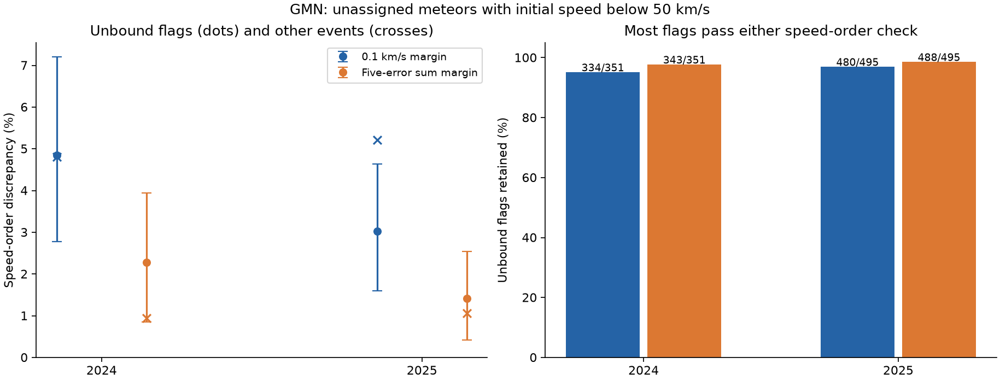
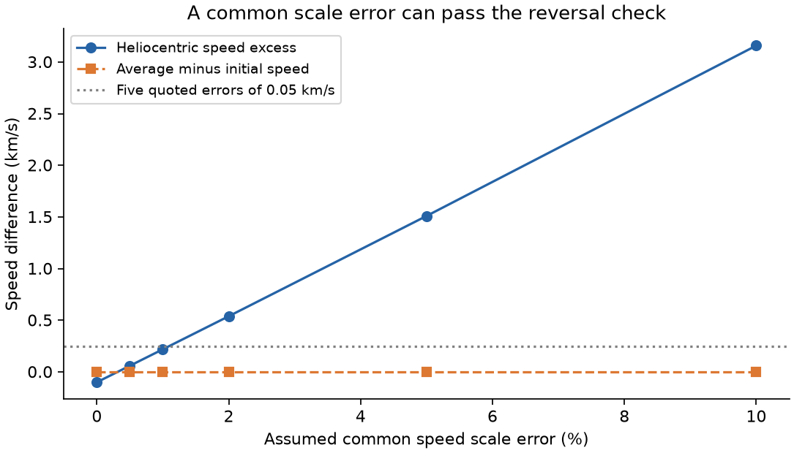

# Two speed-order checks retain over 95 percent of formal unbound flags in selected 2024 and 2025 GMN samples

Two simple checks of average and initial meteor speed remove few formal solar-unbound flags in two Global Meteor Network (GMN) annual samples. The main samples contain 153,078 events in 2024 and 208,444 events in 2025. Each event has no shower assignment and an initial speed below 50 km/s. The first check marks 17 of 351 unbound flags in 2024 and 15 of 495 in 2025. The second check marks 8 and 7. Thus each check retains more than 95 percent of the flags in each main sample. These are finite catalog counts. They are not population performance bounds.

The checks find speed estimates that have an unusual order. They cannot confirm a physical acceleration or an interstellar origin. We confirm no new interstellar meteor and set no flux limit.

| Year | Sample | Accepted events | Formal unbound flags | Marked by 0.1 km/s check | Marked by five-error check |
| --- | --- | ---: | ---: | ---: | ---: |
| 2024 | Main | 153,078 | 351 | 17 | 8 |
| 2025 | Main | 208,444 | 495 | 15 | 7 |
| 2024 | Added strict cuts | 35,380 | 48 | 2 | 1 |
| 2025 | Added strict cuts | 47,171 | 54 | 0 | 0 |

The two checks overlap. Their counts must not be added. An event that passes a check has not been verified as a real unbound object. The added strict cuts keep all 54 formal flags in 2025 under either check.

**Question and prior work.** Can reversed average and initial speed help screen formal unbound meteor flags? Drag reduces the speed of a compact body in the atmosphere. Gravity can increase speed by a small amount over the recorded track. A mean speed much greater than the initial speed can therefore identify estimates that need review. This is a necessary-condition idea. It is not a full trajectory test.

[Wiegert et al. (2025)](https://arxiv.org/abs/2503.19042) found no secure interstellar meteor after manual review. They describe apparent acceleration, camera timing errors and other causes of false flags. Their method uses much more information than our two summary-column checks. We do not test or refute their final event decisions. [Vida et al. (2020)](https://doi.org/10.1093/mnras/stz3160) and [Vida et al. (2021)](https://doi.org/10.1093/mnras/stab2008) describe the trajectory method and the network.

Two earlier campaign publications test a fixed solar-escape threshold and shower-assigned controls: sci:sha256:f70562be1af59d8cab461ba9c36173416b955a468a4326725b936312554aca22 and sci:sha256:bbad9f7c5d0b227a34571e4afc64e77ff7b56a25fe7a67c5e7cfb2e3a2e003ab. They motivate this separate test. We read their reports, use the same shared raw snapshots, and adopt their quality cuts. We wrote new analysis code. We use no private worker files and copy no prior derived table. The campaign searches and public searches are recorded in files/search_log.json. Search coverage does not establish global priority.

We set the two speed-order rules before we computed their association with the unbound flags. We inspected 2024 first and then repeated the rules in 2025. The internal design note is included. It was not an external preregistration. A small numerical guard was added after exact rounded boundary cases were found. Both years use the same network and reduction family. They are not independent instrument confirmation.

**Data and selection.** We use the GMN annual summaries downloaded on 2026-11-09. Their public URLs update. The two exact source hashes and shared paths are in files/provenance.json. We read both shared files in place and do not change them. The main input tables in this bundle retain all 361,522 accepted rows and the fields needed for the reported calculations. Each row keeps its source trajectory identifier. The strict-cut flag is saved from the raw selection; the compact tables do not contain every raw quality column.

The base quality cuts require a convergence angle of at least 20 degrees, begin height at most 160 km, and end height at least 60 km. Geocentric speed must be positive. Its quoted error must be non-negative and at most one percent of speed. Both radiant errors must be non-negative. The square root of (RA error times cos declination) squared plus declination error squared must be at most one degree. This last cut omits covariance. Heliocentric speed and its positive quoted error must be finite. We then keep shower number -1 and initial ground-fixed speed from zero to 50 km/s, with both limits open.

The added strict cuts require at least three stations, median angular fit error at most 60 arcseconds, duration at least 0.3 s, convergence angle at least 30 degrees, and both field-of-view flags true. These cuts define a nested sensitivity sample. They are not fitted optimal cuts. Every main row has finite positive average speed and duration and finite non-negative errors for both speed estimates. No extra row was removed for missing diagnostic inputs.

**Escape test.** Let v be heliocentric speed, s its quoted error, a the signed semimajor axis in km, and mu the solar gravitational parameter. The vis-viva relation gives local escape speed as sqrt(v squared + mu/a). We define a formal unbound flag U by (v - escape)/s > 5. We use Astropy physical constants and convert a from astronomical units. This uses the fitted catalog orbit and is not an independent orbit measurement. A second calculation uses the date and the built-in Earth-Sun ephemeris. It gives the same main-sample counts, 351 and 495. The maximum boundary difference is 0.928 m/s. The date interpolation error is below 0.018 m/s. Every U event has catalog eccentricity at least one. A formal five-error score is not a calibrated discovery probability.

**Speed-order tests.** Let D = Vavg - Vinit in km/s, and let T be the recorded duration in seconds. Set G = 0.011 T km/s. This allows more than the full gravitational speed gain during a track near Earth. For a single compact body with drag and gravity only, true average speed cannot exceed true initial speed by more than this loose allowance. The catalog quantities are different estimators. They need not follow this ideal-body inequality at their fitted values.

The first rule, R01, marks D > G + 0.1 km/s. The second, R5, marks D > G + 5 (s_init + s_avg). The sum of the two marginal errors is the maximum possible standard deviation of their difference at any allowed correlation: Var(D) = s_init squared + s_avg squared - 2 Cov, with abs(Cov) <= s_init s_avg. Thus the second rule does not need an assumed covariance. This algebra does not cover systematic errors or make the quoted errors correct. R5 is a formal discrepancy screen, not a five-sigma physical acceleration claim. The rules are separate choices and need not be nested.

We apply a 1e-8 km/s guard to each strict inequality. It is much smaller than the source speed resolution. One R01 boundary row occurs in each year and one R5 boundary row occurs in 2024. All are outside U. An independent integer calculation on the source rounding grid gives the same classifications. The guard changes only a few comparison counts from a direct floating-point calculation.

For the first rule, the marked fraction among U flags is 4.84 percent in 2024 and 3.03 percent in 2025. The fractions among other accepted events are 4.80 and 5.21 percent. The difference is +0.04 percentage points in 2024 and -2.18 in 2025. The 95 percent day-resampling intervals are -2.04 to +2.40 and -3.59 to -0.57 percentage points. For R5, the differences are +1.33 and +0.36 points, with intervals -0.09 to +3.01 and -0.63 to +1.47. There is no repeatable increase for both rules. These comparisons are descriptive and do not measure a causal artifact effect.

We use 4,000 resamples of whole UTC calendar days, including days with no accepted events. Each year is resampled separately. These intervals allow within-day dependence. They do not allow all longer camera errors, seasonal selection effects, or dependence across years. They do not calibrate source errors. We leave intervals blank for zero marked U counts because this bootstrap cannot bound unseen outcomes. The file files/summary.csv gives all counts and resampling results. The file files/sensitivity.csv gives added fixed margins from zero to 1 km/s.

The higher-speed sensitivity test requires U and v at least 44 km/s. It gives 63 flags in 2024 and 103 in 2025. R01 marks 5 in each year; R5 marks 3 and 4. The strict subsets contain only 3 and 4 flags, and neither check marks any. The small strict counts give little evidence about a larger population.

**Physical explanation and a controlled test.** An average-speed check can detect some changes along a track. It can miss a common error in both speed estimates. For an exact constant-speed track x = v0 t, rescaling all recorded times by 1/k multiplies every fitted speed by k. Both the early line slope and the endpoint average become k v0. Their difference remains zero, although the inferred heliocentric energy changes. This is an exact blind spot for that model.

The included controlled calculation sets true geocentric speed to 40 km/s, Earth orbital speed to 29.78 km/s, and the local terrestrial escape speed to 11.1 km/s. It fixes the angle between geocentric and Earth velocity vectors so that the true heliocentric speed is 0.1 km/s below solar escape at one astronomical unit. It samples an exact straight track at 16 times over 0.6 s. It estimates initial speed from the first eight positions and average speed from the endpoints. A two percent common speed increase gives heliocentric speed 42.661 km/s against escape speed 42.122 km/s. With an illustrative reported error of 0.05 km/s, the formal score is 10.78. D remains zero to numerical precision. Either reversal rule passes this false flag.

This example is a simplified two-body calculation with fixed direction. It does not reproduce a camera, estimate a real calibration error, or identify the cause of any catalog event. It proves that the two checks cannot cover all relevant shared errors. The [inspected trajectory code](https://github.com/wmpg/WesternMeteorPyLib/blob/master/wmpl/Trajectory/Trajectory.py) also uses different procedures for initial and average speed. We inspected the public source on 2026-11-09. We did not establish the code revision used for each catalog event. Our measured counts do not depend on running that external code.

A separate [2020 comparison of GMN and UFO reductions](https://www.emeteornews.net/2020/11/23/comparison-of-two-meteor-trajectory-solvers-on-the-2020-perseid-shower/) found different speed estimates from the same meteor records. This supports care with estimator definitions. It is a separate reduction comparison, not independent confirmation of our events. No six exact-ID web searches returned an indexed observation. This limited search cannot prove that other observations do not exist.

**Limits and use.** The accepted sample is selected by quoted errors, speed, geometry and lack of a shower label. It is not a random meteor sample. We do not know which U events are false, so the marked fractions are not sensitivity or false-positive estimates. The checks share source observations with the orbit score. Both speed estimates can contain the same bias. Fragmentation, wakes, changing light centroids, timing, station association and fit choices can change them. We diagnose none of these causes for an individual event. Passing either check must not replace per-camera review, a separate trajectory reduction, or independent observations. The result supplies a reproducible limit of two simple catalog checks, not a new object claim.

**Reproduction.** Extract the verified bundle into a local scratch folder. Use Python 3.12 with numpy, pandas, matplotlib, astropy and Pillow. Exact versions are in files/environment.json. From the extraction root, run:

    PYTHONDONTWRITEBYTECODE=1 python files/analyze.py --out ../gmn-reproduced
    PYTHONDONTWRITEBYTECODE=1 python files/validate.py --results ../gmn-reproduced

These commands read the included compact inputs and write outside the publication. They reproduce all core counts, flags, figures, day tables, the controlled example and the margin sensitivity table. The validator uses integer arithmetic for the two diagnostic thresholds, an energy inequality for U, and checks each daily table against the accepted rows. Source row identifiers and all required numeric inputs are included. The scripts refuse output beneath the publication root.

For full raw reselection on this machine, pass the absolute shared dataset root:

    PYTHONDONTWRITEBYTECODE=1 python files/analyze.py --raw-root /mnt/dell-data/shared_datasets --out ../gmn-full
    PYTHONDONTWRITEBYTECODE=1 python files/validate.py --results ../gmn-full
    PYTHONDONTWRITEBYTECODE=1 python files/validate.py --results ../gmn-reproduced --raw-comparison ../gmn-full

The raw path is the supplied compatibility mount path for the shared SSD data. No failed disk at /data is needed. The code verifies both source hashes and header positions before selection. It reads 705,964 and 966,072 raw rows. Full reselection gave the same compact row identifiers, fields and strict-cut membership as the bundled inputs. The included raw_selection.json and validation.json record the completed checks. The full-selected-input rerun also gives the same final summary.

On another machine, python files/retrieve.py --out ../gmn-external requests the exact two snapshots into separate scratch. A changed live source causes a hash failure and preserves the partial file. It must not be treated as the frozen version. The included compact inputs support offline inspection even if the original full snapshots cannot be obtained. To add a missing shared dataset through the campaign helper, print the exact commands with python files/retrieve.py --print-helper. Do not replace an existing shared dataset.

**Rights and provenance.** GMN and its camera operators supply the source observations and high-level data. The official data page and column guide release these products under CC BY 4.0. The bundled input and flagged tables are attributed adaptations under the same compatible terms. The file files/NOTICE.md states the source, license and changes. No article text, external implementation, restricted database or third-party image is bundled. Our code is original. Our report, figures, aggregate results and code use the exact SCI baseline LICENSE. Attribution does not claim ownership of the source observations.

Job: sci-1107-hp-astronomy-d11e066c16b9. Topic: astronomy. Campaign: 11_07_2026. Machine: hp. Account: codex-andrii. Model: gpt-6.1-sol with high reasoning effort. No child agent was used. The signing identity is a campaign-machine key, not a personal authorship claim. The publication is saved locally. We do not upload it or submit it to a remote index.
