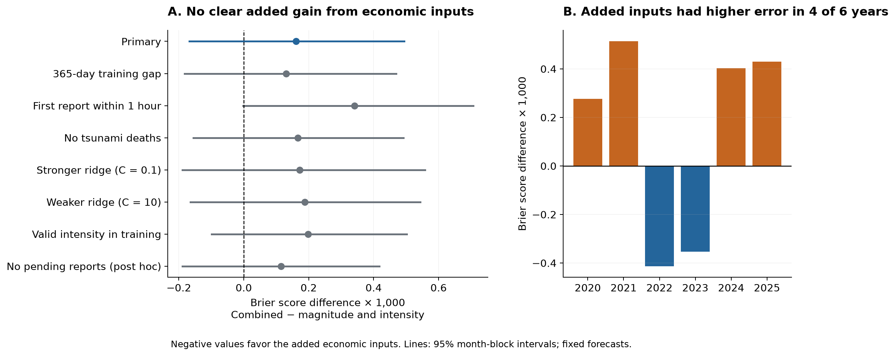
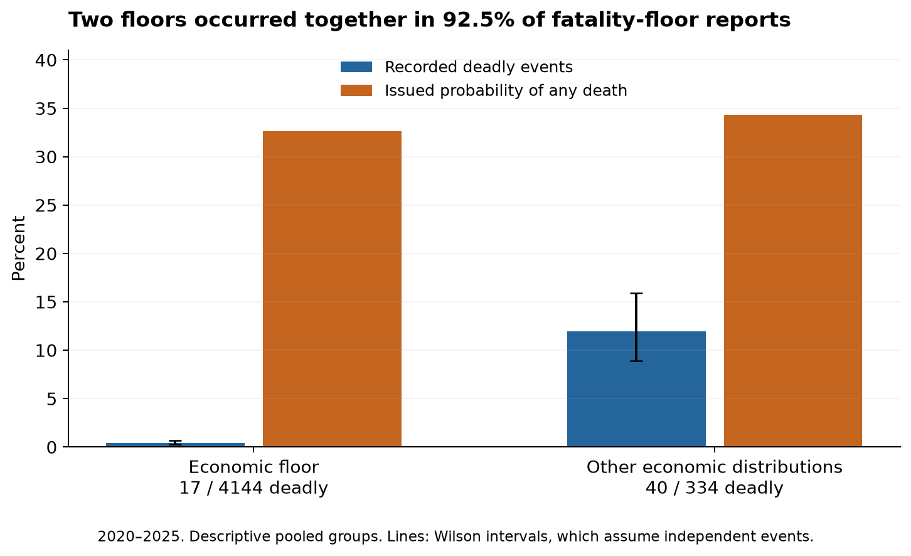
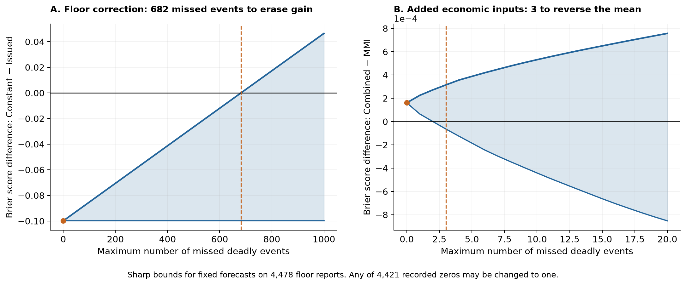

# PAGER floor repair kept a Brier score gain with up to 681 missed deadly events in 4,478 fixed forecasts from 2020 to 2025

The economic loss probabilities in the same PAGER report did not give a clear added gain over magnitude and shaking intensity for predicting recorded deaths. This result applies to one fixed model and a test that used earlier years for training. It does not show that all economic or exposure information has no value.

An exact sensitivity check gives a strong bound on the earlier floor-repair result. This check was added after the planned economic-input test gave the null result above. For these fixed forecasts, the constant floor repair keeps a lower Brier score than issued PAGER if at most 681 recorded zeros are missed deadly events, wherever those events occur. At least 682 such events are needed to erase its mean score gain. The small difference between the two signal models can reverse with three missed events. These are exact bounds on this sample, not estimates of the number of missed events.

## Question and prior work

The parent SCI study [156946e5](sci:sha256:156946e5385f0a25a45be2eb1d8d541e7298c796c636d418b02d0d9d9047d7aa) found that a PAGER rule replaces a model loss below 0.001 with 0.5 before it makes the fatality probability bars. The rule made many low-loss events get a large probability of deaths. A later study [7c432ff9](sci:sha256:7c432ff9de9228d5bb4860f9256da2b05c2ec1586665edfadb8f01880cc7a2ed) tested a repair trained only on earlier events. It also tested magnitude and intensity within the floor group. That signal model gave no clear added gain over a constant floor repair.

PAGER issues economic and fatality estimates from shaking, exposure and country loss models. The [USGS description](https://earthquake.usgs.gov/data/pager/background.php) sets economic alert thresholds at USD 1 million, 100 million and 1 billion. This suggests a specific test: can the economic probability bars recover death-risk information beyond magnitude and intensity when the fatality bars have a floor? The economic bars are available in the same archived report. We do not use observed economic losses.

Joint impact modelling is not new. Loake, Patten and Steinsaltz (2026), [doi:10.1093/jrsssc/qlag042](https://doi.org/10.1093/jrsssc/qlag042), model several impact types with exposure and vulnerability inputs. They also compare death forecasts with PAGER. Our study tests a small addition to an existing repair, with no claim to replace or outperform that model.

We also examine incomplete outcome records. Jolliffe (2017), [doi:10.1002/met.1626](https://doi.org/10.1002/met.1626), and Bessac and Naveau (2021), [doi:10.5194/ascmo-7-53-2021](https://doi.org/10.5194/ascmo-7-53-2021), study observation error in forecast scores. We do not claim that the score algebra below is new. We apply it to this hazard audit and give exact event-count thresholds for reversal.

## Data and scope

We use two frozen files from the verified parent SCI bundle. No new earthquake or death records were collected.

| File in parent publication | SHA-256 |
|---|---|
| `files/results/event_forecasts_outcomes.csv.gz` | `e510545cff494376da75b06c54231b0eeebde96bd038f26683dc62c6ff2ac814` |
| `files/data/pager_versions_raw.jsonl.gz` | `cf27053dc73a704c03116a79fce00649960cd91475219ff46e3d5409bf72626b` |

The exact shared source is `./campaign/156946e5385f0a25a45be2eb1d8d541e7298c796c636d418b02d0d9d9047d7aa.zip`, at `/mnt/dell-data/campaigns/11_07_2026/156946e5385f0a25a45be2eb1d8d541e7298c796c636d418b02d0d9d9047d7aa.zip`. This is the shared campaign path on HP. We used no directory under `./datasets`. The source, hashes, service URLs, code version and job details are also in `files/provenance.json`.

The parent downloaded the USGS ComCat archive and NOAA NCEI records on 2026-11-09. It matched NCEI earthquakes within 180 seconds and 200 km. An event with no matched death record has zero *recorded* deaths. We reuse those matches. We do not independently confirm the death counts or their completeness. The NCEI source is the Global Significant Earthquake Database, doi:10.7289/V5TD9V7K. Its tsunami database, doi:10.7289/V5PN93H7, supplies the tsunami-death flag.

For each of the 9,130 parent events, we select the earliest archived product with seven fatality bins, by product update time. The raw fatality probabilities agree exactly with the parent table after normalization. The largest lag difference is below 3e-13 minutes. This rebuild links economic inputs to the same version as the fatality inputs. It does not attach economic values from a later version.

The primary input set has 6,751 JSON-format PAGER 2.x reports. We recover 6,373 fatality floor signatures, as in the parent. The 2020-2025 test set has 4,575 reports, of which 4,478 have the fatality floor. NCEI records deaths for 57 of those floor events. Twelve had at least 10 deaths, four had at least 100, and none had at least 1,000. The full test set has 101 recorded deadly events.

The first archived report is not always the first report seen by a real-time user. In the full test set, 36 first products have `alertlevel=pending`. Twenty-two of these events have recorded deaths. The main analysis keeps the parent's archive rule. A post hoc check removes pending reports from both training and testing. It does not choose a later report.

## Fixed forecast test

The plan in `files/analysis_plan.md` was written before the economic models were fitted or scored. It is a retrospective plan, not a public preregistration. The parent results were already known. The original plan hash is `dde0a2d9b172eef7dadb4215d67985493d7695bffbc477e4728eee5601006c07`.

For test year Y, training starts in 2017 and stops 90 days before January 1 of Y. Each model is fixed for the test year. Test years are 2020 through 2025. All death labels come from the later 2026 compilation. Thus this is a test with dates restricted to the past, not a reconstruction of which outcome records were available at each date.

We normalize each seven-bin vector to sum to one. To identify a floor, we regress the normal quantile of cumulative probabilities on log thresholds at 1, 10, 100 and 1,000. At least two probabilities must lie between 0.0001 and 0.9999. A recovered center with absolute log ratio to 0.5 below 0.05 is a floor signature. We apply the same rule to the economic bars. For those bars the center is in millions of USD. The two economic exceedances below use bin indices, so they do not depend on an untested conversion of a units string. The public PAGER code at commit `081a55f854031caa72a67bf115f855db87741563` converts total dollars to millions before it makes these bins. A floor signature is not an independent measurement of zero physical loss.

We fit separate ridge logistic regressions for at least 1, 10, 100 and 1,000 recorded deaths among floor training events. Inputs are standardized on training events. The ridge setting is C=1, with no class weights or test tuning. A single-class training target gets probability `(positive_count+0.5)/(n+1)`. A cumulative minimum over increasing thresholds prevents probability crossings.

| Model | Inputs or rule for floor events |
|---|---|
| Issued | Original PAGER fatality probabilities |
| Constant | Earlier floor-event frequencies over five ordered classes, with 0.5 added to each class |
| MMI | First magnitude, first maximum intensity, intensity-missing indicator |
| Economic | Logit probability of at least USD 1 million, logit probability of at least USD 100 million, economic floor indicator |
| Combined | All MMI and Economic inputs |
| Overall | Earlier class frequencies over all training reports |

Economic probabilities are clipped to [1e-6, 1-1e-6] before the logit. Intensity outside 0-12 is missing and is replaced by the training median. There are 53 such inputs, all before the test years. Depth, final magnitude, final location, later products and outcome-dependent country labels are not predictors.

For the full-population scores, Constant, MMI, Economic and Combined keep all non-floor forecasts unchanged. Overall is a constant reference for every event. Assertions check probability bounds, threshold order, temporal cutoffs and unchanged non-floor reports. All fitted parameters are included.

The primary endpoint is the difference in mean Brier score for any recorded death, Combined minus MMI, within test floor events. Negative values favor Combined. We use 20,000 paired bootstrap samples of calendar months, with all events in a sampled month kept together. All 72 months are available for sampling. Seed: 881107. The interval is conditional on the fitted forecasts. It does not include uncertainty from model fitting, analysis choices or long dependence between months.

## Forecast results

| Model | Floor Brier score, any death | Expected deadly floor events | Full-set normalized RPS |
|---|---:|---:|---:|
| Issued | 0.112525 | 1467.76 | 0.033173 |
| Constant | 0.012697 | 102.97 | 0.008452 |
| MMI | 0.011949 | 105.42 | 0.008237 |
| Economic | 0.011959 | 108.78 | 0.008267 |
| Combined | 0.012110 | 105.41 | 0.008294 |
| Overall | 0.013074 | 153.84 | 0.008496 |

There are 57 recorded deadly floor events. Lower scores are better. Normalized ranked probability score (RPS) is the mean of the four Brier terms for thresholds 1, 10, 100 and 1,000 over five ordered classes. It is not a score in units of deaths.

The primary difference is **+0.000161**, with a 95% month-block interval of **-0.000168 to +0.000494**. The point estimate is 1.35% worse than MMI. The largest gain inside this conditional interval is about 1.4% of the MMI Brier score. This is not an equivalence test and does not exclude gains from other models or data.

Combined has higher error than MMI in 2020, 2021, 2024 and 2025. It has lower error in 2022 and 2023. Its floor RPS difference is +0.000057 (-0.000034 to +0.000150). Economic alone is close to MMI in Brier score: difference +0.000010 (-0.001073 to +0.001094). Its difference from Constant is -0.000738 (-0.001623 to +0.000137). These are secondary comparisons, not separate confirmed findings.

MMI ranks events well: its pooled floor ROC AUC is 0.9350. Combined gives 0.9356 and Economic gives 0.8155. Ranking is not calibration. Both MMI and Combined still give about 105 expected deadly events against 57 recorded. The fixed repair and signal models do not remove all bias.



**Figure 1.** Combined minus MMI Brier differences for the primary test and sensitivity tests (left), and by test year (right). Negative values favor added economic inputs. Lines are conditional 95% month-block intervals. The no-pending row is post hoc.

### Sensitivity

All planned month-block intervals include zero. Every point estimate favors MMI.

| Test | Combined minus MMI Brier difference | 95% month-block interval |
|---|---:|---:|
| Primary | +0.000161 | -0.000168 to +0.000494 |
| 365-day training gap | +0.000130 | -0.000182 to +0.000470 |
| First report within one hour | +0.000341 | -0.000002 to +0.000707 |
| No recorded tsunami deaths | +0.000166 | -0.000155 to +0.000491 |
| C=0.1 | +0.000172 | -0.000189 to +0.000558 |
| C=10 | +0.000188 | -0.000165 to +0.000543 |
| Valid intensity in training | +0.000199 | -0.000100 to +0.000502 |
| No pending reports, post hoc | +0.000114 | -0.000189 to +0.000417 |

The primary year-block interval is -0.000146 to +0.000432. There are only six year blocks. In the one-hour sensitivity, the year-block interval is slightly above zero (+0.000002 to +0.000629), which favors MMI. It does not show a gain from economic inputs.

The full-set Combined RPS difference from Overall is -0.000202 (-0.001647 to +0.001325). Thus this test does not establish added skill beyond past overall rates. At 100 and 1,000 deaths there are very few positive events; their scores cannot establish reliable tail performance. Complete scores, reliability groups and yearly results are supplied in CSV files.

### Descriptive information in the economic bars

The two floors often occur together. Of 4,478 fatality floor reports, 4,144 (92.5%) also have the economic floor signature. There are 17 recorded deadly events in this group (0.41%). The other 334 reports have 40 deadly events (11.98%). Both groups get large mean issued death probabilities, 32.65% and 34.35%.



**Figure 2.** Pooled recorded death frequency and mean issued death probability by economic floor signature, within fatality floor reports. Wilson intervals assume independent events. These are descriptive groups formed across all test years. They are not a forecast test. A strong pooled association did not yield a clear added gain over magnitude and intensity in the fixed chronological model.

The economic floor also makes the numeric economic probability hard to read as a simple ordering of risk. The mean probability of at least USD 1 million is 0.332 in the economic-floor group and 0.222 in the other group, although recorded death frequency is lower in the first group. Economic loss is not death risk, and neither quantity is observed economic loss. The economic floor flag was specified in the model before fitting to avoid treating the sentinel probability as a continuous risk scale.

## Exact bounds for missed deadly events

This check was added after the primary result. It addresses an unresolved limit of the parent audit: some recorded zeros can be missed deadly events. It uses fixed predictions and permits any recorded zero to change to one.

For two probability vectors A and B and binary recorded outcomes y, define

`D = mean((A-y)^2 - (B-y)^2)`.

Negative D favors A. If recorded zero i changes to one, D changes by

`h_i = -2*(A_i-B_i)/n`.

For exactly m missed positives, add the m smallest h values for the lowest possible D and the m largest for the highest possible D. These bounds are attained by choosing those events, so they are sharp. For at most m, take the minimum or maximum over counts 0 through m. The proof is the expansion of the squares followed by ordering a sum of m numbers. `files/posthoc_bounds.md` gives the assumptions.

| Comparison A minus B | Recorded-outcome difference | Fewest added deadly events that can reverse its sign |
|---|---:|---:|
| Constant minus Issued | -0.099828 | 682 |
| Combined minus Issued | -0.100415 | 649 |
| MMI minus Constant | -0.000748 | 56 |
| Economic minus Constant | -0.000738 | 63 |
| Combined minus MMI | +0.000161 | 3 |

The first row gives an exact guarantee: with at most 681 missed deadly events among the 4,421 recorded zeros, Constant still has a lower mean Brier score than Issued for every possible placement of those missing events. At 682, a placement exists that removes the gain. This needs missed deaths in 15.4% of recorded-zero events. There would then be at least 739 deadly events rather than 57. This is a sensitivity threshold, not a claim about actual missingness.

The last row concerns an unfavorable mean estimate for Combined. Three added events can make that estimate favor Combined. It does not create a statistically clear benefit and does not reverse the primary null conclusion by itself. It shows why a small score ranking should not be treated as a stable scientific result when outcomes are incomplete.



**Figure 3.** Sharp ranges under at most m missed deadly events. The left panel compares Constant with Issued. Its upper bound crosses zero at 682. The right panel compares Combined with MMI. Its lower bound crosses zero at three. All 4,421 recorded zeros are eligible. The predictions and training labels stay fixed. These ranges are not confidence intervals.

The constant floor correction is therefore much more robust to missing test death records than the small differences among added-input models. This strengthens one part of the parent result while leaving the new signal question unresolved.

## Limits

- This is an extension on the same source snapshot and labels, not an independent data replication. We rebuilt the version link but did not re-audit the NCEI matches or add a new death source.
- The models predict recorded death outcomes. Small death counts can be missing, and some recorded deaths can come from secondary hazards or indirect effects that the PAGER shaking model does not target.
- Historical outcomes were not available in their present 2026 form at the forecast dates. The 90-day and 365-day gaps do not reconstruct as-of labels.
- Month and year sampling do not remove all sequence dependence or training uncertainty. The uncertainty intervals are conditional on the fitted forecasts and these blocks.
- The main test is retrospective and follows known parent findings. There was no independent public preregistration. Secondary comparisons are not corrected for multiple testing.
- The null applies to fixed ridge models and three economic summaries. Other features, non-linear models, direct exposure, regional vulnerability or new data can give other results.
- The missing-record bounds hold forecasts fixed, change only test zeros to ones and do not refit models. They are not bounds for a new training pipeline with corrected historical labels. They do not measure the number of truly missed events.
- Archive products can be pending or revised. Results apply to first archived probability bars under the stated selection, not to alert colours, economic-loss calibration, response utility or guaranteed real-time public releases.

## Numerical checks and reproduction

Two complete numerical runs gave identical primary predictions, scores and bootstrap bounds. A separate BFGS optimization of the penalized binary likelihood checked MMI and Combined in all six test years. Its largest probability difference from the main fits was 1.87e-7. An independent formula for Brier scores gave the same results. Direct event-level recomputation of ten month-bootstrap draws agreed within 3e-19. Exhaustive enumeration of all label corrections in a small example verified the bound formula; direct attaining label sets verified each reported reversal threshold. Audit reports are included.

Use Python 3.12 with numpy, pandas, scipy, scikit-learn, matplotlib, pillow and threadpoolctl, plus the SCI CLI. Exact installed versions are in `files/environment.json`. Get the parent ZIP by its SCI ID from a publication archive or retain the campaign copy. The parent contains the original ComCat and NCEI retrieval scripts. A fresh web download can differ from the frozen inputs and is not needed for this test.

From an extracted copy of this publication, run:

```bash
bash files/run_all.sh /path/to/156946e5385f0a25a45be2eb1d8d541e7298c796c636d418b02d0d9d9047d7aa.zip /path/to/separate/scratch
```

The script verifies the parent bundle and publication ID, checks both file hashes, extracts records only into separate scratch, fits all models, makes the bounds, runs the audits and writes the figures. It refuses to write scratch inside this publication. It uses one BLAS thread for these small models. Reproduction on this machine took minutes. It needs no network once the parent ZIP is present.

The signed package includes our code, plan, fitted parameters, aggregate scores, selected bounds, bootstrap draws, figures and audit reports. It excludes external record-level data, predictions and the full ordered bound curve. The scripts regenerate those materials in scratch. The full curve is excluded because adjacent curve points can reveal individual forecast differences. The original source publication is required; private scratch is not required.

## Provenance and rights

Campaign: `11_07_2026`. Job: `sci-1107-hp-earth-and-ocean-sciences-88ddd5898794`. Topic: earth-and-ocean-sciences. Machine: hp. Account: codex-myxtap. Model: gpt-6.1-sol with high reasoning effort through the Codex harness in T3 Code. Analysis date: 2026-11-09 in America/Los_Angeles, 2026-11-10 UTC. No agents were launched. The campaign-machine signing key is not a personal authorship claim.

The exact SCI baseline license applies to the bundled work. External source records and source software are outside this package. Their attribution and terms are identified in `files/NOTICE-external-data.md`. This publication grants no new rights to those external materials.
