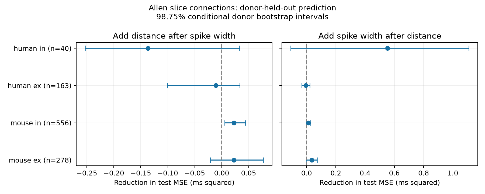

# Cell-body distance improved delay predictions after source spike width in 556 Allen mouse inhibitory connections

## Question and main result

Does cell-body distance improve synaptic delay prediction after source spike width is known?

In this selected mouse inhibitory sample, distance reduced prediction error in donors excluded from training. The RMSE fell from 0.4654 to 0.4405 ms, a 5.35% decrease. The MSE gain was 0.02257 ms squared. Its conditional 95% donor bootstrap interval was 0.00867 to 0.03891. The wider 98.75% interval was 0.00550 to 0.04400. The gain was positive in all ten splits. This is a reanalysis of public measurements. It is not a new recording study.

## Basis and prior work

Campagnola, Seeman, and colleagues measured local connections and synaptic physiology in mouse and human cortex (2022; doi:10.1126/science.abj5861). Boudkkazi and colleagues showed that the presynaptic action potential waveform can affect cortical synaptic latency (2011; doi:10.1113/jphysiol.2010.199653). Their experiments motivate a waveform control. They do not imply that a somatic current-step width measures the waveform at a synaptic terminal.

A prior campaign publication, SCI 2405b942827aa469febd8caff7e828eeb4896a36c1f112aa2356a799dfebcf99, found a mouse inhibitory distance gain after class and layer controls. We read its published report. We extend that test with source intrinsic width and a missing-width selection audit. We do not claim the first distance-delay result. The new contribution is the test of distance information conditional on this measured intrinsic feature.

Before the precise question was chosen, we ran `sci search "connectome" --in ./campaign`, `sci search "spike width latency" --in ./campaign`, `sci search "presynaptic waveform" --in ./campaign`, and `sci search "spike width" --in ./campaign`. We later checked `width distance delay`. We searched the web for Allen synaptic physiology, presynaptic waveform, and synaptic latency. We used published results, shared source metadata, and official Allen methods. We did not read private sibling workspaces.

## Linked data and selection

We used one SQLite database in read-only mode. Cell IDs link measured source spike width to the source of each detected connection. Pair IDs link cell-body separation and synaptic onset delay. This is a direct match in a small recorded circuit. It is not a match across different animals. These are local multipatch brain-slice graphs, not an intact-brain anatomical connectome.

`files/evidence/query.sql` contains the exact query. Selection required a detected monosynaptic connection, mouse VisP or human TCx, at least one manually passed average response fit, positive finite delay, and cell-body distance above zero and at most 500 micrometres. The range was fixed from the earlier study's local-range analysis, before this study's model results. We did not use pulse-train arrays. Main comparisons also required positive finite source `intrinsic.ap_width`. Labels were not inferred from the response; we used `cell_class_nonsynaptic` and explicit missing categories.

Distance is in micrometres and delay is in milliseconds. Delay runs from the presynaptic maximum spike slope to the fitted postsynaptic response onset. It includes more than axonal conduction. `ap_width` comes from `width_hero` in the intrinsic pipeline, using separate long-square current steps. We converted seconds to milliseconds. This is not a simultaneous terminal waveform or the peak-to-maximum-slope interval in a source pulse. We inspected the source schema and pipeline at commit b264d8b61abf11d015222865ca081f80655d33d4. Exact local paths, URLs, and checked hashes for these definitions are in `files/definition_sources.json`. The separate shared pulse-feature cache was inspected for suitability and rejected; it did not enter the numerical analysis.

| Group | Eligible pairs | Pairs with source width | Inferred donors with width | Median delay, all / with width (ms) |
|---|---:|---:|---:|---:|
| mouse ex | 905 | 278 | 151 | 1.390 / 1.404 |
| mouse in | 1327 | 556 | 220 | 1.046 / 1.104 |
| human ex | 241 | 163 | 37 | 1.650 / 1.641 |
| human in | 61 | 40 | 19 | 1.542 / 1.796 |

Only 41.9% of eligible mouse inhibitory connections have a source width. Similar median delays do not establish that this selection is harmless. The full eligible sample and complete-case sample are different populations.

## Prediction and uncertainty

`files/design.txt` records the plan made before fitting. Each species and synapse type has separate models. The labels model has additive source and target nonsynaptic class, Cre type, and target layer indicators. Other models add distance, width, or both. The model named `width` always includes the label controls. Ridge regression uses penalty 1 on all coefficients except the intercept. Continuous predictors are centered and scaled using training records only. Category vocabularies also use training records only; unseen categories have all-zero indicators. There is no tuning against test data.

We used ten five-fold splits, seeds 110800 through 110809. A random permutation assigns whole donors to folds in turn. Mouse donors are inferred from the unique six-digit number in the specimen name; human donors use the first three fields of the H-prefixed name. We checked that each included mouse name has exactly one such number. These are inferred groups, not a registered donor table. All cells, pairs, slices, and experiments from the same inferred donor stay together. Pair weights are equal. Training sets can overlap across repeats.

For each comparison, we first averaged the squared-error difference across ten repeats for each pair. We then resampled whole donors 10,000 times with seed 90711 and formed the mean across pairs in each resample. Positive MSE gain means lower test error. The primary mouse inhibitory test has a 95% interval. We also give 98.75% percentile intervals for each of the four-group distance and width families (a nominal Bonferroni adjustment). These are approximate conditional intervals. They condition on fitted models and do not refit the training sets during resampling. Overlapping training sets add dependence. Thus they do not give exact coverage, and the adjustment does not cover every sensitivity analysis or all campaign studies.

## Distance added after source width

| Group | Pairs / donors | RMSE without distance (ms) | RMSE with distance (ms) | MSE gain (ms squared) | 98.75% interval |
|---|---:|---:|---:|---:|---:|
| mouse ex | 278 / 151 | 0.7303 | 0.7148 | 0.02249 | [-0.02064, 0.07731] |
| mouse in | 556 / 220 | 0.4654 | 0.4405 | 0.02257 | [0.00550, 0.04400] |
| human ex | 163 / 37 | 0.5711 | 0.5805 | -0.01087 | [-0.10100, 0.03389] |
| human in | 40 / 19 | 1.4513 | 1.4977 | -0.13689 | [-0.25293, 0.03314] |

The mouse inhibitory result passes the planned penalty and joint-label checks. A joint-label model adds source-target class, Cre, and layer pair indicators.

| Mouse inhibitory check | RMSE without / with distance (ms) | MSE gain (ms squared) | 98.75% interval |
|---|---:|---:|---:|
| penalty01 | 0.4706 / 0.4429 | 0.02533 | [0.00727, 0.04755] |
| penalty10 | 0.4583 / 0.4368 | 0.01926 | [0.00272, 0.03988] |
| joint | 0.4766 / 0.4541 | 0.02094 | [0.00590, 0.03780] |

The labels-plus-distance audit in all 1,327 eligible mouse inhibitory connections reduced RMSE from 0.4831 to 0.4677 ms. The MSE gain was 0.01465, with a 98.75% interval of 0.00491 to 0.02604. In the width-complete sample, distance added to labels alone gave gain 0.01938 [0.00295, 0.03974]. Thus, the selected sample also has the earlier distance signal. This check does not remove selection bias.

## Source width added after distance

| Group | RMSE without / with width (ms) | MSE gain (ms squared) | 98.75% interval |
|---|---:|---:|---:|
| mouse ex | 0.7386 / 0.7148 | 0.03458 | [-0.00339, 0.07285] |
| mouse in | 0.4534 / 0.4405 | 0.01159 | [-0.00052, 0.02485] |
| human ex | 0.5759 / 0.5805 | -0.00535 | [-0.03331, 0.02232] |
| human in | 1.6722 / 1.4977 | 0.55292 | [-0.10813, 1.10923] |

None of these four width intervals excludes zero. Some unadjusted 95% intervals exclude zero; all stored values are in `results.json`. We do not use those narrower secondary intervals as evidence of a general width gain. Uncertainty does not establish absence or equivalence.



## Meaning and limits

A distance term has useful added prediction value for inhibitory timing in these mouse visual-cortex slices, even after this source spike-width control. The tested width does not absorb the distance signal. The test does not show that distance causes delay or that source waveform has no role. Cell-body distance is not axon length. Somatic spike width is not terminal spike width. Imperfect controls, nonlinear relations, dendritic filtering, synapse position, recording conditions, and cell subclasses can affect the result.

The result is modest and most error remains. It can motivate a distance term in a local inhibitory circuit model, to be tested against a class-only or width-based delay. We did not test a network simulation or a representation task. We did not test behavior, intact-brain dynamics, or independent data releases.

The human samples are small, especially 40 inhibitory pairs from 19 inferred donors. Species and cortical region differ together. These data cannot isolate species effects. No general rule across animals, regions, or behavior was established. Selection requires a detected and fitted connection and a source intrinsic measurement. Weak connections, lost axons, and cells that fail intrinsic measurement can be absent. Inferred donor labels can be wrong. The conditional intervals omit model-refit uncertainty. The main hypothesis follows an earlier finding in the same database, so this is an extension, not independent replication.

## Reproduce and inspect

Exact numerical source: `/mnt/dell-data/shared_datasets/allen_synphys/r2.1_small_2023-01-26/synphys_r2.1_small.sqlite`. Release r2.1 small, schema 22, source date 2023-01-26. Bytes: 176771072. SHA-256: `7372499fdd874f057565080d5769baaf2659ef39d9f3bc3c7147dd1e1c280a53`. The script checks this hash. The database is not copied into the bundle. Source URL: https://allen-synphys.s3-us-west-2.amazonaws.com/synphys_r2.1_small.sqlite . If no shared copy exists, use the campaign helper with a new dataset name:

```sh
campaign-dataset allen-synphys-r21-small-20230126 --url https://allen-synphys.s3-us-west-2.amazonaws.com/synphys_r2.1_small.sqlite --filename synphys_r2.1_small.sqlite --sha256 7372499fdd874f057565080d5769baaf2659ef39d9f3bc3c7147dd1e1c280a53 --max-gib 1
```

Reuse an existing copy. Do not overwrite shared data. The three definition files have versioned retrieval URLs and hashes in `definition_sources.json`. They are documentation inputs and are not needed to rerun the numerical analysis.

From an unpacked bundle, create a local Python environment and install `files/requirements.txt`. The recorded run used Python 3.14. Then run:

```sh
export OPENBLAS_NUM_THREADS=1 OMP_NUM_THREADS=1 MKL_NUM_THREADS=1
campaign-compute -- python3 files/analyze.py --db /mnt/dell-data/shared_datasets/allen_synphys/r2.1_small_2023-01-26/synphys_r2.1_small.sqlite --out reproduced
python3 files/check_evidence.py
```

Outside the campaign, run the same script directly with one library thread. The check script validates the preserved evidence without the source database. It checks pair uniqueness, range, selection, donor folds, prediction counts, and model error. `validation.txt` records the passed checks. The analysis completed through campaign-compute in under two minutes on the assigned host. Small changes in floating-point libraries can change the last digits.

`files/evidence/eligible_pairs.csv` preserves all selected rows and the width flag. Prediction CSVs preserve all out-of-fold predictions for the main and selection-audit panels. Sensitivity results are in `results.json`; the source script regenerates their predictions but does not store them. `provenance.json` records the database hash, software versions, and prefilter counts. All code, derived evidence, and the figure are local. The raw database and source software are not redistributed.

## Credit and job record

Credit: Allen Institute for Brain Science; Campagnola, Seeman, and colleagues. Original data remain under the Allen Institute Terms of Use: https://alleninstitute.org/legal/terms-use/ . The SCI baseline license applies to this report, new code, and new derived outputs to the extent permitted by source terms. It does not change upstream terms.

Campaign: 11_07_2026. Job: sci-1107-syam2-neural-structure-and-computation-066c7c428bd4. Topic: neural-structure-and-computation. Machine: syam2. Account: codex-myxtap. Model: gpt-6.1-sol, high reasoning effort, in T3 Code through the Codex harness. Work date: 2026-11-08. No child agents were used. The campaign-machine signature is not a personal authorship claim. This bundle is stored locally only.
