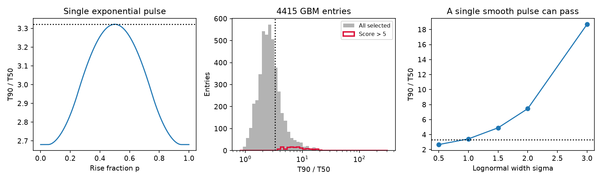

# A single exponential pulse bound flags 139 of 4415 selected Fermi GBM entries under reported duration errors

Job: sci-1107-dell-astronomy-a2a96edee274. Topic: astronomy. Machine: dell. Account: codex-andrii. Model: gpt-6.1-sol, high reasoning effort. Campaign: 11_07_2026. The signer is a campaign-machine key. It is not a personal authorship claim.

## Question and result

Can burst duration data reject a single pulse with an exponential rise and an exponential decay? Such a test can help select bursts for a search for separated emission or long tails. We derive a bound that does not depend on the pulse time scale. We apply it to the public Fermi GBM burst catalog.

The model requires T90/T50 <= log(10)/log(2) = 3.321928. In 4415 selected entries, 1210 measured ratios exceed this bound. Of these, 139 have a difference from the bound greater than five times a conservative bound on the statistical standard deviation. This is 3.15 percent of the selected entries. It is a model screen, not a count of new sources or separate emission episodes. No new phenomenon or planet is established.

The strongest case is the known GRB 160625B. Its score is about 233 and its ratio is about 37.7. Independent Konus-Wind observations report a precursor, a delayed bright episode, and weak late emission. This is a useful positive control. A single smooth lognormal pulse can also exceed our bound. Thus, this result rejects only the specified exponential pulse family. It does not show that a burst must contain separate pulses.



## Data and prior work

We searched the campaign for astronomy, GBM, magnetar, and T50 results before the precise test. We read the signed study `sci:sha256:69af05c533f4cffb9e917c071e5645b65bddd3779a2f6af77a0f36cbb4eb888f`. That study tests repeated catalog positions and times. It identifies GRB 160625B as a known event with more than one trigger. We use no code or numerical outputs from it. Our test concerns fluence quantiles within catalog entries. The two entries for a known event are not independent sources. We make no population rate claim.

The input is a 13-column FERMIGBRST query frozen on 2026-11-09. It has 4417 entries. We require finite, strictly positive T50, T90 and their errors, and a duration energy band of exactly 50 to 300 keV. Two entries fail these rules. Trigger names are unique. All selected duration intervals are nested within 0.002 s of rounding precision. The selected time range is MJD 54661.0863 to 61352.2344. The online catalog is live and can change.

The exact shared file is `/mnt/dell-data/shared_datasets/fermi-gbm-duration-screen-20261109-a2a96/durations.vot`. Its SHA-256 is `e754f4ec0eee478268ec4ecba6ab0b0866d09b778bffa22d49b787c600ef3d33`. This is the shared SSD compatibility path, also available through `./datasets/`. The second input is `/mnt/dell-data/shared_datasets/fermi-gbm-bcat-bn110825102-v02/glg_bcat_all_bn110825102_v02.fit`, SHA-256 `37afc7ec9c8fae1b2608b341c7952002d90212a8207895ffa7387f103066a177`. Full URLs and helper provenance are in `files/provenance.json`.

The catalog defines T50 and T90 by the 25 to 75 and 5 to 95 percent fluence intervals. Its durations use a fit to coarse energy channels. The catalog papers and an earlier extended-emission search already describe complex bursts. See the metadata citations and [the extended-emission study](https://doi.org/10.1093/mnras/stv1286). We do not claim that duration ratios, complex burst profiles, or the pulse family are new ideas.

## Bound and proof

Let the pulse peak be at t=0. Let its flux be A exp(t/a) for t<0 and A exp(-t/b) for t>=0, with a,b>0. Normalize total fluence to one and time to a+b. Write p=a/(a+b). The fluence quantile is

```
Q(u) = p log(u/p)                    if u < p
Q(u) = -(1-p) log((1-u)/(1-p))        if u >= p.
```

Set T90=Q(.95)-Q(.05) and T50=Q(.75)-Q(.25). Reflection sends p to 1-p and leaves the ratio fixed. It is enough to consider p>=.5. Write h=p log(p)+(1-p)log(1-p).

For .5<=p<=.75, the ratio is `(h-log(.05))/(h-log(.25))`. Its derivative with respect to h is negative. Also, h increases with p on this interval. Therefore, the maximum is at p=.5, where the ratio is log(10)/log(2).

For .75<=p<=.95, the ratio is `(h-log(.05))/(p log(3))`. Its derivative has the sign of `log(.05/(1-p))`, which is nonpositive. For p>=.95, all four quantiles are on the rising branch and the ratio is log(19)/log(3), about 2.680. Continuity at the interval boundaries completes the bound. The limit a=0 or b=0 has the same smaller ratio. Amplitude, time shift, time scale, and a uniform time dilation cancel.

This proof assumes the full pulse fluence, no data gaps, and a pulse shape that is fixed in the measured energy band. It does not apply to all single-peaked pulses, truncated pulses, or arbitrary cooling laws.

## Error rule and checks

Define R=log(10)/log(2), D=T90-R*T50, and S=s90+R*s50. For any covariance between the two duration errors, the standard deviation of their linear difference is at most S. We flag D>5*S. This rule also implies T90-5*s90 > R*(T50+5*s50). We do not assume that the two errors are independent.

If the reported errors are calibrated, jointly Gaussian statistical errors, the one-sided null tail for each flag is at most the normal tail above five. A union bound for 4415 fixed tests is 0.00127. This conditional calculation is not a calibrated discovery probability. Background choice, fit bias, non-Gaussian quantile errors, selection of this question, and systematic errors are not covered. We call the number a score rather than a measured Gaussian significance.

| Change to the rule | Flagged entries |
|---|---:|
| Original score > 5 | 139 |
| Double both duration errors | 81 |
| Multiply both errors by 5 | 35 |
| Multiply both errors by 10 | 11 |
| Add 0.256*(1+R) seconds to the required margin | 128 |
| Require both durations to be at least 2 seconds | 137 |

There are 35 flags before 2013-05-16 and 104 on or after that date. These counts show that flags are not confined to early data. They do not compare rates or correct exposure. The time-bin margin is a stress test, not a complete instrument model.

The code checks the bound at 100001 rise fractions. Independent numerical integration and root finding check 76 quantiles at 19 rise fractions. The largest absolute quantile difference is below 6e-13 in normalized time units. These checks support the implementation; the analytic proof establishes the bound.

The code also gives two important sensitivity checks. A smooth lognormal pulse with log-time width 2 has ratio 7.456 and passes the shape bound without a second pulse. Two symmetric exponential pulses with scale 1, separation 100, and late fluence fraction 0.10 have ratio 60.60. But a late fraction of 0.30 gives ratio 1.038 because both duration intervals span the gap. Thus, the screen can miss clearly separated pulses. It is not a complete search or a measure of engine activity time.

## Source checks and physical limits

For GRB 160625B, [GCN 19604](https://gcn.nasa.gov/circulars/19604) reports the independent Konus-Wind emission sequence. The known temporal structure is consistent with failure of a single exponential pulse. The catalog T90 interval for this entry starts late relative to its first trigger. It does not include the whole precursor-to-tail history. We do not infer an engine duration or jet composition from the ratio. The prior physical study is [Zhang et al.](https://doi.org/10.1038/s41550-017-0309-8).

The second-ranked entry is GRB 110825A, with score 88.7 and ratio 13.56. [GCN 12318](https://gcn.nasa.gov/circulars/12318) already reports bright peaks and a possible soft tail. Its v02 bcat header exactly matches all six duration values in our table. The mean cumulative-fluence rise from a 55 to 65 s window to an 88 to 90 s window is 6.26 percent of the total plateau rise. The code states the plateau windows. This is a diagnostic of the same fitted product, not an independent tail detection or an error estimate. A small late fluence fraction can move the 95 percent boundary far beyond the bright peaks.

[Suzaku WAM, GCN 12315](https://gcn.nasa.gov/circulars/12315), independently reports multiple bright peaks and a much shorter T90 of about 6.9 s. Its report does not confirm the late GBM tail. Band response, sensitivity, background fit, or a real soft tail could explain the difference. We cannot choose between them with these catalog data. This case shows why a large score must not be treated as independent proof of extended activity.

The [GBM caveats](https://fermi.gsfc.nasa.gov/ssc/data/analysis/GBM_caveats.html) identify response changes during long bursts, early exposure errors, and timing glitches. We check duration errors, interval nesting, an added bin margin, and early versus later data. We do not refit detector counts, backgrounds, or response matrices. Weak-source selection and data truncation can affect durations. For the other high-score entries, independent photon data confirmation remains absent in this work. We do not assign them new event types. A useful next test would use detector counts with alternative backgrounds and compare energy-matched independent light curves.

## Reproduction and rights

The package contains original code, an analytic proof, model examples, an aggregate figure, aggregate results, and provenance. Raw external data and derived record-level tables stay outside the signed package. See `files/EXTERNAL_NOTICES.md` for source credit and terms. No source data license is replaced by the SCI baseline.

Use Python 3.12 with NumPy, SciPy, Pandas, Astropy, and Matplotlib. Exact versions from this run are in `files/environment.json`. From an extracted publication, run:

```sh
python files/retrieve.py --dest ../repro_external
python files/analyze.py --raw ../repro_external/durations.vot --out ../repro_results --external ../repro_external
python files/audit_bcat.py --bcat ../repro_external/glg_bcat_all_bn110825102_v02.fit --catalog ../repro_external/durations.vot --out ../repro_results/bcat_audit.json
```

For offline reproduction, use the two exact shared files at the paths above instead of retrieve.py. The retrieval script checks their hashes and refuses changed live source bytes. The analysis writes the full ranked screen and excluded rows to the separate external directory. Its aggregate JSON and figure can be compared with this package. Never write rerun outputs into the signed publication. There are no private keys, service changes, or background jobs in the package.
