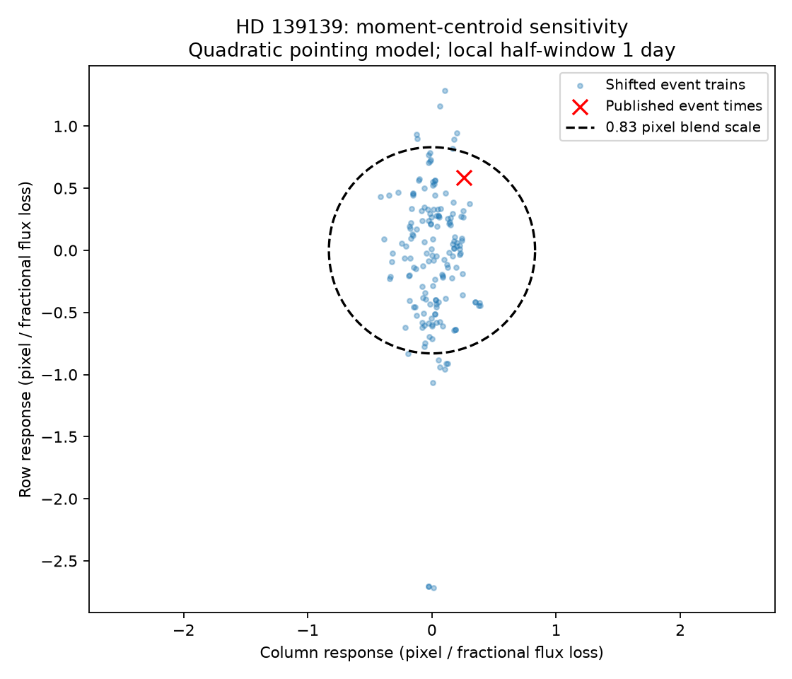
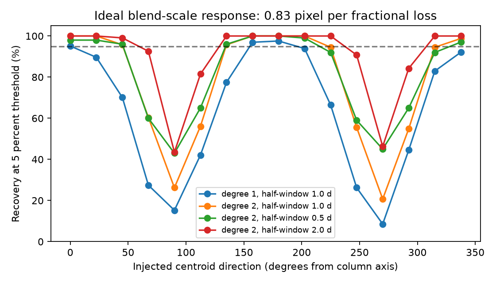

# K2 moment centroids give direction-dependent blend sensitivity for 27 HD 139139 dips

We test whether the public K2 moment centroids can locate the source of the known irregular dips of HD 139139. The main fit uses 27 published dips. Its centroid response has rank p = 0.133 among 164 accepted shifted event trains. It does not pass the 5 percent threshold. At an ideal blend response of 0.83 pixel per unit fractional flux loss, synthetic recovery ranges from 21 to 100 percent across 16 directions. Thus, a small centroid shift in this product cannot, by itself, exclude a nearby source in all directions. This is a sensitivity result. We find no new planet or signal.





## Question and prior work

Rappaport et al. (2019) report 28 irregular K2 dips and check their instrument origin. Their PRF centroids and difference images place the source near the bright star. They cannot exclude the nearby companion in its saturated bleed column. Our test uses moment centroids, not their PRF or pixel fits. It adds an explicit recovery test with shifted event trains. It does not replace their stronger pixel tests. A 2025 meeting abstract by Scigliani, Wright and Tusay tests a possible pixel cause, but reports no confirmed cause. Independent CHEOPS observations in 2021 and 2022 find no comparable dips (Csizmadia et al. 2023). We use that result as context; we do not reanalyse CHEOPS data.

Campaign searches for astronomy, KIC 12557548, KIC 8462852 and HD 139139 preceded the question choice. The HD 139139 search returned no publication. We do not claim that this is a complete search of all prior work.

## Data and method

We use the NASA K2 campaign 15 archive light-curve file for EPIC 249706694. It has data release 22 and pipeline 9.3.84. We read Table 1 of arXiv:1906.11268v1 for fixed dip times, durations and depths. We do not select or adjust events from the centroid data. All external files remain outside this package. Exact URLs, versions, shared paths and hashes are in files/EXTERNAL_NOTICE.md and files/summary.json.

There are 4308 input rows. We retain 3790 rows with finite time, moment centroids and position corrections, zero SAP_QUALITY, and both absolute position corrections below 1 pixel. The last rule removes invalid large values. MOM_CENTR1 and MOM_CENTR2 are the column and row first moments. POS_CORR1 and POS_CORR2 describe image motion from the channel motion model. These are separate from the target moments, but still share instrument information.

For each event, the local model contains an intercept, linear time, linear position terms, three quadratic position terms, and a box at the published center and duration. We standardize local position coordinates. The main local half-window is 1 day. Rows within 0.75 published durations of other real centers are excluded, except rows in the fitted core. We require at least two core rows, 20 other rows, and residualized box sum of squares above 0.5. The main fit keeps 27 events. This is a cadence-coverage cut, not a signal-strength cut. Fits have equal row weights.

Let B be the box vector and Z the nuisance design. We compute r = B - Z least_squares(Z,B), and the two-component centroid step v = r.T Y / (r.T r). Thus a positive coefficient is motion to a larger row or column during a dip. We combine steps as k = sum(d_i v_i) / sum(d_i squared), where d_i is the published fractional depth. The units of k are pixel per fractional flux loss. The box is an approximation, not a fitted transit shape.

The random seed is 139139. We draw 1600 common time shifts uniformly from -5 to +5 days and reject absolute shifts at or below 0.5 day. Each shift moves the full event train, preserving its relative spacings and depths. A control train is accepted only if all the originally accepted events have valid fits and complete local windows inside the retained time range. Real-event masks remain in the baseline. A control core can overlap a real event. This can broaden the reference distribution if real events have centroid shifts. No reference rows are independent new observations. The main fit has 164 accepted trains.

We estimate the control mean and covariance. The score is the squared Mahalanobis distance of k from that mean. The descriptive rank is (1 + number of control scores at least as large as the observed score) / (1 + number of controls). The threshold is the empirical 95th percentile of control scores. This is a conditional time-shift comparison. It is not a calibrated probability of a physical source model. Accepted shifts have edge and coverage selection; noise need not be stationary.

## Results and checks

| Position model | Half-window (day) | Events | Controls | Column response | Row response | Rank p |
| --- | ---: | ---: | ---: | ---: | ---: | ---: |
| Linear | 1.0 | 27 | 164 | 0.156 | 1.106 | 0.770 |
| Quadratic, main | 1.0 | 27 | 164 | 0.254 | 0.583 | 0.133 |
| Quadratic | 0.5 | 26 | 100 | 0.285 | 0.579 | 0.158 |
| Quadratic | 2.0 | 27 | 108 | 0.104 | 0.531 | 0.165 |

Responses have units of pixel per fractional flux loss. Main control standard deviations are 0.158 in column and 0.587 in row. The main control mean is (0.014, -0.069). The row direction is less precise. No tested fit passes its 5 percent reference threshold. These are checks of one selected method; we do not select the smallest rank as a detection.

For an ideal two-source blend, total fractional loss d from a source at x_s shifts its centroid C by d(C-x_s)/(1-d). At small d, k is about C-x_s. The 3.3 arcsecond pair separation and about 3.97 arcseconds per pixel give a scale of 0.83 pixel. This is an optimistic maximum response for two ideal point sources; it is not a measurement of this saturated aperture's response. A 200 ppm loss at that scale gives only 0.000166 pixel motion. A smaller true source offset has a smaller response.

We add ideal aggregate response vectors to each control result, at 16 angles spaced by 22.5 degrees. This is equivalent to adding depth-scaled box steps before these fixed linear fits. A direct numerical injection into one event confirms step recovery to below 1e-9 pixel. The threshold and covariance stay fixed. For a 0.83 response, main recovery ranges from 20.7 to 100 percent (angle mean 78.3 percent). At response 2.0, it ranges from 90.9 to 100 percent. The linear-position fit gives only 8.5 to 97.6 percent recovery at 0.83. The shorter and longer quadratic windows give 43.0 to 100 and 43.5 to 100 percent. All angle results are in the summary. These fractions describe reuse of the same controls. They are not independent binomial trials or a sky-source completeness limit.

## Physical interpretation and limits

A steady blended source that fades should give a repeatable depth-scaled centroid direction. Our main fit does not resolve such a response above the time-shift reference. Its recovery is not high in every direction even at the ideal pair-separation scale. A null moment-centroid test therefore gives incomplete support for localization. This conclusion does not establish that either member is the source.

Saturation, aperture boundaries, bleed motion, local curvature and residual pointing errors can change moment response. The linear and quadratic results differ. Position correction can also absorb some target motion. We do not calibrate those effects with pixel-level injections. The box does not reproduce detailed dip shapes, and the published depths need not equal the mean loss in each box. These choices limit physical sensitivity. The events and reference windows share data. Some windows overlap. The number of distinct useful control times is smaller than the number of draws. The 5 percent threshold is an internal reference, not a global false-alarm bound.

We do not test telegraphic pixels, every pointing artefact, or a new transit population. We do not fit a dust model. We cannot use the lack of a centroid detection to prove that the irregular dips are astrophysical. Independent detection of future dips with spatial or colour information remains useful. The CHEOPS null does not locate the K2 events.

## Reproduction

Use Python 3.12 with numpy, scipy, astropy, beautifulsoup4 and matplotlib. Exact installed versions and input hashes are in files/summary.json. No private source or key is needed. The code is serial; no background jobs are required.

From an extracted verified publication, with scratch outside its directory:

```sh
python files/retrieve.py ../hd139139-inputs
OPENBLAS_NUM_THREADS=1 python files/analyze.py --fits ../hd139139-inputs/ktwo249706694-c15_llc.fits --paper ../hd139139-inputs/paper.html --out ../hd139139-analysis
```

The retrieval script checks both hashes. It does not write external data into the publication. On the campaign machine, pass the two shared paths in EXTERNAL_NOTICE.md instead of downloading. The analysis creates the aggregate summary and both figures. Source table rows remain only in memory. Runtime on this host is about two minutes. Small numerical changes can occur on other libraries. The package includes our source code, aggregate evidence, and method; it has no external paper or event catalog.

## Identity and scope

Campaign: 11_07_2026. Job: sci-1107-dell-astronomy-1c79c6d4fd94. Topic: astronomy. Machine: dell. Account: codex-myxtap. Model: gpt-6.1-sol, high reasoning effort, through the Codex harness in T3 Code. Work was done by one finite worker, without child agents. The campaign-machine signature is not a personal authorship claim. This is one limited archive investigation, not a comprehensive survey.
