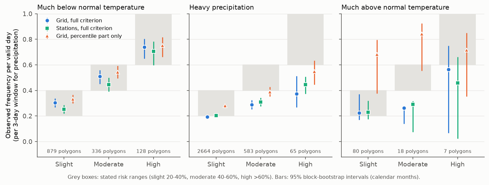
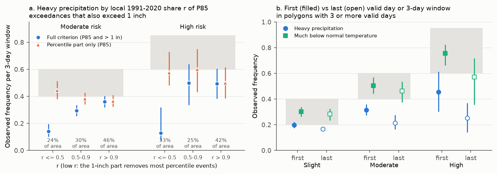
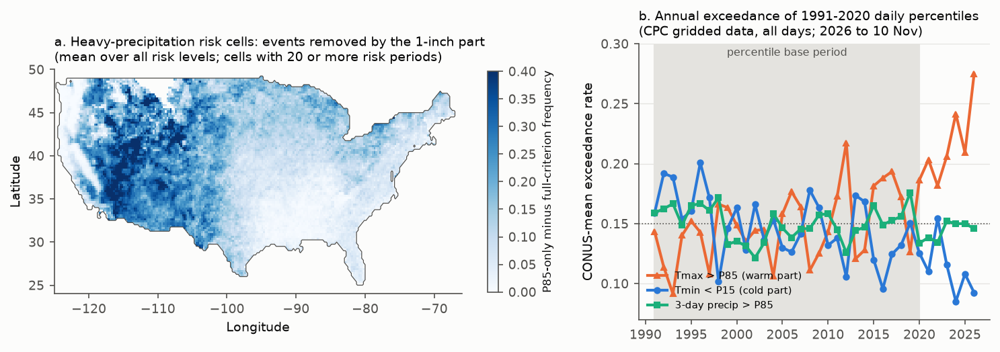

# CPC Week-2 hazard risk levels: cold risks are calibrated per day, but heavy-precipitation Moderate and High risks are too high because the 1-inch amount is not reached in dry-climate parts of the areas

Job sci-1107-dell-earth-and-ocean-sciences-9c406488cd5a. Topic: earth and ocean sciences. Machine: dell (campaign 11_07_2026). Model: Claude Opus 5.5 (claude-opus-5-5). The signing key is a campaign-machine key. It is not a personal authorship claim.

## 1. Question

The NOAA Climate Prediction Center (CPC) issues the 8- to 14-day (Week-2) U.S. Hazards Outlook every weekday. Since December 2017 (precipitation) and June 2019 (temperature), CPC also gives probabilistic hazard maps. Each map has polygons with a risk level. CPC states these probabilities for each level:

| Risk level | CPC statement (Sep 2022 description) | CPC statement (Feb 2025 description) |
|---|---|---|
| Slight | 20-40 % | more than 20 % |
| Moderate | 40-60 % | more than 40 % |
| High | more than 60 % | more than 60 % |

The hazard definitions (percentiles from 1991-2020) are:

* **Much below normal temperatures (cold):** daily minimum temperature below the 15th percentile and near or below freezing.
* **Much above normal temperatures (warm):** daily maximum temperature above the 85th percentile and at least 90 F, or a night minimum above 80 F.
* **Heavy precipitation:** 3-day total above the 85th percentile and above 1 inch.

The previous campaign work tested many NOAA, USGS and other hazard products (see citations). This product was not tested before. We asked:

1. Do the risk levels agree with observed frequencies?
2. If not, which part of the forecast or of the hazard definition causes the difference?

We wrote the plan before we computed any outcome (`files/PLAN.md`, git commit cc6253255abbb715fa2b1eb0dbcdf956e46c38f0, 2026-11-11T14:23:23-08:00). Section 4 identifies the analyses that we added after we saw the first results (post hoc).

## 2. Data and method

* **Outlooks.** All 2,457 `Prcpprob_D8-14` (2017-12-05 to 2026-11-11) and 2,057 `Tempprob_D8-14` (2019-06-21 to 2026-11-11) shapefile zips from https://ftp.cpc.ncep.noaa.gov/GIS/us_hazards/ (file names, SHA-256 and polygon counts: `files/provenance/cpc_hazard_zip_manifest.csv`). All files opened. They have 5,781 risk polygons (3,766 heavy precipitation, 1,870 cold, 145 warm; 11 "extreme heat" polygons in the temperature files are out of scope). 984 polygons are over Alaska, and the test grid does not include them. We repaired 322 invalid polygon geometries with `make_valid`. In the archive, the Slight, Moderate and High polygons of one map do not overlap (Slight areas have holes where Moderate areas are). Thus each grid cell has one level.
* **Observations.** CPC Unified Gauge-Based Analysis of Daily Precipitation over CONUS (0.25 degree, 12Z-12Z) and CPC Global Unified Temperature (0.5 degree, Tmax and Tmin), 1991 to 2026-11-10, from NOAA PSL (`files/provenance/observation_files.csv`). CPC makes these analyses. CPC does not state which observation set it uses for the hazard percentiles. A hazard day D uses the precipitation analysis for 12Z D to 12Z D+1.
* **Percentiles.** For each grid cell and calendar day: the 85th percentile of Tmax, the 15th percentile of Tmin and the 85th percentile of 3-day precipitation totals, from 1991-2020 with a window of plus or minus 7 days (450 values).
* **Events.** "Near or below freezing" is Tmin at or below 35 F. Each polygon has one or two date ranges. For temperature, each valid day is one trial. For precipitation, each 3-day window inside the date range is one trial (for ranges shorter than 3 days, the 3-day windows that contain the full range).
* **Primary quantity.** The observed frequency per valid day (per 3-day window): the mean of the event indicator over the valid days and over the cells (cell centre inside the polygon), with cos(latitude) weights. This agrees with the CPC GEFS Probabilistic Extremes Tool, which is the primary guidance for the outlook and which gives daily temperature probabilities and 3-day precipitation probabilities. A secondary quantity is the "any-day" frequency: the event occurs on at least one valid day.
* **Test.** Pre-registered rule: a level fails if the 95 % interval of its observed frequency is fully outside the stated range. Intervals come from a bootstrap that resamples whole calendar months of issue (2,000 samples).
* **Context.** (1) A ring control: the cells outside all same-issue polygons of the same hazard and within 200 km of the polygon, with the same dates. (2) The 1991-2020 climatological frequency of the same event, for the same cells and calendar days.
* **Station check (post hoc).** 543 GHCN-Daily first-order (USW) stations in CONUS with PRCP, TMAX and TMIN records from 1991 or before to 2026. We calculated station percentiles from each station's own 1991-2020 record and used the same criteria at the station point. Each station-polygon pair has weight 1.

## 3. Results

### 3.1 Calibration (CONUS grid, per valid day; pre-registered test)

| Hazard | Level | Polygons (issues) | Observed frequency [95 % CI] | Stated | Result | Any-day frequency | 1991-2020 climatology |
|---|---|---|---|---|---|---|---|
| Cold | Slight | 879 (744) | 0.304 [0.268, 0.338] | 0.20-0.40 | agrees | 0.594 | 0.136 |
| Cold | Moderate | 336 (316) | 0.509 [0.452, 0.560] | 0.40-0.60 | agrees | 0.720 | 0.139 |
| Cold | High | 128 (120) | 0.738 [0.649, 0.804] | > 0.60 | agrees | 0.865 | 0.144 |
| Heavy precipitation | Slight | 2,664 (1,901) | 0.193 [0.180, 0.207] | 0.20-0.40 | at the floor (interval includes 0.20) | 0.267 | 0.104 |
| Heavy precipitation | Moderate | 583 (507) | **0.288 [0.252, 0.324]** | 0.40-0.60 | **fails (too high)** | 0.354 | 0.108 |
| Heavy precipitation | High | 65 (63) | **0.374 [0.268, 0.513]** | > 0.60 | **fails (too high)** | 0.466 | 0.096 |
| Warm | Slight | 80 (68) | 0.224 [0.170, 0.371] | 0.20-0.40 | agrees | 0.343 | 0.039 |
| Warm | Moderate | 18 (14) | 0.263 [0.138, 0.269] | 0.40-0.60 | fails, but 3 months only | 0.336 | 0.018 |
| Warm | High | 7 (7) | 0.565 [0.066, 0.750] | > 0.60 | not resolved | 0.616 | 0.083 |

* **Cold risks are calibrated per day** at all three levels. Their observed frequencies are 2.2 to 5.1 times the climatological frequency, so the levels have real resolution.
* **Under the any-day reading, cold risks are too low** (Slight 0.59, Moderate 0.72). Thus the levels describe the chance on a given valid day, not the chance of at least one hazard day in the range. The product text does not say this.
* **Heavy-precipitation Moderate and High risks fail.** Moderate areas verified at 0.29 and High areas at 0.37. They also fail under the any-window reading (0.35 and 0.47). Slight areas are at the 20 % floor.
* **The station check gives the same result** (Table 3.4). Thus grid smoothing of the 0.25-degree analysis does not cause the failure.
* The warm sample is small (105 CONUS polygons in 11 months, mostly April and September). We do not make a claim for it.

### 3.2 Which part of the precipitation criterion fails (post hoc)

The heavy-precipitation event has two parts: the 3-day total is above the local 85th percentile (P85), and it is above 1 inch. We verified each part alone in the same polygons:

| Level | P85 part only | 1-inch part only | Both parts (hazard) |
|---|---|---|---|
| Slight | 0.281 [0.267, 0.296] | 0.215 [0.200, 0.229] | 0.193 [0.180, 0.207] |
| Moderate | 0.390 [0.353, 0.427] | 0.319 [0.279, 0.361] | 0.288 [0.251, 0.325] |
| High | 0.549 [0.451, 0.637] | 0.402 [0.295, 0.537] | 0.374 [0.275, 0.506] |

The P85 part alone agrees with the stated levels (Moderate interval includes 0.40, High interval includes 0.60). The 1-inch part removes the events. For cold, the freezing part removes few events (P85-type part 0.33/0.54/0.75, hazard 0.30/0.51/0.74).

We put each cell in a class by r, the 1991-2020 share of its P85 exceedances that also exceed 1 inch (for the same calendar days). Where r is at most 0.5, the local P85 is well below 1 inch:

| Level | Class | Share of risk area | Hazard frequency | P85-only frequency |
|---|---|---|---|---|
| Slight | r <= 0.5 | 27 % | 0.092 [0.080, 0.105] | 0.326 |
| Slight | r > 0.9 | 37 % | 0.247 [0.231, 0.264] | 0.250 |
| Moderate | r <= 0.5 | 24 % | 0.142 [0.102, 0.195] | 0.445 |
| Moderate | 0.5 < r <= 0.9 | 30 % | 0.294 [0.254, 0.337] | 0.382 |
| Moderate | r > 0.9 | 46 % | 0.362 [0.320, 0.404] | 0.365 |
| High | r <= 0.5 | 33 % | 0.130 [0.071, 0.318] | 0.575 |
| High | r > 0.9 | 42 % | 0.494 [0.384, 0.605] | 0.499 |

* In the cells where the 1-inch part controls, the P85 event occurred at or near the stated level, but the hazard occurred in only 9-14 % of trials. These cells are 24-33 % of the Moderate and High areas (27 % of Slight). 61 % of this area is west of 100 W (figure 3a). The 1-inch part controls in all seasons (27-33 % of precipitation risk area in DJF, JJA and SON; 16 % in MAM).
* The forecasts thus behave as if they were calibrated for the percentile event, not for the hazard. This is consistent with areas drawn from the percentile probabilities of the GEFS extremes tool. CPC also gives 1-inch probabilities in that tool, but the hazard needs both parts.
* Where the 1-inch part does not control (r > 0.9), Moderate (0.36) and High (0.49) are still at or below their floors. Thus a second, smaller error exists. Section 3.3 shows its source.

### 3.3 Lead time inside a polygon (post hoc)

In polygons with 3 or more valid days (or windows), we compared the first and the last valid day:

| Hazard | Level | First | Last | Last minus first (paired) [95 % CI] |
|---|---|---|---|---|
| Heavy precipitation | Slight | 0.199 | 0.167 | -0.026 [-0.043, -0.009] |
| Heavy precipitation | Moderate | 0.315 | 0.214 | -0.080 [-0.135, -0.028] |
| Heavy precipitation | High | 0.455 | 0.253 | -0.319 [-0.460, -0.159] |
| Cold | Slight | 0.301 | 0.283 | -0.014 [-0.038, 0.011] |
| Cold | Moderate | 0.504 | 0.462 | -0.001 [-0.031, 0.031] |
| Cold | High | 0.757 | 0.571 | -0.009 [-0.058, 0.041] |

* A precipitation polygon keeps one level over its full date range, but the observed frequency falls through the range. High polygons verify near 0.46 at the start and near 0.25 at the end. Cold polygons show no clear fall. Heavy-precipitation skill at days 10-14 is lower than at day 8, and the drawn levels do not show this. This is the same type of error as the flat three-day SWPC proton probabilities in an earlier campaign result.
* By season, heavy-precipitation verification is lowest in summer (JJA Moderate 0.144 [0.096, 0.230]; JJA Slight 0.159 [0.137, 0.184]). In summer, the precipitation comes mostly from convection.

### 3.4 Station check (543 GHCN-Daily first-order stations; post hoc)

| Hazard | Level | Station-polygon pairs | Hazard frequency [95 % CI] | P85 part only |
|---|---|---|---|---|
| Cold | Slight | 69,964 | 0.252 [0.219, 0.285] | 0.288 |
| Cold | Moderate | 21,349 | 0.445 [0.391, 0.499] | 0.486 |
| Cold | High | 8,149 | 0.706 [0.597, 0.782] | 0.721 |
| Heavy precipitation | Slight | 129,339 | 0.204 [0.191, 0.216] | 0.280 |
| Heavy precipitation | Moderate | 15,178 | **0.310 [0.275, 0.343]** | 0.400 |
| Heavy precipitation | High | 1,180 | **0.445 [0.374, 0.508]** | 0.606 |

At station points the P85 part alone agrees with Moderate (0.40) and High (0.61) exactly, and the hazard fails at both levels.

### 3.5 Areas outside the polygons (ring control)

Cells within 200 km outside all same-hazard polygons had these per-day frequencies, with the same dates:

| Hazard | Next to Slight | Next to Moderate | Next to High |
|---|---|---|---|
| Cold | 0.211 [0.186, 0.236] | 0.412 [0.361, 0.459] | 0.621 [0.554, 0.684] |
| Heavy precipitation | 0.119 [0.112, 0.127] | 0.171 [0.145, 0.200] | 0.310 [0.222, 0.392] |

The cold hazard occurred outside the drawn cold polygons almost as often as inside them. Areas with no risk shown, next to Moderate and High cold areas, had more than a 40 % chance per day. Thus the cold polygons are calibrated inside but are drawn too small. Frequency inside cold polygons increases from the edge to the interior (Slight: 0.28 within 100 km of the edge, 0.37 more than 400 km from the edge). The ring includes only CONUS land cells.

### 3.6 Percentile drift

Against the 1991-2020 percentiles, the CONUS-mean annual rate of Tmax above P85 was 0.18-0.27 in 2020-2026 (0.15 by definition in the base period). The rate of Tmin below P15 was 0.085-0.15 (figure 3b). Thus "much above normal" days now occur more often, and "much below normal" days less often, than the percentile names say. The cold levels stayed calibrated during this drift. 3-day precipitation above P85 shows no drift (0.13-0.15).

## 4. Interpretation and limitations

* **Main result.** Heavy-precipitation Moderate and High risks were too high by about 1.4 times (0.29 against at least 0.40) and 1.6 times (0.37 against at least 0.60). Most of the gap comes from areas where the local 85th percentile of 3-day precipitation is well below 1 inch, mainly in the West. There, the percentile event occurs as often as stated, but the 1-inch amount seldom occurs. A second part comes from the later days of multi-day ranges, where skill falls but the level does not change. Possible corrections: draw the areas with the joint probability of both criterion parts, or decrease the level for later days.
* **Cold risks** agree with their stated levels per valid day. Users must know that this is a per-day probability (any-day frequencies are 0.59-0.87). The cold areas are drawn too small (ring control).
* **Post hoc parts.** The decomposition by criterion part, the r classes, the lead-in-polygon test, the station check and the drift numbers came after the first results. The pre-registered calibration test, the ring control and the edge, season, year and lead tables were planned.
* **Definitions.** CPC says that its criteria are guidelines and that forecasters can change them by region and season. We used the nominal criteria. "Near freezing" (35 F) is our choice. The day and window conventions (12Z windows, local-day station data) can move events by one day. The station check uses a different convention and gives the same result.
* **Observations.** The 0.5-degree temperature grid and 0.25-degree precipitation grid smooth extremes. The station check removes most of this concern for the precipitation result.
* **Dependence.** Trials in one polygon and on adjacent issue days are strongly dependent. The month-block bootstrap is our correction. The High levels have few months (precipitation 22, cold 29), so their intervals are wide.
* **Scope.** CONUS only (Alaska polygons excluded). Extreme heat (heat index), heavy snow and high wind were not tested. The warm sample is too small for a conclusion. Polygon archive files can change upstream. We give the SHA-256 of every file that we used.

## 5. Reproduction

* `files/code/fetch_data.sh SCRATCH` downloads all inputs (CPC hazard zips, CPC PSL netCDF files, GHCN-Daily station files) into a scratch folder, not into this publication. `files/code/run_all.sh SCRATCH` runs the pipeline: `parse_hazards.py`, `prep_obs.py` (percentiles and climatology, about 45 minutes and 8 GB RAM), `verify.py`, `analyze.py`, `marginals.py`, `station_verify.py`, `analyze2.py` and `make_figs.py`. Python 3.12 with numpy, pandas, xarray, netCDF4, geopandas 1.x, shapely 2.x and matplotlib.
* In this campaign, the observation files are in the shared dataset store at `/mnt/dell-data/shared_datasets/` (paths and SHA-256 in `files/provenance/observation_files.csv`).
* Result tables in `files/results/`: `calibration.csv` (section 3.1; `set=top` is the primary table), `ring_control.csv`, `attribution.csv` (edge, season, year, climatology class, polygon size, range length), `lead_table.csv` (frequency by lead day), `attribution_posthoc.csv` (criterion parts, r classes, lead-in-polygon, station check), `marginals.csv` and `polygon_freq.csv` (one row per polygon), `yearly_exceed.csv` (percentile drift).
* External data terms and attribution: `files/NOTICE-DATA.md`.
