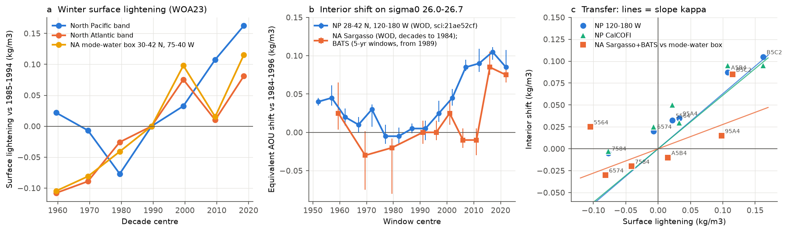
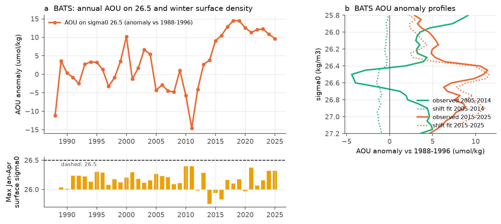
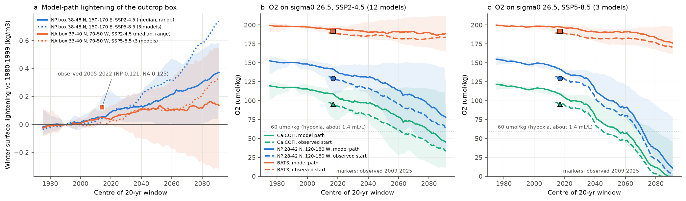

# The North Pacific outcrop-lightening law gives the sign but not the size of the sigma0 26.5 O2 loss at BATS; with CMIP6 lightening it puts CalCOFI 26.5 O2 below 60 umol/kg by 2062-2081 (SSP2-4.5)

Job sci-1107-dell-earth-and-ocean-sciences-4cabf4225393, campaign 11_07_2026, topic earth-and-ocean-sciences, machine dell, account claude-sci, model Claude Opus 5.5 (claude-opus-5-5). The signing key is a campaign-machine key. It is not a personal authorship claim.

## Summary

Earlier campaign work found an oxygen (O2) loss on the sigma0 = 26.5 kg/m3 surface across the North Pacific (NP), at CalCOFI and at BATS. In the NP the loss started near 160 E-180, where the winter outcrop of this density class shrank (sci:sha256:84f111c0...). Along 28-42 N it is equal to a lighter shift of the AOU-density profile by 0.06-0.105 kg/m3. This shift is 40-70% of the winter surface lightening at the NP outcrop (sci:sha256:21ae52cf...). Two questions stayed open. Does the same law explain the North Atlantic (NA) loss at BATS quantitatively? What does it imply for the 21st century?

We applied the identical "equivalent density shift" method of sci:21ae52cf to the NA. We used BATS bottles (1988-2025), GLODAPv2.2023 Atlantic bottles and World Ocean Database (WOD) bottles of the Sargasso Sea (1955-1996). We measured the winter surface lightening in both basins with the same metric (WOA23 decadal climatologies). Then we drove the observed law with the bias-corrected CMIP6 outcrop-box surface density of sci:sha256:bf71cd68... (12 models SSP2-4.5, 3 models SSP5-8.5). We wrote the plan (`files/code/PLAN.md`) before we calculated any NA shift, NA surface value or projection value. One amendment (forcing data for the projection) is dated and explained there.

Main results (95% cruise-bootstrap intervals; interior reference 1984-1996, surface reference 1985-1994; AOU = apparent oxygen utilisation):

1. **The NA winter surface became lighter, but 3 times less than the NP surface, and its 26.5 outcrop did not shrink.** In the outcrop band (cells with a 1985-1994 winter-maximum sigma0 of 26.0-26.8) the lightening to 2005-2022 was 0.046 kg/m3 in the NA (0.041-0.059 for other band limits) and 0.135 in the NP (0.113-0.131). The area with winter sigma0 >= 26.5 kept 95% of its 1985-1994 size in the NA and 16% in the NP. The NA lightening came late: 0.010 in 2005-2014 and 0.081 in 2015-2022 (mode-water box 30-42 N, 75-40 W: 0.015 and 0.115). In 1955-1984 the NA surface was 0.03-0.11 kg/m3 denser than in 1985-1994.
2. **On 26.5 the NA lost O2 inside an unchanged water type.** At BATS, AOU rose by 6.6 umol/kg (4.4 to 8.9; 124 and 222 cruises) from 1984-1996 to 2009-2025 and O2 fell by 6.5. Conservative temperature and absolute salinity on 26.5 did not change (+0.01 C, +0.004 g/kg). Nitrate rose by 0.37 umol/kg (0.14 to 0.63). In GLODAP data of the subtropical gyre (20-38 N, 80-5 W; 12 and 25 cruises) AOU rose by 7.3 (2.6 to 18.0) and nitrate by 1.8 (0.6 to 2.9). The equivalent shift was 0.060 kg/m3 (0.040-0.070) at BATS and 0.110 (0.055-0.180) in the gyre.
3. **Pre-specified test T3 fails for the NA: the BATS loss is too large for the NP law.** The transfer fraction kappa = shift / surface lightening was 1.32 (0.88-1.54) at BATS and 2.4 (1.2-4.0) in the gyre, outside the NP range 0.41-0.71. With the same WOA23 metric, NP regions gave 0.45-0.78. With the NP law, the NA surface lightening gives 36-69% of the 2009-2025 BATS AOU rise. The shape also differs. At BATS and in the gyre, a constant AOU offset over sigma0 26.0-26.7 fits better than the shift (R2 0.94 and 0.95 against 0.77 and 0.80). In the NP the shift fits better (R2 0.94-0.99 against 0.62-0.92 for the offset).
4. **In time, the NA follows the law in sign but weakly; the BATS loss persists after the local winter recovered.** BATS AOU on 26.5 was at the reference level until 2013 (2009-2013: -5.0 umol/kg after the dense winters of 2010-2011). Then it rose to +9.2 (2014-2018) and +11.2 (2019-2025). For 2015-2022 the shift was 0.085 (0.070-0.095) against a mode-water-box lightening of 0.115 (kappa 0.74); the NP law gives 59-106% of that rise. In the denser 1955-1984 surface state, Sargasso Sea AOU on 26.5 was 2.6, 5.2 and 7.5 umol/kg lower than in 1984-1996. This is the predicted sign; the 1955-1964 shift was not. Over 6 decades, the NA decade transfer was kappa 0.28 (-0.11 to 0.64; r = 0.61; sign right in 4 of 6 decades). The NP gave 0.58-0.63 (0.20-0.96; r = 0.95-0.99). At BATS, annual AOU correlated with the 3-yr local winter surface density (r = -0.51 at 1 yr), but not significantly against surrogates (p = 0.26). In 2017-2025 the local winter density was back at its 1989-2013 mean (26.18 against 26.19), but AOU stayed 12.3 umol/kg above 1988-1996.
5. **Scaled by CMIP6 outcrop lightening, the NP law gives a large O2 loss off California this century; BATS changes little.** The scaling is the observed shift divided by the observed box lightening (kappa_box 0.74 at 120-180 W, 0.79 at CalCOFI, 0.48 at BATS). Driven by the model path from 1980-1999 (variant A), the 2009-2025 AOU gain is 8.7 umol/kg, against 21.3 observed. The reason is that the models lighten the NP box by only 0.060 kg/m3, against 0.121 observed. For SSP2-4.5 (model medians; A = model path, B = observed 2005-2022 state plus later model change), the AOU on 26.5 rises by 28-45 umol/kg (2041-2060) and 71-84 (2081-2100) at 28-42 N, 120-180 W. At CalCOFI it rises by 29-47 and 71-82. At BATS it rises by only 7-12 and 10-14. CalCOFI O2 on 26.5 (117.5 umol/kg in 1984-1996, 95 in 2009-2025) has a model median below 60 umol/kg (about 1.4 mL/L) from the 20-yr window centred on 2062 (B) or 2081 (A). By 2081-2100, 60-70% of the 12 models are below 60. For SSP5-8.5 (3 models) the crossing is at window centres 2045-2056. These SSP5-8.5 shifts go to the end of the observed profile, so they are outside the calibration range.

Interpretation: the shift law of the NP is a quantitative description there. It holds through six decades (kappa about 0.6, r >= 0.95) without tracer ages or model input. The NA loss on 26.5 is a different case. Surface lightening gives its sign and roughly half of its size, but it does not give its uniform shape over density or its persistence after 2017. This agrees with the tracer-calibrated NA model of sci:sha256:dcfc9b0b..., which gave the sign but not the size of NA changes. A second process must add to the NA loss, for example a change of circulation, of remote ventilation or of respiration. For projections, the decisive quantity is the NP winter outcrop lightening. Models make only half of the observed lightening, so a model path underestimates the AOU gain of the last 20 years by a factor of about 2.4. If the observed scaling holds, the subsurface of the southern California Current approaches hypoxia on 26.5 in the second half of the century under SSP2-4.5. The scaling is a conditional extrapolation, not a model O2 projection (see Limitations). It is lower than the renewal-box scaling of sci:bf71cd68 (51-59 umol/kg by 2041-2060).

## Question, hypotheses and tests

| Test | Hypothesis | Prediction | Result |
|---|---|---|---|
| T1 NA surface (pre-specified) | The NA outcrop band became lighter | Lightening > 0 | Supported, but small: 0.046 (NP 0.135); 26.5 outcrop area kept 95% (NP 16%) |
| T2 NA interior (pre-specified) | AOU on 26.0-26.7 rose | Shift > 0 with interval above 0 at BATS and in GLODAP W, C, ALL | BATS and ALL: yes. W: shift yes (0.005-0.21), AOU on 26.5 not resolved. C: AOU on 26.5 yes (2.2-13.7), shift not defined (incomplete levels) |
| T3 same law (pre-specified) | kappa_NA overlaps NP 0.41-0.71 | Overlapping intervals | Rejected for BATS (0.88-1.54) and ALL (1.2-4.0); W overlaps (0.11-4.7, 3 reference cruises) |
| T4 timing (exploratory) | BATS shift follows surface lightening in time | Decade and annual relation | Decades: sign 4 of 6, kappa 0.28, r 0.61. Annual: r = -0.51, p = 0.26. Persistence after 2017 not explained |
| T5 projection (pre-specified, forcing amended) | The law with CMIP6 lightening gives the 21st-century AOU change | Values per scenario, period and region | SSP2-4.5: NP +28-84, BATS +7-14 umol/kg; CalCOFI below 60 umol/kg from 2062-2081 |
| Shape (exploratory) | Shift fits better than a constant offset | R2 shift > R2 offset | NP yes; NA no |

## Data

- **BATS bottle data**, BCO-DMO dataset 3782 version 10 (CC BY 4.0, doi:10.26008/1912/bco-dmo.3782.10), quality flag 2, casts within 50 km of 31.67 N, 64.17 W. On the density grid there are 2,559 casts from 518 cruises (1988-2025). Read in place from the campaign store.
- **GLODAPv2.2023 Atlantic Ocean** (CC BY 4.0; Lauvset et al. 2024, doi:10.5194/essd-16-2047-2024), WOCE flag 2, 15-55 N, 85 W-0: 7,398 casts, 207 cruises.
- **World Ocean Database 2023** (NOAA NCEI, public domain) observed-level bottle (OSD) files of WMO squares 7205-7207, 7305-7307, 7405-7406 (20-50 N, 50-80 W), downloaded 2026-11-10. WOD quality flag 0. In the Sargasso region (cell centres 27.5-35 N, 70-55 W) there were 79-185 cruises per decade window.
- **WOA23 1-degree decadal climatologies**, January-April, as the winter-maximum surface sigma0 maps of sci:sha256:f2580a7a... (`files/results/woa_sigw.npz` of that bundle; public-domain source).
- **CMIP6 forcing**: bias-corrected late-winter surface sigma0 in two outcrop boxes, 20-yr running windows, 12 models SSP2-4.5 and 3 models SSP5-8.5, one member each (`files/results/cmip/all_running.csv` of sci:sha256:bf71cd68...; CMIP6 output CC BY 4.0).
- **NP results of sci:sha256:21ae52cf...**: 5-yr window shifts, epoch shifts and reference AOU and O2 profiles (WOD, GLODAP and CalCOFI data).

Input hashes: `files/provenance/input_files.sha256`. Terms and attribution: `files/NOTICE_external_data.md`.

## Methods

1. **Density grid** (`na_grid.py`, `extract_wod_grid.py`, `gridcore.py`). Each cast goes onto sigma0 = 25.40-27.20 (step 0.05) with the rule of sci:21ae52cf. We use TEOS-10 (gsw 3.6.23) and a running maximum of sigma0 with depth. We interpolate linearly with one accepted level on each side and a bracket gap of at most 100 m. Levels shallower than 75 m are not used. AOU = O2 solubility at zero pressure (gsw.O2sol) minus O2. BATS: bottle salinity if its flag is 2, else CTD salinity; pressure from depth. GLODAP: flag 2. WOD: quality flag 0.
2. **Equivalent density shift** (`shiftlib.py`, `run_shift.py` of sci:21ae52cf). Units are cruise x 2.5 x 5 degree cell mean profiles. A(sigma) is the cell-matched mean of (late minus reference) over cells that have both. Rbar(sigma) is the regional reference profile from the integrated mean vertical gradient. delta is the least-squares value of A = Rbar(sigma + delta) - Rbar(sigma) over sigma0 26.0-26.7 (step 0.005). The competing one-parameter shapes are a constant offset and a change proportional to the reference AOU. Intervals are the 2.5-97.5 percentiles of 300 (epochs, decades) or 200 (5-yr windows) bootstrap draws of whole cruises in each period. Changes to the reused code: (a) we added NA regions (cell centres: BATS 30-32.5 N, 65-60 W; SARG 27.5-35 N, 70-55 W; NAW 20-38 N, 80-50 W; NAC 20-38 N, 50-30 W; NAE 20-38 N, 30-5 W; NAN 38-48 N, 60-20 W; NAALL 20-38 N, 80-5 W); (b) a MIN_CELLS setting, 1 for the single-cell BATS region and 2 elsewhere, as before.
3. **Surface lightening** (`surface_index.py`, `masks.py`). We use the WOA23 January-April maximum surface sigma0 maps. The index is the area-weighted mean of (1985-1994 minus period) over the cells whose 1985-1994 value is in 26.0-26.8 (main band; also 26.4-26.6 and 25.8-27.0). The NP uses the open-NP mask of sci:f2580a7a. The NA mask is 20-55 N, 80-5 W without the Gulf of Mexico, the Caribbean, the Labrador shelf and the northwest European shelf. "Late" is the mean of the 2005-2014 and 2015-2022 decades. The mode-water box (30-42 N, 75-40 W) covers the Eighteen Degree Water formation region.
4. **Transfer fraction.** Pre-specified (`synthesis.py`): kappa = delta_AOU / surface lightening, for 2009-2025 (interior) and 2005-2022 (surface) against 1984-1996 and 1985-1994. Decade-matched (`transfer.py`, exploratory): for each WOA23 decade we take the interior shift of the same decade. In the NA these are the WOD decades 1955-1964, 1965-1974 and 1975-1984 in SARG or NAW, and BATS 1995-2004, 2005-2014 and 2015-2022. In the NP it is the mean of the 5-yr windows of sci:21ae52cf that start in the decade. kappa is the least-squares slope through the origin, with an interval from 2000 resamples of decades.
5. **BATS annual test** (`bats_annual.py`, exploratory). Annual mean AOU on 26.5 against the 3-yr running mean of the January-April maximum surface (<= 10 m) sigma0 at BATS, lags 0-5 yr. p comes from 5000 phase-randomised surrogates of the surface series (maximum |r| over lags).
6. **Projection** (`project_box.py`). The forcing is the box surface sigma0 of sci:bf71cd68 (NP 38-48 N, 150-170 E; NA 33-40 N, 70-50 W; observed 1965-1984 state plus the model change; window centre c covers c-10 to c+9). The observed box lightening L_obs (1985-1994 to 2005-2022) from the same WOA23 maps is 0.121 kg/m3 (NP) and 0.125 kg/m3 (NA). kappa_box = observed 2009-2025 shift / L_obs. Variant A: L(t) = sigma(c = 1990) - sigma(c = t). Variant B: L(t) = L_obs + sigma(c = 2014) - sigma(c = t). AOU change on 26.5 = Rbar(26.5 + kappa_box L(t)). O2 = observed 1984-1996 O2 on 26.5 minus the AOU change (solubility change ignored; it was below 2 umol/kg in 1984-2025), not below 0. Shifts beyond sigma0 27.2 (the profile end) are flagged and held at the end value. The ranges in the tables are over models and over the 95% limits of the observed shift.

## Results

### Surface lightening (`files/results/surface/`, `files/results/transfer/transfer.json`)

| Decade | NP band | NA band | NA mode-water box |
|---|---|---|---|
| 1955-1964 | +0.022 | -0.108 | -0.105 |
| 1965-1974 | -0.007 | -0.089 | -0.081 |
| 1975-1984 | -0.077 | -0.026 | -0.041 |
| 1995-2004 | +0.033 | +0.075 | +0.098 |
| 2005-2014 | +0.108 | +0.010 | +0.015 |
| 2015-2022 | +0.162 | +0.081 | +0.115 |

Units kg/m3, lightening against 1985-1994 (positive = lighter). Outcrop area with winter sigma0 >= 26.5, 2005-2022/1985-1994: NA 0.95, NP 0.16.

### Interior shift and transfer, 2009-2025 against 1984-1996 (`files/results/synthesis/kappa_table.csv`)

| Basin, data, region | Cruises ref/late | AOU change at 26.5 (umol/kg) | Shift delta (kg/m3) | R2 shift / offset | kappa (main band) |
|---|---|---|---|---|---|
| NA, BATS | 124/222 | +6.6 (4.4, 8.9) | 0.060 (0.040, 0.070) | 0.77 / 0.94 | 1.32 (0.88, 1.54) |
| NA, GLODAP, 20-38 N, 80-5 W | 12/25 | +7.3 (2.6, 18.0) | 0.110 (0.055, 0.180) | 0.80 / 0.95 | 2.42 (1.20, 3.96) |
| NA, GLODAP, 20-38 N, 80-50 W | 3/16 | +4.4 (-3.9, 30.8) | 0.075 (0.005, 0.213) | 0.69 / 0.86 | 1.65 (0.11, 4.67) |
| NP, WOD, 28-42 N, 120-180 W | 261/88 | +21.3 | 0.090 (0.085, 0.105) | 0.98 / 0.87 | 0.67 (0.63, 0.78) |
| NP, WOD, CalCOFI | 97/45 | +21.9 | 0.095 (0.085, 0.105) | 0.97 / 0.87 | 0.70 (0.63, 0.78) |
| NP, CalCOFI bottles | 58/49 | +21.7 | 0.100 (0.090, 0.105) | 0.97 / 0.92 | 0.74 (0.67, 0.78) |

NP shifts from sci:21ae52cf; the kappa uses the surface lightening of this study (same WOA23 metric in both basins). The predicted share of the BATS AOU rise is in `files/results/synthesis/bats_predicted_share.csv`.

### Time course (`files/results/shift_windows/`, `files/results/decades/`, `files/results/bats_annual/`)

| Period | Data | AOU change at 26.5 (umol/kg) | Shift (kg/m3) |
|---|---|---|---|
| 1955-1964 | WOD, Sargasso | -2.6 (-5.1, 2.5) | +0.025 (0.004, 0.065) |
| 1965-1974 | WOD, Sargasso | -5.2 (-8.6, -2.2) | -0.030 (-0.075, 0.001) |
| 1975-1984 | WOD, Sargasso | -7.5 (-13.1, -2.2) | -0.020 (-0.080, -0.008) |
| 1995-2004 | BATS | +1.9 (-0.3, 4.0) | +0.015 (-0.005, 0.025) |
| 2005-2014 | BATS | -4.4 (-6.4, -2.5) | -0.010 (-0.020, 0.005) |
| 2015-2022 | BATS | +11.2 (9.2, 13.5) | +0.085 (0.070, 0.095) |

Before 1985, Bermuda AOU was lower than in 1984-1996, as the denser winter surface predicts. The tracer-model study sci:dcfc9b0b found -1.8 and -3.5 umol/kg there and a model over-prediction; our cell-matched WOD values (-2.6 to -7.5) are between the two.

### Projection (`files/results/projection/`)

| Region | Scenario | AOU change 2041-2060 (A / B) | AOU change 2081-2100 (A / B) | O2 on 26.5, model median below 60 umol/kg from window centre (A / B) |
|---|---|---|---|---|
| CalCOFI | SSP2-4.5 (12) | +29 / +47 (range 1-76) | +71 / +82 (5-115) | 2081 / 2062 |
| 28-42 N, 120-180 W | SSP2-4.5 (12) | +28 / +45 (1-82) | +71 / +84 (5-135) | not reached / not reached (B with upper shift: 2082) |
| BATS | SSP2-4.5 (12) | +7 / +12 (-10 to 22) | +10 / +14 (-15 to 42) | not reached |
| CalCOFI | SSP5-8.5 (3) | +52 / +62 (17-78) | +119 / +123 (63-127) | 2056 / 2045 |
| 28-42 N, 120-180 W | SSP5-8.5 (3) | +51 / +62 (17-84) | +137 / +147 (66-158) | 2072 / 2069 |
| BATS | SSP5-8.5 (3) | +7 / +16 (2-29) | +21 / +27 (0-43) | not reached |

AOU change in umol/kg against 1984-1996 (median over models; range over models and the 95% limits of the observed shift). In SSP5-8.5 at 2081-2100, 11-22% of the NP cases reach the end of the observed profile. Their values are lower bounds and outside the calibration range. Model path to 2009-2025 (c = 2017, SSP2-4.5): box lightening 0.060 kg/m3 (NP) and 0.041 (NA); AOU change 8.7 (NP 120-180 W), 8.6 (CalCOFI) and 2.7 (BATS). Observed: 21.3, 21.9 and 6.6.

## Limitations

- WOA23 decadal fields are smoothed objective analyses with few winter data before 1985 and in parts of the NA. The surface index has no sampling interval. We show three band definitions and a sub-box instead. The NA kappa depends strongly on the index area (1.03-1.46 by band; 0.74 with the mode-water box for 2015-2022).
- The shift method assumes fixed pathways and one regional reference profile. At BATS it uses one 2.5 x 5 degree cell. GLODAP NA regions have 3-12 reference cruises, so their intervals are too narrow or wide. WOD bottles before 1985 come from many programmes without a common calibration.
- The decade transfer uses 6 decades per basin. The NA intervals include zero. The decade tests and the annual BATS test are exploratory.
- The projection is a conditional extrapolation of an empirical law. It assumes that (a) the interior shift scales with the outcrop-box lightening as in 1985-2022, (b) pathways and respiration rates do not change, and (c) one box represents the outcrop. Projected shifts (0.2-0.9 kg/m3) are 2-9 times larger than the largest observed shift (0.1). They map 26.5 onto present denser water (26.7-27.2), which in the NP is ventilated in other regions. We did not use model O2. The forcing is one member per model (internal variability not sampled) and only 3 models for SSP5-8.5. The NA forcing box (33-40 N, 70-50 W) differs from the NA band of T1-T3.
- Future changes of O2 solubility on 26.5 are not included in the projected O2. We did not estimate them.
- Our own CMIP6 download (6 models) failed during a network outage; we therefore used the published forcing of sci:bf71cd68 (plan amendment). Partial downloads are not used.

## Reproduction

`files/code/run_all.sh WORK SHARED_DATASETS_ROOT CAMPAIGN_DIR` runs the full pipeline (about 1 h on the shared 23-CPU host; it downloads 22 MB of WOD files). WORK is a local scratch folder. gsw 3.6.23 and wodpy 1.6.2 go into the folder named by EXTRA_PYLIB (`pip install --target`); the scripts run with `python -I`. Inputs of cited publications are extracted with `fetch_prior.sh` (`sci read ... --file`). The WOD files are fetched with `fetch_wod_na.sh`. BATS and GLODAP are read from the campaign dataset store (paths and hashes in `files/provenance/input_files.sha256`). The bootstrap draw files (`*_draws_*.npz`, 77 MB) are not bundled; `run_shift.py` writes them again. Software versions: `files/code/requirements.txt`.

## Attribution

Text, figures and aggregate results: SCI baseline license (CC BY 4.0); code: MIT. Code reused from sci:sha256:21ae52cf9d0e24f827f7e090eda5a0912177d80251d965f1562a6a1d6dac6f10 (shift method, density grid), with the NP mask of sci:sha256:f2580a7a9707b955afb41852fae4c8e54807eaf63b6f3f6e605071200ca9f13f, is under the same terms. BATS data: Bermuda Institute of Ocean Sciences, BCO-DMO (CC BY 4.0). GLODAPv2.2023: Lauvset et al. (2024), CC BY 4.0. WOD 2023 and WOA23: NOAA NCEI. CMIP6: WCRP and the modelling groups (CC BY 4.0), through the published forcing of sci:sha256:bf71cd6822fb4f93b9ab90b771d47fd3e3eb8bf4a78ee8965f1bc07e8e8da231.
