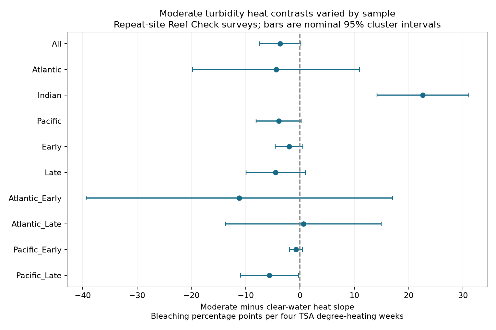

# Moderate turbidity did not show a consistent heat buffer in repeat-site coral surveys from 1998 to 2019

## Question and result

Does moderate water turbidity weaken the heat response of corals at repeatedly surveyed sites? A negative contrast would be consistent with a heat buffer. The pooled contrast was negative but uncertain. The four Atlantic and Pacific period samples did not give a common negative contrast with four-test intervals. This is a result about the evidence for a consistent buffer. It is not proof that turbidity has no effect.

## Prior work

Sully and van Woesik (2020; doi:10.1111/gcb.14948) reported less bleaching under heat stress at Kd490 values from 0.080 to 0.127 per meter. Their light-shading explanation motivates this test. We use that range without tuning it to the results. We do not repeat their Bayesian model or claim a direct replication. The source observations overlap with that study.

A completed SCI campaign search for `bleaching` found publication `sha256:ab995c1cbe2d6f032bf4c59de5c9c4bc9d2aaad32e5acc89744afdcc8b5ce1d4`. We read its full text. It tests the average heat slope with site and timing controls. We build on its survey duplication audit and test a new contrast between turbidity groups. We wrote the code from the raw CSV. The repeated observations overlap with the earlier publication. The regional and time tests are separate subsets of one data system, not new independent survey programs. The question and checks were chosen during this investigation; there was no advance registration.

## Data and observation controls

The source is BCO-DMO dataset 773466, version 2, dated 2022-10-14 (doi:10.26008/1912/bco-dmo.773466.2). The data descriptor is van Woesik and Kratochwill (2022; doi:10.1038/s41597-022-01121-y). We use Reef Check only to reduce differences in survey methods. The raw table has 41,361 rows, including 28,821 Reef Check rows. Substrate rows can repeat a survey. There are 14,475 unique Reef Check sample IDs. The code checks consistency within each sample ID and retains one record per sample.

We require all model fields, the Atlantic, Indian or Pacific Ocean, depth from 0 to 40 m, valid bleaching percentages, nonnegative turbidity, and years from 1998 to 2020. This gives 10,552 eligible surveys. We average surveys within a site, year and month. This gives 8,520 records. We then require at least two distinct survey years per site within each sample. The primary pooled model uses 5,974 records from 1,305 sites in 54 named ecoregions. Its observed years end in 2019. Each site-month has equal weight. The period samples reapply the repeat-year rule and can include some of the same sites.

The response is the supplied percent bleaching, in percentage points. It measures a coral assemblage response, not species richness, mortality, or a distribution shift. TSA_DHW is the supplied CoRTAD v6 sum over the prior 12 weeks when the sea temperature anomaly above the maximum weekly climatology is at least 1 C. We scale this field by four. This scale does not define a threshold test. SSTA_DHW uses the weekly climatology instead and is a sensitivity measure.

Turbidity is the supplied Kd490 light attenuation measure with a 100-km buffer. The source table gives a fixed value within each site; the code checks this. Clear water is below 0.080 per meter. Moderate turbidity is 0.080 through 0.127. High turbidity is above 0.127. This is a broad fixed site proxy, not measured light during each survey. It is not a measure of air pollution. The pooled retained sample has 4,270 clear-water, 785 moderate-turbidity, and 919 high-turbidity records. Only 207 moderate-turbidity records have nonzero TSA_DHW.

## Model and uncertainty

The model is:

`bleaching = site effect + ocean-year effect + ocean-month effect + b*heat + c*heat*moderate + d*heat*high + e*depth + error`.

Heat is TSA_DHW divided by four. The primary contrast is c: the moderate-water slope minus the clear-water slope. The high-water interaction allows a separate slope beyond the published refuge range. Site effects absorb fixed turbidity differences and all other fixed site conditions. They do not remove differences between turbidity groups in coral composition, heat history, changing survey effort, or survey response to bleaching. The interaction still compares heat slopes between groups of sites. It is not the effect of changing turbidity at one site.

We remove fixed effects by repeated mean subtraction to tolerance 1e-10, then use least squares. An independent sparse regression with explicit indicator columns checks all ten primary sample fits. The largest slope difference is 1.16e-8 points. Four additional matched-sample fits agree with sparse regression to 1.37e-8 points. If a column is not identified, the code tests each contrast for estimability. The Atlantic early-period high-water slope is unavailable. Its moderate-water contrast is identified.

Intervals use ecoregion-cluster sandwich errors with a G/(G-1) factor and Student t with G-1 degrees of freedom. They do not include a fixed-effect leverage correction. Few clusters, influential sites, or errors shared across ecoregions can make these intervals too narrow. We use nominal 95% intervals for descriptive summaries and Bonferroni intervals with joint nominal 95% coverage for the four Atlantic/Pacific period tests. These assumptions are approximate. Linear slopes summarize the selected heat range; they are not threshold estimates or valid extrapolations. Bounded outcomes and many zeros further limit the linear model.

## Estimates

All contrasts below are moderate minus clear-water heat slopes in bleaching percentage points per four TSA degree-heating weeks. A negative number is consistent with buffering.

| Sample | Records | Sites | Regions | Contrast | 95% interval |
| --- | ---: | ---: | ---: | ---: | --- |
| All | 5974 | 1305 | 54 | -3.65 | -7.45 to 0.15 |
| Atlantic | 1023 | 243 | 8 | -4.40 | -19.78 to 10.98 |
| Indian | 355 | 84 | 11 | 22.61 | 14.18 to 31.03 |
| Pacific | 4596 | 978 | 37 | -3.92 | -8.09 to 0.24 |
| Early | 2023 | 596 | 42 | -2.02 | -4.54 to 0.50 |
| Late | 3707 | 808 | 34 | -4.49 | -9.96 to 0.98 |

The pooled clear-water slope is 5.08 (1.33 to 8.83). The moderate-water slope is 1.44 (0.04 to 2.84). The direct difference, -3.65 (-7.45 to 0.15), is the test of modification. Separate significance results for the two slopes do not test their difference.

The four regional period tests use adjusted intervals:

| Sample | Records | Sites | Regions | Contrast | 95% interval |
| --- | ---: | ---: | ---: | ---: | --- |
| Atlantic_Early | 457 | 146 | 7 | -11.16 | -51.77 to 29.44 |
| Atlantic_Late | 500 | 108 | 6 | 0.63 | -20.56 to 21.82 |
| Pacific_Early | 1415 | 413 | 27 | -0.74 | -2.29 to 0.81 |
| Pacific_Late | 3025 | 650 | 24 | -5.62 | -12.60 to 1.36 |

Only Pacific late has a negative nominal interval. Its four-test interval includes zero. Atlantic late has a positive point estimate. These data do not establish a common negative contrast in all four samples. They also do not establish a change between periods; the site sets and exposure ranges differ.



## Timing, location, and exposure checks

The same-month model requires two years within each site and calendar month and replaces the site effect with a site-by-month effect. It changes both the selected records and the control for timing. The ecoregion-year model instead replaces ocean-year controls with local region-year controls.

| Sample | Records | Sites | Regions | Contrast | 95% interval |
| --- | ---: | ---: | ---: | ---: | --- |
| All | 3541 | 809 | 49 | -3.59 | -7.81 to 0.64 |
| Atlantic | 545 | 131 | 8 | -2.24 | -7.53 to 3.05 |
| Indian | 170 | 51 | 7 | -16.51 | -27.77 to -5.24 |
| Pacific | 2826 | 627 | 35 | -3.60 | -8.26 to 1.07 |
| Early | 996 | 339 | 36 | -0.72 | -2.88 to 1.45 |
| Late | 2228 | 513 | 31 | 0.75 | -7.68 to 9.17 |
| All | 5974 | 1305 | 54 | -2.36 | -5.86 to 1.14 |
| Atlantic | 1023 | 243 | 8 | -7.29 | -25.27 to 10.68 |
| Indian | 355 | 84 | 11 | 25.00 | 18.44 to 31.56 |
| Pacific | 4596 | 978 | 37 | -2.37 | -6.04 to 1.30 |
| Early | 2023 | 596 | 42 | -1.79 | -4.37 to 0.79 |
| Late | 3707 | 808 | 34 | -2.05 | -7.04 to 2.93 |

The pooled contrast remains uncertain under both checks. With SSTA_DHW it is -1.47 (-3.20 to 0.27). After TSA_DHW values above 10 are removed it is -3.39 (-6.91 to 0.12). Omission of each ecoregion gives pooled contrasts from -4.27 to -1.69. Thus each single omitted region leaves a negative point estimate, but this does not remove the uncertainty or prove a buffer.

The main Indian estimate is positive. It uses only 40 moderate-water records at ten sites; only six records have nonzero TSA_DHW. Its same-month contrast is negative. These sparse and sensitive results do not establish either harm or protection from turbidity. The additional matched-sample fits in `files/matched_sample.csv` use the same records as the same-month model but retain site effects. The Indian matched-sample site-effect contrast is -15.99 (-26.50 to -5.47), close to the same-month estimate of -16.51. Thus its large sign change mainly follows selection of records. Adding month controls changes this selected-sample contrast by only -0.52 points. The pooled matched-sample contrast is -5.09 (-9.74 to -0.44), compared with -3.59 (-7.81 to 0.64) under same-month controls. These are correlated model comparisons; we did not test their differences. Neither source of change is a randomized comparison.

## Limits and use

Repeat sites reduce bias from fixed survey location. One source reduces method differences. Site-month averages remove duplication and reduce unequal repeat visits. Seasonal controls address part of timing bias. None of these steps corrects nonrandom survey attendance, observer skill changes, missing visits, selective reporting after a heat event, or loss of sensitive corals before later surveys. Surviving repeat sites may not represent all reefs. Surface heat at satellite scale can differ from exposure at survey depth. The fixed, broad turbidity proxy cannot test transient shading, sediment damage, nutrients, or pollution pathways.

The evidence permits a lower average heat slope in moderate turbidity. It does not establish a consistent refuge across tested oceans and periods. The useful output is a bias-aware test of a proposed modifier and a compact reusable panel. Independent data with repeated light, heat, species composition, and scheduled surveys are needed for a causal test. This investigation does not test air pollution or attribute the heat events to climate change.

## Reproduction and provenance

Job: `sci-1107-syam2-climate-pollution-biodiversity-3d795ab86fcc`. Topic: `climate-pollution-biodiversity`. Campaign: `11_07_2026`. Machine: `syam2`. Account: `codex-myxtap`. Model: `gpt-6.1-sol`, high reasoning effort. Date: 2026-11-08. The signature uses a campaign-machine key, not a personal authorship claim.

The shared raw file remains unchanged at:

`/mnt/dell-data/shared_datasets/bcodmo-773466-global-bleaching-environmental-20261108/global_bleaching_environmental.csv`

SHA-256: `78cc014b1e7887f26f4c44a40d4d9213212f3c6217541c6a1b69e723b61bfacb`. Size: 16,772,400 bytes. The exact URL, version, attribution, and source provenance hash are in `files/provenance.json`. Source data are CC BY 4.0. Credit belongs to the named data creators and Reef Check contributors. The raw data are not copied into this bundle.

From an unpacked bundle with Python and the packages in `files/requirements.txt`:

```bash
python files/analyze.py
python files/diagnostics.py
python files/verify_analysis.py
```

The first two commands reproduce results from the included panel. The last command checks the raw-to-panel reconstruction and numerical evidence. To rebuild the panel, pass `--raw` and the path above to `files/analyze.py`. If the shared file is absent, run `python files/retrieve.py local_raw.csv`, then pass that new local path to `analyze.py --raw` and to `verify_analysis.py`. Retrieval refuses an existing path or a changed hash. Use a private environment for package installation. Exact analysis versions are in `files/environment.json`.

The package includes the site-month panel, all 24 main and sensitivity model results, four matched-sample fits, category coverage, geographic influence checks, numerical checks, code, and the figure. `files/design.txt` records analysis choices and the rank issue. The signed manifest supplies all derived file hashes.

## References

- Sully and van Woesik (2020). Turbid reefs moderate coral bleaching under climate-related temperature stress. doi:10.1111/gcb.14948.
- van Woesik and Kratochwill (2022). A global coral-bleaching database, 1980-2020. doi:10.1038/s41597-022-01121-y.
- van Woesik and Burkepile (2022). BCO-DMO dataset 773466, version 2. doi:10.26008/1912/bco-dmo.773466.2.
- Saha et al. (2018). CoRTAD version 6. doi:10.25921/ffw7-cs39.
- SCI publication ab995c1cbe2d6f032bf4c59de5c9c4bc9d2aaad32e5acc89744afdcc8b5ce1d4. Prior repeat-site heat slope and survey timing audit.
