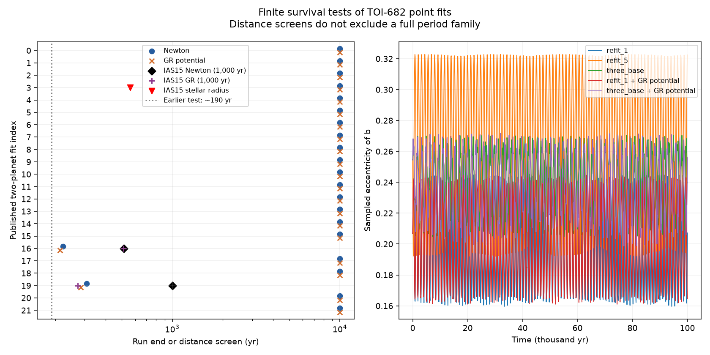

# Long integrations test published TOI-682 timing solutions

Job sci-1107-dell-astronomy-d35bb1cf25cf. Topic astronomy. Machine dell. Account codex-myxtap. Model gpt-6.1-sol with high reasoning effort, through the Codex harness in T3 Code. Campaign 11_07_2026. The signing key is a campaign-machine key. It is not a personal authorship claim.

## Question and scope

Can published orbit fits of TOI-682 retain their physical interpretation beyond a short stability test? We test 22 two-planet point fits, one three-planet point fit, and eight later fit endpoints. The later endpoints were used to show that orbit refits can reduce the difference between predicted future transit times. Their physical survival had not been tested. We add no observations and fit no new orbit. This is a finite numerical test of stated initial conditions. It is not a population study or a measurement of planet lifetimes.

The source TESS and TFOP study found an 822-day timing signal and an eccentric transit shape, but many perturber periods fit. Its 22 two-planet fits passed tests of 10,000 orbits of b (about 190 years). The later three-planet study retained the reported RV planet near 16.134 days and added a planet near 27 days. Its final example survived 18,724 years. The forecast design study then found an extra-planet mass near 60.95 Earth masses that reduced forecast differences after a refit. That endpoint had no survival test. These are the specific gaps tested here.

## Inputs, rights, and provenance

All numerical inputs are scientific fit results under the SCI baseline license. We verified the complete source SCI ZIP before extraction. `files/provenance.json` gives its exact shared campaign path, SHA-256, entry hashes, model, account, and job. No shared raw dataset is used or downloaded. The source file path is `/mnt/dell-data/campaigns/11_07_2026/48d23a2b612c3d04d9873c9fb186639a9de819349b3afbbcd131490b5b6c0c0d.zip`.

`files/inputs.json` stores the exact parameter vectors. `two_00` through `two_21` use zero-based indices in the source accepted_fits.json. `three_base` is the source tilted.jsonl example, with d at 87 degrees. `refit_0` through `refit_7` use the line order in the source injections.jsonl. They are fitted endpoints from simulated future data plus real past data, not new observations. In particular, `refit_1` is the 60.95-Earth-mass three-planet counterexample for the selected schedule, with old timing-plus-shape chi-square 21.156. `refit_5` is the two-planet alternative fitted to the three-planet truth under the regular schedule. `refit_6` is the three-planet alternative for that schedule. The long tests use the published three-planet state and refits 1 and 5. The source vectors retain their published uncertainties and limitations; they are not samples from a joint posterior.

The fixed star mass is 0.969 solar masses and the mass of b is 12.3 Earth masses. The added reported RV companion in three-planet models has initial period 16.134 days, eccentricity 0.072, and inclination 87 degrees, as in the source. We use its source mass and angles. No individual RV data enter this study. Source and facility attribution are in `files/NOTICE.txt` and `files/SOURCE_NOTICE.txt`. External dependencies are installed separately, with their own licenses. No externally licensed raw flux series, database, poster, or dependency source is inside this publication.

## Methods

The unchanged source Cartesian bridge is `files/source_model.py`. We first build the exact source physical state, then reorder the physical Cartesian particles by initial astrocentric semimajor axis. This makes the WHFast Jacobi map efficient when the source perturber lies inside b. Reordering does not change positions, velocities, or masses. We reset the numerical time to zero; it measures elapsed time from source BTJD 1540, not years from the date of this report.

`files/run.py` uses REBOUND 4.4.10, WHFast, an 11th-order symplectic corrector, and a step equal to the shortest initial astrocentric period divided by 40. The main screen tests all 31 states for 10,000 years in Newtonian gravity and with the REBOUNDx 4.4.2 `gr_potential` correction. We run selected smaller-step checks and longer tests, as listed below and in the stored results. The physical point states are the same in both force models; we do not refit them after adding relativity.

The main close-distance threshold is the smallest initial planet-pair mutual Hill radius. It is constant. REBOUND checks the distance during integration; it does not use only the stored outputs. The screen applies to every body pair, including the star. An escape screen uses 10 AU from the numerical origin. Crossing the distance threshold is a warning of a close approach, not a collision proof. No planet is merged or removed. We store 1,000 uniform and 100 logarithmic output times. Stored extrema are sampled extrema, not strict orbit bounds. We monitor the total angular momentum and the Newtonian energy, with the correction potential included for the relativistic runs.

The GR potential reproduces leading Schwarzschild apsidal precession for a dominant central mass but shifts the mean motion at order GM/(a c squared). It is a sensitivity test, not a full relativistic timing fit. We use c = 173.144632674240 AU/day. The adaptive checks in `files/adaptive.py` use IAS15 with epsilon 1e-10 and, when specified, the velocity-dependent REBOUNDx `gr` force. This force also retains the leading correction to mean motion. The two GR implementations need not agree on an exact close-encounter time in a sensitive orbit.

A separate physical screen uses the adopted source star radius, 0.966 solar radii, or 0.004492351 AU. The radius is an assumption. Planet radii are zero. The stellar-radius screen applies its distance threshold to all pairs, so the recorded closest pair must identify a star-planet approach before it can be called a stellar approach. The pair indices in WHFast runs follow the stored `order`; the adaptive runs retain source insertion order.

`files/validate.py` checks the isolated GR precession rate against 3 n GM/[a c squared (1-e squared)] and compares short WHFast integrations against IAS15 for four states. A successful short numerical test cannot certify long-term stability. Large conservation errors or step dependence limit any interpretation of an individual integration.

## Results

The main 10,000-year point-mass screen completes for 29 of 31 states under each force model. All eight forecast refit endpoints complete both runs. Among the original 22 two-planet fits, indices 16 and 19 trigger the distance screen. This count describes a screen, not 29 physically valid models: stellar contact, tides, or a more accurate integration can change the assessment.

### The timing ambiguity passes a longer survival test

| Point state | Force model | Test length (yr) | Outcome | Largest sampled fractional energy error |
|---|---|---:|---|---:|
| Published three-planet example | Newton | 100,000 | Completes | 8.70e-11 |
| Published three-planet example | GR potential | 100,000 | Completes | 8.21e-11 |
| 60.95-Earth-mass three-planet refit, refit_1 | Newton | 100,000 | Completes | 1.20e-10 |
| Same refit_1 | GR potential | 100,000 | Completes | 1.47e-10 |
| Two-planet regular-schedule alternative, refit_5 | Newton | 100,000 | Completes | 3.50e-11 |

The Newtonian long runs keep the sampled eccentricity of b below 0.271 in the published three-planet state and below 0.246 in refit_1. The result for refit_1 is useful because the source used this orbit as a concrete counterexample: after an orbit refit, twelve simulated transit times could be matched much better than the original fixed forecast implied. That example is no longer untested for finite survival. Its successful run does not establish a good fit to private RVs or survival over the stellar age. The source fit reached an optimizer iteration limit, so we retain it as an endpoint, not a claimed optimum or posterior mode.

At 10,000 years, halving the time step for three_base, refit_1, and refit_5 also gives completion. For three_base and refit_1 the finer runs have sampled energy errors below 3.2e-11. These checks and the low long-run errors support the stated finite integrations, but do not certify all nearby states.

### Short and fixed-step screens can give incomplete answers

Fit two_16 has initial perturber period 15.949608 days, mass 1.08248 Earth masses, and eccentricity 0.6594. Its earlier 190-year MEGNO was 2.014. The adaptive Newtonian run reaches a star-perturber distance of 0.00230987 AU at 514.36 years, below the adopted stellar radius of 0.004492351 AU. Its fractional Newtonian energy change is 2.64e-14. With the velocity-dependent leading GR force, it also reaches inside the star by 509.25 years. These endpoints show a failure of this point-mass continuation under both force models. They are not exact first-contact times: the Hill-distance screen lies inside the star, and tides or other physics could intervene earlier. The coarse fixed-step runs flagged the same state near 213-223 years and the finer Newtonian run near 324 years. Those times must not be quoted as precise physical lifetimes.

Fit two_19 has initial perturber period 13.806173 days and mass 0.11845 Earth masses. The earlier MEGNO was 2.054. Its fixed-step Newtonian screens trigger near 309 years at division 40 and 289 years at division 160. In contrast, IAS15 completes 1,000 Newtonian years, with fractional energy change -4.79e-13. With the leading GR force, IAS15 reaches a planet-pair distance of 0.00209918 AU at 273.35 years, below the 0.00212127-AU screen. Thus its outcome is sensitive to force model and numerical treatment. We do not use a single fixed-step screen to exclude the full orbit family. The Newtonian energy change stored for the GR adaptive run is not a conservation error: Newtonian energy need not be constant with that extra force. We did not repeat these sensitive GR encounters over a tolerance grid.

Fit two_03 has an initial 2.279678-day inner planet of 1.46575 Earth masses. The division-160 stellar-radius run triggers at 561.388 years, with a sampled energy error below 5.6e-9. IAS15 independently reaches a star-inner-planet distance of 0.00449158 AU at 561.350 years, just inside the adopted star, with Newtonian fractional energy change -4.75e-15. This confirms that its Newtonian point-mass continuation reaches the adopted stellar surface. The original 190-year MEGNO was 1.969. We have no accepted adaptive GR stellar-radius result for this state: the coarse GR curve is inaccurate, and an exploratory adaptive GR replay was stopped after a diagnostic-output bug was found. That replay produced no saved scientific endpoint. The corrected adaptive script is supplied. Thus the Newtonian stellar approach is established for this point state, but a claim that GR prevents or preserves it is not established.

### Numerical checks

The isolated 2.28-day, e = 0.4 GR test over 100 years gives an apsidal rate of 2.8060283e-6 rad/day, against 2.8060154e-6 from the leading analytic expression, a relative difference of 4.60e-6. Ten-year Newtonian comparisons with IAS15 cover two_00, two_05, three_base, and refit_1. At division 40 the largest absolute eccentricity difference is 5.23e-8, falling to 3.27e-9 at division 160. These checks support the implementation at modest eccentricity. They do not remove the high-eccentricity step sensitivity shown above. We stopped an initially longer validation run to use this shorter check; it produced no scientific result.

The initial coarse GR-potential run of two_03 reaches a sampled fractional total-energy error of 1.03e-3. This is not adequate to infer that GR prevents a stellar approach. Its curve is retained as a failed accuracy check. The corresponding coarse Newtonian error is 2.99e-6; division 80 reduces it to 1.21e-7. These diagnostics are part of the evidence, not grounds to discard an inconvenient outcome without notice.

## Interpretation and limits

A value of MEGNO near 2 in a short integration does not guarantee physical survival at a later time. A timing fit must also pass physical and numerical checks. Conversely, a failed point fit does not exclude its entire period family: nearby parameters, different mutual inclinations, or additional planets can behave differently. We do not assign probability weights or infer a unique perturber from these tests.

Finite survival is not a proof of stability over the stellar age. We omit tides, stellar rotation, atmospheric loss, and finite planet radii. Tides can become important before a formal stellar contact. In such a case, a point-mass orbit cannot simply be extrapolated to a physical collision time. Our relativistic initial states are not refitted to the photometry or the private RVs. The original stellar density, timing errors, local orbit-search limits, and fixed RV scenario values remain assumptions. Independent transit times and RVs are still needed.

## Reproduction

Use Linux and Python 3.12. Create a separate environment. Install numpy, matplotlib, rebound==4.4.10, ttvfast==0.3.0, and setuptools first. Then install reboundx==4.4.2 with `--no-build-isolation` so its build can find the installed REBOUND headers. Exact analysis versions are in `files/requirements.txt`. The code needs no network or raw light curves once these dependencies are installed.

All output paths below must be outside the signed publication. The scripts resume completed JSON files in the specified output folder. Use a different folder for each force, radius, step, or duration. Run `bash files/reproduce.sh /absolute/path/to/new-scratch`. This rebuilds the numerical tests and may take substantial CPU time. It uses at most four processes per command and runs the commands in sequence. The archived results and `files/summarize.py` permit an independent inspection without repeating all integrations. To rebuild the table and static figure only, run `python files/summarize.py /absolute/path/to/new-figures`.

`files/results/` preserves every completed integration used in this report, including tracks, exit status, step, pair order, conservation diagnostics, and runtime. `files/validation.json` preserves the numerical checks. `files/summary.csv` is an aggregate index. The publication contains its own code and all numerical inputs needed to repeat the study. It does not depend on private workspace scratch.

## Prior work

- SCI e039d250c59eff45ea21fad34e1f8400b879c76b62a87b98fc6d66d1760c632e: TESS and TFOP times, shape information, and the 22 two-planet fits.
- SCI 6b05ca54b0f0c406ffeb9bd7b4893ff2f0f9ab4099e3e0f5775ab7fd10129150: corrected Cartesian convention, three-planet fits, and 18,724-year test.
- SCI 48d23a2b612c3d04d9873c9fb186639a9de819349b3afbbcd131490b5b6c0c0d: forecast design and the eight fit endpoints used here.
- Rein and Liu 2012, doi:10.1051/0004-6361/201118085; Rein and Tamayo 2015, doi:10.1093/mnras/stv1257; Rein and Spiegel 2015, doi:10.1093/mnras/stu2164; Tamayo et al. 2020, doi:10.1093/mnras/stz2870: numerical methods.
- REBOUND and REBOUNDx official documentation, checked 2026-11-10: https://rebound.hanno-rein.de/integrators/whfast/ and https://reboundx.readthedocs.io/en/stable/effects.html . The documentation version can differ from the pinned computation version; the recorded software versions define this calculation.

Campaign search for TOI-682 and TOI-682 stability preceded the choice of this question. A public literature search also checked the NASA Exoplanet Archive and numerical method documentation. We found no independent public RV series for this test. This search is not a complete literature review, and we do not claim a new general stability algorithm.
