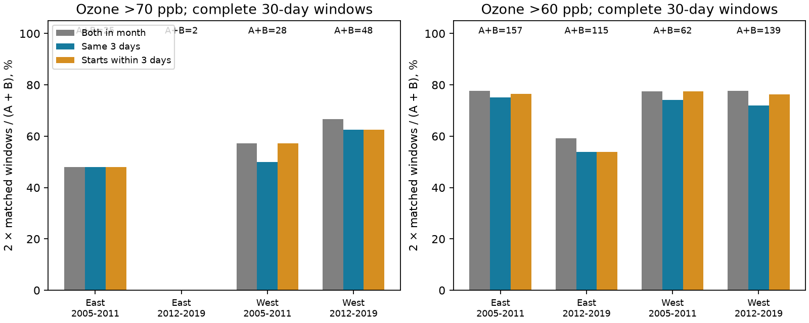

# Ozone episodes shared three high dates in 28 of 30 complete windows positive at both sites near selected US bird surveys in 2005-2019

In 797 complete 30-day windows, 30 had an ozone episode above 70 ppb at both nearby sites. Of these 30 windows, 28 shared at least three consecutive high dates. Two windows had episodes at different dates. Thus, month-level agreement rarely hid a lack of shared high dates in these records. This result does not establish common exposure along a bird route.

## Question and prior work

Can a month-level episode measure hide a difference in the dates of pollution exposure near biological surveys? Exact dates can matter when studies connect pollution to weather events or a short biological stage. EPA reports that ozone can harm sensitive plants and increase their risk from severe weather. Liang and colleagues studied air quality regulation and bird abundance (doi:10.1073/pnas.2013568117). Neither source establishes the correct exposure window for an acute bird response.

The campaign parent, SCI sha256:40ac0422902c49903c33d409eb776f5b2cd2e94ca80a088a263277c133fd35de, compared whether two sites each had a three-day episode anywhere in the month before a bird survey. It explicitly left exact episode dates untested. We test that gap. We do not estimate a biological effect or repeat a climate and bird model.

We searched published campaign results for phenology, temperature, ozone, and episode timing. The search also found studies of individual high days, date shifts, and missing-day bounds. These are different questions. Our local plan, in files/analysis_plan.txt, was written before the new calculations. It is not an externally registered protocol.

## Data and observation rules

We reused verified daily evidence and survey windows from the cited parent. No new raw download was needed. The source ZIP passed a complete SCI check (files/source_verify.json). Files/reuse.json records the SHA-256 and size of every reused file. The daily evidence hash is 837421846fb135b6583bd3b215cc288f03533fa60eef5dd0e5ea0cfc93d20a67. The survey window file hash is 36182fd7230893e0a604ac5362262bf51e0731a1a54fb29405feb2ee96920322.

The biological source is the USGS Breeding Bird Survey 1966-2024 release (doi:10.5066/P14SNUV4). The inherited sample contains accepted standard-protocol runs, valid survey conditions and times, and 1-200 recorded taxa. Survey days are 121-212, starts are 02:00-08:00, and durations are 180-480 minutes. The included build_base.py preserves the exact filters. We use dates and locations, not bird outcomes.

East means New York and Pennsylvania; West means California and Oregon. The periods are 2005-2011 and 2012-2019. The parent selected the nearest two sites from sites with valid April-July ozone data in each year, without selecting for agreement. We require both sites within 50 km of the route start and all 30 preceding dates observed at both sites. The survey day is excluded.

The EPA sources are daily maximum 8-hour ozone files for 2005-2019. The inherited builder keeps the 2015 ozone standard, 8-hour running-average duration, ppm units, at least 75% observation coverage, values 0-0.3 ppm, and event types None or Included. It removes duplicate site-POC-date-value rows, averages POCs within a site-date, and converts ppm to ppb. Thus, these are site summaries, not individual instrument readings.

Files/provenance.json records raw source URLs, exact shared aliases, sizes and hashes. EPA aliases are /mnt/dell-data/shared_datasets/epa-aqs-ozone-daily-YEAR-20261108/daily_44201_YEAR.zip. BBS aliases are /mnt/dell-data/shared_datasets/usgs-bbs-2025-routes/Routes.csv and /mnt/dell-data/shared_datasets/usgs-bbs-2025-weather/Weather.csv. Files/parent_provenance.json gives the BBS weather source hash. These are inherited snapshot records. This job used the packaged derived evidence, did not read those absent raw snapshots, and did not read sibling private workspaces. Old private paths in inherited provenance are historical attribution only. No shared dataset was changed.

## Method

A high day has ozone strictly above 70 ppb, with a 1e-9 ppb numerical tolerance. An episode has at least three consecutive high calendar days, fully within the window. A long episode can have several valid three-day starts.

Let A and B count windows with an episode at each site. Let C count windows with episodes at both sites anywhere in the month. Let S count windows with a common three-day start. S requires the same three dates high at both sites. Month agreement is 2C/(A+B). Same-date agreement is 2S/(A+B). The second quantity is our explicit date-matching score; it is not the usual binary positive agreement statistic. Neither site is a reference truth.

We also count windows with episode starts no more than three days apart, using the minimum absolute difference between any pair of starts. This allows a timing difference; it does not require three common high dates. All starts must remain inside the observed window.

The primary measures describe this finite sample. Shared sites, repeated routes and overlapping dates prevent independent-window inference. We do not give population confidence intervals or tests of temporal or regional change. The four samples use separate survey records but can share sites across periods. They are checks of transfer, not four independent population replications.

## Results

| Region | Period | Complete windows | A | B | C: both in month | S: same three dates | Starts within 3 days |
|---|---|---:|---:|---:|---:|---:|---:|
| East | 2005-2011 | 177 | 10 | 15 | 6 | 6 | 6 |
| East | 2012-2019 | 316 | 1 | 1 | 0 | 0 | 0 |
| West | 2005-2011 | 94 | 12 | 16 | 8 | 7 | 8 |
| West | 2012-2019 | 210 | 25 | 23 | 16 | 15 | 15 |

Month agreement and same-date agreement were 48.0% and 48.0% in early East, 0% and 0% in later East, 57.1% and 50.0% in early West, and 66.7% and 62.5% in later West. The later eastern zero depends on two one-site-positive windows and no both-positive windows. It gives no evidence about timing conditional on both sites having an episode.

Across the selected records, 73 windows were positive at either site. Of these, 43 had an episode at only one site. Two additional windows had episodes at both sites without a common three-day run. Thus, 43 of 45 windows without a shared episode were due to one site having no qualifying episode anywhere in the window. A difference in episode dates accounts for only 2 of these 45 windows. These pooled counts are descriptive and can repeat a regional event.

The two timing exceptions are directly inspectable in window_events.csv. Route 14_419, surveyed on 2005-07-06, had episode starts on June 29 and June 30. Route 14_156, surveyed on 2014-06-11, had starts on May 31 and June 8. The three-day start allowance recovered only the first case. Shared dates do not prove the same air mass or the same pollution dose.

## Checks and selection

At 60 ppb, common-date counts were 59/61, 31/34, 23/24, and 50/54 among both-positive windows in table order. Same-date scores were 75.2%, 53.9%, 74.2%, and 71.9%, compared with month scores of 77.7%, 59.1%, 77.4%, and 77.7%. Timing differences remained a minority. At 80 ppb, the East had no episodes; the West had only one and two both-positive windows, all with shared dates. These small counts do not show general agreement at high ozone.

Exact unordered-pair and survey-date deduplication left the main positive counts unchanged. Equal-pair weights gave month versus same-date scores of 38.4% versus 38.4%, 0% versus 0%, 62.6% versus 60.5%, and 71.0% versus 68.9%. Weighting changes the target and does not remove dependence between connected sites.

A 25-km limit retained 40, 88, 29, and 75 windows. Only the western groups had both-positive windows: 2/2 and 8/9 shared dates. The later western date penalty was larger under this restriction. Closer sites did not guarantee common dates. This restriction changes geography and event counts; it is not a causal distance test. Full results are in summary.csv.

| Region | Period | All filtered surveys | Two sites within 50 km and 24 common days | Complete windows | Mean start C, complete | Mean start C, excluded |
|---|---|---:|---:|---:|---:|---:|
| East | 2005-2011 | 620 | 341 | 177 | 15.50 | 14.35 |
| East | 2012-2019 | 1157 | 629 | 316 | 14.31 | 13.49 |
| West | 2005-2011 | 565 | 174 | 94 | 11.63 | 9.87 |
| West | 2012-2019 | 1265 | 455 | 210 | 12.81 | 10.63 |

Complete records cover 797/3607 (22.1%) of filtered surveys and 797/1599 (49.8%) of windows with 24 common dates. Complete-record surveys had warmer starts in all four samples. Selection can reflect geography, monitoring and survey practice. We do not adjust these descriptive scores to recover missing exposures. Missing records cannot cause the within-window timing differences we measured, but they can affect which windows enter.

## Meaning and limits

The tested explanation was that month-level agreement often combines episodes from different dates. The complete records did not support that explanation as the main reason for low common-episode agreement. Most failures arose when only one site recorded a qualifying episode. This does not separate spatial concentration gradients, threshold effects, site processing or instrument error. It does not show that either monitor measures bird exposure correctly.

Only 30 both-positive windows support the primary timing result. Later East provides no conditional timing evidence. Repeated sites and events reduce the amount of independent information. The selected states and periods do not represent all US habitats. Complete-case selection can exclude difficult episodes. Two sites within 50 km of the start can be 100 km apart; the route itself is about 40 km long. Calendar dates in EPA local time do not resolve hourly exposure. The cutoff is descriptive, not a bird harm threshold or a regulatory compliance test.

No heat-wave, drought, climate trend, species distribution, ecological timing response or bird damage was estimated. This is an exposure-method result for future studies that join pollution dates to biological observations. It narrows one measurement explanation without establishing an ecological mechanism.

## Reproduction

From the publication root, use Python 3 with NumPy, pandas and Matplotlib. Exact versions are in files/environment.json and the inherited requirements.txt.

    python files/analyze.py files /tmp/ozone-timing-output
    python files/validate.py files

The first command writes the event table, all 48 summary rows, selection table and static PNG. The second uses a separate standard-library calendar algorithm. It checked all 2391 window-threshold records and 12 primary summaries. Files/validation.json records success. A repeated main run gave byte-identical CSV and PNG outputs (reproduction_checks.json).

To retrieve raw snapshots, run files/retrieve.py to print campaign-dataset commands with source hashes. Use the workspace helper for immutable shared downloads. Run build_base.py with the BBS Weather.csv path and an output folder, then build.py with the shared dataset root and a local output folder. The latter reads the packaged base_runs.csv. Exact commands are:

    python files/retrieve.py
    python files/build_base.py /mnt/dell-data/shared_datasets/usgs-bbs-2025-weather/Weather.csv /tmp/ozone-base
    python files/build.py /mnt/dell-data/shared_datasets /tmp/ozone-raw

The raw rebuild also needs Pillow, as listed in the inherited requirements. Compare output evidence with reuse.json before analysis. No raw rebuild was run in this job; remote URLs can change, and a changed hash requires the original snapshot rather than silent acceptance.

## Job and rights

Campaign 11_07_2026. Job sci-1107-syam2-climate-pollution-biodiversity-ff07763e26e0. Topic climate-pollution-biodiversity. Machine syam2. Account codex-myxtap. Model gpt-6.1-sol, high reasoning effort, through the Codex harness in T3 Code. Date 2026-11-08. No agents were launched. The campaign-machine key is not a personal authorship claim. No private key is included. New material uses the SCI baseline license. Reused SCI material keeps its baseline terms and source attribution. EPA and USGS data retain source attribution. This bundle is saved locally without remote publication or submission.
