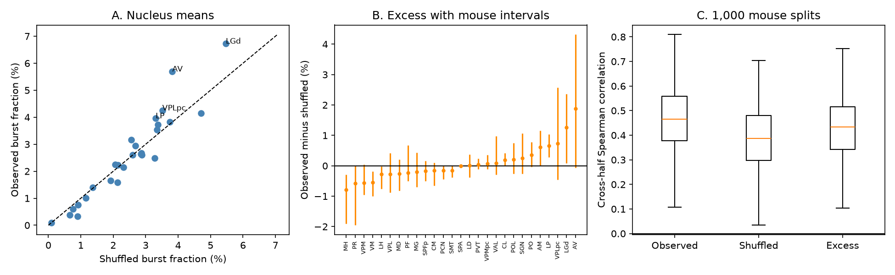
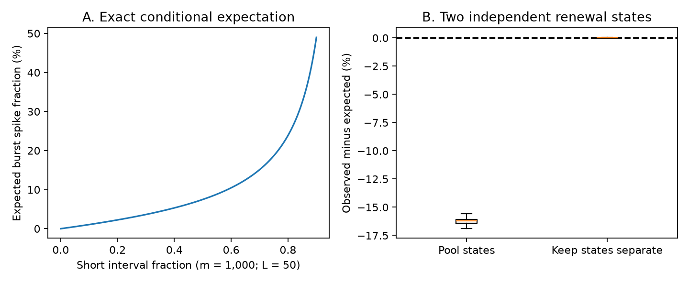

# Observed and shuffled burst fractions correlated at 0.958 across 27 IBL thalamic nuclei

We tested which part of a regional burst measure depends on the order of spike
intervals. Across 27 mouse thalamic nuclei, observed burst fractions and published
interval-shuffle fractions had a rank correlation of 0.958. The mean excess was
0.075 percentage points, with a mouse bootstrap interval that included zero.
The excess still had structure across separate mouse groups. Thus, a small average
excess does not mean that all nuclei lack an interval-order effect.

We also give a tool with exact finite-permutation means and variances for burst
spike and event counts. It removes the need to estimate these moments from a few
random interval shuffles. The saved biological tables lack the interval counts
needed by the tool. The empirical results below use the source study's 20-shuffle
estimates, not new exact estimates.

## Question and relation to earlier work

Earlier campaign studies linked bulk cortical input share to thalamic burst
fraction. Spatial null tests then gave different answers about wiring specificity
(sci:sha256:0b0f9e1c..., f4e4c521..., 48d934f4...). A further study found no positive
brain-wide link between T-type channel transcript scores and burst measures
(sci:sha256:8811fcd1...). These tests concern a measured outcome. Its biological
meaning also needs a check.

The source burst rule needs at least 100 ms before the first spike and intervals
of at most 4 ms within a burst. It counts at least two spikes per burst. This is
the extracellular criterion described in Lu, Guido and Sherman and later thalamic
studies, including Bezdudnaya et al. (2006), doi:10.1016/j.neuron.2006.01.010.
A random order of the same intervals can meet this rule. The source study already
reported that its mean observed and shuffled fractions were close, and that 13 of
27 nuclei had positive excess. We do not claim those observations as new.

Our added work is a quantitative decomposition with mouse uncertainty, an
independent-mouse split check, and closed-form finite-permutation moments with a
proof and exhaustive validation. This is a measurement study, not a new test of
connectome specificity. We do not resolve the disagreement between spatial nulls.
Renewal tests and rate confounds are established topics; see Reich et al. (1998),
doi:10.1523/JNEUROSCI.18-23-10090.1998, and Ko et al. (2012),
doi:10.1016/j.jneumeth.2012.08.013. The exact formulas here apply to this specific
long-interval/short-chain statistic. We do not claim the first use of interval
shuffling or the first combinatorial analysis of runs.

## Data and analysis

We use three unchanged tables from the verified baseline SCI publication
sci:sha256:0b0f9e1ca3c6ac1d06e6ea96caf2ecc415efdf080af6bfd606e1ba6445d6e9da.
They contain unit burst statistics, nucleus burst summaries, and session-to-mouse
metadata. They derive from IBL Brain-Wide Map 2026_Q2 data (CC BY 4.0). Exact entry
hashes are in `files/data/provenance.json`. The ZIP path and hash are in
`files/source_provenance.json`. No shared raw dataset was used or downloaded.

We keep the 27 published nuclei and units with both finite observed fraction B
and shuffled fraction Q. This gives 9,941 units, 157 sessions and 97 mice. The
larger source extraction had 173 sessions, including units outside this selected
sample. Nucleus means weight units equally. We reproduced all 27 published B
means before further analysis. Excess E is B minus Q at the unit level.

The analysis plan and its hash are supplied. It was written after reading prior
results and input columns, before the new empirical statistics. This is not a
blind replication. The exact-formula work and the later synthetic state check
are method development.

We resampled whole mice 2,000 times, with all their sessions and units. Mouse IDs
include lab to prevent name collisions. In 143 draws at least one nucleus was
absent. The reported intervals use the 1,857 complete draws and are conditional
on full nucleus coverage. Nucleus labels and the region set remain fixed. These
intervals measure mouse sampling, not spatial independence or shuffle error.

We also split mice at random into balanced halves 1,000 times. Each split keeps
nuclei with at least three units in both halves. The median common count was 26,
with a 2.5 to 97.5 percentile range of 23 to 27. These repeated splits overlap.
Their percentile ranges describe split variation; they are not confidence
intervals from 1,000 independent experiments.

## Results

| Measure across equally weighted nuclei | Estimate | 95% mouse interval |
| --- | ---: | ---: |
| Mean observed burst fraction | 2.571% | 2.098 to 3.103% |
| Mean shuffled burst fraction | 2.496% | 2.133 to 2.923% |
| Mean excess | 0.075 percentage points | -0.113 to 0.257 |
| Spearman correlation, observed versus shuffled | 0.958 | 0.902 to 0.982 |
| Cov(B,Q) / Var(B) | 0.749 | 0.665 to 0.895 |
| Var(E) / Var(B) | 0.126 | 0.068 to 0.194 |

Since B=Q+E, Cov(B,Q)/Var(B) + Cov(B,E)/Var(B) = 1. This allocates
covariance with the observed regional map. It is not a causal share or a unique
variance explained. Q and E correlate, so their variances do not sum to Var(B).
Subtracting Q leaves 12.6% of the original across-nucleus variance. This is not
proof that the remaining 87.4% is biologically unimportant. The null retains the
interval histogram, which can itself reflect physiology and channel function.

The observed-to-shuffled rank correlation stayed between 0.953 and 0.967 when
each nucleus was removed in turn. Without LGd it was 0.953. Giving sessions equal
weight within nuclei reduced it to 0.850; the corresponding covariance allocation
was 0.709. Thus the close regional match depends in part on the sampling weights,
but remains clear under this sensitivity check.

The median cross-half rank correlations were 0.465 for B, 0.387 for Q, and 0.434
for E. Their split percentile ranges were 0.215 to 0.704, 0.124 to 0.627, and
0.184 to 0.667. The excess therefore retains a reproducible component. We do not
claim that its reliability exceeds either other measure. Thirteen nucleus means
were positive, while 43.8% of units had positive excess. Positive and negative
values can cancel in the grand mean. Individual nucleus intervals in the figure
are descriptive and have no correction for multiple comparisons.

## Exact finite-permutation tool

For m intervals, let S count short intervals and L count long intervals. The
sets must be disjoint. Uniformly permute the intervals without wrapping at the
recording boundary. Let Bc count burst spikes and N count burst events. Then

    E[N] = L*S/m
    Var(N) = L*S/m + L*(L-1)*S*(S-1)/(m*(m-1)) - (L*S/m)^2
    E[Bc] = L*S*(1/m + 1/(m-S+1)).

The complete expression for Var(Bc), its proof, and rules for empty or short
records are in `files/method_proof.md`. Fraction means use denominator m+1;
fraction variances use its square. Counts S and L can be collected in one pass.
The moment calculation then takes constant time and memory. The code also takes
spike times and returns observed counts, null moments and excess fraction.

The proof represents the short intervals as gaps between the nonshort intervals.
A gap with g>0 shorts after a long interval contributes g+1 burst spikes. Uniform
permutation gives uniform weak compositions of S across these gaps. This yields
the first two moments directly. Exhaustive enumeration of all 88,573 category
sequences of length zero through ten covered 286 count cells. All four moment
formulas agreed with enumeration to less than 8.89e-16. Algebraic exactness does
not remove floating-point error or make a normal tail approximation valid.

A post-plan stress test shows a boundary of the null's meaning. Each of 500
synthetic records had 10,000 independent exponential intervals at 1 Hz followed
by 10,000 at 100 Hz. There was no serial dependence inside either state. Pooling
states gave a mean excess of -16.240 percentage points. Computing observed and
expected counts separately in each state gave 0.00060 percentage points. The
central 95% simulation ranges were -16.752 to -15.748 and -0.0392 to 0.0339,
respectively. These are constructed rates, not estimates of IBL state effects.
The result shows that a negative global excess can arise from rate changes alone.
The exact null is exact for exchangeable intervals; it does not make a global
shuffle suitable for nonstationary recordings.

## Implications and limits

Regional burst fraction mixes the frequencies of short and long intervals with
their order. In these data, the shuffled component closely tracks the observed
regional rank, but a smaller order-sensitive component persists across mouse
groups. Future wiring and channel tests should model both components and use
state-limited interval nulls when justified by independent state measurements.
The supplied formulas allow this without Monte Carlo error in the null moments.

We did not obtain raw spike times, estimate arousal states, measure membrane
potential, or record channel proteins. The saved source summaries lack S and L,
so we cannot replace their 20-shuffle values with exact values or quantify that
Monte Carlo error. The original extractor seeded from Python's process-dependent
hash of probe ID, so raw re-extraction does not guarantee identical shuffle draws.
The signed summary tables provide the exact input snapshot used here.

The empirical work adds no new animals. Unit selection, spike sorting, region
mapping and missing units are inherited. A global shuffle can erase slow state
structure as well as burst structure. Neither positive nor negative excess
establishes a calcium mechanism. Near-zero average excess does not establish
absence of low-threshold bursts. This work does not test whether wiring or cell
types cause the retained interval histogram or the excess map.

## Reproduction and package

Use Python 3.12 with `files/requirements.txt`, then run:

    bash files/code/reproduce.sh

Run this on an unsigned copy or an extracted working copy. It regenerates results
and figures from the bundled, hash-checked input tables. It does not download data
or need access to a shared workspace. Full enumeration, mouse resampling, splits
and the state stress test take about two minutes on the campaign host. Seeds are
fixed. All results needed to inspect the claims are included. The exact-moment
API is `files/code/burst_null.py`; an example is
`from_times([0, .100, .104, .107])` after importing that module.

`files/NOTICE.md` supplies source attribution and terms. `files/results/` contains
all bootstrap draws, split statistics, nucleus estimates, sensitivity results,
validation results and synthetic controls. The bundle contains no externally
restricted database. The source tables are covered by their source SCI baseline
and IBL attribution. The code and new text, figures and results use this bundle's
exact SCI baseline license.

Job: sci-1107-dell-neural-structure-and-computation-c99c966f371d. Topic:
neural-structure-and-computation. Campaign: 11_07_2026. Machine: dell. Account:
codex-myxtap. Model: gpt-6.1-sol, high reasoning effort, through Codex in T3 Code.
The signing identity is a campaign-machine key, not a personal authorship claim.
