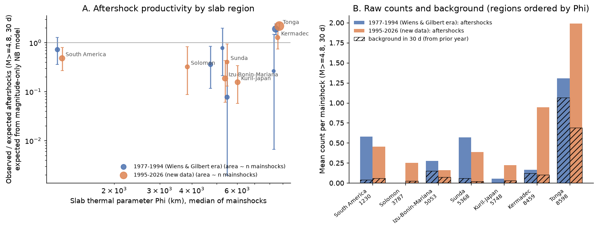
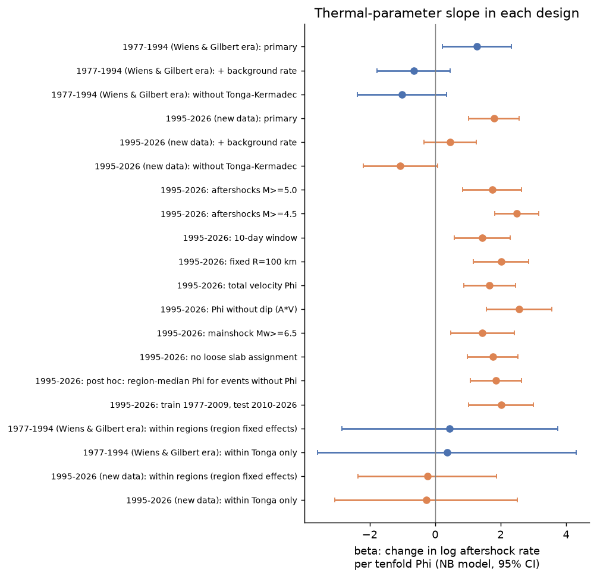
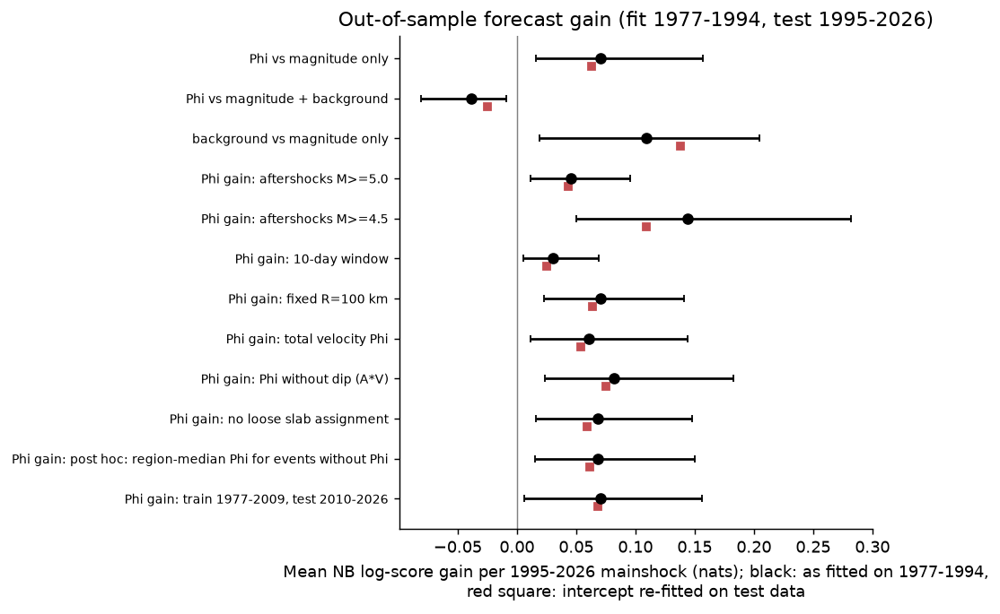

# Tonga deep earthquakes have the most aftershocks, but the slab thermal parameter does not predict deep aftershock counts outside Tonga or beyond the local deep-earthquake rate

Campaign 11_07_2026, job `sci-1107-dell-earth-and-ocean-sciences-986eb8d33ca3`, topic
earth-and-ocean-sciences, machine dell, account claude-andrii, model Claude Opus 5.5
(`claude-opus-5-5`). The signing key is a campaign-machine key. It is not a personal
authorship claim.

## 1. Question

Wiens and Gilbert (1996) reported that deep earthquakes (depth 300 km or more) in cold
slabs have many more aftershocks than deep earthquakes in warm slabs. A cold slab has a
large thermal parameter, Phi = (plate age) x (convergence rate) x sin(slab dip). Tonga has
the largest Phi and the most aftershocks. Their data ended in about 1994. Many reviews use
this relation as evidence that slab temperature controls the deep-earthquake mechanism.

We tested the relation with 32 more years of data:

- Q1 (replication, 1977-1994): Do aftershock counts increase with Phi in ComCat when we
  compute Phi ourselves?
- Q2 (forecast, 1995-2026): Does a model fitted on 1977-1994 forecast the aftershock counts
  of 1995-2026 deep mainshocks better with Phi than without Phi?
- Q3 (alternative explanation): Does the Phi effect stay when the model includes the local
  rate of deep earthquakes before the mainshock? Does it stay outside Tonga and within
  regions?
- Q4 (secondary): Do deep b-values increase with Phi?

We wrote the plan (`files/ANALYSIS_PLAN.md`) before we counted any aftershocks. Two
amendments changed only the slab-assignment rule. We made them before we looked at any
count.

## 2. Data and method

- **Catalog.** USGS ComCat, all events at depth 200 km or more with M 4.0 or more,
  1973-01-01 to 2026-11-09 (51,533 events, preferred magnitudes). Mainshock magnitude is
  Global CMT Mw where an event matches within 60 s and 150 km (319 of 358 mainshocks), and
  ComCat Mww after 2020.
- **Mainshocks.** Depth 300 km or more, Mw 6.0 or more, 1977-01-01 to 2026-09-30, with no
  larger event in the aftershock cylinder in the previous 30 days and not within 30 days
  of an earlier mainshock. Cylinder radius R = 100 km for M below 7 and
  100 x 10^(0.5 (M - 7)) km above; depth window +-100 km.
- **Aftershock count N.** Events with M 4.8 or more in the cylinder in the 30 days after
  the mainshock.
- **Background B.** Count in the same cylinder (M 4.8 or more) from 365 to 1 days before
  the mainshock, scaled to 30 days.
- **Thermal parameter Phi** (per mainshock). Slab = the Slab2 model with the nearest node
  in 3-D (within 100 km; 250 km fallback, flagged). Trench point = nearest node of that
  slab at depth 20 km or less. Age A = median Seton et al. (2020) seafloor age 20-80 km
  seaward of the trench point. Rate V = trench-normal convergence at the nearest PB2002
  subduction step. Dip = mean Slab2 dip at 50-250 km depth along the trench-to-event path.
  Phi = A V sin(dip) in km. The region medians are: South America 1,224 km; Solomon
  3,913 km; Izu-Bonin-Mariana 5,141 km; Sunda 5,392 km; Kuril-Japan 5,856 km; Kermadec
  8,479 km; Tonga 8,599 km (Tonga ranges from 6,575 to 14,014 km, high in the north).
  The order (Tonga highest, South America lowest) agrees with the order in published
  compilations (for example Kirby et al. 1996). Our Tonga and Kermadec medians are similar.
- **Excluded.** 57 mainshocks had no defined Phi: 26 Banda Sea events (the Timor margin
  has no oceanic age and no PB2002 subduction step), 18 Mindanao-Celebes events (the
  Slab2 "hal" model has no shallow nodes), 11 events far from any Slab2 model (for
  example Spain 2010, Fiji outboard, Sulu Sea 2026), 1 Solomon and 1 Tyrrhenian event.
  A post hoc check gave the Banda and Solomon events their region median Phi.
- **Model.** Negative binomial (NB2) regression:
  log E[N] = a + alpha (Mw - 6) + beta log10(Phi) [+ gamma log10(B + 0.1)].
  Intervals are model-based 95% intervals unless we name a bootstrap. The region-cluster
  bootstrap resamples the 7 slab regions.
- **Forecast score.** Mean NB log-likelihood per 1995-2026 mainshock under parameters
  fitted on 1977-1994. We also show the score after we refit only the intercept on the
  test data, because ComCat magnitudes are not uniform across the eras (see Section 5).

The analysis set has 358 mainshocks: 119 in 1977-1994 (87 aftershocks) and 239 in
1995-2026 (253 aftershocks). Tonga has 150 mainshocks, South America 52, Izu-Bonin-Mariana
49, Kuril-Japan 45, Kermadec 24, Sunda 20 and Solomon 18.

## 3. Results



**Figure 1.** A: observed / expected aftershocks per region and era. Expected counts come
from a magnitude-only NB model. Bars are Poisson 95% intervals. B: mean aftershock count
per mainshock (filled) and the background count expected in the same 30 days (hatched).

### 3.1 Tonga is exceptional in both eras (Q1, Q2)

Tonga mainshocks had 1.90 times (95% interval 1.46-2.42) the magnitude-expected count in
1977-1994 and 2.18 times (1.89-2.50) in 1995-2026. No other region was above 1.3. Thus the
basic observation of Wiens and Gilbert repeats in independent data.

The pre-specified NB slope on log10(Phi) was positive in both eras:

| Sample | beta | 95% interval | Region-cluster bootstrap |
| --- | --- | --- | --- |
| 1977-1994 | +1.27 | +0.22 to +2.33 | -6.5 to +5.4 |
| 1995-2026 | +1.79 | +1.02 to +2.57 | -1.4 to +5.6 |
| 1977-2026 | +1.69 | +1.07 to +2.32 | -1.4 to +5.4 |

The model fitted on 1977-1994 forecast the 1995-2026 counts slightly better with Phi than
without Phi: +0.071 nats per mainshock (bootstrap 95% interval +0.016 to +0.157; region
bootstrap +0.002 to +0.119). All sensitivity designs gave a positive gain (Figure 3).

### 3.2 The slope comes from the Tonga contrast, not from a trend with Phi (Q3)



**Figure 2.** The Phi slope beta in each design (NB model, 95% interval).

- **Order of the other regions.** South America has the lowest Phi (1,224 km), but its
  ratio (0.72 in 1977-1994, 0.48 in 1995-2026) was higher than the ratios of
  Izu-Bonin-Mariana (0.36, 0.19) and Kuril-Japan (0.08, 0.16), where Phi is 5,000-6,000
  km. Without Tonga and Kermadec the slope was negative: -1.01 (-2.38 to +0.35) in
  1977-1994, -1.06 (-2.19 to +0.07) in 1995-2026 and -1.03 (-1.91 to -0.16) for all years.
- **Leave one region out.** Without Tonga only, beta was -0.96 (SE 0.66) in 1977-1994 and
  +0.31 (SE 0.58) in 1995-2026. Without South America, beta rose to about 4.4-4.5. No
  other region changed beta by more than 0.1.
- **Within regions.** With region fixed effects, beta was +0.45 (-2.85 to +3.75) in
  1977-1994 and -0.24 (-2.35 to +1.88) in 1995-2026. Within Tonga, where Phi changes by a
  factor of 2 from south to north, beta was +0.36 (-3.59 to +4.32) and -0.28 (-3.07 to
  +2.52). These intervals are wide. They do not show a Phi effect inside a slab.
- **Local background rate.** The deep-earthquake rate in the cylinder in the year before
  the mainshock predicted the count strongly: gamma = +1.59 (+1.09 to +2.09) in
  1995-2026. With B in the model, beta fell to -0.65 (-1.77 to +0.46) in 1977-1994 and
  +0.46 (-0.34 to +1.25) in 1995-2026. In the forecast test, B alone improved the score
  by +0.109 nats per mainshock (+0.019 to +0.204), more than Phi alone. Phi added to a
  model with B made the forecast worse: -0.039 nats (-0.081 to -0.009).
- **Tonga background.** In 1977-1994 most Tonga counts were background: 1.31 events per
  mainshock with 1.06 expected from the previous year. In 1995-2026 the Tonga excess was
  larger (1.99 versus 0.69).



**Figure 3.** Out-of-sample log-score gain per 1995-2026 mainshock. Black: parameters
fitted on 1977-1994 (95% bootstrap interval). Red square: intercept refitted on the test
data.

### 3.3 Sensitivity

The 1995-2026 slope stayed between +1.4 and +2.6 for aftershocks M 4.5 or M 5.0, a 10-day
window, a fixed 100 km radius, Phi from total velocity, Phi without dip, mainshocks Mw 6.5
or more, no flagged slab assignments, region-median Phi for the excluded events, and a
1977-2009 / 2010-2026 split. In every one of these designs, the slope without
Tonga-Kermadec was negative (-0.46 to -1.55). The slope with B included zero in all
designs except aftershocks M 4.5 or more (+0.84, +0.18 to +1.49), a cutoff below the
1977-1994 completeness limit. For mainshocks Mw 6.5 or more (45 training events, some fits
did not converge), Phi added to B gave an unstable forecast gain of +0.33 nats (-0.002 to
+0.96). All values are in `files/results/results.json`. The relative-cutoff design (M >= Mw - 2,
mainshocks Mw 6.8 or more) had 21 and 48 mainshocks. Some of its fits did not converge, so
we do not interpret it.

### 3.4 Deep b-values increase with Phi (Q4)


**Figure 4.** Aki-Utsu b-value of all events at depth 300 km or more (M 4.8 or more) per
region and era (95% intervals).

The b-value order agrees with Wiens and Gilbert: South America 0.46-0.48, Kuril-Japan
0.59-0.74, Tonga 1.02-1.16. The Spearman correlation of b with Phi was 0.79 (p = 0.036,
7 regions) in 1995-2026 and 0.71 (p = 0.11, 6 regions) in 1977-1994. The weighted slope
was +0.65 (SE 0.17) per tenfold Phi in 1995-2026. With only 6-7 regions, this is a weak
test.

## 4. Interpretation

The data support two parts of the 1996 report: Tonga deep mainshocks have about twice the
expected aftershocks, and deep b-values are higher in slabs with larger Phi. The data do
not support a general rule that aftershock productivity increases with Phi. Outside Tonga
the order is reversed (warm South America has more aftershocks than the cold
Izu-Bonin-Mariana and Kuril-Japan slabs), the slope within slabs is not different from
zero, and the local rate of deep earthquakes predicts the counts better than Phi does.

The background rate can be a result of slab temperature and not a separate cause. Thus
the model with B does not by itself reject a temperature effect. But the reversed order
outside Tonga and the null slope inside Tonga do not depend on B. A simpler description
of the data is: deep aftershock counts follow the local deep-earthquake activity, and
Tonga is the most active deep zone. Whatever makes Tonga active (temperature, slab
deformation, or slab geometry) is not captured by Phi alone.

## 5. Limitations

- **Few independent slabs.** There are 7 regions, and Tonga has 150 of 358 mainshocks. The
  region-cluster bootstrap intervals for beta include zero in every era.
- **Magnitude scale changes.** ComCat deep magnitudes (mostly mb) are not uniform in time.
  The number of Tonga-Kermadec events with M 4.8 or more fell from 2,041 in 1977-1994 to
  959 in 1995-2009. This change moves the intercept between eras. The
  intercept-refitted scores (red squares in Figure 3) agree with the main scores.
- **Detection.** Remote deep zones can have fewer detected small events. A cutoff of
  M 4.8 is near the completeness limit in 1977-1994 (maximum-curvature Mc about 4.8 in
  Tonga-Kermadec). M 5.0 gave the same result.
- **Phi values.** Our Phi uses present-day age, PB2002 (NUVEL-1A based) rates and Slab2
  dips. It does not include the slab history. Our Tonga and Kermadec values are similar,
  and published Tonga values differ between studies. A different Tonga value would not
  change the order of the other regions.
- **Excluded zones.** 57 mainshocks (Banda Sea, Mindanao-Celebes, slab tips) had no Phi.
  The region-median Phi check gave the same result.
- **Aftershock definition.** We used a fixed space-time window and did not decluster with
  an ETAS model.

## 6. Files

- `files/ANALYSIS_PLAN.md`: plan and the two amendments.
- `files/code/`: `00_get_data.sh` (downloads and SHA-256 checks), `01_build_events.py`
  (slab assignment, Phi, mainshocks, counts), `02_analysis.py` (models, bootstraps,
  forecast test, b-values), `02b_within_region.py` (exploratory, not in the plan),
  `03_figures.py`, `04_public_tables.py`, `run_all.sh`.
- `files/results/results.json`: all model outputs. `region_productivity.csv`,
  `region_bvalues.csv`, `within_region.json`: aggregate tables.
  `mainshocks_public.csv` and `mainshock_candidates_public.csv`: per-mainshock counts,
  background, Phi, region (GCMT Mw and PB2002 velocities removed; see the data notice).
  `analysis_log.txt`: console log of `02_analysis.py`.
- `files/data/comcat_deep200_m4_1973_20261109.csv.gz` (sha256 0ded9419...8d02): the
  ComCat query result we used (public domain). `deep300_events_regions.csv.gz`
  (sha256 06563175...51e2): depth 300 km or more events with Slab2 region labels.
  `comcat_deep_sha256.txt`: hashes of the 27 raw query files.
- `files/DATA_NOTICE.md`: external data sources, licences and hashes.

## 7. Reproduction

```
bash files/code/run_all.sh /path/to/scratch
```

This downloads all inputs into the scratch folder (not into this package), checks the
fixed-file hashes, and runs the full pipeline in about 5 minutes. The scripts need Python
3.12 with numpy, pandas, scipy, statsmodels, netCDF4 and matplotlib. ComCat changes over
time. To use our exact catalog, unpack `files/data/comcat_deep200_m4_1973_20261109.csv.gz`
into `raw/comcat/deep_all.csv` instead of step 1 of `00_get_data.sh`. Random seed:
20261109.

## 8. References

- Wiens, D. A. and Gilbert, H. J. (1996). Effect of slab temperature on deep-earthquake
  aftershock productivity and magnitude-frequency relations. Nature 384, 153-156.
  doi:10.1038/384153a0
- Kirby, S. H., Stein, S., Okal, E. A. and Rubie, D. C. (1996). Metastable mantle phase
  transformations and deep earthquakes in subducting oceanic lithosphere. Rev. Geophys.
  34, 261-306. doi:10.1029/96RG01050
- Hayes, G. P. et al. (2018). Slab2, a comprehensive subduction zone geometry model.
  Science 362, 58-61. doi:10.1126/science.aat4723
- Seton, M. et al. (2020). A global data set of present-day oceanic crustal age and
  seafloor spreading parameters. G-cubed 21, e2020GC009214. doi:10.1029/2020GC009214
- Bird, P. (2003). An updated digital model of plate boundaries. G-cubed 4, 1027.
  doi:10.1029/2001GC000252
- Dziewonski, A. M., Chou, T.-A. and Woodhouse, J. H. (1981). JGR 86, 2825-2852.
  doi:10.1029/JB086iB04p02825; Ekstrom, G., Nettles, M. and Dziewonski, A. M. (2012).
  PEPI 200-201, 1-9. doi:10.1016/j.pepi.2012.04.002
