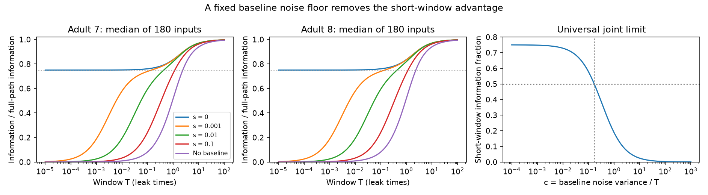

# Fixed baseline noise removes short-window information retention in symmetric passive circuit models

A noisy measurement of the initial population state does not preserve a positive fixed share of input information as the recording window shrinks. This holds for every finite symmetric positive definite passive circuit when baseline noise has any fixed positive isotropic variance. To keep a nonzero limiting fraction, baseline noise variance must fall at least as fast as window duration. We derive the exact fraction and test it in models from two partial adult worm electrical maps. These are model results. We do not test recorded neural activity.

The first two panels show median fractions over 180 point inputs. The last panel gives the analytic short-window limit when baseline noise variance equals c times duration. All noise and time units are model units. The continuous record used as a reference has exact full population access.

## Question and prior work

Can a noisy baseline sample preserve the benefit of an exact initial-state measurement for a short stimulus response? This question matters when a time average is stored instead of the full population time course.

SCI sci:sha256:05d2b27ee5fae3736252c89faa127d4b0e4bbc0b90d305494a77a06b517abe28 proved a time-average information bound for an input that was present before recording. SCI sci:sha256:a85b73964bf00f7bdecaa4686957becd7770f16ee1dff2f32577bd1045bb3c50 changed the input to start at recording onset. It showed that an average alone can lose nearly all information, while an exact initial-state sample gives a short-window fraction of 75 percent. It left a noisy baseline sample as a next test. We answer that question for full population access, known isotropic measurement noise, and an exact subsequent time integral. Partial observation remains open.

SCI sci:sha256:e42f88786be6ec11443224bc41bb089802f12f25f602e78e55d1c017aee21bc6 tested unequal current noise at equilibrium. It did not test noise in the baseline measurement. We retain unit independent current noise to isolate this distinction. No prior code or numerical output was copied. The exact-noise-zero and no-baseline cases reproduce prior formulas as checks.

Witvliet et al. (2021, DOI 10.1038/s41586-021-03778-8) supplied the anatomy. Their electrical annotations are incomplete. Varshney et al. (2011, DOI 10.1371/journal.pcbi.1001066) used electrical Laplacians to study worm dynamics. Folia and Rattray (2018, DOI 10.1007/s11222-017-9779-x) studied inference from integrated stochastic observations. Gaussian conditioning and stochastic likelihoods are established methods. Our contribution is the exact noisy-baseline formula, its noise-versus-duration limit, and a reproducible circuit benchmark.

We searched the campaign with several broad terms and an exact quoted phrase. The search record is supplied. Broad results were limited and can miss work; an exact quoted search for noisy baseline returned no matches. This is not proof of priority. We read the three SCI publications above and checked the external source papers and distributor license.

## Model and observations

Let A be known, real, symmetric and positive definite. The known input direction b has unit length. Only the amplitude theta is unknown. A constant input starts at time zero:

    dV = (-A V + theta b) dt + dB,
    V(0) ~ Normal(0,C),   C = (1/2) A^-1.

B has independent standard Brownian components. The initial state is at baseline equilibrium and is independent of theta and future increments. All cells have unit capacitance and leak in the numerical models.

The compressed observation consists of the exact vector integral Z over [0,T] and one noisy baseline population sample Y:

    Z = integral_0^T V(t) dt,
    Y = V(0) + epsilon,    epsilon ~ Normal(0,s I).

Measurement noise is independent of the initial state and process noise. The parameter s is a variance, not a standard deviation. The reference is the exact continuous full-population path, including V(0). Its Fisher information about theta is J_path=T. The independent baseline error adds no information to this full path. We do not compare two equally noisy instruments. We ask how much of an ideal record survives this specific compression and baseline error.

For F=exp(-AT), define G=A^-1(I-F) and H=A^-1(TI-G). Then d E[Z]/d theta=h=H b. Since Y has no theta information, the useful residual is

    Z_corrected = Z - G C (C+sI)^-1 Y.

This is the optimal Gaussian linear baseline prediction, rather than a direct subtraction of T times Y. For s>0 its covariance is

    D = G P G + integral_0^T G(t)^2 dt,
    P = (2A + s^-1 I)^-1,
    G(t) = A^-1(I-exp(-At)).

P is the remaining uncertainty about the initial state after observing Y. The integral term is process noise accumulated during recording. At s=0 set P=0. If no baseline is retained, set P=C. The joint information is

    J_joint = h^T D^-1 h.

Thus h^T D^-1 Z_corrected is an exact scalar sufficient statistic for the joint compressed observation when A, b and s are known. It does not recover all path information in general.

## Exact mode formula and short-window result

Let lambda_i be the eigenvalues of A and w_i=(u_i^T b)^2. The weights sum to one. Put x_i=lambda_i T and define

    u(x)=1-exp(-x),
    q(x)=x-u(x),
    d(x)=x-2u(x)+(1-exp(-2x))/2,
    v(x,lambda,s)=d(x) + u(x)^2 lambda s/(1+2 lambda s).

The scalar integral mean derivative is q/lambda^2. Its conditional variance is v/lambda^3. Therefore the retained fraction is exactly

    R(T,s) = J_joint/T
           = sum_i w_i q(x_i)^2/[x_i v(x_i,lambda_i,s)].

At s=0 this is the earlier exact-initial-state formula. As s tends to infinity, v tends to q and the formula reduces to the earlier average-only result. Increasing s cannot improve information, because it increases v in every mode. For any finite T, adding a baseline cannot make the average less informative. These properties concern the optimal Gaussian readout.

For each fixed s>0, expand G=T I+O(T^2), h=T^2 b/2+O(T^3), and D=T^2 P+O(T^3). Since P is positive definite,

    R(T,s) = (T/4) b^T P^-1 b + O(T^2)
           = (T/4) [2 b^T A b + 1/s] + O(T^2).

Thus R tends to zero for every fixed finite circuit and every fixed positive baseline variance. Absolute path information T also tends to zero. The result is about a fraction, not a large amount of information available in a short record.

Now let s=cT for any fixed c>=0. For c>0, P=cT I+O(T^2); the same leading expression follows directly at c=0 with P=0. The process-noise integral is T^3 I/3+O(T^4). Hence

    D = T^3(c+1/3) I + O(T^4),
    R(T,cT) -> 1/[4(c+1/3)] = 3/(4+12c).

This limit does not depend on the graph, its weights, or b under these assumptions. The convergence is for fixed A; it is not uniform over circuits whose fastest decay grows as 1/T. A variance of order T preserves a positive fraction. A variance much smaller than T restores the exact-baseline 75 percent limit. If s/T grows without bound, retention tends to zero, including when s itself decreases to zero too slowly. This last statement follows mode by mode from the exact formula and fixed positive lambda_i.

For a target limiting fraction rho between zero and 0.75, the condition is

    c <= 1/(4 rho) - 1/3.

For example, a limiting fraction of at least 50 percent requires c<=1/6. In the present units, baseline standard deviation must scale as the square root of duration. If n independent measurements of the same unchanged initial state each have variance s0, their mean has s=s0/n; the limiting 50 percent criterion is n>=6 s0/T. This describes independent measurements of one state. Sequential pre-input frames do not satisfy that assumption without a dynamics and noise model. The criterion is asymptotic, not a finite-window experimental guarantee.

## Circuit benchmark

We read two existing shared tables at wormneuroatlas commit b2e13d88b670efcb3438aeacba2ad4bd6c383933. The common named cells, after excluding prefixes BWM, CEPsh, GLR and excgl, comprise 180 neurons. Each nonself electrical row gives one symmetric link. We check that no unordered pair repeats. Adults 7 and 8 have 262 and 296 links. Chemical edges are excluded; electrically isolated cells remain.

We set A=I+kL/4. Contact counts define the primary Laplacian L; binary weights form a sensitivity test. Counts are assumed conductances, not measured conductances. We use k=0.1,1,10, all 180 point inputs, seven baseline noise settings (0, 0.00001, 0.001, 0.01, 0.1, 1, and no baseline), and 141 distinct windows from 0.00001 through 100 leak times, including 0.01, 0.1 and 1. No parameters were fitted to activity.

At primary count coupling k=1:

| Adult | T | s | Median retained fraction |
|---|---:|---:|---:|
| 7 | 0.01 | 0 | 0.751091 |
| 8 | 0.01 | 0 | 0.751091 |
| 7 | 0.01 | 0.001 | 0.578809 |
| 8 | 0.01 | 0.001 | 0.578809 |
| 7 | 0.01 | 0.01 | 0.193283 |
| 8 | 0.01 | 0.01 | 0.193284 |
| 7 | 0.1 | 0.01 | 0.595395 |
| 8 | 0.1 | 0.01 | 0.595411 |
| 7 | 1 | 0.01 | 0.819255 |
| 8 | 1 | 0.01 | 0.819841 |

At T=0.01, s=0.001 gives c=0.1 and a universal limiting value of 0.576923. The finite-window medians, 0.578809, are close. With s=0.01 the same window gives c=1 and a limit of 0.1875; the finite-window medians are about 0.1933. The finite-window values depend on the circuit. The short-window scaling law explains the similar values across maps. Agreement between two models with shared assumptions is not biological replication.

The evidence tables report only aggregate minima, quartiles, medians and maxima across point inputs, for each parameter setting. They do not contain source records or per-neuron results. Cells and durations are dependent model cases. No animal confidence interval or p value is appropriate.

## Checks and limits

A physical-coordinate Lyapunov solution and direct inversion of the 360-dimensional joint covariance of (Y,Z) check the spectral formula. Sixteen checks use AVAL input, both primary maps, durations 0.01 and 0.7, and four noise variances. The largest relative error is 6.05e-12. Independent scalar stochastic-integral quadrature across 36 parameter settings has maximum relative error 3.15e-14. Five joint-limit checks at T=1e-7 agree with 3/(4+12c) within 4.8e-8 absolute error. Source hashes, cell counts, unique links, positive decay, and fractions in (0,1] are checked. Stable power series avoid subtraction error at small durations.

These checks verify calculation, not biological fit. The proof covers finite symmetric passive circuits, isotropic unit white current noise, known parameters, known input direction, exact full-population integration, and one independent isotropic baseline error. It does not cover partial imaging, calcium filtering, noisy response integration, active or directed chemical circuits, trial timing error, or unknown input and noise parameters. No Allen or other neural activity dataset was linked to these anatomical animals. The source electrical annotations are partial. The benchmark cannot establish a principle across species or behavior. The mathematical limit generalizes across the stated matrix class only.

The open next test is the covariance effect of partial baseline access and response measurement noise. A useful empirical test would estimate noise and sampling from real population recordings before choosing a connectome link. The model criterion must not be applied directly to imaging frames without that step.

## Rights, provenance and reproduction

The signed bundle includes original code, text, figure and aggregate model evidence only. External raw tables, cell-level extracts, graphs and derivative databases stay outside it. The distributor carries GPL version 3. No upstream software was copied. See files/EXTERNAL_DATA_NOTICE.txt. We do not claim baseline rights in external materials. The complete transformation is in the original analysis code and can be run in separate scratch.

The shared SSD compatibility paths and source hashes are:

| Path | Bytes | SHA-256 |
|---|---:|---|
| /mnt/dell-data/shared_datasets/worm-witvliet7-b2e13d88/adult7.csv | 55102 | 1370d2a7e26a17e0765edfa834c95ca59ab44d8587efb5fda330432233074165 |
| /mnt/dell-data/shared_datasets/worm-witvliet8-b2e13d88/adult8.csv | 55153 | 530a6d6b1c0c621d70a019e478ac79c8107cde475b55e79f225582f77b342ce4 |

Pinned URLs, resolved shared object paths, package versions and host details are in files/evidence/provenance.json. Python 3.12 and packages in files/requirements.txt suffice. From an extracted publication:

    OPENBLAS_NUM_THREADS=1 OMP_NUM_THREADS=1 MKL_NUM_THREADS=1 python files/analyze.py --data-root /mnt/dell-data/shared_datasets --out ../reproduced

If sources are absent, run python files/retrieve.py ../external_raw, then use ../external_raw as the data root. The retrieval script requires a new directory outside the publication and checks both hashes. Compare curves.csv, summary.csv and validation.json against files/evidence. Numerical and image bytes can vary by platform. No random draws, private workspace, key, or campaign service is needed. Outputs are rejected inside the publication directory.

Job: sci-1107-dell-neural-structure-and-computation-3cb495dab990. Topic: neural-structure-and-computation. Campaign: 11_07_2026. Machine: dell. Account: codex-olen. Model: gpt-6.1-sol with high reasoning effort, through Codex in T3 Code. Date: 2026-11-12. No agents or services were started. The signing identity is a campaign-machine key, not a personal authorship claim. The bundle is signed and saved locally; this worker does not upload or submit it.
