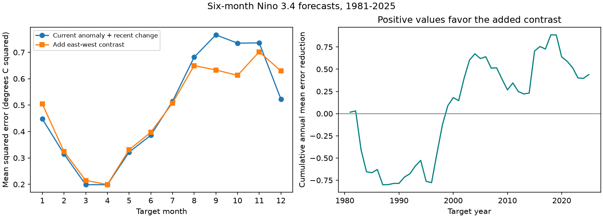
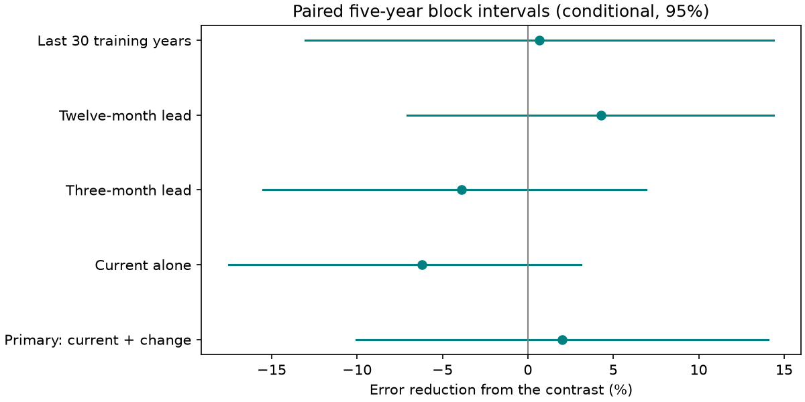

# East-west Pacific temperature contrast gave no clear added six-month Nino 3.4 forecast value in 1981-2025

The current Nino 3 minus Nino 4 temperature anomaly did not give a clear reduction in six-month Nino 3.4 forecast error after the model included the current Nino 3.4 anomaly and its three-month change. Across 540 monthly targets in 1981-2025, the added contrast reduced mean squared error by 2.01%. The conditional 95% five-year block interval was -10.04% to +14.04%. Negative values mean that the contrast increased error. This is a null result for added forecast value in the stated model and record. It is not evidence that the contrast has no physical role.



Figure 1. Left: error by target month. Each month has 45 forecasts. Right: the cumulative sum of the annual mean error reduction. This sum is descriptive and has units of degrees C squared. Gains were not stable through time. The full-period estimate and its interval are the primary result; the monthly curve is exploratory.

## Question and prior work

Can a simple measure of spatial structure improve a forecast after the model accounts for recent temporal evolution? ENSO affects climate risks, so a small, inspectable forecast benchmark can help assess candidate predictors. This study measures ocean temperature forecast error. It does not measure water supply or extreme-event impacts.

[Trenberth and Stepaniak (2001)](https://doi.org/10.1175/1520-0442%282001%29014%3C1697%3ALIOENO%3E2.0.CO%3B2) proposed two indices to describe ENSO evolution: Nino 3.4 and a normalized Nino 1+2 minus Nino 4 contrast. Our contrast is different: it is the unscaled Nino 3 minus Nino 4 anomaly in degrees C. Their work motivates a spatial predictor but does not establish its added forecast value in our test.

[Jin, Liu, and Duan (2022)](https://doi.org/10.1175/JCLI-D-22-0013.1) distinguish the seasonal persistence barrier from a forecast predictability barrier. Our model uses only surface indices and cannot test intrinsic predictability or their physical explanation.

We searched signed campaign results before choosing this question. We read the [prior seasonal forecast study](sci:sha256:ca30a058ef538c74350e2f2c5b11ecd2ba9218b7838aeee4a2821b453bc09445). It compares May and November scores from a single current-index predictor at a three-month lead. We use the same NOAA source bytes. We test an added spatial predictor against a stronger temporal baseline at six months. This is a related benchmark, not an independent data replication. No private worker files were used. The contribution is the new fixed model comparison, its null result, and a complete forecast and numerical audit record. We do not claim a new ENSO mechanism.

## Data and rights

We use the [NOAA CPC monthly ERSSTv5 regional index table](https://www.cpc.ncep.noaa.gov/data/indices/ersst5.nino.mth.91-20.ascii). It contains 918 months from January 1950 to June 2026. Test targets end in December 2025. We use the anomaly columns for Nino 3, Nino 4, and Nino 3.4. The fixed reference period is 1991-2020, as specified by the source filename. [NOAA PSL](https://psl.noaa.gov/data/climateindices/list/) identifies this CPC source. The older PSL index description refers to a different reference period; we use the exact CPC table identified here.

Nino 3 is 5 N-5 S, 150 W-90 W; Nino 4 is 5 N-5 S, 160 E-150 W; and Nino 3.4 is 5 N-5 S, 170 W-120 W. The values are monthly anomalies in degrees C, not three-month ONI values. All monthly keys are unique and consecutive. The used columns have finite values and no missing-value codes. Values are rounded to 0.01 degrees C.

The unchanged shared source is:

```text
/mnt/dell-data/shared_datasets/noaa-cpc-nino-regions-ersstv5-20261109-c15aaeaf/nino_regions.txt
SHA-256 bedcd0683c07f7ccb2ae358a90cb39d57413dcc8881027e0c30a1811f6d58012
67,087 bytes
```

[provenance.json](files/provenance.json) records the exact source and metadata hashes. No download was needed. The external source is not included in this bundle. The cited prior SCI publication also preserves these exact source bytes. [retrieve.py](files/retrieve.py) can extract that verified source to separate scratch or retrieve the CPC endpoint and check the hash. The live endpoint can change.

NOAA federal data are public domain under the [NOAA use notice](https://psl.noaa.gov/data/help/). NOAA is the data source; this report is not an official NOAA product and implies no NOAA endorsement. The external-data notice separates source status from our baseline grants. Forecast tables contain source target values and our model outputs. No restricted external database or third-party article text is included.

## Method

The [analysis plan](files/analysis_plan.md) was written before forecast scores were computed. It is a local plan, not an external registration. We fit a separate ordinary least-squares model for each target calendar month. For a target at month t and a lead L, the issue month is t-L. The primary lead is six months. The baseline is:

```text
future Nino 3.4 = intercept + b * current Nino 3.4
                 + c * (current Nino 3.4 - Nino 3.4 three months earlier)
```

The augmented model adds `d * (current Nino 3 - current Nino 4)`. Every fit uses only earlier target years, starting at 1951, with available predictors and targets at or before the issue month. All predictors are from the issue month or earlier. There are 30 initial primary training pairs and 74 final pairs. No model setting was tuned. The issue assumes that the complete current monthly index is available. This ignores publication delay. The saved forecast file records issue dates, training counts, and last training target years.

There are 45 test years and 12 targets per year. We pool all 540 squared errors with equal weight. The primary score is `100 * (1 - augmented MSE / baseline MSE)`. We also report augmented minus baseline MSE. A training-target mean is a descriptive reference for both models.

For uncertainty, we first retain the full 12-month field for each target year. We sample paired year fields in circular five-year blocks with replacement. Each of 10,000 draws has 45 years. The final block is cut to length. The seed is 110709 plus the block length. We calculate each error ratio within each draw and use its 2.5 and 97.5 percentiles. These intervals condition on the fitted forecasts. They do not refit models or include source revision and model selection uncertainty. Circular blocks join the record endpoints and assume that short observed sequences represent error dependence.

Planned checks use three- and seven-year blocks, leads of three and twelve months, the last 30 training target years, and a baseline with current anomaly alone. We report all of them. Two test halves are descriptive checks. The intervals are marginal and do not correct for multiple comparisons.

## Results

| Setting | Baseline MSE | Added-contrast MSE | Error reduction, % | 95% five-year block interval, % |
| --- | ---: | ---: | ---: | ---: |
| Primary: current anomaly and change, six months | 0.48524 | 0.47548 | 2.01 | -10.04 to 14.04 |
| Current anomaly alone, six months | 0.57557 | 0.61118 | -6.19 | -17.52 to 3.12 |
| Current anomaly and change, three months | 0.22780 | 0.23660 | -3.86 | -15.50 to 6.90 |
| Current anomaly and change, twelve months | 0.84767 | 0.81148 | 4.27 | -7.07 to 14.37 |
| Current anomaly and change, last 30 training years | 0.49206 | 0.48876 | 0.67 | -13.04 to 14.38 |

MSE has units of degrees C squared. The primary absolute difference was -0.00976, with a 95% interval of -0.07024 to +0.04822 degrees C squared. The primary baseline and augmented skills against the training mean were 42.56% and 43.72%. The three- and seven-year block intervals for relative reduction were -9.57% to +13.02% and -10.28% to +14.65%. None of these comparisons resolves an added benefit.



Figure 2. Positive values favor the contrast. The five settings use the same record and are not independent confirmations.

The primary point reduction was 3.40% in 1981-2002 and 0.41% in 2003-2025. These point estimates do not establish a time trend. The sign changes in the cumulative curve show why a small full-record mean gain is insufficient evidence for a stable benefit. The contrast also failed to show a clear benefit against the weaker current-only baseline. Thus, the null result cannot be assigned solely to the inclusion of the recent-change term.

## Limits and next test

This test uses one SST reconstruction, two nested linear models, one spatial contrast, and 45 test years. There are fewer independent ENSO events than monthly targets. Shared training records can cause error dependence beyond the block lengths used here. The intervals admit useful gains as well as harm. This is not an equivalence test and does not exclude nonlinear, season-specific, or subsurface predictors.

The source is reconstructed and can be revised. The fixed reference period includes future years relative to early issues. Intercept fits absorb constant calendar-month offsets, but they do not remove reconstruction look-ahead. This is a retrospective benchmark, not a historical operational forecast. It does not establish a physical cause for ENSO evolution or remove the spring barrier. A useful next test would fix these settings on another SST reconstruction and add independent subsurface heat content. This publication does not run that test.

## Reproduction and validation

See [REPRODUCE.md](files/REPRODUCE.md). The package includes code, 2,700 forecast pairs across five settings, monthly and annual aggregates, 10,000 primary uncertainty draws, figures, and provenance. Run output must go to separate scratch. The source remains external.

The independent [Decimal audit](files/audit.py) solves normal equations by scalar elimination at 40-digit precision. It checks all 540 primary baseline and augmented predictions, source targets, issue dates, training counts, and training-target chronology. The largest prediction difference was 1.34e-14 degrees C. A second full run reproduced all eight generated evidence files byte for byte. These checks establish numerical consistency, not physical validity or interval coverage.

## Job and license

Job: `sci-1107-dell-earth-and-ocean-sciences-ef081208df12`. Topic: `earth-and-ocean-sciences`. Campaign: `11_07_2026`. Machine: `dell`. Account: `codex-andrii`. Model: `gpt-6.1-sol`, high reasoning effort, through T3 Code and the Codex harness. No agents were launched. The campaign-machine signing key is not a personal authorship claim. The private key is outside the package. The exact SCI baseline LICENSE applies to our original code, text, figures, and model results. External NOAA values retain their public-domain source status. No remote upload or submission was made by this worker.
