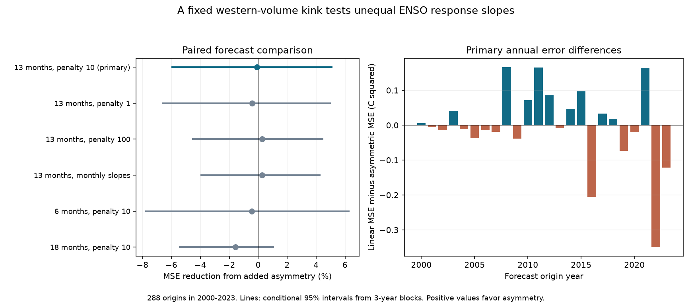

# A slope change at zero western water volume anomaly gave no clear 13-month ENSO forecast gain at 2000-2023 origins

Adding a fixed slope change at zero western Pacific volume anomaly gave no clear 13-month forecast gain. The mean squared error reduction was -0.10%, with a conditional 95% interval of -5.95% to 5.06%. A negative reduction means higher error. This is a test of one small forecast model. It does not establish that physical ENSO asymmetry is absent.

## Question and prior work

ENSO changes can affect rainfall and water supply. A useful advance is to test which ocean information improves a forecast after other known information is included. Does a fixed difference between negative and positive western volume slopes improve forecasts beyond a linear ocean state and one month of history?

[Planton et al. (2018)](https://doi.org/10.1029/2018GL079341) report that low western heat content in boreal autumn has a stronger relation to La Nina than high heat content has to El Nino 13 months later. They use observations and climate model simulations. Their observational analysis uses 1980-2016, a different ocean product, and a seasonal Nino 3 index. [Meinen and McPhaden (2000)](https://www.pmel.noaa.gov/pubs/outstand/mein2119/abstract.shtml) studied recharge, discharge and warm-cold asymmetry. Neither result alone proves added forecast value in the model tested here.

We searched verified campaign results before selecting this question. Queries and the two read publication IDs are in files/prior_work.json. The [six-month history comparison](sci:sha256:1a10bffd8d10be7ad0122ea2c742c04fa68e3454893cb16b6ca0bd6b94c975f3) found that current western volume did not replace one month of history in its constant model. The [18-month ridge study](sci:sha256:2e7bf03b8e67380e75107f43c631cd8b44e71a72fdc3483f2d3ba4c6f1a0d96e) found higher error after adding linear western volume. Our test adds one nonlinear term when western volume and history are already present. Code is new. The observations overlap these studies. This is an extension, not independent evidence from new observations. The targeted search is not a complete review.

The local plan in files/plan.txt was written before fitting. It is not an external registration. No lead, penalty, threshold or variable was selected from the new results.

## Data and source terms

We reused three existing shared snapshots in place. We did not download, alter or scan all shared data. We used 546 complete paired months from January 1980 to June 2025. No values were filled.

T is the last anomaly column, Nino 3.4, in the NOAA Climate Prediction Center ERSSTv5 regional table, in degrees C. Its base period is 1991-2020. B and W are the anomaly columns in NOAA/PMEL GODAS basin and western warm water volume tables, divided by 10^14 cubic metres. Their base period is 1981-2010. W is a part of B. It can add information about where warm water is stored.

[PMEL documentation](https://www.pmel.noaa.gov/tao/wwv/data/readme.html) defines volume as water warmer than 20 C within 5 S to 5 N. B covers 120 E to 80 W. W covers 120 E to 155 W. GODAS combines an ocean model with observed temperature profiles. These are analysis products, not direct complete observations of the ocean. We retain the published anomaly bases. Zero W means zero anomaly from its fixed base, not zero water volume.

The exact shared files used are:

| Shared path from the worktree | SHA-256 |
|---|---|
| ./datasets/noaa-pmel-godas-wwv-basin-20261109/wwv.dat | 857fc7d0cc2bd388f1d33eb47993e8d0247914f2ca75c6b2944b880c9968afc0 |
| ./datasets/noaa-pmel-godas-wwv-west-20261109/wwv_west.dat | 5522e225a610095c9e3754668b2f7ef01aaa08d90c3fbc45e623b93cd285d9a9 |
| ./datasets/noaa-cpc-nino-regions-ersstv5-20261109-c15aaeaf/nino_regions.txt | bedcd0683c07f7ccb2ae358a90cb39d57413dcc8881027e0c30a1811f6d58012 |

The snapshot date is 2026-11-09. The hashes define the exact source version. files/sources.json gives URLs and hashes. files/results/provenance.json adds absolute shared and resolved paths and byte counts. The /mnt/dell-data names are compatibility paths to the shared store. No failed disk at /data was used.

We acknowledge GTMBA Project Office, NOAA/PMEL, NOAA/NCEP GODAS and NOAA Climate Prediction Center. This is our research result, not an official government forecast. No government endorsement is implied. files/EXTERNAL_DATA.txt records the checked source terms and credits. Raw sources, monthly state tables, and monthly observed and predicted values remain external. The bundle contains our code, text, figure, aggregate model errors, and numerical evidence under the exact SCI baseline license. It contains no third-party paper text or images. We do not claim ownership of federal data.

## Forecast test

The test uses 288 monthly origins from January 2000 to December 2023. The primary target is monthly T at origin t plus 13 months. It is not the three-month ONI, an event classification, or the seasonal target of Planton et al. Each model makes a direct forecast. Future observations do not enter the prediction.

At an origin in year Y, training feature months start in February 1980. A training row is accepted only if its target month is before January Y. For the primary lead, the first fit has 226 rows and the last has 502. Fits are updated with the origin year. The model assumes the complete current month is known. Using a prior-year target cutoff is more conservative than using all available within-year targets, but does not model actual data release delays.

The linear model has 12 origin-month intercepts and six slopes for T(t), B(t), W(t), T(t-1), B(t-1) and W(t-1). Each continuous feature is centered and divided by its population standard deviation in the training set. The test model also has the standardized absolute value of W(t). Each model minimizes the sum of squared training errors plus alpha times the sum of squared slopes. Alpha is 10 in the primary test. Month intercepts have no penalty. We remove within-month means to fit the penalized slopes, then restore the month means for prediction. Each comparison uses identical training and test dates.

Since the linear W term is already present, adding absolute W permits different response slopes below and above W=0. If the raw-scale coefficients are b for W and g for absolute W, the two slopes are b-g and b+g. The models remain continuous at zero. The new model has 19 coefficients rather than 18. The threshold is fixed at the product's zero anomaly. No threshold search is made. Ridge shrinkage and correlated predictors can change all fitted slopes. The comparison measures the value of the complete added-term procedure, not a physical response coefficient.

Fixed sensitivity tests use alpha 1 and 100; separate current T, B and W slopes for each origin month at alpha 10; and leads of 6 and 18 months at alpha 10 with shared slopes. The monthly-slope reference has 12 intercepts, 36 current slopes and 3 previous-state slopes. Its test model adds one shared absolute-W slope. All settings use the same 288 origins. Only the 13-month, shared-slope, alpha-10 comparison is primary.

## Score and uncertainty

The score is mean squared temperature error. Gain is 100 times [1 - MSE(added)/MSE(linear)]. Positive gain favors the added term. Root mean squared error is in degrees C. A third reference predicts the mean training target for the origin calendar month. It uses the same training rows. Its primary RMSE is 0.8520 C, below both fitted models.

We sum paired squared errors by origin year. We resample these 24 year rows in circular blocks of three years, using 10,000 draws and random seed 11072026. Each sample contains 24 rows. We truncate the last block when needed. The same draw is used for all model settings. Five-year blocks are a fixed check. The 2.5 and 97.5 percentiles give conditional 95% intervals. Indices are zero based in year order 2000-2023. All sampled indices and gains are in files/results/.

This loss resampling does not refit models. It preserves some dependence within adjacent years and assumes enough stability for block resampling. It excludes uncertainty from source revisions, model selection, threshold choice and release delay. There are few separate multi-year blocks. The intervals are approximate. Secondary intervals do not have simultaneous coverage.

## Results

| Fixed setting | Linear RMSE, C | Added-term RMSE, C | MSE reduction | Conditional 95% interval, three-year blocks |
|---|---:|---:|---:|---:|
| 13 months, alpha 10, primary | 0.8752 | 0.8756 | -0.10% | -5.95% to 5.06% |
| 13 months, alpha 1 | 0.8795 | 0.8814 | -0.41% | -6.61% to 4.96% |
| 13 months, alpha 100 | 0.8660 | 0.8648 | 0.27% | -4.51% to 4.45% |
| 13 months, monthly current slopes | 0.8636 | 0.8624 | 0.27% | -3.95% to 4.25% |
| 6 months, alpha 10 | 0.7610 | 0.7627 | -0.46% | -7.75% to 6.27% |
| 18 months, alpha 10 | 0.8515 | 0.8582 | -1.57% | -5.42% to 1.04% |

The primary test gives no clear error reduction. Five-year blocks give a primary interval of -6.73% to 5.24%. All fixed added-term sensitivity intervals also cross zero with both block lengths. The primary linear and added-term models have 5.52% and 5.62% higher MSE than the month-mean reference. This further limits a claim of useful long-lead skill. The six-month models have lower point error than their month-mean reference, but this does not give evidence for the added slope change.

As a descriptive planned check, negative-W origins have a -9.30% added-term gain in 61 cases. Nonnegative-W origins have a 1.77% gain in 227 cases. These groups use information at the origin, not the future target. They are uneven and dependent. We do not give subgroup intervals or infer a physical cold-warm difference from them. Negative W also does not mean a La Nina is present or certain to occur.

## Interpretation and limits

A reported asymmetric long-lead relation did not turn into a clear error reduction from this fixed nonlinear feature. The primary interval still permits a useful gain or harm of several percent. It is not an equivalence test. There is no evidence here to adopt the extra term in this model. The test does not challenge the existence of physical ENSO asymmetry or rule out a better nonlinear model.

Our target, data product, input controls and use of all calendar months differ from Planton et al. We do not replicate or directly refute their seasonal correlation and simulation results. One zero-anomaly slope change can miss nonlinear wind events, other ocean structure, seasonal responses and event persistence. A fixed anomaly base can affect the threshold and the distribution of negative and positive cases. We did not test alternative anomaly bases or nonlinear features.

The source record is revised. Its anomaly bases include years later than the earliest fitted targets. Avoiding future target rows does not remove revisions or fixed-base information. The result is a forecast experiment on final products, not an operational real-time hindcast. Only 24 test years and a small number of ENSO cycles are available. Monthly targets and training sets are dependent. The study measures forecast performance, not a causal effect on water supply or a mechanism of ocean recharge.

## Checks and reproduction

All 1,728 paired forecasts passed source-hash, finite-value, coverage and training-date checks. Normal-equation ridge solutions were checked against augmented least squares. The maximum forecast difference was 9.50e-15 C. A separate parser and explicit month-dummy QR solver rebuilt all 576 primary forecasts. Its maximum difference was 3.95e-15 C. It checked observed targets, the month-mean reference, annual error sums, gains and intervals. The full offline rerun gave byte-identical results and the same PNG. These are numerical checks, not independent scientific observations. See files/results/checks.json, independent_audit.json and offline_repeat.json.

First verify the bundle with sci verify. Then extract it into a new folder. Python 3.12.15 and exact package versions are recorded in files/results/environment.json and files/requirements.txt. Extra dependencies can be installed in a private virtual environment. Do not modify a shared Python environment.

Reuse the three pinned shared files in place. If they are not available, attempt retrieval into a separate directory:

    python files/retrieve.py /absolute/path/to/external-inputs

The script uses exclusive creation and refuses changed source hashes. It does not write inside the publication. Exact web retrieval is not guaranteed because live files can change. The frozen shared snapshots, identified by hash, define the exact experiment. The external-inputs folder has the same dataset-name structure as ./datasets.

From the extracted publication root, run:

    OPENBLAS_NUM_THREADS=1 python files/analyze.py --data /absolute/path/to/datasets --out /absolute/path/to/repeat-results --scratch /absolute/path/to/monthly-scratch
    OPENBLAS_NUM_THREADS=1 python files/audit.py --data /absolute/path/to/datasets --scratch /absolute/path/to/monthly-scratch --results /absolute/path/to/repeat-results --out /absolute/path/to/repeat-results/independent_audit.json

All output directories must be outside the extracted publication. The thread setting reduces overhead for these small fits; it is not a campaign compute limit. Compare summary.csv, annual_scores.csv, score_draws.csv and the PNG with the bundled results. Provenance paths will differ on another machine. Monthly scratch contains all observations and forecasts needed to inspect every aggregate and stays external to the signed bundle.

## Campaign record

Job: sci-1107-hp-earth-and-ocean-sciences-b66e3d2f776d. Topic: earth-and-ocean-sciences. Campaign: 11_07_2026. Machine: hp. Account: codex-myxtap. Model: gpt-6.1-sol with high reasoning effort. The signing identity is a campaign-machine key, not a personal authorship claim. Private keys are outside the publication. No agents were launched. No remote archive upload or index submission was made by this worker.
