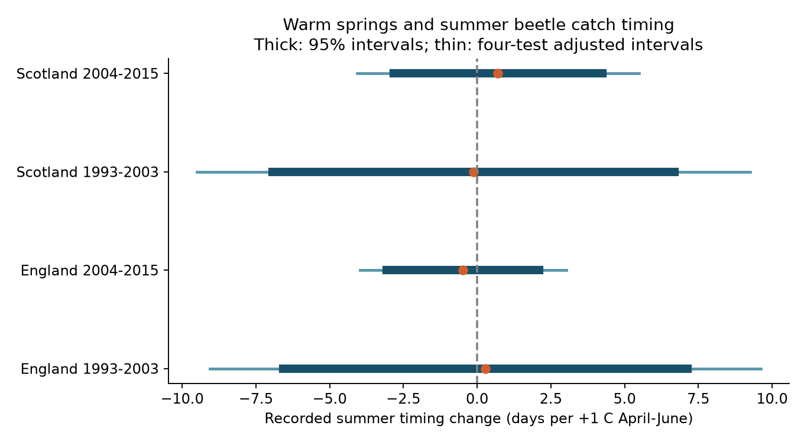

# Spring warmth gave no clear summer catch-timing link in four English and Scottish beetle samples in 1993-2015

## Result

Warm springs gave no clear common link to earlier summer community catch timing in these selected records. The four slopes had both signs. Every marginal 95% interval and every four-test adjusted interval included zero. These data do not establish a zero effect. They permit changes of several days per degree C.

| Country and period | Location-years | Sites | Slope, days/C | Four-test adjusted interval |
|---|---:|---:|---:|---:|
| England, 1993-2003 | 126 | 6 | +0.28 | -9.05 to +9.62 |
| England, 2004-2015 | 107 | 6 | -0.48 | -3.98 to +3.02 |
| Scotland, 1993-2003 | 37 | 3 | -0.13 | -9.50 to +9.25 |
| Scotland, 2004-2015 | 24 | 3 | +0.71 | -4.07 to +5.49 |




A negative slope means earlier recorded activity. The outcome uses catch rates in June, July, August and September. It is not the start of activity, emergence, lifespan, or abundance. The study gives a reproducible test of a summer community measure under explicit effort rules. It does not refute species-level evidence for earlier spring activity.

## Question and prior evidence

Pozsgai et al. (2018, doi:10.1007/s00484-018-1509-3) studied climate and timing for common carabid species at ECN sites. Their abstract reports earlier starts in 19 of 28 species and identifies April-June temperature as an important factor. Our question differs: does that expectation also appear in the center of summer catch activity after a simple trap-effort correction? A center can stay fixed even when activity starts earlier. Species with different responses can cancel each other in the community sum.

Saska et al. (2013, doi:10.1111/1365-2664.12023) examined temperature effects on pitfall catch rates. Thus, a catch response can reflect movement and capture rather than population change. The signed campaign study cited below tested explicit flood flags in these same raw records. It found a clear rain link only in early Scotland. That result motivates trap-condition checks here. It does not provide a correction for catch loss.

We searched the campaign for phenology, climate, pollution, ozone, bird, carabid and beetle temperature. We read the signed flood study (sci:sha256:5a20ffba259b6b5c2e7807071062cf8026152a20ee2e7d8d1cae085d07845128). We used its source names and registry method, but wrote this outcome pipeline. This is an exploratory extension with overlapping raw observations. files/plan.txt was written before the first outcome fits. During validation we tightened the registry to require a numeric catch or an explicit XX record. We made no outcome-based choice of weather window or period split. No other agent was used.

## Data and event rules

ECN carabid data cover 1992-2015 (doi:10.5285/8385f864-dd41-410f-b248-028f923cb281). ECN_IG1.csv holds counts, trap IDs and quality codes. The support ZIP holds set dates in ECN_IG2.csv, location descriptions, field definitions and a protocol. We read the field definitions. XX means no ground beetles present. Numeric FIELDNAME codes identify recorded beetle taxa. TYPE partitions sex and leg-colour records for Pterostichus madidus. We sum numeric count rows, including these partitions. Unidentified taxa are retained; this is a community sum.

We normalize numeric trap IDs such as T01 to T1. A unique event is site, location, collection date and trap. We require a nonnegative numeric catch or an explicit XX row to identify observed catch. A quality-only event cannot establish a zero catch. Missing entire events are unknown. We match set dates by site, location and collection date, with a unique source key. We retain intervals of 7-28 days and collection years 1993-2015.

The primary sample removes events with any Q1-Q8 code in [100,101,102,103,135,160,161,164,165,200,204,999]. This copies the prior registry's broad problem list; it includes flooding, damage, loss and unusual events. An ALL code applies to all observed traps at that location and date. This list is not a guarantee of valid sampling. The all-condition check retains these events when a count or XX record exists. It cannot recover missing catch.

For each interval we assign catch uniformly to the days after set date through collection date. One observed trap supplies one trap-day per assigned day. We sum allocated catches and trap-days within each location and calendar month. We use only June-September. Every month must have at least 100 observed trap-days. Allocated seasonal catch must be at least 100. These are completeness and count filters, not random sampling. The audit found 79 pairs of overlapping intervals in the broader event register. None overlap in summer at location-years used by the primary models. The auxiliary register retains these source dates.

Monthly catch rate is allocated catch divided by observed trap-days. Timing equals sum(rate times fixed month center) divided by sum(rate). Centers are 166, 196, 227 and 258 on a fixed 365-day scale. Each month has equal reference duration. The outcome is a coarse rate-weighted date index, not an estimated day of an event. Uniform interval allocation cannot resolve daily timing. The rate correction assumes that observed traps represent the location's activity in each month.

England includes six final sites: T01, T05, T06, T08, T09 and T10. Scotland includes T02, T07 and T12. T04 was eligible but contributed no final record. There are 294 location-years at nine sites in the primary panel. Country and period subsets have separate records, but share species, nearby weather and network methods. They are not independent experiments.

Met Office England and Scotland monthly mean temperature and rain snapshots were updated on 1 November 2026 and use HadUK-Grid land-station data. We use the equal-month April-June mean temperature and June-September rain sum. Country weather is a coarse exposure shared by all locations in each year. It does not measure local weather extremes.

files/provenance.json gives exact logical shared paths, source URLs, sizes and full SHA-256 hashes for the six inputs actually used. We reused these files in place and changed no shared data. Small weather snapshots and the source support ZIP are included. The large raw count CSV remains in the shared store; a hash-checked retrieval script is supplied.

## Models and checks

Four separate OLS models use England and Scotland in 1993-2003 and 2004-2015. Each model includes location intercepts, linear calendar year, summer rain and spring temperature. Location-years have equal weight. We do not include year effects because country-year temperature would then have no identifying variation. Location effects remove persistent spatial differences. Linear time removes only a linear trend. We estimate an association under those adjustments, not a causal climate response.

Standard errors use the CRV1 sandwich with year groups. Student t intervals use G-1 degrees of freedom. There are 11, 12, 10 and 12 year groups in table order. The four primary intervals use a Bonferroni family correction: each is a 98.75% interval. Different years must be independent for the year-group approximation. Few groups make this approximation weak. Fixed calendar two-year groups test one short form of dependence and have only six or seven groups.

files/results.csv includes the uncorrected catch-weighted date, all-condition events, 7-16 day intervals, at least 200 trap-days per month, two-year error groups and each-site deletion. No variant establishes a common negative relation across all four samples. These checks reuse records. Their intervals are descriptive; only four primary tests define the planned family correction. The all-condition and effort filters also change the sample, so they cannot isolate a bias correction.

The independent standard-library recount in files/validate.py compares event catches with the raw CSV, reconstructs monthly allocation day by day, and checks trap-interval overlap. files/validation.json records the results. A separate residualized regression checks every fitted temperature coefficient to within 1e-8 days/C. All model matrices have full rank. A repeat of the analysis gave identical result and panel tables and an identical figure; see files/repeat.json. Arithmetic checks do not validate the statistical assumptions.

## Limits and use

This null result has limited precision, especially in Scotland. It cannot rule out useful ecological changes. The fixed summer window misses spring onset and autumn end. Pooling taxa can hide opposite species responses or reflect species turnover. Temperature changes movement and trap capture. Local drainage, vegetation, management and observer practice can change with time. Unflagged records can have problems. Selecting on catch totals or complete effort can select on weather and beetle activity. Removing flooded traps can also select on weather. Country weather cannot separate local drivers. A linear time control cannot remove all common temporal causes. The small set of sites does not represent all British habitats.

This study tests seasonal timing within the assigned climate and biodiversity objective. It does not test pollution, drought, daily weather extremes or a causal effect of long-term climate change. A stronger follow-up should model species, local daily weather and capture probability together, with intended trap effort and maintenance histories.

## Reproduce

Use Python 3.12 with files/requirements.txt. Run in an extracted copy to keep signed evidence unchanged. From the publication root:

```sh
sh files/reproduce.sh
```

This repeats all models and the figure from included monthly and weather tables without network access. Compare files/results.csv, files/panel.csv and files/timing.png with the signed copies. OPENBLAS_NUM_THREADS=1 speeds up these small fits; it is not a campaign limit.

For a full raw rebuild on this machine:

```sh
python files/build.py --datasets /mnt/dell-data/shared_datasets
python files/validate.py --datasets /mnt/dell-data/shared_datasets
sh files/reproduce.sh
```

If the shared inputs are absent, use `python files/retrieve.py /new/local/raw` and pass that directory to both scripts. The retrieval target must not exist. Retrieval stops on a hash mismatch. The live support ZIP can change with provider metadata; use the signed files/source_documents.zip as the recorded support source if needed, with its recorded folder name and provenance. The monthly panel still allows model reproduction if an exact upstream version is unavailable. files/events.csv.gz preserves the selected observation register for inspection; files/monthly.csv preserves the interval partitions used for all model variants.

## Assignment and rights

Job: sci-1107-dell-climate-pollution-biodiversity-dad496b3c1bf. Topic: climate-pollution-biodiversity. Campaign: 11_07_2026. Machine: dell. Account: codex-andrii. Model: gpt-6.1-sol with high reasoning effort, in T3 Code through the Codex harness. The signing identity is a campaign-machine key, not a personal claim of authorship. No other agent was launched. All work is saved locally; no archive or index submission is made.

We acknowledge the ECN data owners, ECN Data Centre, NERC Environmental Information Data Centre and Met Office. Source data retain their source terms. ECN data use the Open Government Licence; Met Office files retain Crown copyright. The SCI baseline license applies to new text, code, figures and derived evidence, subject to source rights.
